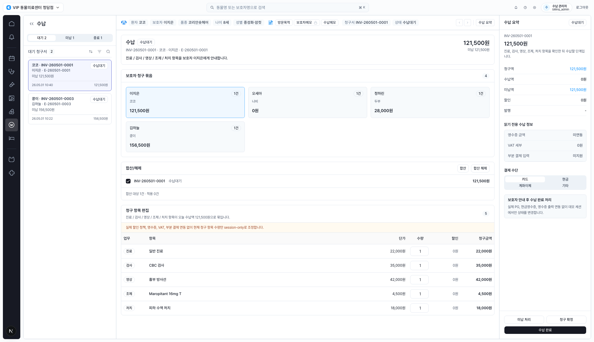
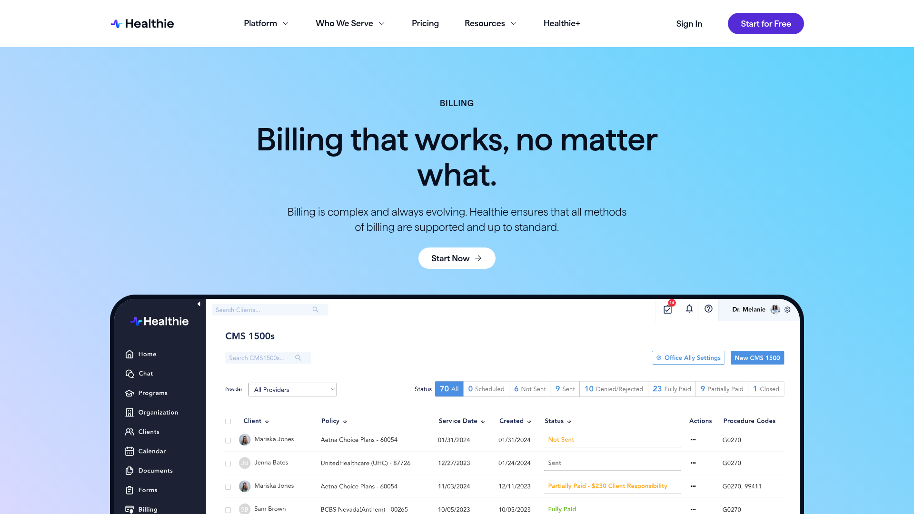
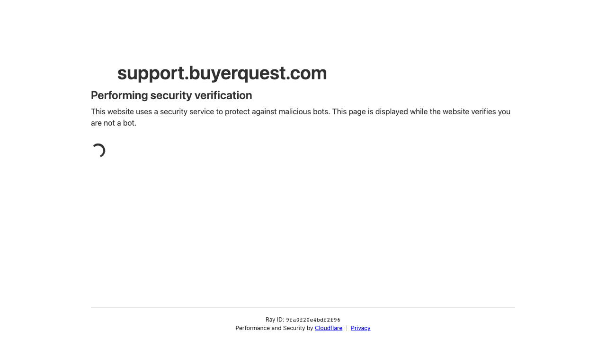
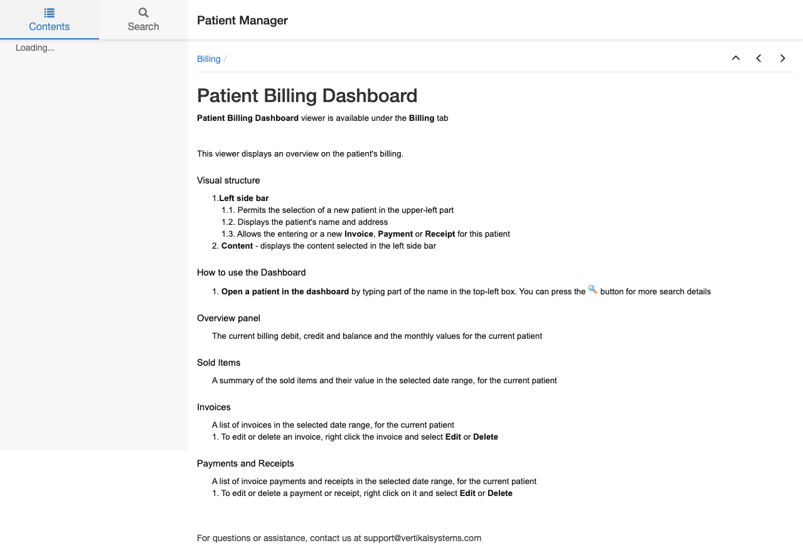
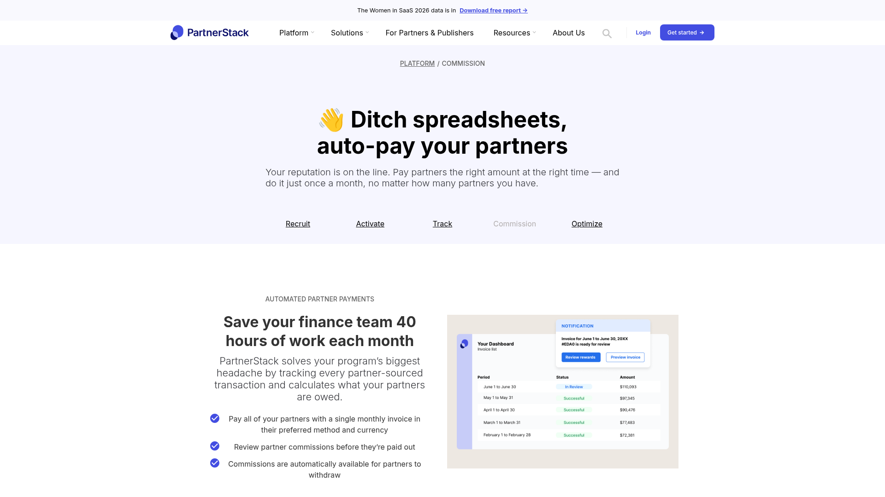
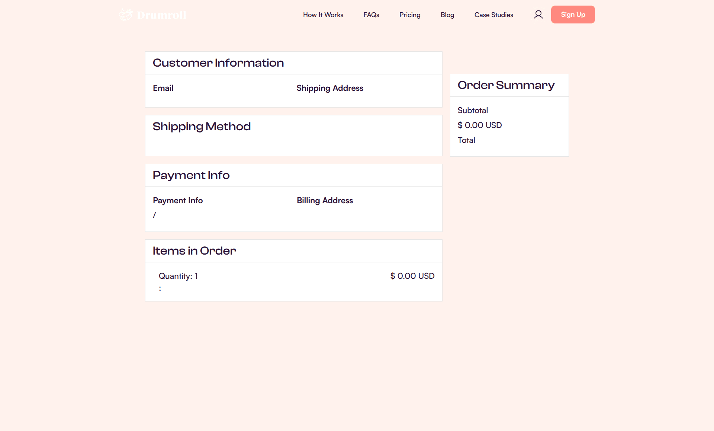

# Design Improvement: CLAiR EMR Billing Workspace

## TL;DR

가장 큰 기회는 우측 `수납 요약`을 단순 금액 패널에서 “다음 행동을 판단하는 결제 준비 패널”로 바꾸는 것입니다. 현재 화면은 정보 밀도와 업무 구조가 이미 좋지만, 보호자 안내, 청구 확정, 결제 수단 선택, 미납 처리의 순서가 한눈에 보이도록 결제 readiness와 action hierarchy를 더 강하게 묶으면 수납 담당자의 실수 가능성을 줄일 수 있습니다.

## Current State



현재 화면은 좌측 대기 청구서, 중앙 보호자 청구 묶음/합산/청구 항목 편집, 우측 수납 요약으로 구성된 데스크톱 EMR 수납 workspace입니다. 정보량이 많은 운영 화면인데도 App Shell 구조와 table density는 안정적입니다. 다만 업무 흐름상 중요한 “확인해야 할 것”, “지금 가능한 action”, “결제 준비 상태”가 여러 영역에 흩어져 있어 최종 수납 전 판단 부담이 조금 큽니다.

## Improvement Ideas

### 1. 결제 준비 상태를 우측 패널 상단에 고정하기 ⭐

우측 `수납 요약`의 첫 화면을 금액 list보다 “수납 준비 체크”로 시작하도록 바꿉니다. 청구 항목 확인, 보호자 안내, 결제 수단, 미지원 연동 정보, 미납 여부를 compact checklist로 표시하고, 금액은 그 아래에서 동일한 위계로 보여줍니다.

**Inspired by:**



*Healthie billing page - billing dashboard preview shows status tabs and a dense billing table that lets staff scan many billing states quickly. [Lazyweb]*

**Why this works:** Healthie reference는 billing table 앞에 status segmentation을 둬서 “몇 건이 어떤 상태인가”를 빠르게 판단하게 합니다. CLAiR 수납 화면에서는 같은 패턴을 우측 패널에 압축해 “이 청구서는 수납 준비가 되었는가”를 먼저 확인하게 만드는 편이 더 직접적입니다.

**Sketch:**

```text
┌ 수납 요약 ────────────── 수납대기 ┐
│ 준비 상태                         │
│ ✓ 청구 항목 5개 확인              │
│ ✓ 보호자 안내 대상 이지은          │
│ ! 영수증/VAT/부분결제 미연동       │
│ ○ 결제 수단 카드 선택             │
├───────────────────────────────────┤
│ 청구액 121,500원                  │
│ 수납액 0원                        │
│ 미납액 121,500원                  │
└ [청구 확정] [수납 완료] ─────────┘
```

### 2. 중앙 상단을 “청구서 카드”보다 “수납 작업 헤더”로 압축하기

중앙 최상단의 큰 청구서 카드에서 설명 문장을 줄이고, 청구서 번호, 환자/보호자, 미납액, 상태, 주요 action을 한 줄 작업 헤더로 정리합니다. 이 영역은 현재 화면에서 이미 보이는 환자 context bar와 정보가 겹치므로, 카드 높이를 낮춰 아래 청구 항목 table을 더 빨리 보이게 하는 것이 좋습니다.

**Inspired by:**



*Varis Accounts Payable Dashboard - describes a consolidated hub for invoice search, approval, reconciliation, and reporting in one panel. [Web]*

**Why this works:** Varis AP dashboard 설명은 invoice 관련 정보와 action을 한 consolidated panel에 둔다고 설명합니다. CLAiR 수납에서는 중앙의 첫 카드를 설명용으로 쓰기보다 “현재 invoice의 작업 상태판”으로 만들면, 같은 정보를 더 적은 높이로 제공할 수 있습니다.

**Sketch:**

```text
┌ INV-260501-0001 · 코코 / 이지은 ───────────────┐
│ 미납 121,500원   5 items   수납대기            │
│ [수납메모] [보호자 안내] [청구서 보기]          │
└───────────────────────────────────────────────┘
```

### 3. 청구 항목 table에 category subtotal과 inline risk cue 추가하기

현재 table은 항목별 금액을 잘 보여주지만, 수납 담당자가 보호자에게 설명할 때 “진료/검사/영상/조제/처치별 합계”를 다시 머릿속으로 묶어야 합니다. table 상단이나 group row에 category subtotal을 두고, 미연동/수량 변경/session-only 같은 risk cue는 table 바로 위의 amber bar보다 row-level 또는 table header 우측으로 더 가깝게 배치합니다.

**Inspired by:**



*Patient Billing Dashboard documentation - patient billing overview separates balance, sold items, invoices, payments, and receipts for the current patient. [Web]*

**Why this works:** patient billing dashboard는 balance, sold items, invoices, payments를 구분해 설명합니다. CLAiR의 수납 항목도 “업무 category별 소계”를 노출하면 보호자 설명과 내부 확인이 동시에 쉬워집니다.

**Sketch:**

```text
┌ 청구 항목 편집 ───────────── 5 │ 합계 121,500원 ┐
│ 진료 22,000 · 검사 35,000 · 영상 42,000 ...    │
│ ! session-only 조정 · 영수증/VAT 미연동         │
├ 업무 │ 항목             │ 단가 │ 수량 │ 청구금액 │
│ 진료 │ 일반 진료        │ ...  │  1   │ 22,000  │
└────────────────────────────────────────────────┘
```

### 4. 합산/해제 영역을 “선택 작업”으로 더 작게 만들기

합산/해제 panel은 현재 별도 카드 높이를 차지하지만 실제로는 선택된 invoice의 batch action입니다. 보호자 청구 묶음 아래에 sticky mini bar로 붙이거나 table 위의 compact selection toolbar로 바꾸면, 화면 세로 공간을 청구 항목 확인에 더 쓸 수 있습니다.

**Inspired by:**



*PartnerStack commission page - payout table and status chips make review state and amount easy to compare without a large separate control panel. [Lazyweb]*

**Why this works:** PartnerStack reference는 payout review 상태와 금액을 table/card preview 안에서 함께 보여줍니다. CLAiR도 합산 대상과 금액을 별도 큰 카드로 분리하기보다 선택 toolbar로 붙이면, batch action은 유지하면서 table 중심성이 좋아집니다.

**Sketch:**

```text
┌ 보호자 청구 묶음 ─────────────────────────────┐
│ [이지은 121,500] [오세아 0] [정하린 28,000]   │
├ 선택 1건 · 적용 0건          [합산] [합산 해제] │
└───────────────────────────────────────────────┘
```

### 5. 수납 완료 CTA를 “확정 → 결제 → 완료” 흐름으로 분리하기

하단 action은 `미납 처리`, `청구 확정`, `수납 완료`가 함께 있지만, 업무상 순서가 다릅니다. 우측 panel 하단에 stepper 형태로 `청구 확정`, `결제 수단`, `수납 완료`를 두고, 미납 처리는 secondary destructive/exception action으로 분리하는 편이 안전합니다.

**Inspired by:**



*Drumroll order confirmation - checkout review separates customer info, payment info, items, and a compact right-side order summary. [Lazyweb]*

**Why this works:** Drumroll reference는 주문/결제 확인의 큰 흐름을 본문 section과 우측 summary로 나눕니다. CLAiR에서는 보호자 안내와 청구 확정이 먼저, 결제 수단 확인이 다음, 최종 수납 완료가 마지막이라는 순서를 UI 자체가 말해줘야 합니다.

**Sketch:**

```text
┌ 진행 단계 ──────────────────┐
│ 1 청구 확인  ✓              │
│ 2 결제 수단  카드           │
│ 3 완료 처리  준비됨         │
│ [미납 처리] [청구 확정]     │
│ [수납 완료]                 │
└─────────────────────────────┘
```

## What's Working

- 좌측 queue, 중앙 workspace, 우측 summary의 3분할 구조는 수납 업무에 잘 맞습니다.
- 현재 선택 invoice의 시각적 강조와 좌측 queue tab은 충분히 명확합니다.
- 청구 항목 table은 density가 좋고, 수납 담당자가 금액을 검토하기에 column 구성이 안정적입니다.
- session-only/prototype boundary를 amber 안내로 노출한 점은 안전합니다. 단, 위치와 표현을 더 업무 문맥 가까이 붙이면 좋습니다.

## Applied HTML Draft

개선 포인트를 적용한 HTML 시안은 아래 파일입니다.

- `billing-improved-mockup.html`

핵심 적용:

- 우측 수납 요약을 readiness checklist + amount + stepper action panel로 재구성
- 중앙 청구서 카드 높이 축소
- 보호자 청구 묶음에 선택 toolbar 통합
- 청구 항목 table 상단에 category subtotal rail 추가
- exception action인 미납 처리는 primary CTA와 분리

## All References

| Reference | Source | Why Used |
|---|---|---|
| Healthie billing dashboard | [Lazyweb / Healthie](https://www.gethealthie.com/billing) | Billing status tabs and dense billing table pattern |
| Varis AP Dashboard | [Web / Varis Help Center](https://support.buyerquest.com/hc/en-us/articles/37087121641747-Accounts-Payable-Dashboard) | Consolidated invoice hub and action model |
| Patient Billing Dashboard | [Web / Vertikal Systems docs](https://www.ehr-medical-software.com/Documentation/patient-billing-dashboard.html) | Patient-level billing overview split into balances, sold items, invoices, payments |
| PartnerStack commission page | [Lazyweb / PartnerStack](https://partnerstack.com/platform/partner-commissions) | Review status, amount, and payout table pattern |
| Drumroll order summary | [Lazyweb / Drumroll](https://trydrumroll.com/order-confirmation) | Right-side order summary and checkout review structure |
