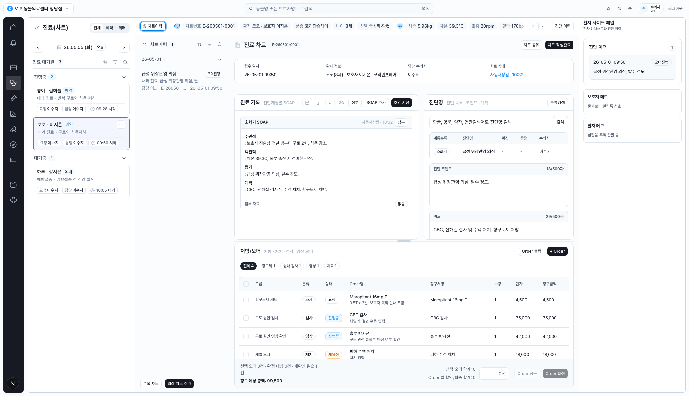
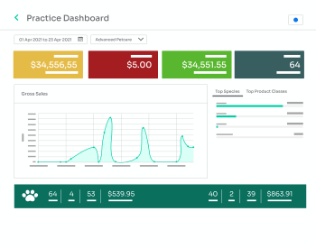
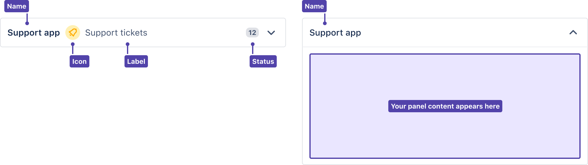
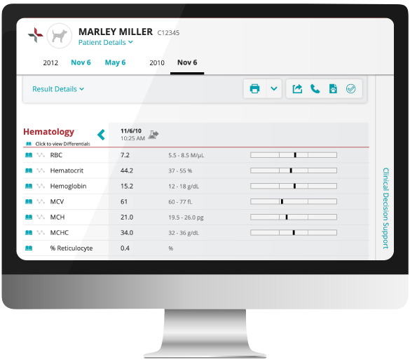
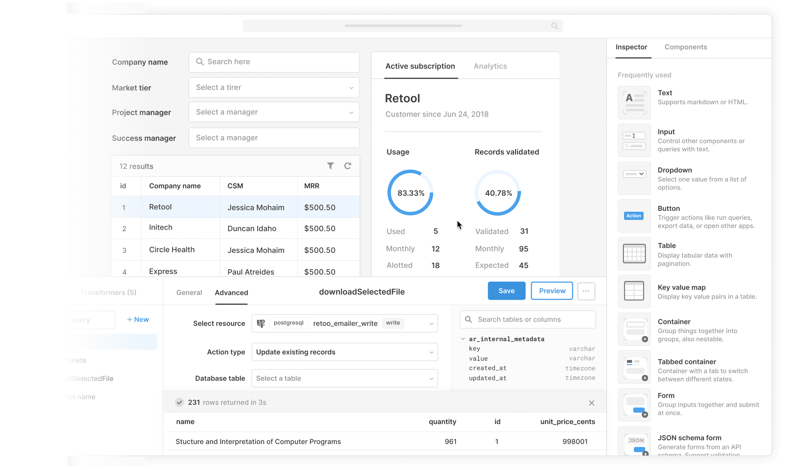
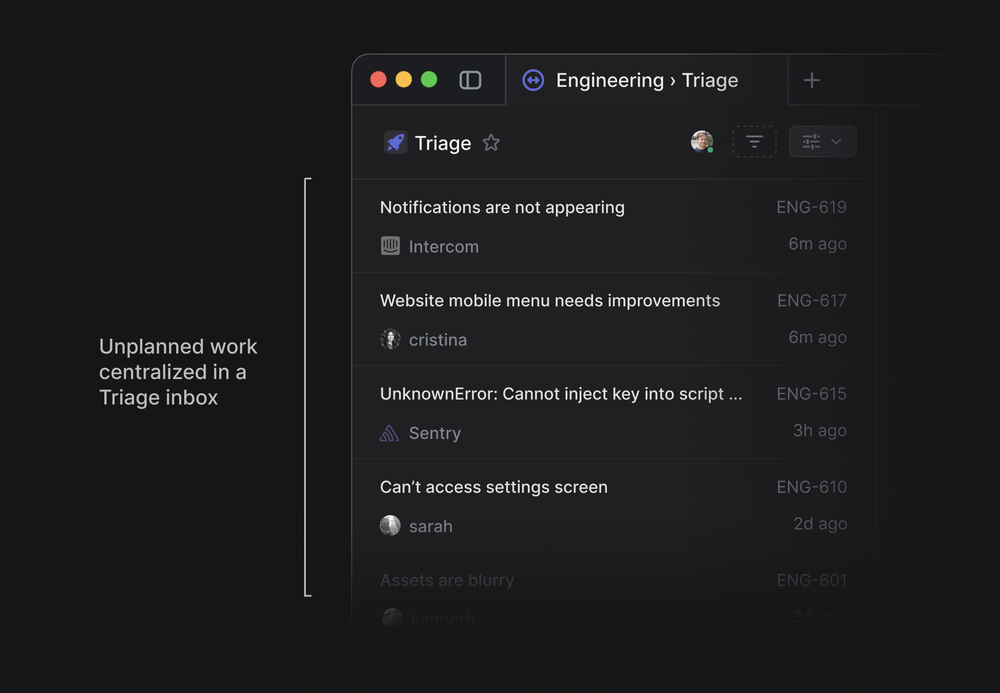

# Design Improvement: CLAiR EMR Chart Workspace

## TL;DR

The screen is already strong as an operational EMR workspace: patient context, SOAP, diagnosis, and orders are all visible without changing routes. The biggest opportunity is to turn the center workspace into a clearer clinical sequence: `intake -> SOAP -> assessment -> orders -> completion`, with stronger local status cues and less equal-weight chrome competing for attention.

Lazyweb MCP note: `lazyweb_health` timed out, so this report uses local screen capture plus web references only.

## Current State



The current chart screen uses a dense four-zone layout: queue, chart history, clinical chart workspace, and patient side panel. It supports the right product direction for a veterinary EMR: same-patient continuity, session-only charting, diagnosis entry, and order confirmation in one workspace.

## Improvement Ideas

### 1. Make the Visit Header a Clinical Checklist Strip ⭐

Keep the current patient context bar, but compress the lower chart-info card into a horizontal visit checklist: 접수, SOAP, 진단, 오더, 완료. Each step should show status, timestamp, and the owning role. This would make the chart feel less like separate panels and more like a single visit progression.

**Inspired by:**



IDEXX Neo uses dashboard tiles and compact status summaries to keep daily activity scannable. Source: [IDEXX Neo product page](https://software.idexx.com/products/neo-veterinary-software).

**Why this works:** The current screen has the information, but the workflow state is split across badges, buttons, and the chart info box. A checklist strip would reduce wrong-next-action risk and help a vet see what is done, what is pending, and what will happen after chart completion.

**Sketch:**

```text
┌ 환자 콩이 · E-260501-0001 · 09:50 접수 ────────────────────────────┐
│ [접수 완료 09:50] [SOAP 자동저장 10:32] [진단 1] [오더 4 / 재요청 1] [완료 전] │
└──────────────────────────────────────────────────────────────┘
```

### 2. Turn the Right Patient Panel Into a Prioritized Context Rail

Keep the right panel, but make it work harder: one compact "Now relevant" block at the top, then collapsible history groups below. The top block should merge diagnosis history, guardian note, patient memo, and clinical warnings into a short ranked list.

**Inspired by:**



Atlassian's issue context pattern keeps secondary information in an expandable right-side panel with a name, icon, label, and status. Source: [Jira issue view guidelines](https://developer.atlassian.com/cloud/jira/platform/issue-view/).

**Why this works:** The current patient side panel is useful, but every card has similar weight. In a clinical screen, the top of the right rail should answer "what can change today's care?" before showing general notes.

**Sketch:**

```text
┌ 환자 사이드 패널 ──────┐
│ 지금 관련됨  3         │
│ ! 탈수 경도            │
│ ! 구토 2회             │
│ i 보호자: 알림톡 선호  │
├ 진단 이력 1 ──────────┤
├ 보호자 메모 ──────────┤
└ 환자 메모 ────────────┘
```

### 3. Give SOAP and Diagnosis a Shared "Clinical Note" Rhythm

Visually pair SOAP and diagnosis as one clinical note region. Use a quieter shared header, align the auto-save/status text, and place diagnosis comment/Plan in a stacked note format that mirrors SOAP sections. The diagnosis panel should feel like the continuation of SOAP, not a separate form competing with it.

**Inspired by:**



IDEXX VetConnect shows patient result context, dates, action buttons, and result rows in one calm visual rhythm. Source: [IDEXX Neo features](https://software.idexx.com/products/neo/features).

**Why this works:** The current SOAP area has a readable clinical note feel, while diagnosis/comment/Plan has more form-like weight. Harmonizing them would make reading and editing faster, especially during a live consultation.

**Sketch:**

```text
┌ 진료 기록 · 자동저장 10:32 ─────────────┬ 진단 · Plan ─────────────┐
│ SOAP: 소화기                            │ 급성 위장관염 의심       │
│ S / O / A / P blocks                    │ 코멘트                   │
│ 첨부 자료                               │ Plan                     │
└─────────────────────────────────────────┴──────────────────────────┘
```

### 4. Make the Order Table More Action-Oriented

Keep the table density, but strengthen row affordances: left status rail per order group, clearer "why this is here" secondary text, and a sticky selected-order summary that lists selected items by name before charging or confirming.

**Inspired by:**



Retool's admin dashboard examples combine filters, tables, selected data, and action controls in a single operational surface. Source: [Retool admin dashboard](https://retool.com/use-case/admin-dashboard).

**Why this works:** The current order footer gives totals and disabled/enabled actions, but selection is still cognitively distant from the eventual action. Naming selected orders in the footer would reduce accidental billing/confirmation.

**Sketch:**

```text
┌ 처방/오더 ───────────────────────────────────────────────┐
│ 조제 │ Maropitant 16mg T      보호자 복약 안내 포함       │
│ 검사 │ CBC 검사               채혈 후 결과 수동 입력       │
│ 영상 │ 흉부 방사선            구토 관련 흉복부 이상 확인   │
├ 선택: Maropitant 16mg T · CBC 검사       합계 39,500 ─────┤
│                         [Order 청구] [Order 확정]         │
└───────────────────────────────────────────────────────────┘
```

### 5. Add a Focus Mode for Active Charting

Add a small focus toggle near the chart header that temporarily narrows side panels and gives SOAP/diagnosis/order more horizontal room. This is especially helpful for vets entering notes under time pressure, while still preserving a quick way back to queue/history context.

**Inspired by:**



Linear's triage screen emphasizes the active work list and hides nonessential detail behind compact controls. Source: [Linear Triage docs](https://linear.app/docs/triage).

**Why this works:** The current full workspace is excellent for review, but writing mode needs fewer competing edges. A reversible focus mode would improve charting speed without changing the default information-rich layout.

**Sketch:**

```text
┌ nav ┬ chart history collapsed ┬ ACTIVE CHARTING AREA ┬ side rail collapsed ┐
│     │ ◂                       │ SOAP + Diagnosis + Orders                │
└─────┴─────────────────────────┴──────────────────────────────────────────┘
```

## What's Working

- The screen preserves full visit context: queue, history, SOAP, diagnosis, orders, and patient notes are all reachable in one place.
- The visual foundation is already calm and operational: borders, table density, and subdued surfaces fit a clinic workflow better than a marketing-style interface.
- The bottom order footer is a strong safety pattern because high-impact actions remain anchored while the order list scrolls.
- The current patient context bar already reduces wrong-patient risk by keeping patient, guardian, chart number, vitals, and action context visible.

## All References

| Reference | Source | Used For |
|---|---|---|
| `current.png` | Local CLAiR EMR capture | Current state |
| `idexx-neo-dashboard.png` | [IDEXX Neo](https://software.idexx.com/products/neo-veterinary-software) | Compact status summaries |
| `idexx-vetconnect-results.png` | [IDEXX Neo features](https://software.idexx.com/products/neo/features) | Calm clinical result rhythm |
| `atlassian-issue-context.png` | [Jira issue view guidelines](https://developer.atlassian.com/cloud/jira/platform/issue-view/) | Right contextual rail |
| `retool-admin-builder.png` | [Retool admin dashboard](https://retool.com/use-case/admin-dashboard) | Table + action surface |
| `linear-triage-image.png` | [Linear Triage docs](https://linear.app/docs/triage) | Focused active-work mode |

## Source Notes

- IDEXX describes Neo's patient workflow as including access to patient history, preformatted exam notes, diagnosis lists, estimates, diagnostics ordering, and real-time results.
- Jira's guidelines emphasize using space wisely, aligning hierarchy, and putting secondary contextual information in right-side panels.
- Retool positions internal admin tools around common building blocks: tables, search, forms, filters, and actions.
- Linear's triage model centralizes incoming work so users can review, prioritize, and act from one focused queue.
