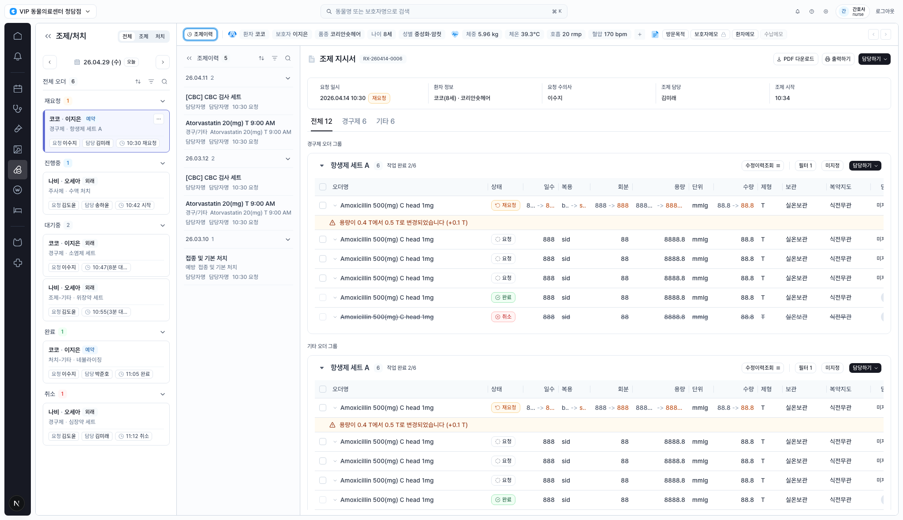
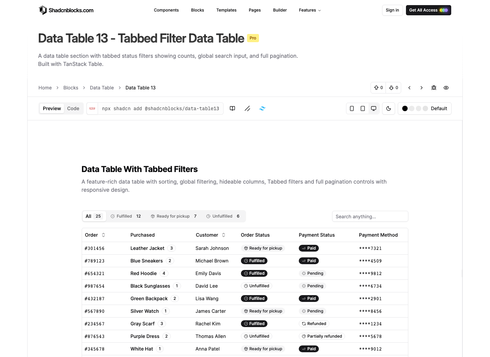
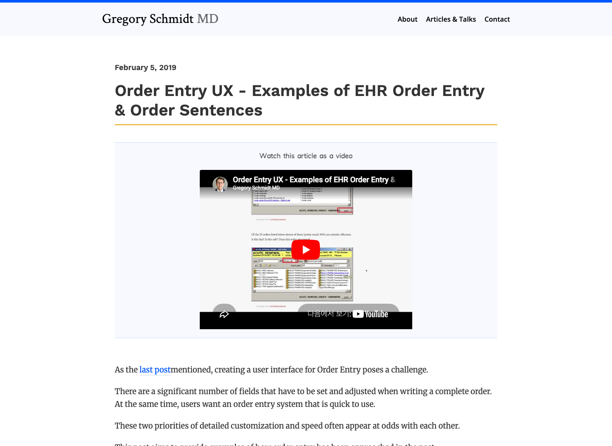
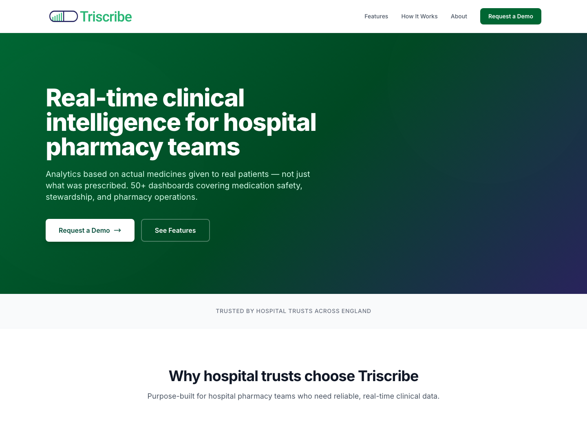
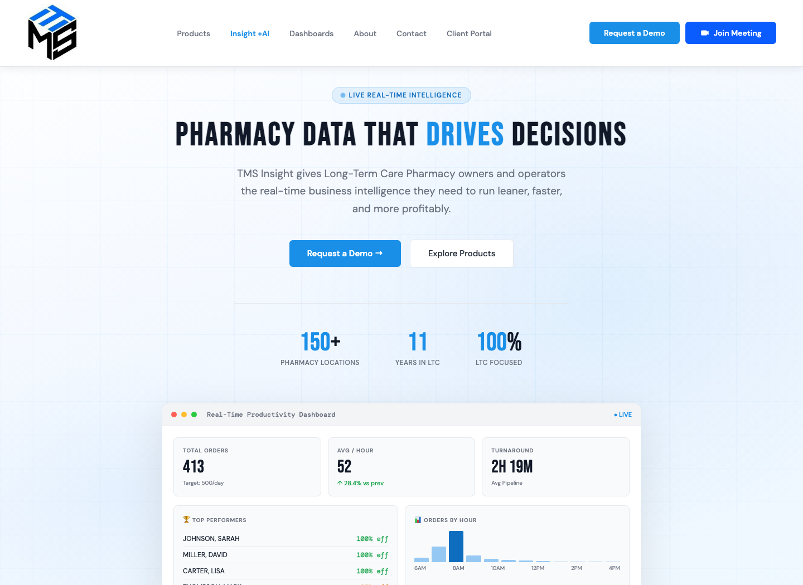

# Design Improvement: 조제/처치 화면

## TL;DR

가장 큰 개선 기회는 `작업 우선순위`, `오더 안전 변경`, `담당/진행 액션`을 표 안팎에서 한눈에 읽히게 만드는 것입니다. 현재 화면은 필요한 정보가 풍부하지만, 반복 컬럼과 가로 스크롤 때문에 조제/처치 담당자가 "지금 무엇부터 처리해야 하는지"를 판단하는 데 시선 이동이 많습니다.

Lazyweb MCP health check가 타임아웃되어 Lazyweb DB 결과는 사용하지 못했습니다. 이번 리포트는 로컬 화면 캡처와 웹 레퍼런스를 기준으로 작성했습니다.

## Current State



현재 화면은 좌측 업무 큐, 조제이력 aside, 환자 컨텍스트, 중앙 오더 그룹 table로 구성됩니다. 정보 밀도와 App Shell 일관성은 좋지만, 재요청/미지정/변경 경고가 넓은 표 안에 흩어져 있고 핵심 액션이 그룹 header와 행 끝에 나뉘어 있습니다.

## Improvement Ideas

### 1. 상태 필터를 "업무 우선순위 바"로 승격 ⭐

상단의 `전체/조제/처치`와 본문 `전체/경구제/기타` 필터를 유지하되, 중앙 본문 시작부에 `재요청`, `미지정`, `내 담당`, `변경 있음` 같은 작업 우선순위 pill을 count와 함께 노출합니다. 조제/처치 담당자는 table을 읽기 전에 오늘 처리해야 할 위험 신호를 먼저 볼 수 있어야 합니다.

**Inspired by:**

*Shadcnblocks Data Table 13 - count가 있는 tabbed status filter와 search를 같은 toolbar에 둔 패턴 [Web]*

**Why this works:** Shadcnblocks 예시는 상태별 count tab이 필터이면서 요약 역할을 합니다. 조제/처치 화면에 맞추면 단순 분류 탭보다 `작업 위험도`와 `담당 공백`을 먼저 노출하는 운영형 필터가 됩니다.

**Sketch:**

```text
┌────────────────────────────────────────────────────────────┐
│ 오늘 작업 12   [재요청 1] [미지정 8] [내 담당 2] [변경 2]  🔎 │
├────────────────────────────────────────────────────────────┤
│ 항생제 세트 A  작업 완료 2/6       [변경만] [미지정] [담당] │
└────────────────────────────────────────────────────────────┘
```

### 2. 표를 "안전 확인 중심"으로 재배열

가로 스크롤을 줄이기 위해 `오더명`, `상태`, `변경/주의`, `처방 요약`, `담당`, `액션`을 기본 노출 컬럼으로 두고, 일수/복용/회분/용량/수량/제형/보관/복약지도는 `처방 요약` 안의 작은 token 또는 행 확장 영역으로 묶습니다. 변경된 값은 주황색 텍스트만 흩뿌리지 말고 `0.4 T -> 0.5 T`처럼 한 셀에서 비교되게 둡니다.

**Inspired by:**

*Gregory Schmidt MD - EHR order entry는 많은 필드와 속도 요구가 충돌한다고 설명하는 사례 모음 [Web]*

**Why this works:** 오더 화면은 세부 필드를 모두 노출해야 하지만, 모든 필드가 같은 가중치로 보이면 검수 속도와 안전성이 함께 떨어집니다. 기본 table은 판단에 필요한 요약을 보여주고, 상세는 확장/side panel로 보내는 편이 안전합니다.

**Sketch:**

```text
┌─ 오더명 ─────────────┬ 상태 ┬ 변경/주의 ┬ 처방 요약 ┬ 담당 ┬ 액션 ┐
│ Amoxicillin 500mg   │ 재요청 │ 용량 +0.1T │ sid · 3일 │ 미지정 │ 확인 │
│   expanded: 일수, 회분, 보관, 복약지도, 변경 이력             │
└──────────────────────────────────────────────────────────────┘
```

### 3. 재요청/변경 경고를 행 아래 알림에서 "검수 카드"로 바꾸기

현재 변경 안내 row는 눈에 띄지만, 어떤 행동을 해야 하는지가 약합니다. 재요청 행에는 `변경 사유`, `이전값/변경값`, `요청자`, `확인`, `되돌림 요청`을 작은 검수 카드로 붙입니다. 담당자가 경고를 읽은 뒤 바로 처리할 수 있어야 합니다.

**Inspired by:**

*Triscribe - 실제 투약/약제 데이터를 기반으로 병원 약제팀의 실시간 판단을 돕는 제품 포지셔닝 [Web]*

**Why this works:** Triscribe의 핵심은 "처방된 것"보다 실제 투약 데이터와 안전 신호를 운영 판단으로 연결하는 점입니다. 조제/처치 화면에서도 변경 알림은 단순 표시가 아니라 검수 흐름의 시작점이어야 합니다.

**Sketch:**

```text
┌ 변경 검수 필요 ───────────────────────────────────────┐
│ 용량 0.4 T -> 0.5 T   요청 이수지 · 10:30              │
│ 사유: 체중 재확인 후 항생제 증량                       │
│ [확인 완료] [수의사에게 문의] [원 처방 보기]             │
└───────────────────────────────────────────────────────┘
```

### 4. 좌측 큐에 SLA/담당 공백 신호 추가

좌측 대기열 카드에는 현재 시간과 상태가 있지만, 우선순위 비교가 어렵습니다. 각 카드에 `대기 8분`, `미지정`, `재요청`, `예약` 같은 신호를 같은 위치에 두고, 상태 그룹 header에는 count뿐 아니라 가장 오래된 대기 시간을 표시합니다.

**Inspired by:**

*TMS Insight - 약국 운영에서 총 오더, 시간당 처리량, turnaround를 한 화면에 요약하는 실시간 운영 dashboard [Web]*

**Why this works:** TMS의 운영 dashboard는 throughput과 bottleneck을 먼저 보여줍니다. CLAiR 조제/처치도 업무 큐가 단순 목록이 아니라 "어디가 막혔는지"를 알려주는 triage surface가 되면 좋습니다.

**Sketch:**

```text
재요청 1 · 최장 8분
┌ 코코 · 항생제 세트 A ──────────┐
│ 예약 · 미지정 · 10:30 재요청    │
└───────────────────────────────┘

진행중 1 · 최장 3분
┌ 나비 · 수액 처치 ──────────────┐
│ 담당 송하윤 · 10:42 시작        │
└───────────────────────────────┘
```

## What's Working

- Shell 구조가 안정적입니다. nav rail, module panel, content aside, main workspace가 각자 역할을 잘 나눕니다.
- 환자 컨텍스트 바가 상단에 고정되어 조제/처치 중 환자 식별 정보를 잃지 않습니다.
- 오더 그룹 단위로 `작업 완료 2/6`, `담당하기`, `수정이력조회`가 배치되어 group-level workflow의 방향은 맞습니다.
- 재요청/완료/취소 상태 badge와 변경 row가 이미 있어 안전 UX를 강화할 재료가 충분합니다.

## HTML 시안

개선 포인트를 적용한 standalone HTML 시안은 [`prototype.html`](prototype.html)에 저장했습니다. 리포트용 HTML 미리보기는 [`report.html`](report.html)입니다.

## All References

| Reference | Source | Context |
|---|---|---|
| Current CLAiR 조제/처치 | Local capture | 현재 구현 화면 |
| Shadcnblocks Data Table 13 | [Web](https://www.shadcnblocks.com/block/data-table13) | Count가 있는 상태 tab/filter와 dense table |
| Gregory Schmidt MD Order Entry UX | [Web](https://www.gregoryschmidt.com/articles/order-entry-ux-eg-order-entry-and-order-sentences) | EHR order entry의 정보 과부하와 안전성 이슈 |
| Triscribe | [Web](https://triscribe.net/) | 약제팀을 위한 실시간 clinical intelligence |
| TMS Insight | [Web](https://www.tmsbi.com/) | 약국 운영 throughput/turnaround dashboard |
