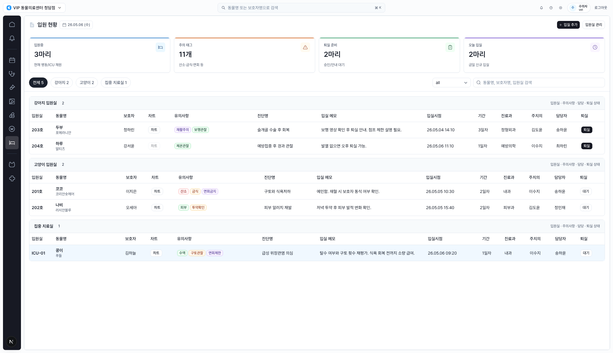
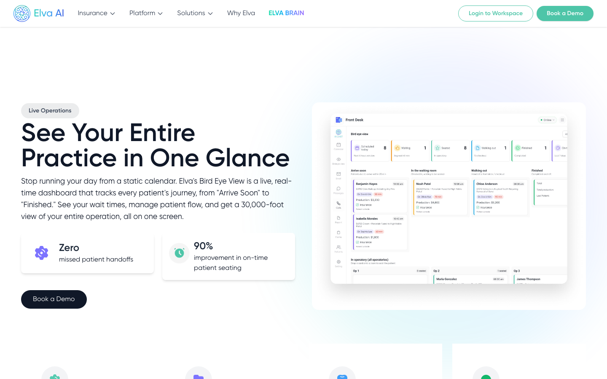
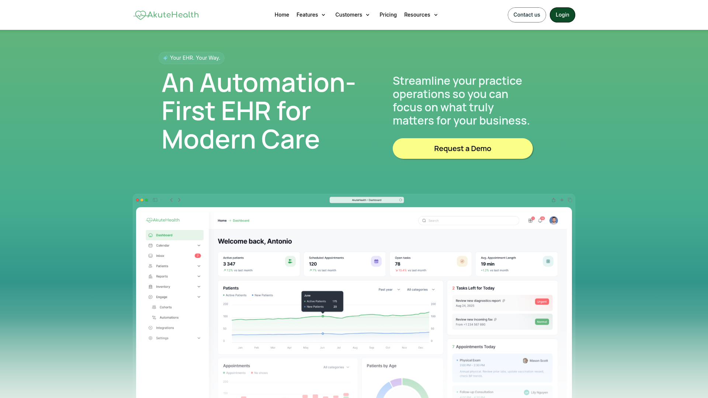
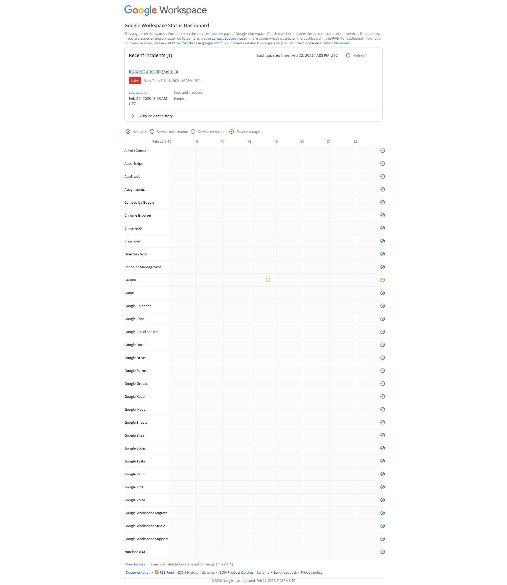
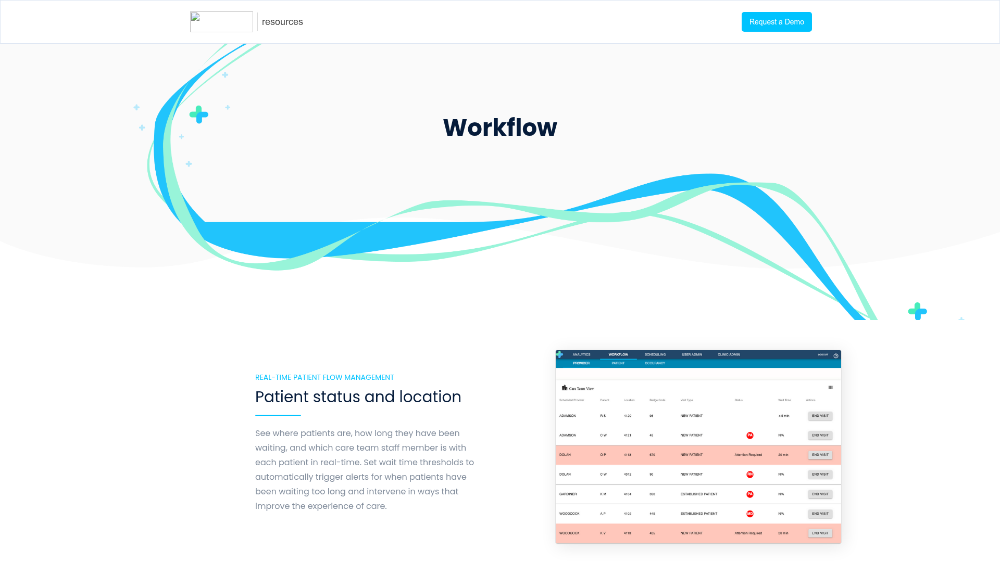
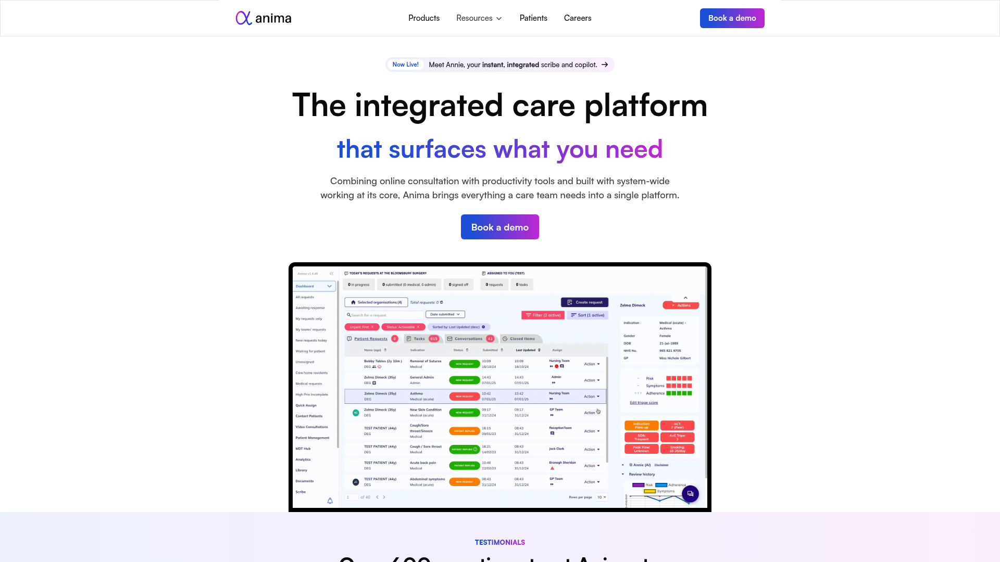
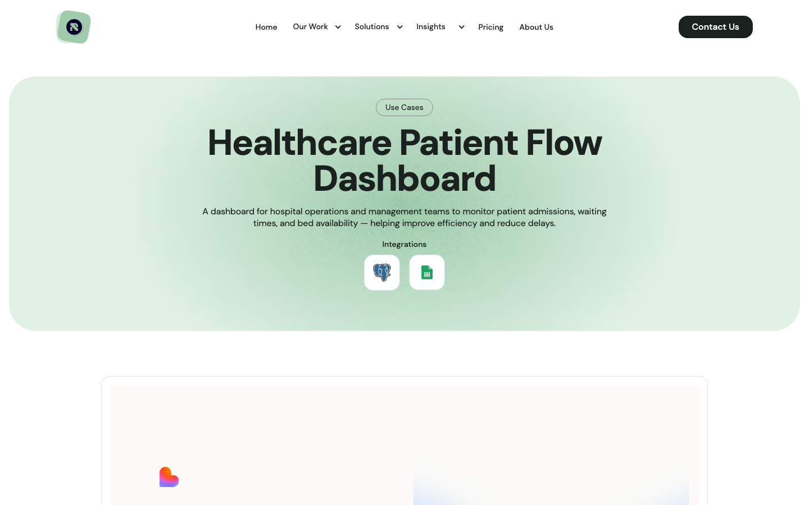

# Design Improvement: Inpatient Admission Workspace

## TL;DR

The current inpatient screen already has the right operational density. The biggest opportunity is to turn the top KPI area and table rows into a ward command surface: show critical patients, next care due, discharge blockers, and bed capacity before the user reads the full table.

## Current State



The current workspace keeps the supplied admission reference's dense table structure: date, primary actions, KPI cards, species/ICU grouping, caution tags, chart action, admission memo, owner/staff context, and discharge status. It is strong as a data register, but the first viewport does not yet make the next action obvious.

## Improvement Ideas

### 1. Add a Ward Command Strip Above the Table - highest impact

Replace the purely count-based KPI cards with an action-oriented strip: `Critical now`, `Care due`, `Discharge blockers`, `Open beds`. Each item should show a count, a small trend or deadline, and the patient or room most needing attention.

**Inspired by:**



Elva Bird Eye View - a clinic operation board organizes live patient journey states into visible status lanes. [Web]



Akute Health - the dashboard preview combines navigation, KPI cards, charts, tables, and tabs so the first viewport tells users where to act. [Lazyweb]

**Why this works:** Inpatient staff are not only counting patients. They are deciding where to go next. The current `입원중`, `주의 태그`, `퇴실 준비`, `오늘 입실` cards should keep their calm style, but the content should shift from static summary to triage.

**Sketch:**

```text
+ Critical now 1  + Care due 3        + Discharge blockers 2 + Open beds 5
| ICU-01 콩이     | 10:30 vitals late | 수납 인계 2건       | ICU 0 / Cat 2
| 산소/구토 관찰  | 담당 송하윤       | 오늘 퇴실 가능       | Dog 3
```

### 2. Add a Compact Bed Status Matrix

Add a horizontal ward/room matrix below the command strip or as a left sub-band inside the content: Dog, Cat, ICU groups with small bed cells. Each cell should encode occupancy and state: normal, caution, critical, discharge ready, empty.

**Inspired by:**



Google service status dashboard - a compact matrix lets users scan many entities and detect abnormal status quickly. [Lazyweb]

**Why this works:** The current grouped tables show who is admitted, but not the shape of capacity. A bed matrix answers `where can the next patient go?` and `which ward needs attention?` before users scroll.

**Sketch:**

```text
Dog ward   [203 ready] [204 ready] [205 empty] [206 empty]
Cat ward   [201 caution] [202 normal] [207 empty]
ICU        [ICU-01 critical] [ICU-02 cleaning]
```

### 3. Move Next Care Into the Row's First Scan Path

Add a `다음 케어` or `Next action` column near the patient identity, before longer diagnosis/memo fields. Use due-time chips such as `10분 지연`, `14:00 회진`, `퇴실 안내`, and keep danger colors reserved for true clinical urgency.

**Inspired by:**



Apprentice Health - a healthcare workflow dashboard combines a care-path visualization with a searchable patient table and color-coded status indicators. [Lazyweb]



Anima - the product dashboard preview uses multi-panel patient status tables with green, red, and yellow indicators. [Lazyweb]

**Why this works:** The current table has diagnosis and memo, but the immediate action is hidden in prose. Putting the next action closer to patient/room keeps the dense register while making shift handoff safer.

**Sketch:**

```text
Room    Patient        Next care          Tags              Dx
ICU-01  콩이 / 김하늘   10분 지연 수액확인  수액 구토관찰      급성 위장관염
203     두부 / 정하린   퇴실 안내          재활주의 보행관찰  수술 후 회복
```

### 4. Keep a Persistent Detail Panel for the Selected Admission

When no row is selected, show a default `오늘 병동 인계` panel. When a row is selected, show patient summary, care point, discharge blockers, and quick actions. This can reuse the current drawer content, but it should feel like a constant workspace companion rather than a hidden after-click view.

**Inspired by:**


Campaign management dashboard - a long table is paired with a right detail/action panel so users can inspect and act without losing table context. [Lazyweb]

**Why this works:** Inpatient workflows are table-heavy, but the decision often depends on one patient's current plan. A persistent panel reduces context switching and gives the table a natural target for row selection.

**Sketch:**

```text
+ Table --------------------------------+ + Selected admission -------+
| ICU-01 콩이  10분 지연  critical       | | ICU-01 / 콩이             |
| 203 두부     퇴실 안내  ready          | | Care point                |
| 201 코코     산소 확인  caution        | | - 구토 횟수 재평가        |
                                           | Discharge blockers 0/3     |
                                           | [차트] [보호자 안내]       |
```

### 5. Make Filters Reflect Work Modes, Not Only Species

Keep the species tabs, but add quick chips for `지연`, `ICU`, `퇴실 준비`, `담당 나`, `오늘 입실`. The screen should support both ward grouping and shift-task triage.

**Inspired by:**



Retoolers - the patient-flow case emphasizes admissions, bed occupancy, waiting trends, department filters, patient detail tables, and threshold alerts. [Web]

**Why this works:** Species grouping matches the reference and hospital layout. Work-mode filters match how staff decide what to do now.

**Sketch:**

```text
[전체 5] [강아지 2] [고양이 2] [ICU 1]     [지연 1] [퇴실 준비 2] [담당 나 3]
```

## What's Working

- The current screen preserves high-value operational density without turning the inpatient module into a decorative dashboard.
- Species/ICU grouping is appropriate for ward work and matches the supplied reference.
- Caution tags are compact and readable.
- The row click to admission detail is a good interaction foundation.
- The session-only scope is clear and does not imply live bed persistence or clinical enforcement.

## HTML Mockup

An improved standalone HTML mockup is saved next to this report:

[Open improved-inpatient-mockup.html](improved-inpatient-mockup.html)

## All References

| Reference | Source | Why Used |
|---|---|---|
| `current.png` | Local app screenshot | Baseline inpatient workspace |
| `elva-bird-eye-view.png` | Web, Elva | Patient journey lanes and live operations framing |
| `akute-health-ehr-dashboard.png` | Lazyweb | First-viewport mix of KPI, chart/table, tabs |
| `google-status-matrix.png` | Lazyweb | Compact many-entity status scanning |
| `apprentice-health-workflow.png` | Lazyweb | Healthcare workflow plus searchable patient table |
| `anima-care-dashboard.png` | Lazyweb | Patient status tables with color-coded indicators |
| `campaign-table-detail-panel.png` | Lazyweb | Long table with right-side detail/action panel |
| `retoolers-patient-flow.png` | Web | Patient flow, bed occupancy, detail table, and alerts framing |

## Source Links

- Elva Bird Eye View: https://www.elva.ai/features/bird-eye-view
- Retoolers Healthcare Patient Flow Dashboard: https://retoolers.io/use-cases/healthcare-patient-flow-dashboard
- Lazyweb captured references are stored locally under `references/`.
