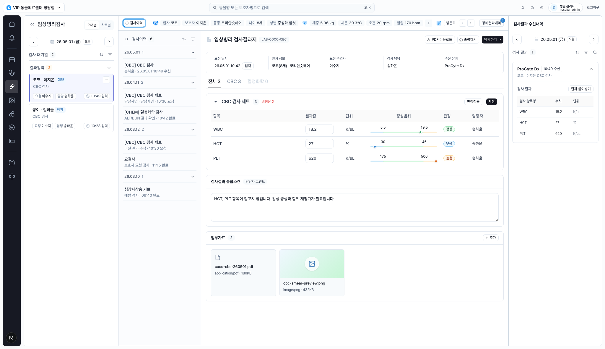
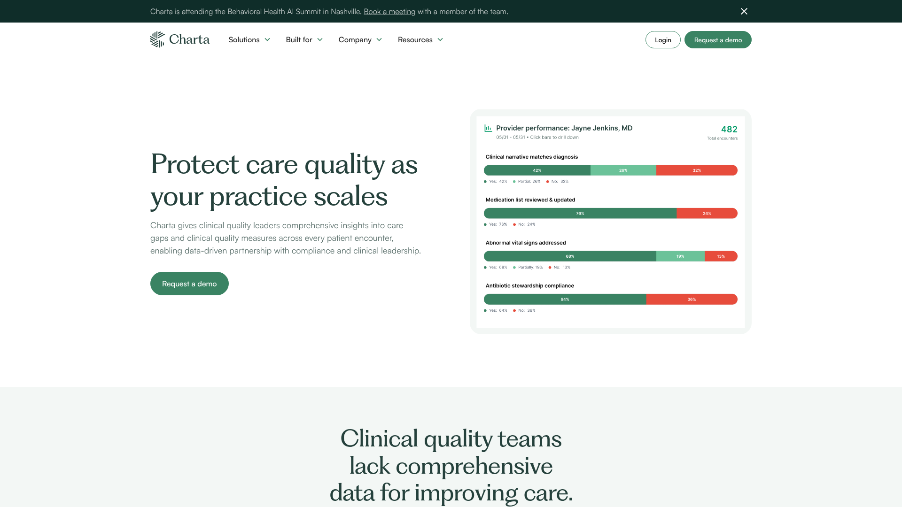
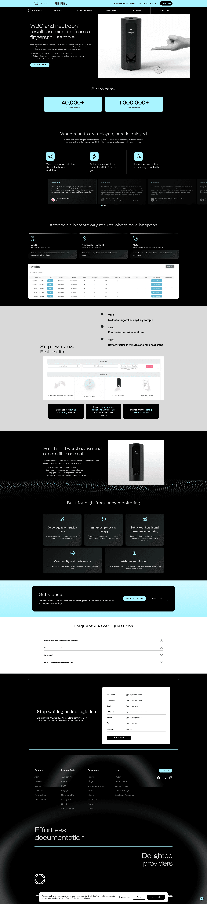
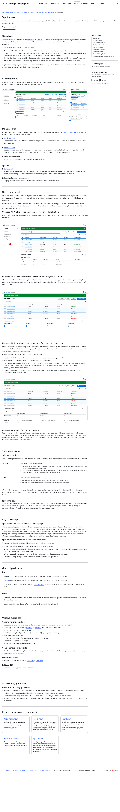

# Design Improvement: 임상병리 검사결과지 Workspace

## TL;DR
가장 큰 기회는 검사결과지를 "입력 화면"에서 "이상치 판독과 장비값 대조가 먼저 보이는 검토 화면"으로 한 단계 끌어올리는 것입니다. 현재 구조와 조용한 운영형 톤은 좋으니, 이상치 요약, row-level 강조, 우측 수신값 reconciliation, 하단 판독 액션을 더 명확하게 만들면 됩니다.

## Current State

*CLAiR EMR 임상병리검사 화면. 좌측 오더 대기열, 검사이력 aside, 중앙 검사결과지, 우측 장비결과 수신내역으로 구성된 desktop EMR workspace입니다.*

## Improvement Ideas

### 1. 검사결과지 상단에 "판독 요약 스트립" 추가 ⭐
현재는 환자/요청/장비 정보와 검사값이 분리되어 있어 HCT 낮음, PLT 높음이라는 핵심 판단이 테이블을 읽은 뒤에야 보입니다. 결과지 제목 아래에 `이상 2`, `정상 1`, `장비값 대조 완료`, `소견 필요` 같은 compact summary를 넣고, 주요 이상 항목을 한 줄로 먼저 노출하세요.

**Inspired by:**

*Charta — clinical quality dashboard가 여러 품질 지표를 색상 막대로 먼저 요약해 사용자가 어디를 봐야 하는지 정합니다. [Lazyweb]*

**Why this works:** 검사 담당자는 모든 수치를 같은 강도로 읽지 않습니다. 정상/이상/조치 필요를 상단에서 먼저 잡아주면 중앙 테이블은 세부 확인용이 되고, 저장/판정 적용 전 실수 가능성이 줄어듭니다.

**Sketch:**
```text
┌ 임상병리 검사결과지   LAB-COCO-CBC                         [담당하기] ┐
│ 코코 · CBC 검사   26.05.01 10:42   ProCyte Dx                         │
├───────────────────────────────────────────────────────────────────────┤
│ 이상 2  정상 1  장비값 일치 3/3  소견 필요                            │
│ HCT 27 낮음 · PLT 620 높음                                             │
└───────────────────────────────────────────────────────────────────────┘
```

### 2. 이상치 row를 "badge"보다 먼저 보이게 만들기
현재 낮음/높음 badge와 정상범위 dot은 정돈되어 있지만, 행 전체의 우선순위는 약합니다. 이상 row에는 왼쪽 3px status rail, 결과값 강조, 이전값/장비값 delta chip을 추가해 `어떤 값이 왜 위험한지`를 한 번에 보이게 하세요. 정상 row는 지금처럼 낮은 대비를 유지하면 됩니다.

**Inspired by:**

*Commure/Athelas — WBC analyzer 결과를 핵심 metric, actionable result, workflow로 분해해 임상적 행동과 연결합니다. [Lazyweb]*

**Why this works:** 수치 입력 화면에서는 작은 badge도 충분하지만, 판독 화면에서는 abnormality가 시각 계층의 첫 번째 신호여야 합니다. 특히 수의사가 검토할 때 `낮음/높음`, 기준 범위, 장비값 일치 여부가 같은 시선 경로에 놓여야 합니다.

**Sketch:**
```text
┌ CBC 검사 세트                    비정상 2                 [저장] ┐
│ 항목     결과값        기준범위             장비값      판정       │
│ WBC      18.2          5.5 ───── 19.5       일치       정상       │
│▌HCT      27 ↓          30 ───── 45          일치       낮음       │
│▌PLT      620 ↑         175 ───── 500        일치       높음       │
└──────────────────────────────────────────────────────────────────┘
```

### 3. 우측 수신내역을 "장비값 대조 패널"로 승격
우측 패널은 현재 수신 카드와 붙여넣기 버튼 중심이라, 중앙 결과지와 어떤 값이 같은지/덮어쓸 값이 있는지 바로 알기 어렵습니다. 선택된 장비 수신값을 중앙 결과지와 1:1로 비교하는 split-view detail panel로 바꾸고, 각 행에 `일치`, `차이`, `미입력` 상태를 붙이세요.

**Inspired by:**

*Cloudscape Design System — 선택한 리소스의 상세 정보를 우측 split panel에 두어 목록/테이블 맥락을 잃지 않게 합니다. [Web]*

**Why this works:** 장비 수신값 붙여넣기는 위험도가 있는 bulk action입니다. 한 번에 붙여넣기보다 "현재값 vs 장비값"을 먼저 보여주고, 변경되는 값만 선택 적용할 수 있으면 안전한 검토 흐름이 됩니다.

**Sketch:**
```text
┌ 장비값 대조: ProCyte Dx 10:49 수신 ┐
│ WBC  현재 18.2   장비 18.2   일치  │
│ HCT  현재 27     장비 27     일치  │
│ PLT  현재 620    장비 620    일치  │
│                                      │
│ [차이만 적용] [전체 붙여넣기]       │
└──────────────────────────────────────┘
```

### 4. 소견/첨부 영역을 "판독 완료 체크포인트"로 정리
하단의 종합소견과 첨부자료는 넓은 공간을 쓰지만, 다음 행동이 약합니다. 소견 입력 위에 `필수 확인`, `보호자 공유 가능`, `진료 재평가 권장` 같은 판독 체크포인트를 두고, 첨부자료는 작은 evidence strip으로 압축하세요.

**Inspired by:**

*Pencil & Paper — enterprise table은 색상, 아이콘, 단위, row grouping 같은 보조 신호를 조합해 복잡한 데이터를 스캔 가능하게 만든다고 설명합니다. [Web]*

**Why this works:** 검사결과지는 입력 이후 "누가 무엇을 해야 하는가"가 남습니다. 소견 영역을 자유 텍스트만 두지 말고, 이상치와 연결된 후속 조치 체크포인트로 만들면 진료 인계 품질이 올라갑니다.

**Sketch:**
```text
┌ 판독 체크포인트 ─────────────────────────────┐
│ [x] HCT/PLT 재평가 필요  [ ] 보호자 공유 가능 │
│ [ ] 응급 알림 필요                           │
├ 종합소견                                      │
│ HCT, PLT 항목이 참고치 밖입니다...            │
├ 첨부 evidence                                  │
│ coco-cbc.pdf  smear-preview.png               │
└───────────────────────────────────────────────┘
```

## What's Working
- 4-column shell이 명확합니다. 좌측 업무 큐, 이력, 중앙 결과지, 우측 수신내역의 역할이 이미 구분되어 있습니다.
- 색상 사용이 과하지 않아 의료 업무 화면답게 차분합니다. 이 톤은 유지하는 편이 좋습니다.
- 환자 context chip과 정상범위 visual range가 있어, 검사결과지가 단순 표에 머물지 않습니다.
- 장비 수신내역을 우측에 둔 방향은 맞습니다. 다만 지금은 "대조"보다 "수신 카드"처럼 보여서 역할을 더 선명히 하면 됩니다.

## All References

| Reference | Source | Why Used |
|---|---|---|
| Charta clinical quality score | Lazyweb | 여러 임상 지표를 상단에서 색상 막대로 요약하는 패턴 |
| Commure/Athelas WBC results | Lazyweb | 검사 결과를 actionable metric과 workflow로 연결하는 패턴 |
| Cloudscape split view | Web | 선택 항목 상세/비교 정보를 우측 패널에 유지하는 split-view 패턴 |
| Pencil & Paper enterprise data tables | Web | 복잡한 테이블을 grouping, color, icons, units로 스캔 가능하게 만드는 원칙 |
| Current CLAiR EMR screen | Local capture | 개선 전 기준 화면 |

## Notes
- PracticeStudio Lab Orders page는 웹 리서치에는 참고했지만 live capture가 timeout되어 이미지 레퍼런스에는 넣지 않았습니다.
- 이미지 비교 검색은 캡처 파일 크기가 커서 도구 입력에 적합하지 않아, Lazyweb text search와 live web capture를 병행했습니다.
