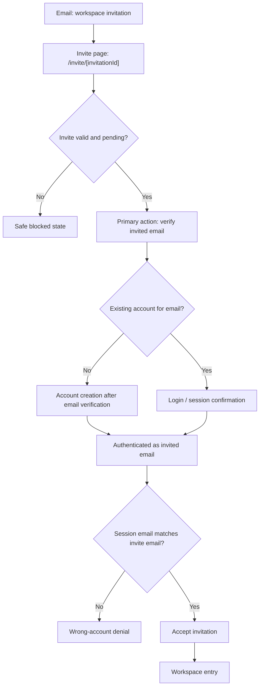

# Invite Acceptance Account Onboarding Flow

Status: review
Updated: 2026-05-23
Related Linear: DEN-187, DEN-244, DEN-246
Related initiative: CLAiR EMR Staging Pilot Enablement

## Purpose

Define the invite acceptance UX flow before implementation and verification.

This is the product/design test basis for the invite flow where a hospital administrator sends an email invitation and the invited person verifies the invited email before the app activates workspace membership.

## Product Principle

An invitation link is not enough to activate workspace access.

CLAiR EMR must activate membership only after both are true:

1. The invitation is valid, pending, unexpired, and belongs to the requested workspace.
2. The authenticated Supabase identity email matches the invitation email.

Supabase Auth owns account creation, password sign-in, session cookies, password reset, and future MFA. CLAiR app routes own invite validity, membership activation, workspace routing, and safe denial UX.

## Primary Actors

| Actor | Goal |
| --- | --- |
| Hospital admin | Invite a staff member into an approved hospital workspace. |
| New invited staff user | Verify the invited email, create an account if needed, accept the invite, and enter the workspace. |
| Existing invited staff user | Verify or sign in with the invited email, accept the invite, and enter the workspace. |
| Wrong signed-in user | Must be blocked from claiming another email's invite. |

## Happy Path Overview

1. Hospital admin sends an invitation email from the workspace member-management surface.
2. Invited person opens the email and clicks `Open invitation`.
3. Invite page loads with workspace, role, invited email, and expiration details.
4. User continues through one primary email verification action.
5. Auth decides whether the invited email maps to an existing account or needs account creation.
6. App returns to the invite page.
7. App accepts the pending invitation through the server accept route.
8. App routes to the invited workspace.

## Screen Flow

## Invite Page Requirements

For a pending invite, the page must show:

- Product mark: `CLAiR EMR`
- Heading: `초대 수락`
- Invited email
- Invited role label
- Workspace display name
- Expiration time
- One primary email verification action:
  - `인증 코드 받기` in Supabase-backed invite flow
  - local/mock mode may keep `초대 수락하고 워크스페이스 열기` for deterministic prototype verification

The page must not ask the user to decide whether they are a new or existing account holder before email verification. That decision belongs to the auth step after the invited email is confirmed.

The primary accept action is available only when the user is already authenticated as the invited email. If unauthenticated, the primary action should route to the invite-aware email verification path instead of failing first.

## Email Verification Path

Trigger: user clicks the primary email verification action from a valid pending invite.

Expected UX:

1. Navigate to an invite-aware account verification path with `reason=invite_email_otp`, `inviteEmail`, and safe `next`.
2. Pre-fill or lock the email to the invited email when possible.
3. Send or confirm an email OTP for the invited email through the DEN-247 handoff.
4. If the email maps to an existing account, continue as that account.
5. If the email does not map to an account, create the minimum approved account after verification.
6. Return to the original invite URL with an authenticated session.
7. Auto-attempt or clearly offer invitation acceptance.
8. On success, route to `/w/[workspaceId]/reception?modulePanel=open&aside=closed`.

DEN-246 updates the invite landing page and invite-aware login reason. DEN-247 adds the invite OTP request guard, locked-email login surface, Supabase `signInWithOtp` / `verifyOtp` boundary, and `/auth/confirm` callback. Remote staging email delivery still requires explicit approval and Supabase redirect/template configuration.

## Existing User Path

Trigger: the verified email already has an account or the user is already signed in.

Expected UX:

1. Navigate to `/login?reason=invite_email_otp&next=[safe invite path]`.
2. Pre-fill the email with the invited email when possible.
3. Show invite-aware copy: `초대받은 이메일 계정으로 로그인하세요.`
4. Hide or de-emphasize development-only controls in staging Preview when Supabase Auth is active.
5. After login, return to the invite URL.
6. Accept the invitation if the authenticated email matches the invited email.
7. On success, route to the invited workspace.

## Already Authenticated Path

If the user opens a valid invite while already authenticated:

| Session state | Expected behavior |
| --- | --- |
| Authenticated email matches invited email | Show invite details and allow direct accept. |
| Authenticated email differs from invited email | Show safe denial and offer sign out / switch account. Do not call accept. |
| Authenticated user is already an active member | Show `이미 워크스페이스 구성원입니다` and route to workspace. |

## Blocked And Error States

| State | UX copy intent | Membership effect |
| --- | --- | --- |
| Missing invite | The link cannot be verified. Ask for a new invitation. | No membership mutation. |
| Expired invite | The invitation expired. Ask admin to resend. | No membership mutation. |
| Canceled invite | The invitation was canceled. Ask admin for a new invite. | No membership mutation. |
| Accepted invite | Already accepted. Route to workspace only if current user has active membership. | No duplicate membership. |
| Unauthenticated | Ask user to create account or log in first. | No membership mutation. |
| Email mismatch | Ask user to switch to invited email. | No membership mutation. |
| Server failure | Show retry-safe error without raw provider details. | No membership mutation unless server returned success. |

## Staging UX Rules

- Do not show raw invite token, service role, API key, OTP, magic link, or provider error.
- Development controls may remain for local/mock mode, but staging Supabase invite flows should keep them visually secondary or hidden.
- The user should not have to guess whether they are creating a new account or signing into an existing account before the invited email is verified.
- The user should never see a generic login screen without invite context after coming from an invite.

## Scenario Test Matrix

| ID | Scenario | Given | Action | Expected result |
| --- | --- | --- | --- | --- |
| INV-UX-01 | Pending invite renders email-first path | Valid pending invite | Open email link | Invite page shows email, role, workspace, expiry, and one primary email verification action. |
| INV-UX-02 | OTP-first handoff preserves next | Valid pending invite, no session | Click primary verification action | Login/verification URL contains safe `next`, `inviteEmail`, and `reason=invite_email_otp`. |
| INV-UX-03 | Account path choice is deferred | Valid pending invite, no session | Open invite page | Page does not show separate `신규 계정으로 시작` / `기존 계정에 연결` choices. |
| INV-UX-04 | OTP verification returns to invite | User verifies the invited email | Submit valid OTP or click configured magic link | Browser returns to invite URL. |
| INV-UX-05 | Matching email can accept | Authenticated as invited email | Accept invite | Server accept route succeeds; workspace opens. |
| INV-UX-06 | Wrong email cannot accept | Authenticated as another email | Open invite / accept | Safe denial; no membership mutation. |
| INV-UX-07 | Invalid invite is blocked | Missing/expired/canceled/accepted invite | Open link | No account actions that imply successful joining. |
| INV-UX-08 | Staging email link points to latest Preview | Resend-approved staging email | Open latest email | Link host is the current staging Preview domain. |
| INV-UX-09 | Development controls do not dominate staging | Supabase staging Preview login | Navigate from invite to login | Login screen prioritizes invite login context over mock role controls. |

## Implementation Slice Recommendation

Implement in two slices if needed:

1. UX routing and copy hardening:
   - Pending invite page presents a single email verification path instead of account-path buttons.
   - Login page reads invite reason/email context and shows invite-aware copy.
   - Staging Supabase mode hides or minimizes mock development controls.
   - Playwright coverage for INV-UX-01 through INV-UX-03 and INV-UX-09.

2. Account creation and auto-accept:
   - Add approved Supabase email OTP send/verify handoff.
   - Return to invite after auth.
   - Accept invite only when authenticated email matches.
   - Server/browser coverage for INV-UX-04 through INV-UX-07.

## Out Of Scope

- Production deploy.
- New email provider work.
- Additional real email sends.
- Direct SQL mutation.
- Remote Supabase migration push without explicit approval.
- MFA, SSO, SCIM, or enterprise domain auto-join.
- Public workspace self-signup.

## Verification Plan

Before implementation:

- Review this flow with 승욱.

After implementation:

- Add or update Playwright tests using the scenario matrix above.
- Run focused invite acceptance tests.
- Run focused login tests if login copy/routing changes.
- Run `npm run docs:check`.
- Run `npm run security:secrets`.
- For staging Preview, verify with the latest invite email only after explicit send/deploy approval.
