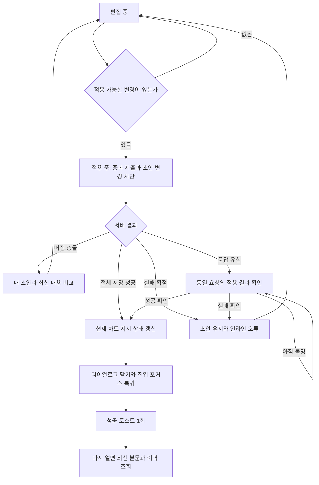

# 총괄 지시사항 — 화면 및 동작 상세 기획

상위 문서: [총괄 지시사항 PRD](../../../../product/features/chart/overall-instructions-prd.md). 구현 근거와 작업 순서는 [구현 계획](../../../../engineering/architecture/overall-instructions-implementation-plan.md)을 따른다.

2026-11-01 로컬 구현 승인 이후 작성 화면, 실제 차트 진입점, 수행 확인·서버 저장·알림을 별도 작업 폴더에 구현했다. 계층별 합성 검증과 원격 적용 전 조건은 [PR-012](../../../../work/clinical-fulfillment/CLINICAL-FULFILLMENT-PR-012-overall-instructions.md)에 기록한다. 원격 DB 적용·배포·병원 사용자 수용은 아직이다.

**UI 확정**은 대화에서 선택한 최종 화면을 뜻한다. **시안 확인**은 HTML의 메모리 동작이다. **제품 권장안**은 서버 연결까지 고려해 이번에 보완한 흐름이다. **정책 확정**은 사용자가 명시적으로 승인한 제품 규칙이다. D-01~D-06은 2026-11-01 확정했고, D-07~D-10의 구현 결정은 PRD와 구현 계획에 기록한다. D-04의 수행자 Info bar·확인 다이얼로그, D-05의 앱 내 알림, D-06의 기존 경구제 전체 지시 통합은 확정 기획이며 v45 HTML 시안에는 미반영이며, 실제 앱의 로컬 후보에는 반영했다. 이 문서는 실제 앱 구현 승인이 아니다.

## 1. 리뷰 기준

| 항목 | 기준 |
| --- | --- |
| 최종 화면 | HTML v45, 2026-11-01 |
| 기본 리뷰 | [저장된 지시가 있는 화면](https://spare-thumbnail-consultation-circles.trycloudflare.com/?open=1&v=45&instructions=saved) |
| 최초 진입 | [본문·이력이 없는 화면](https://spare-thumbnail-consultation-circles.trycloudflare.com/?open=1&v=45&instructions=empty) |
| 이력 리뷰 | [변경 전후 비교](https://spare-thumbnail-consultation-circles.trycloudflare.com/?open=1&v=45&instructions=saved&history=1) |
| 이전 전환안 확인 | [v45의 기존 경구제 지시 영역](https://spare-thumbnail-consultation-circles.trycloudflare.com/?open=1&v=45) — D-06 이전 전환안이 남아 있는 모드이며, 별도 조회·복사 UI는 제품 목표에서 제외 |
| 비교한 앱 소스 | `e3b7923a05d160b240e6beb330121cd14b5b66cd` |
| `index.html` SHA-256 | `c8f85e07015302a8f1ace34fa64a54055934349281ef6f71be085360685ab35b` |
| `origin-alignment.css` SHA-256 | `413a59d544d758dc16b3b1cda00e976801504467440ff4c975f7f30cdc391b01` |

공유 링크는 임시이며 `v` 값은 불변 파일 식별자가 아니다. 위 지문은 이 문서를 작성한 시점의 최종 시안을 식별한다. 이번 시안 수정은 입력 섹션 상단 여백 4px 반영이다. 앱 코드는 수정하지 않았다.

시안 도구·가상 데이터 안내·정책 탭은 리뷰용이다. 저장 테스트 영역은 최종 화면에서 숨겼다. 실제 제품 UI에 포함하지 않는다.

## 2. 진입점과 첫 화면

### 2.1 Plan/Order

- **D-06 확정:** 기존 `경구제 전체 지시` 기능을 `총괄 지시사항`의 `조제 지시`로 통합한다. 조제 지시는 현재 차트의 모든 조제 오더에, 처치 지시는 모든 처치 오더에 전달한다.
- 새 화면에는 별도의 `기존 경구제 지시` 영역이나 `조제 지시로 복사하여 검토` 단계를 두지 않는다. v45의 해당 조회·복사 UI는 후속 구현에서 제거할 대상이다.
- 기존 내용·변경 이력·요청 및 완료 당시 기록은 보존한다. 과거 PO 지시의 당시 적용 범위는 소급 변경하지 않는다. 실제 데이터 이전 절차는 구현 계획에서 정한다.
- 버튼은 호버할 때만 나타나지 않는다. 선택한 행이 없어도 현재 차트 기준으로 연다.
- 표의 선택·필터·정렬·스크롤은 지시 편집과 별개다.
- 편집 가능 여부를 조회하기 전에는 낙관적으로 쓰기 가능 상태를 보여 주지 않는다.

| 차트/권한 상태 | 시안에서의 동작 | 제품 연결 규칙 |
| --- | --- | --- |
| 유효 확정 오더 존재 | 편집 진입 가능 | 서버가 범위별 대상과 편집 가능 사유 반환 |
| 오더 없음 / 미확정만 존재 | 진입 비활성 | `오더를 확정한 뒤 지시사항을 작성할 수 있습니다.` 키보드·터치에서도 확인 가능 |
| 확정 여부 조회 중 | 진입 비활성 | 로딩과 빈 상태 구분 |
| 조회 실패 | 진입 비활성, 다시 조회 | 조회 실패를 대상 0건으로 해석하지 않음 |
| 모두 완료 | 조회 전용 | **D-02 확정:** 현재 지시·이력 조회 유지, 일반 추가·수정·삭제·적용 차단. 완료 당시 기록 보존 |
| 모두 취소 | 신규 작성 비활성, 이전 지시·이력 조회 경로 | **D-03 확정:** 새 작성·일반 수정 차단. 조회 전용으로 이전 지시·이력과 기존 시점 기록 보존 |
| 차트 서명 / 조회 권한만 있음 | 조회 전용 | 기존 서버 제한 보존 |

D-02의 정정은 기존 정정 절차를 따른다. 새로운 정정 권한이나 완료 기록의 덮어쓰기를 허용하는 결정이 아니다. 오더 없음·모두 취소 상태를 모두 완료로 간주하지 않는다.

실제 수행 모듈 지원 여부는 분류 존재 여부와 다르다. 미지원 유형을 시안의 가상 작업으로 대체해 동작한다고 보고하지 않는다.

### 2.2 처음 열기

1. 현재 병원·차트를 고정한 조회를 시작한다.
2. 성공 시 현재 본문, 적용 범위, 권한, 이력 존재 여부를 읽는다.
3. 저장된 지시가 없으면 가운데 범위 선택 화면을 표시한다. 전체 입력란을 자동으로 만들지 않는다.
4. 저장된 지시가 있으면 해당 범위의 입력란을 표시한다. 전체 없이 분류만 있어도 그대로 연다.
5. 제목에 초기 포커스를 둔다. 제목 아래 설명은 없다. 범위를 선택하면 해당 입력란에 포커스를 옮긴다.

로드 중에는 이전 차트의 내용을 남겨 두지 않는다. 오류 시 재조회 경로를 제공하고 적용은 막는다. 이 실제 초기 조회 흐름은 v45에서 구현되지 않았다.

## 3. 화면 구조 — UI 확정

```text
┌────────────────────────────────────────────────────┐
│ 총괄 지시사항                                    ×  │
│                                                    │
│ 추가한 범위의 지시                           삭제  │
│ 입력 내용                                          │
│ 작성자 · 날짜 시각                         높이 조절│
│                                                    │
│ 삭제 아이콘 · 분류 지시 삭제 예정          되돌리기 │
│ ┌ ─ ─ ─ ─ ─ ─ ─ ─ ─ ─ ─ ─ ─ ─ ─ ─ ─ ─ ─ ─ ─ ┐ │
│                    + 지시 추가                     │
│ └ ─ ─ ─ ─ ─ ─ ─ ─ ─ ─ ─ ─ ─ ─ ─ ─ ─ ─ ─ ─ ─ ┘ │
│                  본문 내부 스크롤                  │
├────────────────────────────────────────────────────┤
│ 변경 이력                              취소  적용  │
└────────────────────────────────────────────────────┘
```

- 제목 아래 설명·헤더 하단 보더는 없다. 헤더의 아래 16px와 입력 섹션 위 4px를 구분한다.
- 처음에는 가운데 아이콘 박스와 `어디에 지시를 작성할까요?`, 범위 선택 아웃라인 버튼을 표시한다. 전체 오더 버튼을 따로 두고 분류 버튼을 그리드로 묶는다. 현재 합성 데이터는 6개 분류(3열×2행)이며 실제 대상 분류 전체를 뜻하지 않는다.
- 아이콘 박스는 유지한다. 일러스트로 대체하거나 제거하지 않는다.
- 범위를 선택하면 편집 화면으로 전환한다. 추가·삭제·선택 화면 복귀 모두 같은 외곽 크기를 유지한다.
- `지시 추가`는 마지막 입력란/삭제 예정 아래의 점선 영역이다. 투명 배경, 옅은 텍스트, + 아이콘만 사용한다. 호버·열림에도 검정 배경을 복구하지 않는다.
- 추가 메뉴는 버튼과 같은 폭·좌우 위치로 열린다. 가용 공간에 따라 위/아래를 선택한다. 메뉴 때문에 본문 높이가 바뀌지 않는다.
- 푸터 왼쪽 변경 이력은 고스트, 오른쪽 취소는 아웃라인, 적용은 주요 버튼이다. 세로 디바이더는 없다. 범위 선택 화면에서는 오른쪽 취소·적용을 숨긴다.
- 변경 이력은 항상 표시한다. 이력이 없으면 비활성화한다. 현재 본문 유무와 이력 유무를 구분한다.
- 본문만 스크롤하고 헤더·푸터는 고정한다. 추가 영역은 본문에 속하므로 함께 스크롤한다.
- 조회 전용에서는 추가·적용을 숨기고 닫기를 제공한다. 기록 없는 조회 전용 화면에 신규 작성 선택지를 노출하지 않는다. 이 상태의 최종 앱 표현은 구현에서 확인한다.

### 3.1 컴포넌트와 수치

| 요소 | 기준 | v45 반영값 / 구현 기준 |
| --- | --- | --- |
| 다이얼로그 | `EmrDialogShell` 재사용 | 데스크톱 560×560px. 공용 `wide-form` 기본 680px를 전역 변경하지 않고 기능별 크기 지정 |
| 작은 화면 | 뷰포트 안 배치 | 데스크톱 최대 높이 뷰포트−80px, 640px 미만 뷰포트−32px. 폭도 화면 안으로 제한 |
| 헤더 | 공용 다이얼로그 구조 | 위 28px·좌우 32px·아래 16px. 모바일 위 24px·좌우 20px·아래 16px |
| 본문 | 제목/푸터와 좌우 정렬 | 입력 섹션 위 4px·아래 24px. 스크롤바 여백을 보정해 입력 테두리/추가 영역 끝을 제목과 버튼 끝에 맞춤 |
| 첫 화면 아이콘 | 중앙 선택 화면 | 박스 48×48px. 선택 버튼은 아웃라인 |
| 닫기 | 공용 닫기 슬롯 | 클릭 영역 32px, 우측·상단 10px |
| 제목 | `emr-text-dialog-title` | 18px, 굵기 600 |
| 일반 버튼 | `Button` | 높이 32px, 글자 14px, 모서리 8px |
| 추가 영역 | 메뉴 트리거 | 높이 48px, 입력란과 같은 폭, 점선·투명 배경·`emr-text-tertiary`, 셰브런 없음 |
| 필드 삭제 | `EmrIconButton` | 클릭 영역 24px, 아이콘 14px. 전체 닫기와 접근성 이름 구분 |
| 입력 | `Textarea` 토큰 재사용 | 제목·본문·메타데이터를 하나의 테두리로 묶음 |
| 삭제 예정 | `EmrInlineAlert` 중립 톤 | 항목 간 8px, 입력란 다음 16px |
| 메뉴 | 기존 `DropdownMenu` | 트리거와 폭·좌우 정렬 일치. 공용 구현은 Base UI 기반이므로 다른 라이브러리 전용 변수를 가정하지 않음 |
| 이력 범위 | `Select` 표현 | 셰브런 우측. 현재 HTML은 네이티브 select |
| 이력 다이얼로그 | 비교 화면 | 폭 840px를 뷰포트로 제한. 모바일 전후 세로 비교 |

정적 HTML은 토큰·SVG를 적용한 시안이다. 실제 앱에서는 공용 React 컴포넌트의 접근성·포커스 계약을 사용한다. 320px·390px 최종 배치는 구현 시 다시 검증한다. 과거 v25 모바일 캡처는 v45 푸터 배치의 증거가 아니다.

## 4. 입력란 추가·편집

### 4.1 추가

- 드롭다운에는 확정 오더가 있는 분류 중 아직 표시하지 않은 분류만 노출한다. 오더 개수는 표시하지 않는다.
- 현재 없는 전체 오더 지시는 메뉴에 다시 노출한다.
- 분류 선택 → 메뉴 닫기 → 입력란 추가 → 새 textarea 포커스 → 본문을 **최하단**으로 이동한다. 입력란만 겨우 보이도록 스크롤하지 않는다.
- 본문이 늘어나도 푸터는 밀려나지 않는다. 추가된 카드의 하단과 본문 아래 여백까지 볼 수 있어야 한다.
- 기존 입력 내용과 수정 상태를 유지한다. 분류 하나를 두 번 추가할 수 없다.
- 메뉴는 방향키·Home·End·Enter로 조작한다. 메뉴에서 Escape를 누르면 메뉴만 닫고 추가 버튼으로 포커스를 돌린다.
- 새 분류를 여러 번 연속 추가하거나 다른 필드를 편집한 뒤 추가해도 같은 규칙을 지킨다.

**시안과 로컬 구현의 차이:** v45는 전체 오더 지시를 재추가할 때 맨 앞에 삽입하면서 스크롤은 맨 아래로 이동한다. 긴 목록에서 포커스한 입력란과 화면 위치가 갈라질 수 있다. 로컬 구현은 D-08에 따라 새 입력란을 마지막에 배치하고 포커스한다. v45 HTML은 그대로다.

### 4.2 입력과 메타데이터

- 전체 지시 작성 없이 분류 지시만 적용할 수 있다.
- 최대 5,000자. 평소 글자 수를 숨기고 4,500자 이상부터 `현재 글자 수 / 5,000`을 표시한다. 클라이언트와 서버는 같은 문자 길이 기준을 사용해야 한다.
- 작성자·시각은 **마지막으로 적용된 내용의 기록**이다. 타이핑만으로 새 작성자·시각으로 바꾸지 않는다.
- 새 빈 입력란에는 가짜 작성자나 시각을 넣지 않는다.
- 메타데이터와 높이 조절 손잡이는 같은 하단 줄에 둔다. 긴 메타데이터가 입력 내용이나 글자 수를 덮지 않게 한다.
- 높이 조절은 입력 영역만 늘린다. 페이지나 푸터의 크기를 직접 늘리지 않는다.
- 입력란 추가만으로 지시가 발행되지 않는다. 적용 전에는 수행 화면에 전달하지 않는다.

## 5. 삭제·되돌리기

| 상황 | 즉시 화면 변화 | 적용 전 저장 상태 | 다음 행동 |
| --- | --- | --- | --- |
| 새 빈 입력란 삭제 | 입력란 제거 | 본문·임상 이력 변화 없음 | 메뉴에서 다시 추가 |
| 미적용 내용이 있는 입력란 삭제 | 내용 폐기 확인 후 제거 | 서버 상태 불변 | 취소하면 초안 유지 |
| 적용된 전체/분류 지시 삭제 | 삭제 확인 후 입력란 제거, 삭제 예정 표시 | 서버의 기존 본문·버전 유지 | 개별 되돌리기 또는 적용 |
| 삭제 예정에서 되돌리기 | 해당 범위의 적용된 본문·입력란 복구 | 서버 변화 없음 | 다른 수정·삭제 예정은 유지 |
| 삭제 적용 성공 | 현재 적용 내용 제거 | 삭제자·시각·이전 본문 이력 보존 | 재진입 시 삭제한 입력란 자동 복원 금지 |
| 삭제 적용 실패 | 삭제 예정과 되돌리기 유지 | 전부 실패 원칙 | 재시도 또는 되돌리기 |

삭제 확인은 적용 직후 복구하는 기능과 다르다. **`되돌리기`는 아직 적용하지 않은 삭제를 취소**한다. 이미 적용한 삭제를 되돌리려면 새 변경을 작성·적용해야 한다. 이번 범위에는 이력에서 과거 버전을 원클릭 복원하는 기능을 포함하지 않는다.

전체 오더 지시 삭제는 분류 지시를 삭제하지 않는다. 분류 지시 삭제는 전체·다른 분류를 바꾸지 않는다.

빈 입력란의 표시 여부는 임상 본문과 별개다(D-07). v45는 내용이 없는 입력란 추가·제거만으로 적용 가능한 변경을 만들지 않는다. 입력란과 삭제 예정이 모두 없으면 처음 범위 선택 화면으로 돌아간다. 새로고침 뒤에도 빈 필드 구성을 유지하는 기능은 확정하지 않았다.

직접 본문을 모두 지우는 동작은 명시적 삭제와 같은 확인·이력 규칙을 적용하는 것을 권장한다(D-09). 공백만 입력한 본문은 오류로 안내하며 자동 삭제로 바꾸지 않는다.

## 6. 적용 이후 흐름 — 제품 권장안



### 6.1 적용 전

- 실제 변경이 없거나 읽기 전용이면 적용하지 않는다.
- 여러 범위 중 하나라도 내용 검증을 통과하지 못하면 저장을 시작하지 않는다.
- 서버는 차트·병원·권한·확정 오더·범위별 기준 버전을 다시 검사한다.
- 서버에 보낼 변경은 범위별 최신 초안과 삭제 의도다. 사용자 이름·작성 시각·차트 관계를 클라이언트 값으로 확정하지 않는다.

### 6.2 적용 중

- 적용 버튼: `적용 중…`, 비활성. 성공 전까지 닫지 않는다.
- 입력·추가·삭제·되돌리기·취소·닫기·변경 이력 열기를 잠근다. Escape나 바깥 클릭으로도 요청 중 다이얼로그를 닫지 않는다.
- 중복 클릭, Enter 반복, 네트워크 재전송이 하나의 변경을 여러 번 기록하지 않게 한다.
- 장기 지연은 성공으로 간주하지 않는다. 브라우저 새로고침·탭 종료로 결과를 잃는 경우도 결과 확인 흐름으로 복구한다.

### 6.3 저장 성공

| 순서 | 동작 | 목적 |
| --- | --- | --- |
| 1 | 서버가 확정한 내용·범위별 버전·작성자·시각을 수신 | 로컬 초안만으로 성공을 판단하지 않음 |
| 2 | 해당 차트의 현재 지시 상태를 갱신하고 초안의 수정 표시를 해제 | 다음 조회에서 낡은 내용 노출 방지 |
| 3 | 다이얼로그 닫기 | 편집 작업 완료 |
| 4 | 같은 차트의 `총괄 지시사항` 진입점에 포커스 복귀 | 키보드 작업 문맥 유지 |
| 5 | 성공 토스트 한 번 표시 | 적용 완료 피드백 |
| 6 | 연결된 조회 화면을 갱신하거나 재조회하도록 알림 | 수행 화면에서 최신 지시 확인 |

- Plan/Order의 선택 행·분류 필터·정렬·표 스크롤을 초기화하지 않는다. 다른 화면으로 자동 이동하지 않는다.
- 토스트 권장 문구: `지시사항을 적용했습니다.` 위치·아이콘·접근성은 앱 공용 성공 토스트를 따른다.
- 토스트에 자동 되돌리기를 넣지 않는다. 지시가 이미 수행 화면에 전달될 수 있으므로 복구는 새로운 명시적 적용으로 다룬다.
- 토스트가 사라져도 다시 열어 본문과 이력으로 결과를 확인할 수 있어야 한다. 토스트만이 유일한 저장 증거가 되어서는 안 된다.
- 토스트는 비차단형이다. 포커스를 토스트로 강제로 이동하지 않는다.
- 저장 성공 뒤 연관 화면 재조회가 실패하면 저장 성공을 실패로 바꾸지 않는다. 해당 화면에 최신화 실패와 재조회 경로를 제공한다.
- 요청 시작 후 사용자가 다른 차트·병원으로 이동했다면 이전 응답이 현재 화면을 닫거나, 현재 진입점으로 포커스를 옮기거나, 문맥 없는 성공 알림을 표시하지 않게 한다.

### 6.4 재진입

- 같은 페이지에서 다시 열기뿐 아니라 새로고침·다른 창에서도 서버의 현재 값을 조회한다.
- 삭제된 지시를 오래된 로컬 상태로 복원하지 않는다. 이력은 계속 접근 가능하다.
- 적용한 내용과 같은 상태라면 적용은 비활성이다.
- 마지막 적용 이후 다른 사용자가 수정했다면 그 최신 내용과 작성자·시각을 보여 준다.
- 적용하지 않고 닫은 초안을 다음 진입에서 자동 복원할지는 별도 제품 기능이다. v45는 폐기 확인 뒤 초안을 버린다.

### 6.5 실패와 재시도

| 상황 | 제안 문구 | 화면과 데이터 처리 |
| --- | --- | --- |
| 저장 실패 확정 | `적용하지 못했습니다. 작성한 내용은 유지됩니다. 다시 시도해 주세요.` | 다이얼로그 유지, 입력·삭제 예정 유지, 성공 토스트 없음 |
| 응답 유실·결과 미확인 | `적용 결과를 확인하지 못했습니다. 결과를 확인한 뒤 다시 시도해 주세요.` | 동일 요청 결과 조회. 확인 전 무조건 새 저장 요청을 만들지 않음 |
| 동시 수정 | `다른 사용자가 지시사항을 변경했습니다. 내용을 비교한 뒤 적용해 주세요.` | 변경 범위별 내 초안과 최신 내용 보존. 적용 잠금 |
| 공백만 입력 | `공백만 입력할 수 없습니다. 지시를 없애려면 지시 삭제를 사용해 주세요.` | 해당 필드로 이동, 저장하지 않음 |
| 유효 대상이 사라짐 | `대상 오더가 변경되어 적용할 수 없습니다. 오더 상태를 확인해 주세요.` | 서버 재검사 결과 표시. 다른 범위만 부분 저장하지 않음 |
| 서명·권한 변경 | 구체적 불가 사유 표시 | 저장 차단. 조회가 허용되는 동안에만 복구용 초안 유지 |
| 저장 성공 후 최신화 실패 | `지시사항은 적용됐지만 최신 내용을 불러오지 못했습니다. 다시 조회해 주세요.` | 저장 재전송 대신 조회 재시도 |

복구가 필요한 오류는 사라지는 토스트만으로 알리지 않는다. 다이얼로그 안에 남는 오류와 행동을 제공한다.

### 6.6 충돌 해결

- 비교 화면에는 현재 적용된 서버 내용과 내 초안을 함께 둔다.
- `작성한 내용으로 계속`은 저장된 내용을 즉시 덮어쓰는 동작이 아니다. 선택한 초안을 새 기준 버전으로 검토·재적용한다.
- `최신 내용으로 계속`은 그 범위의 초안을 최신 값으로 교체한다. 다른 범위의 초안은 보존한다.
- 같은 본문으로 수렴했다면 불필요한 새 이력을 만들지 않는다.
- 재적용 직전에 다시 충돌하면 새 충돌을 표시한다. 마지막 저장 우선 방식으로 조용히 덮어쓰지 않는다.
- v45는 한 범위의 충돌만 가상 재현한다. 실제 앱은 여러 변경 범위의 충돌·검증 실패를 함께 처리해야 한다.

## 7. 취소·닫기·이력 조회

- 변경이 없으면 취소, ×, Escape는 닫기다.
- 미적용 본문 변경·적용된 지시의 삭제가 있으면 폐기 확인을 연다.
- `계속 작성`은 모든 초안과 삭제 예정을 유지한다. `버리고 닫기`는 적용된 상태만 남긴다.
- 기존 이력을 열 때는 작성 중 초안을 버리지 않는다. 이력 다이얼로그를 닫으면 편집 다이얼로그로 돌아간다.
- 이력에는 적용된 기록만 표시한다. 현재 초안이나 삭제 예정은 적용 이력이 아니다.
- 이력 또는 확인 다이얼로그가 위에 떠 있으면 Escape·Tab은 가장 위 다이얼로그를 기준으로 동작한다.
- 실제 앱에서 차트 이동·탭 닫기·병원 변경도 같은 미적용 상태와 권한 경계를 고려해야 한다. v45의 `beforeunload`만으로 앱 라우팅 보호를 검증할 수는 없다.

## 8. 변경 이력

1. 기록이 있는 범위만 범위 선택 목록에 표시한다. 이력이 전혀 없으면 편집 푸터의 변경 이력을 비활성화한다. 버튼은 유지하고 디바이더는 사용하지 않는다.
2. 해당 범위의 최신 변경을 위에 보여 준다.
3. 헤더의 주 정보는 날짜·시각, 다음은 행위자다. 오른쪽에는 변경 종류를 짧은 텍스트로 둔다.
4. 본문은 변경 전·변경 후를 함께 보여 준다. 추가·삭제 부분을 구분하지만 색만으로 의미를 전달하지 않는다.
5. 줄바꿈, 긴 본문, 특수문자를 보존한다. 본문을 실행 가능한 HTML로 해석하지 않는다.

| 기록 종류 | 표시 |
| --- | --- |
| 처음 적용 | `최초 지시`; 변경 전에는 `작성된 지시 없음` |
| 기존 본문 변경 | `변경된 지시`; 전후 본문 비교 |
| 삭제 적용 | `지시 삭제`; 변경 후에는 `지시 삭제됨` |
| 삭제 후 새로 적용 | `다시 작성된 지시`; 이전 삭제와 별개 기록 |

- 화면 시각 형식: `YYYY. MM. DD HH:mm`. 일자 뒤 마침표를 넣지 않는다. 현재 제품의 시간대 규칙을 따르고 서버 시각을 사용한다.
- 삭제한 지시의 이력을 조회할 수 있어야 한다. 목록에서 현재 적용 내용이 없어졌다는 이유로 과거 기록을 숨기지 않는다.
- v45의 문자열 비교는 공통 앞·뒷부분 사이를 통째로 강조하는 단순 방식이다. 떨어져 있는 여러 수정 구간을 정교하게 나누는 것은 실제 이력 비교 구현에서 별도 검증한다.
- 긴 이력의 페이지 나누기·추가 조회가 필요하면 최신순과 범위 선택을 유지한다. 데이터가 많아도 이력 응답이 편집 입력을 막지 않게 한다.

## 9. 수행 화면과 기록 연결 — 제품 권장안

**확정 정책 D-01:** 같은 차트에서 이후 확정되는 오더는 확정 시점의 최신 전체 오더 지시와 해당 분류 지시를 자동 적용한다. 미확정 오더에는 확정 시점부터 적용한다. 같은 환자의 다른 차트로 상속하지 않으며, 이전 작업의 요청·완료 당시 지시 기록은 덮어쓰지 않는다. 수행자 확인은 D-04, 앱 내 알림은 D-05의 확정 정책을 따른다.

| 정보 | 의미 | 기록 시점 |
| --- | --- | --- |
| 현재 지시 | 지금 해당 작업에 적용되는 내용 | 성공적으로 적용된 최신 범위별 버전 |
| 요청 당시 지시 | 이 요청 회차에 붙은 내용 | 오더 확정/작업 요청 시 |
| 완료 당시 지시 | 완료 처리 때 사용한 지시 버전 | 서버의 완료 처리와 일관된 시점 |
| 담당자 확인 | 특정 사용자가 특정 버전을 명시적으로 확인함 | D-04 확정: 비교 다이얼로그에서 `최신 지시 확인`을 누를 때 사용자·범위별 버전·서버 시각 저장 |

- 전체·분류·세트·개별 내용의 제목을 구분해 함께 읽을 수 있어야 한다.
- 전체 지시가 바뀌면 관련 진행 작업에, 분류 지시가 바뀌면 해당 분류 작업에 변경 표시를 제공한다. 다른 차트·분류에 변경 표시를 확산하지 않는다.
- 완료된 작업의 기존 결과·완료 당시 기록을 최신 본문으로 바꾸지 않는다.
- 요청/완료 당시 기록이 있다는 사실은 사람이 읽었다는 증거가 아니다.
- 변경 알림을 닫았다고 읽음·확인 완료로 기록하지 않는다.
- 확인한 범위별 버전 묶음을 저장한다. 같은 버전을 확인한 사용자에게 반복 확인을 요구하지 않는다. 확인 뒤 새 변경이 생기면 이전 확인을 최신 확인으로 취급하지 않는다.
- 알림 발송·읽음·최신화·작업 시작·완료는 서로 별개로 검증한다. D-04는 변경된 최신 지시의 확인을 시작·완료의 조건으로 삼는 결정이며, 확인 자체가 작업을 완료하거나 기존 수행·완료 기록을 변경하지 않는다.

### 9.1 변경 확인 UI — D-04 확정, v45 미반영 기획

```text
ⓘ 총괄 지시사항  변경됨              변경 내용 확인   ×
  현재 적용된 지시 본문…
```

- 기존 지시사항 Info bar를 사용한다. 그 위에 별도 안내 문구·배너·Info bar를 쌓지 않는다. 본문은 바로 읽을 수 있게 유지한다.
- 페이지 진입만으로 비교 다이얼로그를 자동으로 열지 않는다.
- `변경됨`은 제목 옆의 작은 상태 표시다. `변경 내용 확인`은 같은 제목 줄 오른쪽, 기존 ×의 왼쪽에 둔다.
- 기존 변경 이력 버튼이 해당 자리에 있으면 별도 버튼을 추가하지 않고, 미확인 변경이 있는 동안만 `변경 내용 확인`으로 바꾼다.
- 버튼을 누르면 변경 전후·변경자·시각을 보여 주는 비교 다이얼로그를 연다. 열기·닫기만으로 확인 처리하지 않는다. `최신 지시 확인`으로 명시적 확인을 기록한다.
- 미확인 변경이 있는 상태에서 시작·완료를 누르면 같은 비교 다이얼로그를 열고, 해당 버전의 확인이 기록되기 전에는 시작·완료를 실행하지 않는다.
- 확인이 성공하면 `변경됨` 표시를 해제한다. 일반 변경 이력 조회 경로는 유지한다. 같은 사용자가 같은 버전을 확인했다면 반복해서 묻지 않는다.
- ×는 Info bar를 잠시 숨기는 동작이다. 저장된 본문·미확인 상태·이력을 지우지 않는다. 다시 보기 경로를 유지하며, 숨긴 뒤에도 미확인 시작·완료 조건은 유지한다. 새 버전이 생기면 다시 표시한다.
- 확인 도중 새 변경이 생기거나 확인 저장이 실패하면 최신 버전 확인 완료로 표시하지 않는다. 이전 확인 기록이나 현재 수행 내용은 보존한다.
- 이 Info bar는 **수행 화면**의 지시 표시 영역이다. 작성 다이얼로그의 푸터 `변경 이력` 위치나 우측 상단 닫기 버튼을 다시 바꾸는 결정이 아니다.
- 실제 수행 시작·완료 경로와 권한 경계에서 확인 대상 사용자·버전을 검증해야 한다. 문서 확정만으로 해당 검증이나 실제 앱 구현이 완료된 것은 아니다.

### 9.2 진입부터 수행 전까지의 3단계 흐름 — D-04 보완

| 단계 | 사용자 행동 | 화면과 처리 |
| --- | --- | --- |
| 1. 오더 페이지 진입 | 변경된 최신 지시가 있는 작업을 연다 | 자동 팝업 없이 기존 상단 지시사항 Info bar 안에 `변경됨`과 `변경 내용 확인`을 표시한다. 현재 지시 본문은 바로 읽을 수 있다. 별도 상단 배너·안내 줄은 추가하지 않는다. |
| 2. 변경 내용 확인 | `변경 내용 확인`을 누른다 | 비교 다이얼로그에서 변경 전후·변경자·시각을 보여 준다. `최신 지시 확인`을 눌렀을 때 사용자·버전·확인 시각을 기록한다. 단순 열람·닫기는 확인이 아니다. |
| 3. 미확인 상태에서 시작·완료 | 변경된 버전을 확인하지 않고 시작·완료를 누른다 | 2단계와 같은 확인 다이얼로그를 연다. 최신 버전의 확인이 기록된 뒤 수행 행동을 허용한다. 이미 확인한 버전이면 다시 묻지 않는다. |

목적은 페이지 열람을 방해하지 않으면서 실제 수행 행동 전에는 변경된 최신 지시의 확인 여부를 구분하는 것이다. 비교 화면을 열어 둔 동안 새 버전이 생기면 이전 화면의 확인으로 새 버전까지 확인했다고 처리하지 않는다. ×로 Info bar를 숨긴 경우에도 3단계의 확인 조건은 유지한다.

### 9.3 앱 내 변경 알림 — D-05 확정, v45 미반영 기획

| 항목 | 확정 규칙 |
| --- | --- |
| 채널 | 기존 앱 내 알림 |
| 수신 대상 | 변경의 영향을 받는 미완료 작업의 담당자 |
| 묶음 | 같은 담당자·같은 차트에 대해 한 번의 적용당 알림 1건. 여러 범위를 함께 적용해도 대상 작업별로 중복 발송하지 않음 |
| 제외 | 관계없는 분류와 이미 완료된 작업 |
| 클릭 | 해당 작업 페이지로 이동. 이동 후 9.2의 진입·비교·확인 흐름 사용 |
| 확인 상태 | 알림 열기·읽음은 최신 지시 확인 완료가 아님. 비교 다이얼로그의 명시적 확인 기록과 분리 |

- 모든 변경의 저장 성공을 확인한 뒤 해당 적용 결과에 알림을 연결한다. 실패한 저장이나 아직 결과를 모르는 요청에 성공 알림을 만들지 않는다.
- 동일 적용 요청의 재시도로 이력·알림을 중복 생성하지 않는다. 이후의 별도 적용은 별도 변경으로 처리한다.
- 알림에서 이동할 때도 현재 권한·차트·작업을 다시 확인한다. 과거 알림이 조회 권한을 우회하게 하지 않는다.
- 이 승인에는 외부 이메일·문자·메신저 발송을 포함하지 않는다.
- 기존 활성 개별 담당자와 세트 주 담당자를 사용한다. 미배정·완료·무관한 작업은 제외한다. 같은 수신자의 여러 작업은 한 알림으로 묶고, 관련 현재 작업의 운영 날짜·선택 ID로 이동한다.
- 로컬 알림 생산자는 적용 저장과 같은 DB 트랜잭션에서 검증했다. 실제 병원 알림은 생성하지 않았다.

## 10. 저장·조회 계약

아래는 제품 동작에 필요한 정보다. 실제 API·테이블·RPC 이름과 잠금 순서는 구현 계획에 기록했다. D-06의 조제 지시 통합을 구현 기준으로 삼되, 기존 `/oral-instruction` API와 저장 데이터의 전환을 명시적으로 설계한다. 현재 조제 지시는 모든 조제 오더에 전달하고, 과거 PO 기록의 당시 범위·내용·이력은 보존한다. 조제 지시를 다른 분류까지 포함하는 전체 오더 지시로 바꾸지 않는다.

| 경로 | 필요한 정보·보장 |
| --- | --- |
| 차트의 현재 지시 조회 | 병원·차트, 범위별 본문/버전/행위자/시각, 대상 유무, 조회·편집 허용 여부와 사유, 이력 존재 여부 |
| 변경 적용 | 변경 범위, 본문 또는 삭제 의도, 범위별 읽었던 버전, 동일 요청 식별자 |
| 성공 응답 | 확정된 범위별 최신 문서와 적용 결과 식별자. 성공하지 않은 범위를 성공 응답에 섞지 않음 |
| 충돌 응답 | 충돌 범위와 최신 내용·버전. 클라이언트 초안 보존 가능 |
| 결과 확인 | 같은 요청이 이미 성공/실패했는지 확인. 재시도로 이력·알림이 증가하지 않음 |
| 이력 조회 | 범위, 변경 전후, 행위자, 서버 시각, 내부 버전·삭제 종류. 내부 버전은 UI 라벨로 쓰지 않음 |
| 수행 화면 조회 | 자기 작업에 필요한 지시만 제공. 차트 전체 권한을 확대하지 않음 |

서버/API/DB 경계에서 병원·차트 격리, 권한, 대상 오더, 서명 상태, 버전을 검사한다. 사용자·작성 시각·차트 관계는 서버가 결정한다. UI 비활성만으로 권한 검증이 끝났다고 판단하지 않는다.

## 11. v45와 제품 목표의 차이

| 항목 | 현재 시안 확인 | 제품 목표 / 남은 결정 |
| --- | --- | --- |
| 성공 토스트 | `N개 범위의 지시사항을 적용했습니다. (시안)`; 3.5초 후 숨김 | 권장 문구 `지시사항을 적용했습니다.`. 앱 공용 토스트 재사용, 별도 고정 시간을 새 규칙으로 만들지 않음 |
| 저장 | 650ms 가상 지연 후 메모리 반영 | 서버 저장·권한·동시성·원자성 확인 뒤 성공 처리 |
| 재진입 | 같은 페이지에서 적용 내용 유지 | 새로고침·다른 창에서도 서버 최신 값 유지 |
| 적용 후 선택 행 | 표 재렌더링 시 체크 선택 초기화 | 원래 선택·필터·스크롤 보존 권장 |
| 이력 시각 | 합성 날짜 `2026. 10. 31`과 현재 시각 조합 | 실제 서버 기록 시각 사용 |
| 충돌 | 한 범위만 가상 재현 | 다범위 충돌과 재충돌 처리 |
| 전체 입력란 재추가 | 맨 앞에 추가, 본문은 맨 아래로 이동 | 로컬 구현은 마지막에 추가하고 포커스(D-08) |
| 내용 직접 비우기 | 빈 문자열을 적용할 수 있음 | 로컬 구현은 빈 값 저장을 차단하고 명시적 삭제·되돌리기 제공(D-09) |
| 빈 필드·표시 상태 | 빈 입력란 추가·제거만으로 저장 변경을 만들지 않음. 모두 제거 시 범위 선택 복귀 | 현재 편집 세션에서 처리. 새로고침 뒤 빈 필드 구성 보존은 범위 밖(D-07) |
| 현재 지시 유무 표시 | 진입 버튼의 점은 정적인 장식 | 실제 저장된 현재 지시 유무에만 연동하거나 제거. 이력 존재와 혼용하지 않음 |
| 수행 화면 | 가상 데이터·가상 확인·가상 완료 | 실제 각 모듈 연결·최신화·권한·과거 기록 검증 필요 |
| 기존 경구제 전체 지시 | 조제 영역에 별도 조회·초안 복사 UI가 남아 있음 | D-06 확정: 조제 지시로 통합해 모든 조제 오더에 전달. 별도 기존 지시 영역·복사 단계 제거. 과거 기록 보존 |

표는 v45 HTML과 제품 목표를 구분한다. v45 작업에서는 상단 여백 4px만 추가했다. 이후 승인된 앱 구현·합성 검증은 PR-012에 기록하며, 이 표의 시안 증거와 구분한다.

## 12. 검증과 수용 시나리오

### 확인 증거와 한계

- v45 공개 시안을 열어 빈 상태의 범위 선택 → 임상 지시 입력 화면을 확인했다. DOM 실측은 다이얼로그 560×560px, 입력 섹션 `padding-top: 4px`다. 이력이 없을 때 버튼이 비활성이고 취소·적용은 입력 화면에서 나타나는 것을 확인했다.
- v44에서는 추가 영역의 투명 배경·화살표 제거·옅은 텍스트, 메뉴와 트리거 폭/좌우 일치(496px), 이력 없음 비활성을 확인했다. v45는 위 여백만 4px 변경했다.
- v38~v43에서 고정 크기와 내부 스크롤, 보조 버튼 아웃라인, 좌우 정렬, 설명·헤더 보더 제거를 확인했다.
- v25의 저장 실패/재시도·합성 충돌·이력 비교·적용 성공·포커스 복귀는 이전 시안 검증이다. 최신 앱 기능의 회귀 검증을 대신하지 않는다.
- 모든 시안 증거는 합성 데이터와 브라우저 메모리다. 서버 지속 저장, 실사용 권한, 수행 확인, 실제 알림 수신은 검증하지 않았다.

### 구현 시 확인할 시나리오

| 영역 | 확인 항목 |
| --- | --- |
| 편집 | 범위 선택 첫 화면, 분류만 적용, 여러 분류 연속 추가, 빈/긴/공백 입력, 한도 근처 표시 |
| 삭제 | 새 빈 필드, 미적용 초안, 적용된 전체·분류, 여러 삭제 예정, 개별 되돌리기, 삭제 실패, 삭제 이력 |
| 적용 | 변경 없음, 중복 클릭, 모든 범위 성공, 하나의 범위 실패, 응답 유실, 결과 확인 뒤 재시도 |
| 충돌 | 같은 범위·다른 범위 동시 편집, 여러 범위 충돌, 최신 선택, 내 초안 선택, 재충돌 |
| 문맥 | 적용 전후 선택·필터·스크롤 유지, 다른 차트 이동, 늦은 응답, 다른 병원 전환 |
| 권한·상태 | 읽기 전용, 작성 중 권한 상실, 마지막 대상 취소, 서명·완료·취소 정책 |
| 이력 | 최초·변경·삭제·재작성, 긴 내용·특수문자, 이력 없음, 현재 본문 없음, 시간대 일관성 |
| 수행 연결 | 조제·처치·임상·영상 각각 현재·요청 당시·완료 당시 기록, 최신화 실패·재조회 |
| 통합·회귀 | 조제 지시가 모든 조제 오더에 전달됨. 과거 PO 기록의 당시 범위·내용·이력, 세트·개별 지시, 완료 상태, 수행 결과, 청구·수납 값 보존 |
| 접근성 | 제목/입력 라벨, 삭제와 닫기 구분, 키보드 메뉴, 중첩 다이얼로그 포커스 복귀, 비차단 토스트 |

## 13. 후속 결정과 완료 경계

확정한 D-01~D-06을 유지하면서 PRD의 D-07~D-10을 결정하고 실제 소유 계약을 대조한다. `origin/main` 코드 조사와 단계별 구현 계획은 연결된 엔지니어링 문서에 기록했다. 현재 문서의 완료는 **논의·최종 UI·적용 이후 권장 흐름·미결정 항목이 구분된 상태**다. 앱 구현 완료나 병원 사용자 수용 완료를 의미하지 않는다.

## 로컬 UI 검증 보완

기존 경구제 문구는 같은 조제 입력란에서 보여준다. 입력란의 짧은 안내가 적용 시 조제 전체로 전달됨을 알린다. 열어 보기만 하면 미저장 변경으로 보지 않는다. ‘적용’은 명시적 전환이다.

수행 비교 화면은 기록이 없는 상태와 당시 지시가 비어 있던 스냅샷을 구분한다. 새 지시·삭제도 ‘최신 지시 확인’ 대상이다. 닫기·숨기기는 확인을 기록하지 않는다. 실제 차트의 이동 보호와 수행 화면 공통 컴포넌트 검증은 PR-012에 기록했다.
