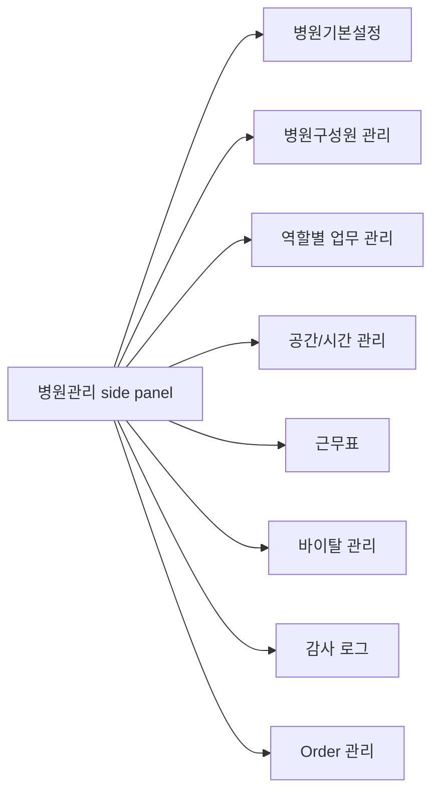

# Hospital Admin Settings Hub UX

Updated: 2026-07-11

## Design Intent

`병원관리` should feel like a quiet operations control surface. It should use the existing module side panel, compact headers, dense forms, tables, status badges, and flat panels from the CLAiR EMR design system.

Do not introduce a separate settings route, landing page, or marketing-style settings overview. The user should stay inside `/w/[workspaceId]/orders?modulePanel=open`.

## Navigation Flow

## Global UX Rules

- Keep `병원관리` as the only hospital settings entry.
- Remove the top-bar gear button from the app chrome while it has no separate personal-setting role.
- Keep account/profile settings under the profile menu.
- Open each target item from the existing hospital-admin side panel.
- Use explicit `취소` and `시안 저장` controls for static screen-only mocks; use add/edit/approval/publish controls for `근무표`.
- Mark future data/API needs in docs, not as noisy in-app explanation.
- Preserve `Order 관리` side-panel child navigation and drawer behavior.

## Screen Patterns

| Screen | Primary pattern | Secondary pattern | Notes |
| --- | --- | --- | --- |
| 병원기본설정 | Summary cards + two-column profile form | Operating-hours table + impact rail | First implementation target after screen review |
| 병원구성원 관리 | Existing table + invite/edit sheets | Role/job controls | Keep existing screen; improve language and relation to role work profiles later |
| 역할별 업무 관리 | Role-work matrix | Default assignment controls | Distinguish from raw permission editing |
| 공간/시간 관리 | Room/status table | Scheduling rule controls | Avoid full calendar editor in this phase |
| 근무표 | Staff/week grid + unassigned row | Daily coverage timeline, personal schedule, request approval | Interactive session state only; no DB/API or notification claim |
| 바이탈 관리 | Vital range table | Alert policy controls | No clinical automation claim |
| 감사 로그 | Existing audit table | Search/filter | Keep minimal read-only admin review |

## UX Flows

### 병원기본설정

1. Admin opens `병원관리`.
2. Admin selects `병원기본설정`.
3. Screen shows workspace profile highlights and editable synthetic fields.
4. Admin changes values locally.
5. Admin clicks `시안 저장`.
6. UI shows saved mock state; no DB/API mutation is claimed.

### 병원구성원 관리 개선

1. Admin selects `병원구성원 관리`.
2. Existing member management surface opens.
3. Admin can invite, edit role/job position, or deactivate members through existing mock/local flows.
4. Later pass should align labels with `역할별 업무 관리` definitions.

### 역할별 업무 관리

1. Admin selects `역할별 업무 관리`.
2. Screen shows default role work profiles and work matrix.
3. Admin reviews default assignment controls.
4. Admin saves mock state.
5. Future implementation connects these profiles to Home work generation and assignment defaults.

### 공간/시간 관리

1. Admin selects `공간/시간 관리`.
2. Screen shows scheduling rule controls and active room table.
3. Admin adjusts appointment interval or room policy locally.
4. Future implementation validates blocked hours and room conflicts before saving.

### 근무표

1. Admin selects `근무표`.
2. Admin uses `주간 편성` to create, edit, copy, turn into leave, or delete staff/day shifts; unassigned shifts remain explicit.
3. Admin switches to `일간 커버리지` to inspect time-axis coverage by role and sees availability conflicts or coverage gaps before publishing.
4. Staff switches to `내 근무`, reviews the personal weekly calendar and availability, then submits a leave or shift-change request.
5. Admin opens the staff detail sheet, approves or declines the request, and approved changes set the schedule to `재게시 필요`.
6. The publish dialog blocks publication while a conflict or coverage gap exists.

### 바이탈 관리

1. Admin selects `바이탈 관리`.
2. Screen shows default species, warning policy, and vital range table.
3. Admin saves mock state.
4. Future implementation versions clinical threshold changes and emits audit.

### 감사 로그

1. Admin selects `감사 로그`.
2. Existing audit review screen loads.
3. Admin searches or filters safe summaries.
4. No write flow exists.

## Screen-Only Implementation Checklist

- Enable target side-panel items: `병원기본설정`, `근무표`, `역할별 업무 관리`, `공간/시간 관리`, `바이탈 관리`.
- Keep out-of-scope items disabled: `진료과 분리운영`, `차트 템플릿`, `장비 관리`, `마약류 관리`, `Order 세트`, `프린터 설정`, `데이터랩`.
- Preserve existing `병원구성원 관리`, `감사 로그`, and `Order 관리` behavior.
- Add test IDs for new screens.
- Verify top-bar gear button is removed.
- Verify static target screens can perform mock `시안 저장`; verify `근무표` CRUD, request approval, conflict review, and publish state separately.

## Future Development Spec Backlog

| Scope | Required follow-up |
| --- | --- |
| Hospital profile persistence | DB table/RPC/API, RLS, admin-only mutation, asset upload rules |
| Role work profiles | Data model, relation to permission policies, Home assignment read model |
| Space/time | Room model, operating hours model, slot rules, conflict validation |
| Schedule | Persisted shifts/templates, coverage rules, availability, staff self-view policy, audit events, server authorization, and notifications |
| Vitals | Versioned thresholds, species defaults, clinical warning boundary, audit event |
| Audit | Add settings mutation events and safe summary mapping |
