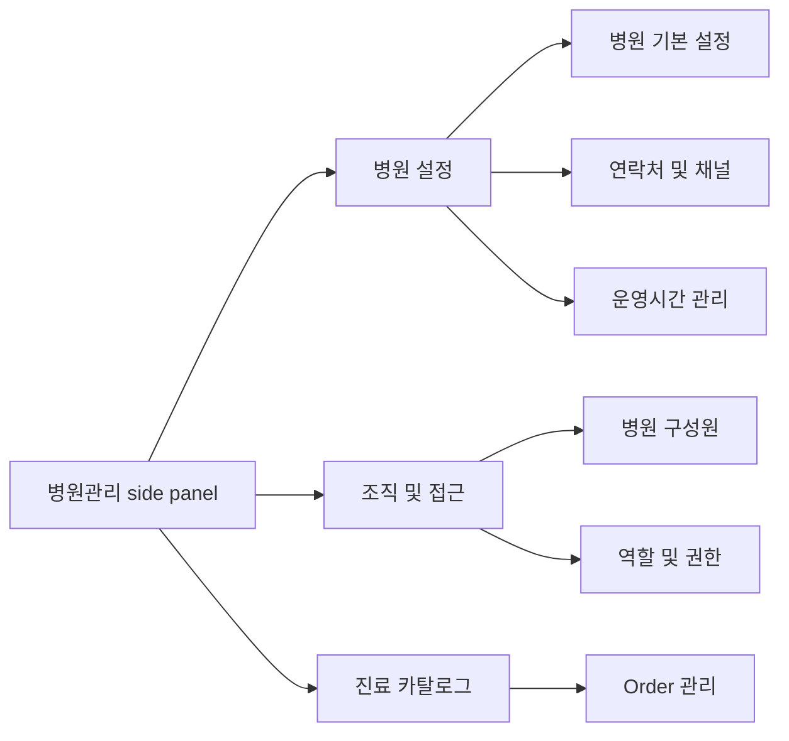

# Hospital Admin Settings Hub UX

Updated: 2026-07-23

## Design Intent

`병원관리` should feel like a quiet operations control surface. It should use the existing module side panel, compact headers, dense forms, tables, status badges, and flat panels from the CLAiR EMR design system.

Do not introduce a separate settings route, landing page, or marketing-style settings overview. The user should stay inside `/w/[workspaceId]/orders?modulePanel=open`.

## Navigation Flow

## Global UX Rules

- Keep `병원관리` as the only hospital settings entry.
- Remove the top-bar gear button from the app chrome while it has no separate personal-setting role.
- Keep account/profile settings under the profile menu.
- Open each target item from the existing hospital-admin side panel.
- Use the side-panel groups `병원 설정`, `조직 및 접근`, and `진료 카탈로그`; group labels are presentational and not focusable.
- Keep hospital identity, contact/channel, and operating-time tasks on independent URL-backed screens. Do not use scroll anchors between them.
- Do not render a breadcrumb/page toolbar above these screens.
- Hide save controls until the user changes an editable value. Show one fixed bottom change bar with save and revert actions while a draft is dirty.
- `공간 관리` is the narrow-command exception: category and space commands submit from their inline row or confirmation dialog and replace the view with the server snapshot.
- Use explicit `취소` and `시안 저장` controls for static screen-only mocks, add/edit/approval/publish controls for `근무표`, and role-specific save/cancel with local dirty state for `역할 및 권한`.
- Mark future data/API needs in docs, not as noisy in-app explanation.
- Preserve `Order 관리` side-panel child navigation and drawer behavior.

## Screen Patterns

| Screen | Primary pattern | Secondary pattern | Notes |
| --- | --- | --- | --- |
| 병원 기본 설정 | Read-only identity/region rows + private logo editor | Registered-information request dialog and address-copy action | Logo image is the trigger; hover/focus dims it and reveals an edit icon |
| 연락처 및 채널 | Divided setting rows with right-aligned controls | Multiline customer guidance memo + fixed dirty bar | Profile API/RPC persistence; meaningful results use toasts |
| 운영시간 관리 | One weekday ToggleGroup + terminal day rows | Time dialog + holiday/exception rows | ToggleGroup is the only open/closed control; no duplicate switches |
| 병원 구성원 | Existing table + invite/edit sheets | Role/job assignment controls | Assign people here and link to definitions in `역할 및 권한` |
| 역할 및 권한 | `920px` grouped settings hub + URL-backed independent detail screen | One-open role items, divided switch rows, and contextual save state | Keep the hub concise; each role item owns its assigned members, summary, and permission controls |
| 공간 관리 | Category settings list + two-level category detail | Inline category/space CRUD with confirmations and toasts | Categories navigate; terminal space rows use direct edit/delete actions |
| 근무표 | Staff/week grid + unassigned row | Daily coverage timeline, personal schedule, request approval | Supabase mode uses route/RPC persistence; mock mode remains explicit session-only fallback |
| 바이탈 관리 | Workspace preset order, units, and availability | Required preset protection and optional preset removal | No clinical range or alert automation claim |
| 감사 로그 | Existing audit table | Search/filter | Keep minimal read-only admin review |

## UX Flows

### 병원 기본 설정

1. Admin opens `병원관리`.
2. Admin selects `병원 기본 설정`.
3. Screen shows the private hospital logo, registered hospital identity, timezone, and region in Linear-style divided rows.
4. Hovering or focusing the logo dims the image and reveals an edit icon. Activating it opens a dialog; closing returns focus to the logo.
5. The dialog validates JPG/PNG type and size, stages a draft preview, then saves through the signed private upload/finalize boundary.
6. Registered identity changes use the dedicated request dialog; address copy and every outcome-bearing action show a toast.

### 연락처 및 채널

1. Admin selects `연락처 및 채널`; the URL-backed screen replaces the previous content instead of scrolling.
2. Representative phone, fax, homepage, and Instagram use right-aligned controls.
3. `고객 안내 메모` uses a multiline textarea sized for several lines of instructions.
4. A fixed dirty bar saves through the workspace profile API or confirms revert. Inline validation and first-invalid-field focus remain visible in addition to error toasts.

### 운영시간 관리

1. Admin selects `운영시간 관리`; weekly hours and holiday/exception rules stay on this one screen.
2. The weekday ToggleGroup selects operating days. Closed days retain their values but show a disabled `휴무` row.
3. Selecting an open-day time row opens a dialog with start/end consultation and break-time fields only; it has no second operating switch.
4. `공휴일 기본 정책` and exception rows keep descriptive text on the left and the action control on the right.
5. Saving uses the existing atomic operating-hours API/RPC and conflict validation; add/edit/delete/save/revert results use toasts.

#### Operating-hours details

- The weekday ToggleGroup is the only open/closed control. Closed days retain but disable their time values.
- Time selects use 30-minute increments inside the selected-day dialog.
- Holiday policy and exception actions use the same left-copy/right-action row grammar as the weekly schedule.
- Exception schedules use a dialog for date, closed/custom mode, and custom hours; duplicate dates are rejected. The list is date-sorted and exposes calendar, edit, and destructive delete affordances.
- If the user moves to another hospital-admin item with unsaved changes, the navigation guard offers continuing edits or discarding the draft. Browser refresh/close uses the native warning.

### 병원구성원 관리 개선

1. Admin selects `병원구성원 관리`.
2. Existing member management surface opens.
3. Admin can invite, edit role/job position, or deactivate members through existing mock/local flows.
4. Role/job catalog creation is not embedded in the invitation form; the flow links to `역할 및 권한`.

### 역할 및 권한

1. Admin selects `역할 및 권한`.
2. One divided settings surface lists `권한 역할`, `직무`, and `업무 기본값` with summaries and chevrons.
3. Selecting a row opens its independent URL-backed detail screen. The detail back action deterministically removes `roleSettings`, while browser back preserves any unsaved draft and returns to the hub.
4. `권한 역할` detail uses at-most-one-open `소유자` / `관리자` / `일반` role items; `관리자` is the initial selection, opening another item closes the previous item, and selecting the open item collapses it.
5. Each role header shows every assigned member name together with member and allowed-permission counts. The open item's role summary, member action, and permissions continue inside the same divided surface.
6. Permission categories remain visible as titled sections with divided switch rows; they do not use nested disclosure.
7. System-role switches are disabled but keep explicit `허용` / `차단` status. Custom roles can edit only the safe allow-list and use a contextual cancel/save bar; owner-only powers stay locked.
8. Collapsing or switching away from a dirty custom role requires discard confirmation. Browser-back drafts stay in memory and the hub row exposes `저장하지 않은 변경`.
9. `직무` manages job labels without changing screen/action permissions. System or read-only rows are static; only editable custom rows use button and chevron affordances.
10. `업무 기본값` saves only browser-local defaults and states that it does not change authorization. Dirty navigation uses discard confirmation, and a browser-back draft remains visible through the hub summary.

### 공간 관리

1. Admin selects `공간 관리`.
2. The overview lists only top-level categories. Each row has a distinct semantic icon, category name, space-count badge, description, and right chevron.
3. Admin uses the header `카테고리 설정` CTA to open one dialog. Category rows use edit/trash icon buttons without count badges.
4. `카테고리 추가` expands to an inline name input with `취소` and `추가`. Editing replaces that category name in the same row with an input plus `취소` and `저장`.
5. Deleting an empty category asks for confirmation. Deleting a category with spaces requires another category; the server moves every space and archives the source category atomically.
6. Selecting an overview row opens one category detail. This is the final navigation depth: space rows do not navigate and expose direct `수정` and `삭제` actions.
7. `공간 추가` expands to an inline input. Space edit expands that row to a name input, category select, and `취소`/`저장`, allowing rename and category move together.
8. Every successful or rejected add, update, move, and delete shows a toast. Cancel closes the inline draft without a toast.
9. Loading preserves the card structure; read error offers retry; category and space empty states keep their relevant add action; read-only users see data without mutation controls.
10. No operating-hour, appointment interval, blocked-time, capacity, allocation, or status setting appears in this screen.

### 근무표

1. Admin selects `근무표`.
2. Admin uses `주간 편성` to create, edit, copy, turn into leave, or delete staff/day shifts; unassigned shifts remain explicit.
3. Admin switches to `일간 커버리지` to inspect time-axis coverage by role and sees availability conflicts or coverage gaps before publishing.
4. Staff switches to `내 근무`, reviews the personal weekly calendar and availability, then submits a leave or shift-change request.
5. Admin opens the staff detail sheet, approves or declines the request, and approved changes set the schedule to `재게시 필요`.
6. The publish dialog blocks publication while a conflict or coverage gap exists.

### 바이탈 관리

1. Admin selects `바이탈 관리`.
2. Screen shows the workspace vital preset list, display units, order, and availability.
3. `체중` and `체온` show `필수`; they can be reordered and change allowed units but cannot be disabled or removed. Measurement entry remains optional.
4. Optional presets can be disabled in place or removed through `목록에서 제거`. Removal is draft-only, offers toast undo, and is confirmed only by the page-level save action.
5. Removed presets return to `바이탈 추가`; historical measurements are never deleted and reappear when the preset is added again.
6. The drag activator uses a conventional six-dot grip, transparent hover, grab/grabbing cursor, visible keyboard focus, and pointer/touch/keyboard ordering.
7. Admin reviews the workspace-wide impact in the existing save dialog and saves the draft.
8. Reception, chart, and patient summaries consume the saved settings without rewriting historical measurements.

### 감사 로그

1. Admin selects `감사 로그`.
2. Existing audit review screen loads.
3. Admin searches or filters safe summaries.
4. No write flow exists.

## Screen-Only Implementation Checklist

- Enable target side-panel items: `병원 기본 설정`, `연락처 및 채널`, `운영시간 관리`, `근무표`, `역할 및 권한`, `공간 관리`, `바이탈 관리`.
- Keep out-of-scope items disabled: `진료과 분리운영`, `차트 템플릿`, `장비 관리`, `마약류 관리`, `Order 세트`, `프린터 설정`, `데이터랩`.
- Preserve existing `병원구성원 관리`, `감사 로그`, and `Order 관리` behavior.
- Add test IDs for new screens and stable role/tab/detail contracts.
- Verify top-bar gear button is removed.
- Verify the three settings items change the URL-backed screen, never scroll within one long page, and render no breadcrumb toolbar.
- Verify the logo hover/focus editor, file validation, dialog focus return, signed upload/finalize flow, and outcome toasts.
- Verify contact/profile save-readback, multiline memo, read-only identity, copy feedback, weekday single-source control, exception CRUD, validation focus, and compact single-column layout.
- Verify `공간 관리` command CRUD/toasts and `근무표` CRUD, request approval, conflict review, and publish state separately.
- Verify every new target screen opens from the side panel. `역할 및 권한` must not use `시안 저장`.

## Future Development Spec Backlog

| Scope | Required follow-up |
| --- | --- |
| Hospital profile follow-up | Remote migration/Storage application and authenticated production readback after release approval |
| Role work profiles | Data model, relation to permission policies, Home assignment read model |
| Space/time | Room model, operating hours model, slot rules, conflict validation |
| Schedule | Persisted shifts/templates, coverage rules, availability, staff self-view policy, audit events, server authorization, and notifications |
| Vitals | Curated preset metadata, required flag, workspace inclusion/order/unit/enabled state, audit event |
| Audit | Add settings mutation events and safe summary mapping |
