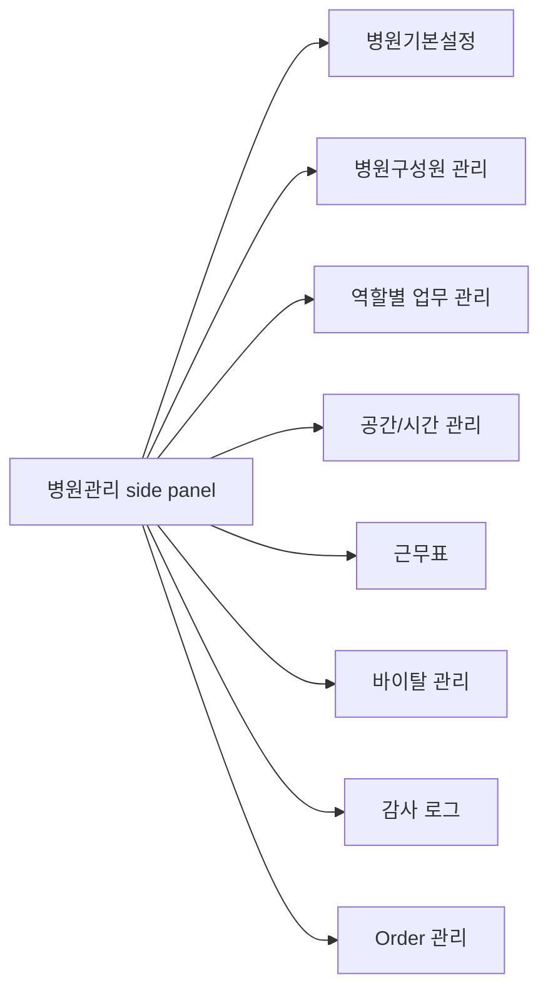

# Hospital Admin Settings Hub UX

Updated: 2026-07-11

## Design Intent

`병원관리` should feel like a quiet operations control surface. It should use the existing module side panel, compact headers, dense forms, tables, status badges, and flat panels from the CLAiR EMR design system.

Do not introduce a separate settings route, landing page, or marketing-style settings overview. The user should stay inside `/w/[workspaceId]/orders?modulePanel=open`.

## Navigation Flow

## Global UX Rules

- Keep `병원관리` as the only hospital settings entry.
- Remove the top-bar gear button from the app chrome while it has no separate personal-setting role.
- Keep account/profile settings under the profile menu.
- Open each target item from the existing hospital-admin side panel.
- Hide save controls until the user changes an editable value. Show one fixed bottom change bar with save and revert actions while a draft is dirty.
- Mark future data/API needs in docs, not as noisy in-app explanation.
- Preserve `Order 관리` side-panel child navigation and drawer behavior.

## Screen Patterns

| Screen | Primary pattern | Secondary pattern | Notes |
| --- | --- | --- | --- |
| 병원기본설정 | Read-only identity + editable contact cards | Day-by-day operating-hours editor + exception dialogs | Dedicated session-local implementation; no development metadata in the visible UI |
| 병원구성원 관리 | Existing table + invite/edit sheets | Role/job controls | Keep existing screen; improve language and relation to role work profiles later |
| 역할별 업무 관리 | Role-work matrix | Default assignment controls | Distinguish from raw permission editing |
| 공간/시간 관리 | Room/status table | Scheduling rule controls | Avoid full calendar editor in this phase |
| 근무표 | Staff/week grid | Coverage rule controls | Screen-only until schedule data model is scoped |
| 바이탈 관리 | Vital range table | Alert policy controls | No clinical automation claim |
| 감사 로그 | Existing audit table | Search/filter | Keep minimal read-only admin review |

## UX Flows

### 병원기본설정

1. Admin opens `병원관리`.
2. Admin selects `병원기본설정`.
3. Screen shows registered hospital identity as read-only fields, with a single `병원 정보 변경 요청` action and address-copy feedback.
4. Admin changes contact, weekday, holiday, or exception settings locally.
5. A fixed bottom change bar appears. Admin can save or confirm a full revert.
6. The session snapshot is updated and a toast distinguishes operating-hour changes from contact-only changes. No DB/API mutation is claimed.

#### Operating-hours details

- Every weekday has an independent `운영일`/`휴무일` switch. Closed days retain but disable their time values.
- Time selects use 30-minute increments. After changing a time, the user chooses either the current day only or all open days.
- Holiday policy stays in the section header beside `예외 일정 추가`.
- Exception schedules use a dialog for date, closed/custom mode, and custom hours; duplicate dates are rejected. The list is date-sorted and exposes calendar, edit, and destructive delete affordances.
- If the user moves to another hospital-admin item with unsaved changes, the navigation guard offers continuing edits or discarding the draft. Browser refresh/close uses the native warning.

### 병원구성원 관리 개선

1. Admin selects `병원구성원 관리`.
2. Existing member management surface opens.
3. Admin can invite, edit role/job position, or deactivate members through existing mock/local flows.
4. Later pass should align labels with `역할별 업무 관리` definitions.

### 역할별 업무 관리

1. Admin selects `역할별 업무 관리`.
2. Screen shows default role work profiles and work matrix.
3. Admin reviews default assignment controls.
4. Admin saves mock state.
5. Future implementation connects these profiles to Home work generation and assignment defaults.

### 공간/시간 관리

1. Admin selects `공간/시간 관리`.
2. Screen shows scheduling rule controls and active room table.
3. Admin adjusts appointment interval or room policy locally.
4. Future implementation validates blocked hours and room conflicts before saving.

### 근무표

1. Admin selects `근무표`.
2. Screen shows coverage highlights and weekly staff grid.
3. Admin reviews lock/vacancy alert controls.
4. Future implementation writes schedule templates and coverage rules.

### 바이탈 관리

1. Admin selects `바이탈 관리`.
2. Screen shows default species, warning policy, and vital range table.
3. Admin saves mock state.
4. Future implementation versions clinical threshold changes and emits audit.

### 감사 로그

1. Admin selects `감사 로그`.
2. Existing audit review screen loads.
3. Admin searches or filters safe summaries.
4. No write flow exists.

## Screen-Only Implementation Checklist

- Enable target side-panel items: `병원기본설정`, `근무표`, `역할별 업무 관리`, `공간/시간 관리`, `바이탈 관리`.
- Keep out-of-scope items disabled: `진료과 분리운영`, `차트 템플릿`, `장비 관리`, `마약류 관리`, `Order 세트`, `프린터 설정`, `데이터랩`.
- Preserve existing `병원구성원 관리`, `감사 로그`, and `Order 관리` behavior.
- Add test IDs for new screens.
- Verify top-bar gear button is removed.
- Verify the dedicated basic-settings screen keeps save hidden initially, surfaces the change bar after an edit, and preserves its session snapshot across hospital-admin navigation.
- Verify read-only identity, copy feedback, schedule propagation, exception CRUD, validation focus, and compact single-column layout.

## Future Development Spec Backlog

| Scope | Required follow-up |
| --- | --- |
| Hospital profile persistence | DB table/RPC/API, RLS, admin-only mutation, asset upload rules |
| Role work profiles | Data model, relation to permission policies, Home assignment read model |
| Space/time | Room model, operating hours model, slot rules, conflict validation |
| Schedule | Shift templates, weekly schedules, coverage alerts, staff self-view policy |
| Vitals | Versioned thresholds, species defaults, clinical warning boundary, audit event |
| Audit | Add settings mutation events and safe summary mapping |
