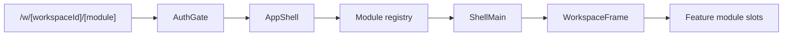
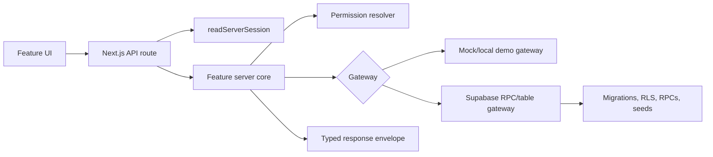

# System Architecture Overview

This document is the first engineering architecture map for CLAiR EMR. It does not replace the more specific contracts linked below. Use it to orient new agents and reviewers before reading deeper product, data, API, auth, security, or testing docs.

Korean reader companion: [CLAiR EMR System Architecture Overview KO HTML](./system-architecture-overview.ko.html).

## Current System Shape

CLAiR EMR is a Next.js App Router veterinary EMR SaaS prototype organized around one workspace-scoped outpatient workflow. The app combines a client-rendered workspace shell, feature modules, Next.js API routes, server-side feature cores, Supabase local/dev/test persistence boundaries, and explicit mock fallback for unconfigured local demo paths.

Current claims must stay within the [MVP Current Status](../current-status.md) and [Mock And Live Boundary Map](./mock-live-boundary-map.md). The system has Product MVP workflow and local-first foundations in scoped paths. It is not production/live, remote-Supabase-validated, provider-integrated, or real-data-ready by default.

## Runtime And Tooling

| Layer | Current anchor |
| --- | --- |
| Web framework | Next.js 16 App Router in `src/app/` |
| UI runtime | React 19, Tailwind/shadcn-oriented primitives, Storybook 10 |
| Workspace shell | `src/app/w/[workspaceId]/[module]/page.tsx`, `src/shell/`, `src/modules/registry.ts` |
| Feature modules | `src/features/*` |
| Server/API boundaries | `src/app/api/workspaces/[workspaceId]/**/route.ts` plus `src/features/*/server-*.ts` |
| Auth/session/permissions | `src/features/auth/*`, `src/lib/supabase/*`, server permission resolver boundaries |
| Data model and local persistence | `supabase/migrations/`, `supabase/seed.sql`, `src/features/*/*-core.ts` gateways |
| Mock and demo data | `src/mocks/`, `src/lib/emr-domain/*`, scoped feature stores |
| Verification | `tests/*.spec.ts`, `npm run docs:check`, `npm run security:secrets`, Playwright route and E2E specs |

See `package.json` for the current dependency set and scripts.

## Code Layer Map

| Layer | Purpose | Primary paths |
| --- | --- | --- |
| App routes | Define public app pages, workspace entry, docs viewer pages, auth pages, and API routes. | `src/app/` |
| Workspace shell | Owns navigation, module slots, top menu, workspace tabs, panel/drawer state, and frame composition. | `src/shell/`, `src/stores/layout-store.ts`, `src/stores/workspace-tabs-store.ts` |
| Module registry | Maps module IDs to labels, icons, side panels, content, drawers, and optional panels. | `src/modules/registry.ts` |
| Feature UI and state | Owns module-specific screens, local UI stores, mock presentation data, and route consumers. | `src/features/reception`, `src/features/chart`, `src/features/billing`, `src/features/lab-imaging`, `src/features/dispensing`, `src/features/customer`, `src/features/hospital-admin`, `src/features/home`, `src/features/inpatient` |
| Server feature cores | Own route-safe operations, typed results, permission checks, mock gateways, and Supabase gateway adapters. | `src/features/*/server-*-core.ts`, `src/features/*/server-*.ts` |
| Shared domain helpers | Own read-model selectors, demo workspace IDs, status labels, audit helpers, and service catalog helpers. | `src/lib/emr-domain/` |
| Supabase boundary | Owns client/server creation, auth mode/config handling, proxy helpers, migrations, seeds, and SQL snippets. | `src/lib/supabase/`, `supabase/` |
| Tests | Own route-boundary, server-core, permission, workflow, UI, and docs regressions. | `tests/` |

## Workspace Shell Flow

The shell is a layout and navigation architecture. It is not the security boundary. Workspace security, permission, persistence, and cross-workspace denial claims must be proven through server/API/DB/RLS boundaries, not by hidden UI or client-only role checks.

## Server Boundary Flow

The current repo uses direct route/API boundaries for selected local-first flows and still preserves older read-model selector boundaries for feature-level adapter work. Future work should state whether it uses a route boundary, repository/read selector boundary, or both.

## Current Product Module Boundaries

Use [MVP Current Status](../current-status.md) for the detailed current claim. This table is only an orientation map.

| Module or area | Current architecture posture |
| --- | --- |
| Home | Operational dashboard and work-status surface with session/mock data foundations. |
| Reception and appointment | Queue, calendar, lookup, registration, walk-in, appointment creation/check-in/update/cancel server-route foundations in local-first scoped paths. |
| Chart and orders | SOAP, diagnosis, order draft/action/lifecycle/completion, live queue, and handoff routes in scoped paths. |
| Fulfillment, lab, imaging, dispensing, treatment | Shared fulfillment work-item routes, selected lab result catalog/result-entry boundaries, and dispensing/treatment readback in scoped paths. |
| Billing | Invoice candidate, invoice line, payment status, and guardian checkout server boundaries in selected demo paths. |
| Customer management | Guardian/patient profile, relationship, and archive/restore server boundaries in scoped paths. |
| Hospital admin | Order catalog and related workspace-admin persistence foundations. |
| Auth, workspace, and permissions | Supabase/server-session foundations, workspace membership, role management, and permission resolver boundaries. |
| Audit | Audit schema, append helpers, mutation emission hooks, and review surface foundations. |
| Inpatient | Visible workspace surface, still primarily session/mock oriented. |
| Docs viewer | Internal read-only `/docs` and legacy `/prd` Markdown reader surfaces backed by curated repo docs. |

## Source-Of-Truth Architecture Docs

Read these docs instead of expanding this overview when you need a specific contract.

| Need | Source doc |
| --- | --- |
| Current MVP scope, status, and recommended work | [MVP Current Status](../current-status.md) |
| Product-level operating model | [CLAiR EMR SaaS Operating Map](../../product/service/clair-emr-saas-operating-map.md) |
| App shell slot/layout contract | [App Shell Layout Contract](./app-shell-layout-contract.md) |
| Mock, local-first, remote staging, and production claim rules | [Mock And Live Boundary Map](./mock-live-boundary-map.md) |
| API boundary adoption and route/repository distinction | [API Boundary Integration Guide](../api-boundaries/api-boundary-integration-guide.md) |
| Read-model selectors and repository boundary | [API Boundary Selectors](../api-boundaries/api-boundary-selectors.md) |
| Data model, schema, migration, RLS, and persistence index | [Data Model](../data-model/README.md) |
| Persistence and data security checklist | [Persistence And Data Security Checklist](../auth-security/persistence-data-security-checklist.md) |
| Auth and live-MVP transition roadmap | [MVP Auth Transition Roadmap](../auth-security/mvp-auth-transition-roadmap.md) |
| Auth/login work package index | [Auth Login README](../auth-security/auth-login/README.md) |
| API-backed synthetic demo verification | [API-Backed Demo Runbook](../testing/api-backed-demo-runbook.md) |
| External reference adoption boundaries | [Reference Project Adoption Plan](./reference-project-adoption-plan.md) |

## Guardrails

- Do not treat client-only permission gates, hidden actions, mock role labels, or workspace IDs in URLs as security completion.
- Do not claim remote Supabase, production deployment, provider integration, payment integration, real email, real clinic data, or compliance readiness from local-first or docs-only evidence.
- Do not replace the current Next.js, Supabase, feature-module, route/API, or design-system direction with a starter kit without a scoped architecture decision.
- Keep synthetic/demo data separate from real patient, guardian, staff, hospital, billing, identity, and clinical data.
- For new code work in Next.js application code, read the relevant `node_modules/next/dist/docs/` guide before coding.

## Architecture Work Checklist

Before starting an architecture-affecting PR or work item:

1. State the boundary: mock/session-only, local-first, remote staging, or production/live.
2. Name the affected module, route, server core, gateway, migration/RLS scope, and tests.
3. Link the specific source docs above instead of duplicating their contracts.
4. Preserve server authority for permissions, workspace isolation, billing amounts, clinical state transitions, and audit evidence.
5. Run `npm run docs:check` for docs-only edits and the active work item's focused verification for implementation edits.
