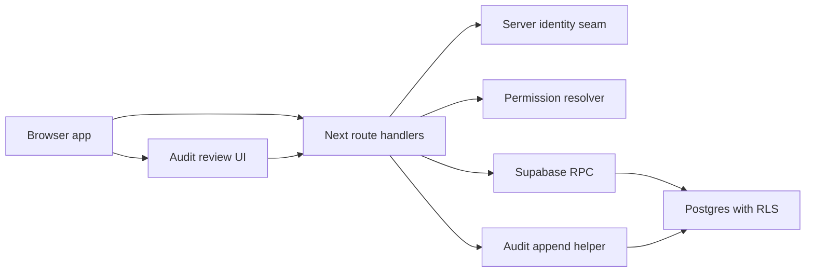

# Live Auth DB RLS Workspace Threat Model

Linear: DEN-87
Project: `05 Audit, Security & MVP Readiness`

## Executive Summary

The highest-risk themes are cross-workspace data exposure, role/permission escalation, and accidental reliance on mock/demo identity seams outside local MVP mode. Existing controls are directionally strong: server route identity resolution, active membership permission checks, RLS helper functions, admin-only RPCs, last-admin protection, rate limiting on mutations, and audit logging/review. The remaining pilot blockers are not new code bugs found in this review; they are validation gaps before any remote/live pilot: local replay/advisor evidence for the newest audit review RPC, explicit production disablement of demo actor headers, and clinical/billing domain RLS review beyond the workspace/auth foundation.

## Scope And Assumptions

In scope:

- Auth/session boundary: `src/features/auth/server-session-reader.ts`, `src/features/auth/server-role-update-identity.ts`, `src/features/auth/permission-resolver.ts`
- Workspace/auth DB and RLS migrations: `supabase/migrations/20260518023715_workspace_auth_schema_foundation.sql`, `supabase/migrations/20260518024708_workspace_membership_rls_baseline.sql`, `supabase/migrations/20260518125000_workspace_role_status_write_transactions.sql`
- Live MVP audit/read boundaries: `src/features/audit/**`, `src/app/api/workspaces/[workspaceId]/**`
- Pilot readiness docs: `docs/engineering/auth-security/auth-login/mvp-pilot-readiness-criteria.md`, `docs/engineering/auth-security/auth-login/workspace-membership-data-security-plan.md`

Out of scope:

- Penetration test, external compliance certification, production deploy, remote Supabase changes, real patient/hospital data, provider integrations, and non-runtime CI/build pipeline review.

Assumptions:

- Current work remains local-first and synthetic until 승욱 separately approves remote Supabase or production.
- Supabase session mode is the intended production identity source; demo actor headers are allowed only in mock mode.
- Workspace id is a tenant boundary and must never be trusted from client UI alone.
- `hospital_admin` is the only role allowed to administer memberships and view the audit review surface.

Open questions that can change risk ranking:

- Whether the first pilot will use local-only review, local Supabase, or a remote staging Supabase project.
- Whether any real clinic or patient data will be imported before Project 05 closes.
- Whether the demo actor header is disabled by deployment configuration outside mock mode.

## System Model

### Primary Components

- Browser app: Next.js app shell and feature modules. Evidence: `src/features/auth/auth-client.ts`, `src/features/hospital-admin/module.tsx`.
- Route handlers: workspace, membership, reception, chart, billing, audit APIs under `src/app/api/workspaces/[workspaceId]/**`.
- Server identity seam: Supabase claims reader plus mock-mode demo header resolver. Evidence: `readServerSession()` and `resolveRoleUpdateActorIdentity(...)`.
- Permission resolver: active user, workspace membership, roles, and permission ids. Evidence: `src/features/auth/permission-resolver.ts`.
- Supabase/Postgres boundary: RLS helper functions and security-definer RPCs. Evidence: `private.clair_is_active_workspace_member`, `private.clair_is_workspace_admin`, `public.clair_update_workspace_membership_roles`, `public.clair_list_audit_events`.
- Audit system: append helper, mutation emission wrapper, and admin review reader. Evidence: `src/features/audit/server-audit-log-persistence-core.ts`, `src/features/audit/server-mutation-audit-core.ts`, `src/features/audit/server-audit-event-review-core.ts`.

### Data Flows And Trust Boundaries

- Browser -> Next route handlers: HTTP JSON payloads, workspace ids, query filters, and demo headers. Auth is Supabase cookie/claims in live mode or explicit demo header in mock mode. Routes normalize inputs and return typed denial results.
- Route handlers -> permission resolver: actor id, workspace id, required permission. Resolver requires active membership and role-derived permission before protected mock-mode actions.
- Route handlers -> Supabase RPC: workspace-scoped mutation/read requests. RPCs use `auth.uid()` and RLS/admin helper functions, not client profile fields.
- Business mutation -> audit append helper: safe event summaries only. Sensitive keys, raw payloads, full SOAP/chart bodies, tokens, stack traces, and SQL errors are rejected or excluded.
- Hospital admin UI -> audit review route: search/filter parameters. Server route and DB RPC enforce admin-only access.

#### Diagram

## Assets And Security Objectives

| Asset | Security objective |
| --- | --- |
| Workspace membership and role state | Integrity: prevent role escalation and last-admin loss. |
| Workspace-scoped clinical/billing rows | Confidentiality and integrity: prevent cross-workspace exposure and unauthorized mutation. |
| Audit events | Integrity and confidentiality: preserve who changed what without storing sensitive raw payloads. |
| Supabase session and auth claims | Authentication integrity: never accept user-editable metadata as permission source. |
| Secrets and service role material | Confidentiality: never expose to browser, docs, logs, or audit payloads. |
| Synthetic demo-data boundary | Safety: avoid mixing demo workflows with real medical advice or real patient/hospital data. |

## Attacker Model

Capabilities:

- Authenticated user in one workspace trying to access another workspace by changing route params.
- Non-admin staff trying to change roles, deactivate users, view audit review, or mutate billing/chart state beyond role.
- Browser user modifying local storage, query strings, or request payloads.
- User trying to inject sensitive keys or raw data into audit payload-like metadata.

Non-capabilities for this scope:

- No assumed server shell, database superuser, service role key, or production network access.
- No real patient/hospital data in the local-first environment.
- No external provider callback, email, payment, PACS, or device integration in scope.

## Threat Enumeration And Risk Priority

| Threat | Abuse path | Existing mitigations | Residual gap | Priority |
| --- | --- | --- | --- | --- |
| Cross-workspace read or mutation | User changes `workspaceId` in a route and tries to read chart/billing/audit data from another workspace. | Server routes pass workspace id to permission resolver; RLS helpers require active membership; focused cross-workspace tests exist for reception/chart/billing slices. | Clinical/billing domain RLS still needs complete local replay/advisor review before remote pilot. | High until remote validation completes; Medium for local synthetic review. |
| Role escalation by non-admin | Non-admin calls membership role/status routes directly. | Role/status routes resolve identity server-side and require admin permission/RPC admin helper; last-admin DB trigger protects admin loss. | Demo header must remain impossible outside mock mode. | High before deployment hardening; Low in current mock-gated local mode. |
| Session spoofing through demo actor header | Attacker sends `x-clair-demo-session-user-id` to protected routes. | Resolver only accepts demo header when server session reader reports `mock_mode`; live Supabase session wins in production path. | Deployment config must prove mock mode is disabled for live/staging. | High if misconfigured; Low when mock mode is local-only. |
| Audit payload leakage | Mutation stores raw SOAP, tokens, SQL errors, or provider payloads in audit JSON. | DEN-84 sensitive-key rejection; DEN-85 event summaries avoid full SOAP/chart and raw payloads; DEN-86 UI shows safe summaries. | Need continued review as more event types are added. | Medium. |
| Audit evidence bypass | Critical mutation succeeds but audit append fails or is skipped. | DEN-85 critical mutation helpers fail the business write when configured audit append fails; audit route and UI provide review path. | Some existing older routes/events remain unconnected until later Project 05 issues. | Medium. |
| Over-broad admin audit visibility | Hospital admin sees audit data outside their workspace. | Review route requires admin; RPC checks `private.clair_is_workspace_admin(p_workspace_id)` and filters by workspace id. | New audit read RPC needs local replay/advisor evidence before remote use. | Medium. |

## Blockers, Follow-Ups, And Post-MVP

Pilot blockers before any remote/live pilot:

- Prove demo actor header cannot authorize requests outside mock mode.
- Replay and advisor-review the newest audit review RPC and all auth/workspace RLS migrations in the target local Supabase setup.
- Complete domain RLS readiness review for clinical/billing tables before remote data is used.

Follow-ups:

- Add request-id propagation consistently across all mutation routes.
- Add negative tests for unsupported audit event filters in Supabase review mode.
- Expand audit emission to remaining event types as Project 05 continues.

Post-MVP:

- External compliance export.
- Retention policy UI.
- Analytics dashboard and alerting.
- Provider-specific audit correlation for email, payment, PACS, device, or messaging systems.

## Focus Paths For Manual Review

- `src/features/auth/server-session-reader.ts`: live session source and mock-mode boundary.
- `src/features/auth/server-role-update-identity.ts`: demo header acceptance rules.
- `src/features/auth/permission-resolver.ts`: role/permission calculation and denial reasons.
- `src/app/api/workspaces/[workspaceId]/memberships/[membershipId]/roles/route.ts`: admin role mutation boundary.
- `src/app/api/workspaces/[workspaceId]/memberships/[membershipId]/status/route.ts`: admin status mutation boundary.
- `src/app/api/workspaces/[workspaceId]/audit/events/route.ts`: admin-only audit review route.
- `src/features/audit/server-audit-log-persistence-core.ts`: audit payload normalization and sensitive-key rejection.
- `src/features/audit/server-audit-event-review-core.ts`: audit review filtering and mock/Supabase read gateway.
- `supabase/migrations/20260518024708_workspace_membership_rls_baseline.sql`: workspace membership RLS helpers and policies.
- `supabase/migrations/20260520130000_live_mvp_audit_event_review_rpc.sql`: admin-only audit reader RPC.

## Evidence Anchors

- `src/features/auth/server-session-reader.ts`: server route identity starts from Supabase claims reader.
- `src/features/auth/server-role-update-identity.ts`: demo actor header is accepted only when server session status is `mock_mode`.
- `src/features/auth/permission-resolver.ts`: active membership and required permission are resolved server-side.
- `supabase/migrations/20260518024708_workspace_membership_rls_baseline.sql`: `private.clair_is_active_workspace_member` and `private.clair_is_workspace_admin` bind auth user to workspace membership.
- `supabase/migrations/20260518125000_workspace_role_status_write_transactions.sql`: membership role/status RPCs require workspace admin and rely on last-admin trigger.
- `src/features/audit/server-audit-log-persistence-core.ts`: sensitive audit payload keys are rejected before gateway write.
- `src/app/api/workspaces/[workspaceId]/audit/events/route.ts`: audit review route reads server identity and denies unauthenticated users.

## Quality Check

- Covered runtime entry points under `src/app/api/workspaces/[workspaceId]/**` relevant to auth, membership, audit, and workspace boundary.
- Covered Browser -> Route, Route -> Permission Resolver, Route -> Supabase RPC, Mutation -> Audit, and Admin UI -> Audit Review trust boundaries.
- Kept CI/build/dev tooling out of scope except noting it was not reviewed.
- Listed assumptions and open questions that can change risk ranking.
- Did not include secrets, production credentials, real patient data, or medical advice.

## Verification

- `npm run docs:check`
- `npm run security:secrets`
