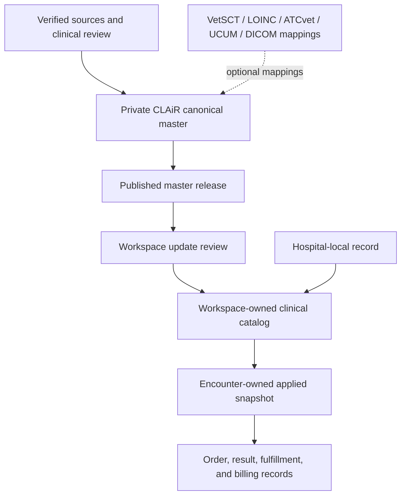

# CLAiR Clinical Master Data Target Architecture

This document defines the target architecture for CLAiR clinical master data. It is the agent-facing canonical draft for future product decisions, logical data modeling, implementation planning, migrations, APIs, RLS, and verification.

Korean reader companion: [CLAiR 임상 마스터 데이터 목표 구조](./clair-clinical-master-data-target-architecture.ko.html).

Phase-1 physical specification: [CLAiR Clinical Master Data Phase 1 DB Specification](./clair-clinical-master-data-phase-1-db-spec.md).

This is a target architecture, not a claim that the schema has been implemented. Current tables remain authoritative for current runtime behavior until a scoped migration and adoption plan is approved and verified.

## 1. Executive Summary

CLAiR will provide a governed clinical master catalog. Each hospital workspace copies eligible published records into a workspace-owned catalog, customizes allowed fields, and applies immutable snapshots during clinical workflows.

```text
CLAiR canonical clinical master
  -> workspace-owned catalog copy and local settings
  -> encounter-owned immutable snapshot
  -> operational work, result, and billing records
```

The architecture must support the full clinical-catalog scope represented by the source PDF while correcting its main structural weaknesses:

- keep clinical classification separate from UI grouping and workflow routing;
- keep CLAiR canonical records separate from hospital-owned copies;
- keep mutable catalogs separate from historical applied records;
- keep shared order fields separate from type-specific clinical detail;
- use stable CLAiR identities and optional external terminology mappings;
- govern publish, update, deprecation, emergency blocking, provenance, and review;
- expand from dog and cat without adding species-specific columns;
- avoid a single wide table and avoid hiding important clinical values entirely in JSON.

## 2. Scope

### 2.1 Included

- order classifications and action identities;
- standard order items;
- medication and vaccine definitions used by orders;
- laboratory/pathology tests, panels, result definitions, reference-range context, and device mappings;
- imaging and other-exam definitions;
- diagnoses, diagnosis classifications, synonyms, and care guides;
- species, breed, biological sex, reproductive status, units, specimen types, administration routes, frequency codes, result-input types, and imaging modalities;
- multilingual names, aliases, abbreviations, and legacy names;
- external terminology/code mappings;
- CLAiR curation, review, release, update, deprecation, provenance, and audit concepts;
- workspace copy, customization, local-only records, update review, and notification concepts;
- traceability from applied clinical snapshots back to source master versions.

### 2.2 Excluded

- guardian and patient instance records;
- staff identities, memberships, roles, and permissions as master-data subjects;
- appointments, reception, encounters, SOAP notes, orders, results, invoices, and payments as transactional records;
- inventory, stock movement, purchase, and supplier operations;
- live device, HL7, DICOM, PACS, pharmacy, payment, insurance, or provider integration;
- automatic clinical correctness, dosing recommendation, or diagnostic recommendation;
- licensed terminology bulk import before licensing and legal review;
- real hospital, patient, guardian, staff, prescription, billing, or identity data.

Transactional entities may reference or snapshot master data, but they are not part of this master-data domain.

## 3. Confirmed Owner Decisions

| Decision | Confirmed direction |
| --- | --- |
| Domain boundary | Match the PDF's clinical-catalog scope rather than all SaaS master data. |
| Ownership layers | CLAiR canonical master -> workspace-owned copy -> immutable applied snapshot. |
| Hospital-local creation | Hospitals may create local records. They are detached from CLAiR master updates. |
| Existing preset update | Auto-update an unmodified workspace copy. Preserve customized records and create an update-review state. |
| New CLAiR record | Copy as `pending_activation`, notify the hospital, and require hospital review before active use. |
| Deprecation | Never hard-delete. Notify, identify replacements, preserve history, and let the hospital transition. |
| Emergency safety action | Allow an exceptional audited safety block for new use while preserving all historical records. |
| Species scope | Dog and cat first; model other companion species without new species-specific columns. Livestock and wildlife datasets are deferred. |
| Identifier authority | Stable CLAiR internal identity is canonical. External identifiers are optional, versioned mappings. |
| Names | Korean preferred name required; English optional; aliases, abbreviations, and legacy names are multi-valued and language-aware. |
| Governance | Draft -> review -> published -> deprecation pending -> deprecated, with clinical review for clinical meaning. |
| Initial data | No Airtable dataset exists. First build a small, clearly non-authoritative structural/synthetic dataset to validate the system; add clinical assertions only from verified sources with clinical review. The PDF is structural reference only. |
| PDF code model | Keep A clinical action, X/T classification, CG presentation grouping, and NT workflow routing separate. A is the required service-visible meaning of an order, not a second order identity or an order set. |
| A split/merge rule | Orders share A only when their underlying clinical action, item type, clinical intent, and measured/performed target are the same. Different names, prices, packaging, or configurable offerings alone do not create a new A; a different analyte, procedure, target, or intent does. |
| A code format | Use an internal UUID primary key plus an immutable, automatically generated `A000001`-style action code. Never reuse a retired code or encode mutable hierarchy or meaning in it. Show the reviewed action name, not the code, as the primary service label. |
| Hospital-local A fallback | A hospital does not create canonical A records in phase 1. A local order selects an existing A or a type-specific Other/Unclassified A, may submit a new-A candidate, and is remapped only after explicit hospital confirmation when a new canonical A is published. |
| Order Set composition | Order Sets are workspace-owned. Phase 1 permits at most two set layers (parent set -> child set -> atomic orders), expands them to atomic orders, and rejects cycles or duplicate atomic results. |
| Order Set member state | A missing or workspace-unavailable member blocks new set application and marks the set for composition review. Normal CLAiR deprecation warns but does not override an active workspace copy; an emergency safety block stops new application immediately. Historical applied snapshots never change. |
| Order Set pricing | An Order Set is a clinical selection bundle that may also use hospital-owned package pricing. Keep the existing `included_order_sum`, `set_fixed_price`, and `range_price` methods; automate child-billing defaults to prevent double billing and snapshot the effective calculation. Do not add a separate package table in phase 1. |
| Applied Order Set editing | The chart receives an encounter-owned applied copy. Staff may change selected atomic orders, add an order, and adjust allowed quantities before confirmation. These changes never write back to the workspace Order Set preset. Phase 1 has no required/locked member policy. |
| Chart-to-preset promotion | Phase 1 does not let chart users save an applied or modified set as a new preset. Reusable presets are created, duplicated, and revised only in hospital admin. A later candidate-suggestion workflow may be added if repeated demand is proven. |
| Empty Order Set | Hospital admin may save metadata-only work with the existing availability flag off. Phase 1 adds no separate draft workflow. Activation and chart exposure require at least one valid expanded atomic order plus successful composition and pricing validation. |
| Phase-1 Order Set completion | Phase 1 is not complete until a valid Order Set can be selected in the chart, expanded, edited as an encounter-owned copy, confirmed, snapshotted, routed, and billed. Implement this after the individual-order core is stable within the same phase. |
| Order Set revisions | Keep a stable set identity and immutable revisions. Every valid admin edit creates a new revision for future use; applied history keeps the exact revision it used. |
| Nested-set update | A parent pins a specific child-set revision. A later child revision never changes the parent silently; it creates an update-review notice, and an administrator refreshes the parent into a new revision. |
| Order Set removal | Do not normally hard-delete sets or revisions. Invalid or empty work may be saved only as explicitly unavailable; activation requires all composition and pricing checks to pass. |
| Workspace order authority | `order_catalog_items` is the target sole workspace order authority. `service_*` tables are compatibility/migration inputs only and must not become a second authoring source. |
| Canonical physical pattern | Use a private `master` schema with `master.master_records` as the shared identity/lifecycle registry and typed one-to-one detail tables. Workspace copies remain in the application schema. |
| Customized-row merge | Track customized fields for review, but phase-1 automatic merge is conservative at row level: if a row is customized, do not partially merge it automatically; present the whole update for review. |
| Revision and release identifiers | Use an integer revision per record and a system-generated immutable release ID. Airtable authors never enter either value manually; the validated server publisher assigns them. |
| Duplicate policy | Enforce uniqueness only for technical identities, keys, and codes. Names are not unique; similar names trigger review and never automatic merge. |
| Initial A dictionary | Seed only the A values required by the phase-1 validation orders plus a type-specific Other/Unclassified A for each used type. |
| Phase-1 price authority | CLAiR does not publish an authoritative suggested price. The workspace owns price; unset and explicit zero/free are different states, and a billable order cannot be activated while price is unset. |
| Lab Panel boundary | A Lab Panel is a result-definition bundle linked to one atomic lab order. Its component tests are not separate chart or billing orders; an Order Set bundles independently orderable atomic orders. |
| Reference-range publication | The schema and validators may be built, but no user-facing canonical range is published without a verified source and clinical review. Synthetic ranges are hidden test fixtures only. |
| Validation-data priority | The first dataset proves the new master-copy, update, Order Set, snapshot, routing, and billing behavior. Veterinary content accuracy is the next priority and unreviewed values must never be presented as clinically verified. |
| Solo phase-1 governance | One CLAiR operator may author, review, and publish structural or synthetic validation data while the team is one person, with actor/time/source/reason audit. Clinical claims cannot be marked reviewed without a named veterinary reviewer. |
| Type detail | Keep shared order data in a common record and structured clinical detail in type-specific families. |
| Local-to-CLAiR proposal | A hospital-local record may be submitted as a candidate, but never auto-promoted. Approval creates a CLAiR identity and an explicit adoption path. |

## 4. Source PDF Interpretation

The source PDF covers these logical families:

| PDF family | Target interpretation |
| --- | --- |
| A, T, X codes | A is the leaf clinical action used to identify an order's meaning and type; T and X are its broader clinical/service classifications. |
| CG code | Chart presentation grouping, not clinical taxonomy. |
| NT code | Downstream workflow/task routing, not clinical taxonomy. |
| `[order] item` | Standard order definition. |
| `[order] medicine` | Medication-order detail and species defaults. |
| `[order] pathology` | Lab order profile, test mapping, device mapping, and reference-range context. |
| `[order] pathology_code` | Standard laboratory observation/test identity. |
| `[order] pathology_equipment` | Workspace-owned laboratory device and device-test mapping. |
| `[order] other exam` | Other-exam definition and result-input schema. |
| `[order] radiology` | Imaging procedure and modality definition. |
| `[assessment] *` | Diagnosis, classification, synonym, and care-guide family. |
| `[breeds] *`, `[sex] item` | Common veterinary vocabularies. |
| Archived pathology ERD | Historical reference only; not a current target schema. |

The PDF is not treated as a database migration specification. Its Airtable field types, lookup fields, semicolon-encoded ranges, duplicated labels, and unresolved comments require normalization and domain review.

## 5. Design Principles

1. **Stable identity, mutable presentation.** Names and hospital wording may change; the CLAiR identity must not be reused or silently reassigned.
2. **Canonical, workspace, and applied data are different owners.** No table should ambiguously serve all three layers.
3. **History is immutable.** A later master or workspace change must not rewrite prior chart, result, or billing records.
4. **No ordinary hard delete.** Use lifecycle status, replacement links, and historical traceability.
5. **Classification, presentation, routing, and billing are separate concerns.** Do not overload one code hierarchy.
6. **Structured clinical values stay structured.** JSON may hold provisional extension data, not authoritative units, ranges, codes, or relationships that require validation and search.
7. **Species applicability is relational.** Do not add `canine_*`, `feline_*`, and `others_*` columns for every rule.
8. **External standards are mappings, not primary keys.** Preserve source system, version, code, display, license context, mapping status, and validity.
9. **Clinical content requires clinical review.** Product or engineering approval alone is not sufficient for dosing, ranges, terminology meaning, or clinical guidance.
10. **Publish small, reviewable releases.** Initial coverage should be useful and verified, not comprehensive and untrustworthy.
11. **Workspace boundaries remain server and DB boundaries.** UI visibility is not authorization.
12. **Current behavior changes only through scoped adoption.** The target model does not authorize destructive renames, remote migration, or broad rewrites.
13. **One meaning has one write authority.** Compatibility fields may repeat a value for runtime use, but they are generated from the canonical source and are never independently edited.
14. **Normalize the master; denormalize only with intent.** Canonical relationships stay normalized. Workspace projections and applied snapshots may duplicate resolved values for safe operation and history when lineage is preserved.

## 6. System Layers



### 6.1 Canonical CLAiR Master

- CLAiR-owned and centrally governed.
- Draft and review data is private.
- Only published records are eligible for workspace distribution.
- Canonical clinical data is not directly edited by hospital users.
- Canonical records use stable internal identity and immutable version history.

### 6.2 Workspace-Owned Catalog

- Owned by exactly one workspace in the current product boundary.
- May derive from a published CLAiR record or originate as a hospital-local record.
- Stores allowed hospital overrides such as display name, billing name, price, availability, aliases, device mapping, and internal instruction.
- Owns hospital-defined Order Sets separately from canonical master orders. Phase 1 supports a parent set containing one child-set layer, followed by atomic workspace orders.
- Phase 1 does not allow per-order CG or NT exceptions. A hospital-local order selects one valid classification path instead of manually editing derived route fields. If no canonical A fits, it uses a type-specific Other/Unclassified path rather than creating a canonical or workspace-local A table.
- Tracks source version, customization state, customized fields, merge state, and review state.
- Hospital-local records have no automatic upstream or downstream master synchronization.

### 6.3 Applied Clinical Snapshot

- Owned by an encounter, order, prescription, result, or billing workflow.
- Copies the values necessary to interpret the event historically.
- Remains readable after source rename, repricing, pause, deprecation, or safety block.
- Keeps source identifiers and versions only for traceability; display must not depend on a mutable live join.

## 7. Logical Schema Boundaries

### 7.1 Recommended PostgreSQL/Supabase Boundary

| Boundary | Purpose | Access posture |
| --- | --- | --- |
| Private `master` schema | CLAiR canonical records, reviews, releases, versions, and external mappings. | Not exposed to the Data API. Server/operator access only. Defense-in-depth policies and explicit grants. |
| Workspace tables in current application schema | Hospital copies, local records, update reviews, device mappings, and settings. | Workspace-scoped RLS; active membership for reads; approved management permission for mutations. |
| Transaction tables | Encounter orders, prescriptions, results, fulfillment, invoices, and audit events. | Existing workflow-specific RLS/API/RPC boundaries. |

If a published canonical read surface is required, expose a narrow server-owned API or a reviewed read model. Do not expose draft/review tables or broad privileged functions to browser clients.

### 7.2 Identity Contract

Every canonical record must provide:

- an internal UUID primary key;
- an immutable, human-debuggable `master_key` that is never reused;
- a `record_type`;
- a lifecycle status;
- a current revision number;
- a current release reference when published;
- created, updated, published, deprecated, and replacement metadata as applicable.

Codes such as A/T/X/CG/NT may remain recognizable domain codes, but they are not database primary keys and must not encode mutable hierarchy assumptions. A uses an automatically generated, zero-padded `A000001`-style code separate from its UUID. The code is immutable, is never reused after deprecation, and is a support/export/debugging aid rather than the primary user-facing label.

## 8. Shared Master Foundation

These are target logical tables. They are not an instruction to create all tables in one migration.

| Target table | Responsibility | Key fields |
| --- | --- | --- |
| `master.master_records` | Stable identity and lifecycle registry for every canonical concept. | `id`, `master_key`, `record_type`, `lifecycle_status`, `current_revision`, `current_release_id` |
| `master.master_record_names` | Preferred names, aliases, abbreviations, and legacy names. | `master_record_id`, `language_code`, `name_kind`, `name`, `normalized_name`, `searchable` |
| `master.master_external_codes` | Optional external terminology mappings. | `master_record_id`, `code_system`, `code_system_version`, `code`, `display`, `mapping_status`, `license_reference` |
| `master.master_sources` | Provenance for manually curated or imported facts. | `source_type`, `title`, `uri`, `version`, `accessed_at`, `license_notes` |
| `master.master_record_sources` | Connects a record or assertion to its source. | `master_record_id`, `source_id`, `assertion_scope`, `notes` |
| `master.master_releases` | Groups reviewed changes into a publishable release. | `release_key`, `status`, `published_at`, `release_notes` |
| `master.master_record_versions` | Immutable published/review snapshots for diff and rollback analysis. Structured current tables remain the query source. | `master_record_id`, `revision`, `release_id`, `snapshot`, `change_summary`, `created_by`, `reviewed_by` |
| `master.master_review_events` | Draft, clinical review, approval, rejection, deprecation, and emergency decisions. | `master_record_id`, `event_type`, `actor_id`, `reason`, `created_at` |
| `master.master_replacement_links` | Supersedes, replaced-by, equivalent, broader, or narrower relationships. | `source_record_id`, `target_record_id`, `relationship_type` |

`master_record_versions.snapshot` is an immutable audit/diff artifact. It must not become the only representation of structured clinical data.

## 9. Common Veterinary Vocabularies

| Target table | Responsibility | Notes |
| --- | --- | --- |
| `master.species` | Species identities and names. | Dog and cat first; extensible to other companion species. |
| `master.breeds` | Breed identities and species relationships. | Support mixed breed through patient relationships, not a synthetic breed row. |
| `master.biological_sexes` | Biological sex values. | Separate from reproductive status. |
| `master.reproductive_statuses` | Intact, neutered, spayed, unknown, and future statuses. | Avoid the PDF's combined sex/neuter value. |
| `master.units` | Canonical machine code and display labels. | Optional UCUM mapping; preserve case-sensitive code. |
| `master.specimen_types` | Blood, serum, plasma, urine, tissue, swab, and other specimens. | Needed for lab identity and ranges. |
| `master.administration_routes` | SC, IV, IM, PO, CRI, and future routes. | External mapping optional. |
| `master.frequency_codes` | SID, BID, TID, QID, interval patterns, and display rules. | Do not treat codes as universal dosing recommendations. |
| `master.result_input_types` | Numeric, text, image, single-select, multi-select, grade, positive/negative, and narrative. | Shared by lab and other exams. |
| `master.imaging_modalities` | XR/DX, US, CT, MR, and other modalities. | Optional DICOM mapping. |
| `master.body_sites` | Body region or anatomical site identities. | Optional VetSCT/SNOMED mapping. |

Common vocabulary tables participate in the shared identity, naming, provenance, external-code, version, and lifecycle contracts.

## 10. Order Classification, Presentation, And Routing

The PDF defines `A subset T subset X`, links each `[order] item` to A, and states that the order type can be identified from its action classification. It keeps medication, pathology, other-exam, and imaging detail links separate and optional, uses CG for chart presentation, and uses NT for the next task created after order confirmation. The PDF does not define uniqueness, versioning, or allowed combinations. The target therefore retains A as a required clinical-action concept while preventing it from becoming a second order identity, an order set, or a type-detail record.

| Target table | PDF concept | Responsibility |
| --- | --- | --- |
| `master.order_categories` | X and T | Hierarchical clinical/service classification with explicit parent relationships. |
| `master.clinical_actions` | A | Required, service-visible clinical action. It owns the stable A code, reviewed names, one order item type, and one T parent. Multiple distinct master orders may share one action. |
| `master.chart_groups` | CG | Default chart search/presentation grouping. It is not the current runtime `categoryGroup`. |
| `master.task_routes` | NT | Default downstream workflow route or no-task outcome. |
| `master.classification_paths` | A/CG/NT with resolved T/X | One validated, human-readable action/presentation/route combination. T and X are resolved through the action's parent hierarchy rather than copied. |
| `master.orders` | `[order] item` | Exact standard order identity, common defaults, optional type-specific detail, and exactly one classification path in phase 1. |
| `master.order_species_links` | Canine/Feline/Others | Applicability/search-filter relationship without species-specific columns. |

The Airtable authoring surface uses `Code Dictionary` for draft X/T/A/CG/NT definitions and `Classification Paths` for allowed combinations. Airtable lookup values are for editing and review only. The publisher validates the references and writes normalized IDs to PostgreSQL; Airtable is never queried by the runtime.

### 10.1 Clinical Action (A)

The target uses the user-facing label **Clinical Action / 행위 구분** and the internal logical table `master.clinical_actions`.

- Every published master order resolves to exactly one active clinical action through its classification path.
- One clinical action may classify many distinct master orders. The action answers "what clinical action is this?" while `master.orders` answers "which exact order item is this?"
- An order set is a separate workspace-owned composition and never receives an A identity merely because it contains orders.
- The A code is an automatically generated, immutable `A000001`-style value separate from the UUID and is never reused. It is not normally shown in the service; reviewed Korean name, optional English name, and aliases support display, search, filtering, and analytics.
- The clinical action owns one item type. Current compatibility `categoryGroup` is derived from that item type and remains unrelated to PDF CG.
- The clinical action belongs to one T category, and T belongs to one X category. T and X are resolved through these foreign-key relationships rather than copied into independently editable fields.
- Orders share A only when the underlying clinical action, item type, clinical intent, and measured/performed target are the same. Display name, price, packaging, or offering configuration alone does not split A. A different analyte, procedure, target, or intent requires a separate A.
- A hospital-local order selects an existing canonical A. If none fits, phase 1 permits a type-specific Other/Unclassified A so work is not blocked. The hospital may submit a candidate; a later canonical A creates a notification and manual remapping choice, never an automatic classification change.
- Type-specific detail belongs to the exact master order and is optional. A lab-type action can have an order with no lab detail profile, as in the PDF's cytology and specimen-collection exception note.
- Phase 1 allows one active classification path per clinical action. Order-specific CG or NT exceptions remain deferred until a real exception appears.

### 10.2 Confirmed Phase-1 CG And NT Codes

Start CG with eight presentation groups:

| Code | Meaning |
| --- | --- |
| `CG_CONSULTATION` | Consultation |
| `CG_PREVENTION` | Prevention |
| `CG_EXAM` | Exam |
| `CG_PROCEDURE` | Procedure |
| `CG_SURGERY` | Surgery |
| `CG_INPATIENT` | Inpatient |
| `CG_THERAPY` | Therapy |
| `CG_MEDICATION_SUPPLY` | Prescription, dispensing, and medical supplies |

`All` and `Billing` are not CG values. Oral medication, ophthalmic medication, injectable medication, and similar values are subcategories or search facets rather than top-level CG values.

Start NT with seven routes. The publisher derives the current compatibility fields from NT; users never edit all three independently.

| NT code | Current/target destination | Derived task-required | Phase-1 use |
| --- | --- | --- | --- |
| `NT_LAB` | `lab` | `true` | Active |
| `NT_IMAGING` | `imaging` | `true` | Active |
| `NT_DISPENSING` | `dispensing` | `true` | Active |
| `NT_TREATMENT` | `treatment` | `true` | Active |
| `NT_INPATIENT` | `inpatient` | `true` | Defined but held until inpatient routing exists in the runtime and DB constraint. |
| `NT_BILLING_ONLY` | `billing_only` | `false` | Active only when no clinical fulfillment task is required. |
| `NT_CHART_ONLY` | `chart_only` | `false` | Active when neither downstream task nor billing candidate is created by default. |

Billing reflection remains a separate policy. It must not be inferred solely from NT.

### 10.3 Standard Order Core

`master.orders` should hold only shared fields:

- stable master record identity;
- exactly one validated classification path, which resolves the required clinical action and item type;
- default active/publish eligibility;
- default destination/task-required behavior;
- default sales unit and billing-reflection behavior when meaningful;
- optional type-specific detail profile compatible with the clinical action's item type;
- optional general care guide and internal instruction references;
- no hospital price as authoritative canonical truth;
- no encounter-specific quantity, result, status, or billing state.

Do not store both `master.orders.clinical_action_id` and `classification_paths.clinical_action_id` as independently editable authorities. The canonical order resolves A through its classification path; read models and workspace projections may denormalize the reviewed action code and label with lineage.

Phase 1 publishes no authoritative CLAiR default or suggested price. The workspace price is authoritative for workspace use, and the applied snapshot is authoritative for historical billing. The target model distinguishes `NULL`/unset from an explicit zero/free price; a billable order cannot become active until the workspace has intentionally set a price, including an explicit zero when it is free.

### 10.4 Workspace Order Set Composition

The source PDF defines individual order items but does not define an Order Set table, nested-set relationship, or set expansion behavior. CLAiR therefore treats Order Sets as a workspace-owned composition outside the canonical master catalog.

Target logical storage separates stable identity from immutable composition:

| Target table | Responsibility |
| --- | --- |
| `order_sets` | Stable workspace-owned set identity, lifecycle, and pointer to the current active revision. |
| `order_set_revisions` | Immutable set metadata and pricing revision created by each valid hospital-admin save. |
| `order_set_revision_items` | Immutable ordered members that reference either an atomic workspace order or a pinned child-set revision. |
| `order_set_revision_price_ranges` | Structured price brackets owned by a `range_price` revision. This is set-revision detail, not a separate package master. |
| `order_set_revision_update_reviews` | Durable parent review when a newer child revision is available; acceptance creates a new parent revision. |

- A set item may reference an atomic `order_catalog_items` row or one child Order Set in the same workspace.
- Phase 1 permits at most two set layers: a parent/root set may contain a child set, and that child set contains atomic orders. A third set layer is invalid.
- The application recursively expands the allowed structure into atomic orders before creating transactional orders.
- A set cannot reference itself, form a cycle, cross a workspace boundary, or resolve to the same atomic order more than once. Phase 1 rejects the composition instead of silently deduplicating it.
- A set has its own stable workspace identity, availability/lifecycle, and composition revision. It is not an A clinical action and does not receive an A code.
- Every valid hospital-admin edit creates a new immutable revision. The stable set points future chart applications to the latest active revision, while prior revisions and applied snapshots remain unchanged.
- A parent-set revision pins the exact child-set revision it reviewed. Publishing a newer child revision creates an update-review notice for affected parents but never changes them automatically. An administrator may refresh the child reference and save a new parent revision.
- A set or revision is not normally hard-deleted. Empty or otherwise invalid edits may be saved only as explicitly unavailable after a clear use-off confirmation; they cannot replace the active revision or appear in chart search.
- Application preserves the source set ID, set revision, parent-child hierarchy, and expanded atomic order snapshots so the original composition remains auditable.
- A later master or workspace-order update does not silently rewrite an already applied set snapshot. Current member rows continue to follow the workspace-copy update rules defined elsewhere in this document.
- A missing member or a member disabled in the workspace changes the set to `needs_composition_review` and blocks new application until the hospital fixes the composition.
- Normal CLAiR deprecation adds a visible warning but does not disable a set while the hospital's copied member remains active. The hospital controls the transition under the normal deprecation policy.
- An emergency safety block overrides workspace availability and immediately blocks new application of every containing set. Historical applied snapshots remain readable and unchanged in all cases.
- A set is primarily a reusable clinical-selection bundle, but the hospital may also make it a billable package. Phase 1 keeps the existing three calculation methods: `included_order_sum`, `set_fixed_price`, and `range_price`.
- `included_order_sum` derives the total only from child orders marked for billing. The parent set is a grouping/display line rather than an additional billable amount.
- `set_fixed_price` bills the hospital-defined set amount. Child billing defaults off; a child contributes only when the hospital explicitly marks it as an extra charge.
- `range_price` selects a hospital-defined bracket amount from the applicable snapshot context. Like fixed price, child billing defaults off and only explicit extras add to the amount.
- Fixed/range pricing owns a set-level tax choice. Included-order-sum pricing preserves each child's tax classification and derives `mixed` for a combination instead of allowing a contradictory set-level tax edit.
- The applied snapshot preserves calculation method, set amount or selected bracket, child prices, quantities, billing flags, tax classifications, and final calculated total. A later price or composition change never rewrites it.
- The admin UX labels the selector as **Pricing method**, distinguishes set-name invoice display, care-guide delivery, and child billing, and changes mode-dependent child defaults automatically. It must not rely on operators manually preventing double billing.
- Phase 1 does not introduce a separate billing-package master or table. Reconsider that boundary only if package-specific refund, allocation, accounting, or settlement requirements emerge.
- Selecting a set in a chart creates an encounter-owned applied copy and shows its expanded atomic orders before confirmation. The chart does not edit the workspace preset record or its composition rows.
- The applied copy starts from each member's `defaultSelected`, `defaultQuantity`, and quantity-source values. Staff may select or deselect atomic members, add a separate atomic order, and adjust quantities allowed by that order before confirmation.
- Phase 1 does not add required-member or locked-member behavior. At least one atomic order must remain selected. The snapshot stores the actual final selection and quantities rather than only the preset defaults.
- In sum mode, selection and quantity changes recalculate the total. In fixed/range mode, the set amount remains fixed to the selected rule and only explicit extra-billing orders change the total.
- Applied-copy edits never update, learn into, or otherwise mutate the Order Set preset. Changing the reusable preset requires a separate hospital-admin edit and creates a new composition revision for future applications only.
- Phase 1 exposes no **Save as new preset** action in the chart. A reusable set must be created, duplicated, or revised through hospital admin so management permission, validation, and change history remain centralized.
- If repeated clinical demand later justifies a shortcut, the chart may submit a preset candidate for admin review; it must still never publish or mutate a preset directly.
- Hospital admin may save a set before adding members, but it is stored with the existing availability flag off. Phase 1 does not introduce a separate draft status or draft-management workflow.
- A new empty set defaults to unavailable and never appears in chart search or application. It may be activated only after expansion resolves to at least one valid selectable atomic order and composition and pricing validation both pass.
- Phase 1 is complete only when an active valid set can be selected from chart search, expanded to an encounter-owned editable copy, confirmed, snapshotted, routed, and billed through the same trusted individual-order boundaries. Individual-order CRUD, snapshot, routing, and billing are implemented first as phase 1A; actual Order Set runtime follows as phase 1B within the same phase.
- The current runtime and database support only direct `child_order_id` membership. Two-level set support requires a separate, scoped migration and runtime adoption; this document does not implement it.

## 11. Medication And Vaccine Family

Medication identity must be separate from a sellable/performable order. One medication product or ingredient may be used by multiple orders.

| Target table | Responsibility |
| --- | --- |
| `master.medication_ingredients` | Ingredient identity, names, and optional ATCvet/external mappings. |
| `master.medication_products` | Product/form identity, strength display, dosage form, base amount, and packaging. |
| `master.medication_product_ingredients` | Ingredient amount and unit composition. |
| `master.medication_order_profiles` | Links a standard order to a medication product and default dispensing/rounding behavior. |
| `master.medication_species_defaults` | Reviewed species-specific default route, dose basis, frequency, duration, and instruction. |
| `master.vaccine_profiles` | Vaccine target, classification, sequence behavior, and product linkage. |
| `master.vaccine_schedule_steps` | Ordered sequence labels and timing relationships when reviewed and published. |

Safety rules:

- species defaults are optional reviewed defaults, never unreviewed recommendations;
- dose amounts, basis, route, frequency, duration, and units remain separate structured values;
- workspace clinicians may override an applied order according to clinical workflow, but the applied prescription records the actual values;
- controlled-substance governance is out of this master-data draft and requires separate security/compliance work.

## 12. Laboratory And Pathology Family

| Target table | Responsibility |
| --- | --- |
| `master.lab_tests` | Standard analyte/observation identity, result type, and canonical unit. Optional LOINC mapping. |
| `master.lab_panels` | Named panel identity such as CBC or chemistry profile. |
| `master.lab_panel_items` | Ordered test membership, optionality, and display grouping. |
| `master.lab_order_profiles` | Links a standard order to one test or panel and specimen/result requirements. |
| `master.lab_reference_ranges` | Reviewed reference intervals or qualitative expectations with explicit context and provenance. |
| `workspace_lab_devices` | Hospital-owned device identity and integration configuration. Not CLAiR canonical master. |
| `workspace_lab_device_test_mappings` | Device result code/name/unit to canonical lab test mapping. |
| `workspace_lab_reference_ranges` | Hospital/device/method-specific verified override when needed. |

A Lab Panel and an Order Set are different structures. One atomic lab order may link to one test or one panel; panel members define the result fields produced by that one order and do not become separate chart rows or billing lines. An Order Set instead bundles multiple independently orderable atomic workspace orders.

### 12.1 Reference Range Contract

A range must not be stored as a semicolon-encoded string. A structured range context should support:

- `lab_test_id`;
- species and optional breed scope;
- biological sex and reproductive status when clinically relevant;
- age lower/upper value and age unit with inclusive/exclusive bounds;
- specimen type;
- method and optional device scope;
- result unit;
- numeric low/high, qualitative value, or interpretation rule;
- provenance, reviewer, version, and validity dates.

Do not publish a reference range without a verified source and clinical review. Phase 1 may implement the range schema and validators and may use clearly labelled synthetic values in hidden test fixtures, but unreviewed ranges must never appear to users as canonical or clinically verified guidance.

## 13. Imaging And Other-Exam Families

### 13.1 Imaging

| Target table | Responsibility |
| --- | --- |
| `master.imaging_procedures` | Imaging order definition, modality, body site, contrast/default preparation, and interpretation requirement. |
| `master.imaging_protocols` | Optional reviewed default protocol definition. Defer until product use exists. |
| `workspace_imaging_devices` | Hospital-owned modality/device configuration. |
| `workspace_imaging_destinations` | Hospital PACS/device/file-drop destination settings. |

The target keeps optional DICOM modality mapping but does not claim PACS or DICOM integration.

### 13.2 Other Exams

| Target table | Responsibility |
| --- | --- |
| `master.other_exam_profiles` | Other-exam result schema and default interpretation behavior. |
| `master.exam_result_fields` | Ordered result fields with type, unit, requirement, and display label. |
| `master.exam_option_sets` | Reusable single/multi-select option groups. |
| `master.exam_options` | Ordered coded options and labels. |

This replaces loosely encoded enum text with structured result definitions while preserving a simple narrative mode.

## 14. Diagnosis And Care-Guide Family

| Target table | Responsibility |
| --- | --- |
| `master.diagnosis_categories` | Hierarchical system/origin/disease classification. |
| `master.diagnoses` | Stable diagnosis identity, preferred names, species applicability, and lifecycle. |
| `master.diagnosis_category_links` | Multi-classification relationship. |
| `master.care_guides` | Reviewed definition, cautions, general management, and treatment guidance content. |
| `master.diagnosis_care_guide_links` | Versioned diagnosis-to-guide relationship. |
| `master.diagnosis_order_suggestions` | Optional non-automatic suggestion relationship. Deferred until separately approved. |

Implementation note (2026-08-23): CLINICAL-MASTER-PR-007 reserves the first
three private diagnosis tables with system-to-disease-group hierarchy,
disease-group-only links, and deferred one-primary completeness. It creates no
rows; publisher and workspace adoption remain deferred, and no remote database
application or runtime diagnosis search is claimed.

Applied chart diagnoses continue to allow free text. Catalog selection may assist search and traceability, but must not automatically claim diagnostic correctness.

## 15. Workspace Copy And Customization Model

Current `public.order_catalog_items` is the workspace-owned order catalog foundation. The target extends its semantics rather than assuming an immediate rename.

Minimum source-tracking contract:

| Field | Meaning |
| --- | --- |
| `origin_type` | `clair_master` or `workspace_custom`. |
| `source_master_record_id` | Nullable for hospital-local records. |
| `source_master_revision` | Last source revision reflected in the copy. |
| `initial_imported_revision` | First copied source revision. |
| `last_auto_merged_revision` | Last safely auto-applied revision. |
| `customization_state` | `unmodified`, `customized`, or `detached`. |
| `customized_fields` | Explicit field set when field-level tracking exists. |
| `merge_status` | `current`, `update_available`, `conflict`, `deprecated_source`, or `detached`. |
| `availability_status` | `pending_activation`, `active`, `paused`, or `inactive`. |

Hospital-local records use `origin_type = workspace_custom`, have no source master reference, and never receive master auto-merge.

Phase-1 merge is deliberately row-conservative. `customized_fields` may be recorded to explain the diff, but any row with `customization_state = customized` is preserved as a whole and receives an update-review record instead of an automatic partial merge. Field-by-field auto-merge is deferred until its conflict behavior and UX are verified.

### 15.1 Update Review Records

Use a durable workspace update-review record rather than a notification alone:

| Target table | Responsibility |
| --- | --- |
| `workspace_master_updates` | New, changed, deprecated, replacement, and emergency changes per workspace. |
| `workspace_master_update_diffs` | Field-level before/source/workspace comparison where useful. |
| Existing `notification_events` | User-visible alert that points to the durable update review. |

Notifications are required for:

- a new pending-activation master item;
- an update available for a customized item;
- a merge conflict;
- deprecation and replacement guidance;
- an emergency safety block.

## 16. Publish, Sync, Deprecation, And Emergency Rules

### 16.1 Publish Lifecycle

```text
draft -> in_review -> published -> deprecation_pending -> deprecated
                   \-> rejected
```

- Only `published` records are distributable.
- Clinical meaning, dosing defaults, reference ranges, and care guidance require clinical review.
- Every publish belongs to a release and creates an immutable revision snapshot.
- Each record revision is a server-assigned positive integer. Each release has an immutable system-generated ID; neither value is authored manually in Airtable.
- Airtable is an authoring and review surface only. A validated server publisher verifies references, provenance, lifecycle, uniqueness, and derived fields before atomically writing the revision and release snapshot.
- During the solo phase, one CLAiR operator may perform author, review, and publish steps for structure and synthetic system-validation data if actor, time, source, and reason are audited. That does not qualify dosing, ranges, care guides, or other clinical assertions as clinically reviewed.

### 16.2 Workspace Sync Algorithm

1. Publish a reviewed master release.
2. Determine eligible workspace records by stable source identity.
3. For a new master record, create a workspace copy in `pending_activation` and notify hospital administrators.
4. For an unmodified workspace copy, auto-merge the new revision and record the merge.
5. For a customized copy, preserve the entire hospital row and create `update_available` or `conflict` review state. Field-level diffs may explain the change, but phase 1 does not partially auto-merge a customized row.
6. Ignore hospital-local detached records.
7. Preserve idempotency: retrying the same release must not duplicate workspace rows or review items.

### 16.3 Deprecation

- Never delete canonical, workspace, or applied history as normal product behavior.
- Mark the canonical record `deprecation_pending` or `deprecated`.
- Link replacement records when known.
- Notify affected workspaces.
- Keep the workspace row until the hospital pauses or replaces it.
- Prevent reactivation against a fully deprecated source unless an explicit reviewed exception exists.

### 16.4 Emergency Safety Block

An emergency block is exceptional and stronger than normal deprecation:

- requires a designated clinical authority and a recorded reason;
- immediately blocks new selection/activation for affected published and workspace-derived records;
- preserves all historical snapshots and records;
- emits high-priority workspace notifications and audit evidence;
- must have an explicit review, resolution, and replacement path;
- must not be implemented as a silent delete or unreviewed operator flag.

## 17. Applied Snapshot Contract

An applied snapshot must copy the values required to understand the historical action without rereading mutable catalog data.

Minimum shared traceability:

- canonical master record ID/key and revision, when derived;
- workspace catalog ID and origin type;
- standard, hospital-display, and billing names;
- category, any adopted action classification, presentation group, and workflow route labels/codes used at apply time;
- target species context;
- price, sales unit, tax, amount basis, and billing-reflection flag when applicable;
- care guide and internal instruction actually applied;
- type-specific medication, lab, imaging, or exam snapshot needed by the downstream workflow.

The snapshot is not a full copy of the master database. Copy only information required for clinical, operational, billing, and audit interpretation.

## 18. Current Repository Mapping

| Current artifact | Current role | Target treatment |
| --- | --- | --- |
| `public.order_catalog_items` | Workspace-owned order catalog. | Make this the sole future workspace order authority; add source/customization/update semantics through scoped migrations. |
| `public.order_sets`, `public.order_set_items` | Workspace order compositions; current membership points only to `child_order_id`. | Evolve toward stable set identities plus immutable `order_set_revisions` and `order_set_revision_items`. Add pinned child revisions and two-level expansion only through a scoped migration after individual-order identity is stable. |
| `public.lab_test_categories`, `public.lab_test_items` | Workspace result-sheet definitions. | Introduce canonical lab identities later and map/copy them into workspace result definitions. |
| `public.order_catalog_lab_test_item_links` | Workspace order-to-result-sheet mapping. | Preserve as workspace mapping; add canonical lineage when available. |
| `public.diagnosis_catalog` | Mixed nullable-workspace diagnosis lookup. | Split target semantics into canonical diagnosis and workspace-local/alias layers before broad adoption. |
| `public.service_categories`, `public.service_items`, `public.service_item_prices` | Earlier service/billing catalog foundation. | Treat as compatibility/migration inputs only. Do not add new dual authoring; map and backfill toward `order_catalog_items`, then retire separately after replay and approval. |
| `public.orders`, result, fulfillment, and invoice tables | Applied/transactional data. | Keep outside master schema; preserve snapshot/source traceability. |
| Patient species/breed text and compatibility fields | Current patient profile representation. | Add vocabulary mapping only through separate patient-domain migration; do not block current workflows. |
| `public.vital_presets` | Curated workspace vital settings foundation. | Out of this PDF-aligned clinical master scope; use as a pattern, not a table to merge here. |
| `src/features/hospital-admin/server-order-catalog-core.ts` | Current preset adapter, initialization, merge, and catalog core. | Reuse behaviors and add a canonical master gateway later. |

### 18.1 Field Authority, Derivation, Override, And Snapshot Matrix

This matrix prevents the current runtime fields, PDF codes, future master fields, and hospital overrides from becoming competing sources of truth.

| Meaning | Current CLAiR field | Canonical master source | Automatic workspace projection | Hospital-editable value | Applied snapshot | Status / integrity rule |
| --- | --- | --- | --- | --- | --- | --- |
| Standard order identity | `standardOrderId` | Stable `master.orders` key and record ID | Copy to source-lineage fields and the compatibility `standardOrderId` | No for a master-derived copy. A hospital-local item receives its own stable local identity. | Master key/ID, revision, and workspace catalog ID | Confirmed. Never reuse an identity for a different meaning. |
| Workspace row identity | `id`, `workspaceId` | None | Generate once when the item is copied or locally created | No | Workspace catalog ID | Confirmed. Exactly one row per `(workspace_id, source_master_record_id)` for master-derived items. |
| Order Set identity and composition | `order_sets`, `order_set_items` | None in phase 1; sets are hospital-owned | No canonical projection. Resolve same-workspace set/order references and calculate a composition revision | Yes, within the two-level rule | Set ID/revision, parent-child hierarchy, and expanded atomic order lines | Confirmed target. Reject cycles, a third set layer, cross-workspace references, and duplicate atomic results. Missing/workspace-unavailable members require composition review; emergency-blocked members stop new use. Current persistence remains one-depth until a scoped migration. |
| Order Set price and billing | `amountBasis`, `setPriceKrw`, `billingReflectionEnabled`, child billing/quantity/price fields | None; CLAiR master does not own hospital package price | Initialize mode-dependent billing defaults and derive the visible total/tax summary | Yes; hospital owns method, amount/brackets, child billing, and tax where applicable | Method, set/bracket amount, child price/quantity/billing/tax, and final total | Confirmed. Sum mode bills selected children only. Fixed/range mode bills the set and explicit child extras only. Mixed child tax is derived. No separate package table in phase 1. |
| Applied Order Set selection | `defaultSelected`, `defaultQuantity`, `quantitySource`; chart-applied rows | Workspace preset provides defaults only | Expand into an encounter-owned working copy | Staff may change selection, add atomic orders, and adjust allowed quantities for that encounter only | Actual selected orders, quantities, source set/revision, and override results | Confirmed. At least one atomic order is required. No phase-1 required/locked member. Applied changes never write back to or create a preset; preset creation, duplication, and revision occur only in hospital admin. |
| Order item type | `categoryGroup` using `ServiceItemType` | `master.clinical_actions.item_type` | Derive the legacy `categoryGroup`; do not interpret it as PDF CG | No direct field edit. A local item selects a valid clinical action/path. | Item type code and label used | Confirmed compatibility projection. The optional detail profile, when present, must match this type. |
| X classification | No dedicated field; `categoryLabel` is currently ambiguous | X parent resolved through the selected action's T parent | Resolve code and label through A -> T -> X; generate a compatibility label only where the current UI requires it | No per-order exception in phase 1. A local item selects one valid path. | X code and label | Confirmed responsibility. Code and label are never edited independently. |
| T classification | `tCode`, `tCodeLabel` | T parent on the selected clinical action | Derive both current fields through the canonical A -> T relationship | No per-order exception in phase 1. A local item selects one valid path. | T code and label | Confirmed projection. The code dictionary is the only write authority for the label. |
| A clinical action | No current dedicated field | Required `master.clinical_actions` reference on the selected `classification_path` | Add a dedicated action reference/read-model code and label through a scoped adoption; never reuse `categoryGroup` or `tCode` | No direct edit for a master-derived copy. A local item selects a valid canonical or type-specific Other/Unclassified path. | A code and reviewed label used | Confirmed. Hospitals do not create canonical A records. A new published A may trigger a manual remapping suggestion but never an automatic change. |
| CG presentation group | No dedicated field | CG reference on the selected `classification_path` | Future chart-search projection uses the CG code. Never map it onto current `categoryGroup`. | No per-order exception in phase 1 | CG code and label used | Eight initial CG values are confirmed. `All` and `Billing` remain UI views, not CG values. |
| NT workflow route | `defaultDestinationModule` plus `defaultTaskRequired` | NT reference on the selected `classification_path` | Derive destination and task-required from the fixed NT mapping in section 10.2 | No direct edit and no per-order exception in phase 1 | NT code/label and actual destination/task decision | Seven NT values are confirmed. `NT_INPATIENT` remains held until the runtime and DB constraint support it. |
| Billing reflection | `billingReflectionEnabled` | Optional master default, separate from NT | Copy as a default | Yes, as workspace billing policy | Actual billing-reflection flag | Confirmed separate authority. Never infer it only from NT. |
| Standard, display, and billing names | `standardOrderName`, `inHospitalOrderName`, `billingName` | Canonical Korean preferred name, optional English name, and reviewed defaults | Copy standard name; initialize display and billing names from reviewed defaults | Display and billing names yes; canonical standard name no | All three effective names | Confirmed. A hospital rename never changes the CLAiR name. |
| Search aliases | `aliases` | Canonical aliases, abbreviations, and legacy names | Merge canonical aliases with a separately tracked workspace alias set for search | Workspace alias set only | Normally none; aliases are discovery aids | Proposed physical split. Do not overwrite local aliases during a master update. |
| Availability and lifecycle | `availabilityStatus`; preset status | Canonical authoring/usage lifecycle and emergency status | New items start `pending_activation`; source deprecation creates a review state | Workspace availability yes | Normally none; preserve source/version traceability instead | Confirmed. Canonical lifecycle and workspace availability are separate fields. |
| Price, tax, sales unit, and pricing rule | `priceKrw`, `taxIncluded`, `salesUnit`, `pricingRule`, `roundingRule` | No authoritative CLAiR phase-1 price | No price projection; workspace must intentionally set price, including explicit zero/free | Yes; workspace value is authoritative | Effective price, tax, unit, amount basis, and rounding used | Confirmed. Unset differs from zero, a billable unset row cannot activate, and historical billing reads the snapshot. |
| Species applicability | `targetSpecies` | Relational canonical species applicability | Resolve to the compatibility array for current runtime use | Workspace filtering may be stored separately; it must not silently change canonical clinical applicability | Patient species context and applied restriction when relevant | Confirmed relational target; current array is a compatibility projection. |
| Care guide and hospital instruction | `careGuide`, `internalInstruction`, delivery flags | Versioned canonical care guide; no canonical ownership of hospital-only instruction | Copy guide reference/default delivery state | Hospital may enable/disable delivery and add a separate internal instruction; it does not edit the canonical guide | Guide version/text and instruction actually applied | Confirmed source/override split. |
| Type-specific clinical detail | `medicationMetadata`, `vaccineMetadata`, lab links, and related rows | Structured medication, vaccine, lab, imaging, or exam profile tables | Project only fields required by the current module; keep source IDs | Hospital device/result mappings and local prescription presets may be managed separately | Actual prescription, result definition, device/method, or procedure values used | Confirmed family separation. JSON is not the final authority for validated clinical relationships. |
| Source version and merge state | `sourcePresetVersion`, imported/merged versions, customization and merge fields | Immutable master revision and release | Publisher writes lineage; sync computes merge state and changed fields | No direct edit | Master revision and workspace catalog ID | Confirmed. Release retry must be idempotent and published revisions immutable. |
| External terminology | No common current field | Versioned mapping records to VetSCT, LOINC, ATCvet, UCUM, or DICOM | Copy only when a runtime feature needs it | No direct edit; local mapping is a separate reviewed record | Only the mapping required to interpret the applied event | Deferred for phase 1. External codes never replace CLAiR identity. |

#### Deterministic Compatibility Projection

The publisher or workspace-copy service, not a human editor, owns these assignments:

| Canonical source | Current compatibility field | Rule |
| --- | --- | --- |
| Stable master order key | `standardOrderId` | One-to-one stable copy; never generated from a display name. |
| `master.clinical_actions.item_type` | `categoryGroup` | Deterministic type map. This is not PDF CG. |
| Classification-path display policy | `categoryLabel` | Generated display compatibility value; not an independent classification authority. |
| Classification path -> T | `tCode`, `tCodeLabel` | Copy the code and current reviewed label together. |
| Classification path -> NT | `defaultDestinationModule`, `defaultTaskRequired` | Use the fixed NT map in section 10.2. Reject contradictory values. |
| Classification path -> CG | Future chart-group projection | Add a dedicated field/read model when the chart UI adopts CG. Do not reuse `categoryGroup`. |
| Classification path -> A | Dedicated future action reference/read-model label | Expose the reviewed action name in administration, search, filters, and analytics. Keep the stable code internal by default and do not reuse current fields. |

#### Normalization And Integrity Gates

1. Canonical X/T/A/CG/NT definitions have a unique `(code_type, code)` pair. Codes are never reused for a different meaning.
2. Each clinical action has exactly one item type and one T parent; T has one X parent. T and X labels are not copied into the action as editable authorities.
3. A classification path stores foreign keys to A, CG, and NT. Its resolved X/T/A/CG/NT combination is unique, and phase 1 permits only one active path per A.
4. Each published phase-1 order references exactly one valid classification path. Many orders may share the same A/path; an order set does not receive an A identity.
5. A published path cannot reference missing, inactive, deprecated, or held codes. `NT_INPATIENT` cannot be used by an active path until runtime support is verified.
6. Item type, optional type-specific detail profile, NT, and billing policy must pass a compatibility validator before publish. A compatible detail profile may be absent; no empty profile row is created merely because of the action type.
7. `categoryGroup`, `categoryLabel`, `tCode`, `tCodeLabel`, the dedicated action read model, `defaultDestinationModule`, and `defaultTaskRequired` are projections. A publish or copy is rejected if supplied values disagree with their sources.
8. A master-derived workspace row is unique by workspace and source master identity. Reapplying a release updates or reviews that row instead of inserting a duplicate.
9. Source values and workspace overrides are stored separately enough to compute a diff. A master update never silently overwrites a customized field.
10. Published revisions and applied snapshots are immutable. A snapshot stores the effective values needed to interpret the event without joining mutable current catalog rows.
11. Airtable may expose friendly lookups and formulas for authoring, but only the validated publisher writes canonical IDs, versions, derived compatibility fields, and releases.
12. Type-specific Other/Unclassified A values are valid fallback classifications, remain visible for review, and cannot be silently changed when a more specific canonical A is later published.
13. An Order Set graph stays inside one workspace, contains at most two set layers, is acyclic, and expands only to selectable atomic workspace orders. Any duplicate atomic result is rejected rather than silently removed.
14. A missing or workspace-unavailable member blocks new set application until composition review. Normal source deprecation warns without overriding an active workspace copy; an emergency safety block immediately blocks every containing set. Historical snapshots remain unchanged.
15. Order Set billing has exactly one calculation authority per application. Sum mode cannot also charge a set price; fixed/range mode cannot charge children unless they are explicit extras. Tax and the final total are derived from the selected method and snapshotted inputs.
16. Chart-side Order Set edits operate only on an encounter-owned applied copy. Confirmation requires at least one valid atomic order, snapshots the effective selection/quantity/pricing, and cannot update the workspace preset or its composition revision.
17. The chart cannot create, duplicate, publish, or revise an Order Set preset in phase 1. All reusable-preset mutations pass through the hospital-admin permission and audit boundary.
18. An empty Order Set may be saved only with its existing availability flag off. Activation requires at least one valid expanded atomic order plus successful composition and pricing validation; unavailable sets cannot appear in chart search or be applied.
19. A valid Order Set edit creates a new immutable revision. A stable set identity points future use to the current active revision; previous revisions and encounter snapshots are never rewritten.
20. A parent revision references a specific child-set revision. A child update creates parent review work and never propagates automatically; accepting it creates a new parent revision.
21. `order_catalog_items` is the only future workspace order write authority. Compatibility `service_*` values are mapped projections or migration inputs and cannot be independently authored as a second catalog.
22. Technical IDs, stable keys, and domain codes are unique. Display, billing, Korean, English, alias, and legacy names are not unique; similarity produces a warning/review candidate and never an automatic identity merge.
23. Workspace price distinguishes unset from explicit zero. A billable row with unset price cannot activate; zero is valid only when intentionally stored as free.
24. A Lab Panel expands only into result definitions within one atomic lab order. It cannot create independent chart orders or billing lines; independently actionable orders belong in an Order Set.
25. A customized workspace row is preserved whole during phase-1 sync. A field-level diff may be displayed, but no field is partially auto-merged until the hospital accepts a reviewed update.

No current table should be renamed, dropped, or re-owned solely because this target document exists.

## 19. Adoption Sequence

### Phase 0 - Architecture And Data Governance

- approve this target architecture;
- define curator, clinical reviewer, publisher, and emergency-authority responsibilities;
- curate only the Clinical Action/A values required by the validation dataset, plus type-specific Other/Unclassified fallbacks, using the confirmed split/merge rule;
- define source/provenance and duplicate-review rules;
- approve and maintain the PDF/current/target field-authority matrix;
- define a small synthetic/curated validation dataset.

### Phase 1 - Shared Foundation, Order Core, And Lab Slice

Phase 1 is sequenced, but not split into separate completion claims:

**Phase 1A - Individual-order foundation**

- canonical identity, names, versions, sources, external mappings, releases, and reviews;
- species, units, specimen types, result types;
- order classification/presentation/routing separation and the confirmed A contract;
- canonical standard orders;
- workspace copy/update-review/notification contract;
- individual-order CRUD, chart search, immutable confirmation snapshot, routing, and billing.

**Phase 1B - Lab and actual Order Set runtime**

- lab tests/panels/order profiles without live device integration;
- workspace-owned Order Sets with immutable revisions, pinned child revisions, at most two set layers, and deterministic atomic expansion;
- chart selection, encounter-copy editing, confirmation, snapshot, routing, and billing for Order Sets;
- applied snapshot and two-workspace/two-release verification.

Phase 1 is not complete while the chart can merely search or display sets but cannot confirm and process them through downstream order behavior.

### Phase 2 - Medication And Vaccine

- ingredients, products, compositions, order profiles, and reviewed species defaults;
- vaccine profiles and schedule steps;
- applied prescription/dispensing snapshot mapping;
- separate controlled-substance security work when needed.

### Phase 3 - Imaging And Other Exams

- modality, body site, procedure, and structured result definitions;
- workspace destinations and device settings;
- file/manual workflow first; integration later.

### Phase 4 - Diagnosis, Care Guides, And Vocabulary Expansion

- canonical diagnosis categories, diagnoses, synonyms, and care guides;
- free-text compatibility and workspace aliases;
- breed and additional companion-species data expansion.

### Phase 5 - Interoperability And Multi-Workspace Operations

- licensed terminology adoption where approved;
- FHIR/LOINC/VetSCT/ATCvet/UCUM/DICOM mapping operations;
- organization/branch shared-catalog layer only when a real multi-site workflow requires it;
- CSV/import review, bulk quality reports, and conflict-resolution UX.

Each phase should be independently useful, reversible where practical, and verified before the next phase expands authority.

## 20. Initial Curated Data Policy

No current Airtable dataset is available. Initial master content must therefore be deliberately created rather than treated as a migration.

- The first priority is proving that the new master-copy, update, order, Order Set, snapshot, routing, and billing contracts work. Veterinary correctness and coverage are the next data-curation priority, not a precondition for structural system validation.
- Use a bounded validation fixture: 20–40 atomic orders, only the A values those orders require plus per-type Other/Unclassified values, two lab panels, and three to five Order Sets including one nested set.
- Run the fixture in two workspaces: one remains unmodified and one customizes selected rows. Apply two master releases to exercise copy, idempotency, automatic update, notification, and customized-row review.
- Limit species to dog and cat for this slice. Do not bulk-import external terminology, publish real dosing recommendations, or claim clinical validity for reference ranges.
- Use synthetic/demo-safe values for product verification and label them as non-authoritative. Hidden fixtures may exercise validators; user-facing copy must not imply that unreviewed values are clinically correct.
- Record source and reviewer for clinical assertions.
- Treat the PDF's values and examples as unverified structural references.
- Do not automatically promote hospital-local records.
- A hospital may submit a local record as a candidate; CLAiR review creates a new canonical identity if approved.
- The hospital decides whether to adopt the newly published canonical record and how to retire or map its local record.

## 21. Security And Authorization Requirements

- Keep canonical curation and review tables outside the exposed Data API schema by default.
- Never expose service-role or secret credentials to clients.
- Use server-owned mutation boundaries for draft, review, publish, sync, deprecation, replacement, and emergency actions.
- Apply workspace RLS to every workspace copy, update review, device mapping, and local record.
- Require active membership for protected reads and an approved management permission for workspace mutations.
- Test unauthenticated, missing membership, inactive membership, cross-workspace, ordinary member, hospital admin, and CLAiR operator/clinical-review paths as applicable.
- Use both `USING` and `WITH CHECK` for update policies.
- Treat published read views as security-sensitive; use security-invoker behavior or keep them unexposed.
- Audit identifiers, versions, changed fields, reasons, and outcomes without copying raw clinical notes, secrets, tokens, or personal data.
- Phase 1 does not need separate author/reviewer/publisher role UI for a one-person CLAiR team. One operator may perform those steps for structural and synthetic validation data, but every action still records actor, time, source, and reason.
- Dosing, reference ranges, care guides, or other clinical claims may be labelled clinically reviewed only when a named veterinary reviewer has actually reviewed them. Emergency live authority and response SLA remain deferred until real hospital distribution requires them.

## 22. Verification Scenarios For Future Implementation

1. A published CLAiR order is copied once to a workspace in `pending_activation` and generates a notification.
2. Retrying initialization or release application does not duplicate the record.
3. An unmodified workspace copy receives a safe automatic update.
4. A customized workspace copy is not overwritten and receives an update review.
5. A hospital-local record never receives CLAiR auto-merge.
6. A hospital-local candidate is not promoted until reviewed and published as a new canonical identity.
7. Deprecation preserves workspace and historical records and shows replacement guidance.
8. Emergency safety block prevents new use while keeping historical snapshots readable.
9. A later rename, repricing, route change, or unit change does not mutate an applied encounter snapshot.
10. Cross-workspace reads and mutations are denied.
11. A new companion species can be added without schema columns or migrations in every clinical-detail table.
12. External code version changes do not change the CLAiR identity.
13. Lab ranges validate context, units, bounds, provenance, and reviewer before publish.
14. Search resolves Korean preferred names, English names, aliases, abbreviations, and legacy names without confusing workspace overrides.
15. A published path cannot produce a `tCode`, destination, or task-required value that contradicts its canonical T or NT source.
16. The same master release applied twice preserves the unique workspace-source row and its hospital overrides.
17. Multiple exact master orders can share one A without sharing an order identity, while each order still resolves to exactly one action.
18. A lab-type action may have an order with no type-specific detail profile, and the publisher does not create or require an empty detail record.
19. The service can display, search, filter, and snapshot the reviewed action label without exposing the internal code as the primary user label.
20. A hospital-local order can remain usable with a type-specific Other/Unclassified A, and a later canonical A produces a notification and explicit remapping choice rather than an automatic update.
21. A parent Order Set can expand through one child-set layer into atomic orders while preserving the set revision and hierarchy in the applied snapshot.
22. A cyclic set reference, a third set layer, a cross-workspace member, or a duplicate atomic result is rejected before application.
23. A missing or workspace-unavailable set member produces a composition-review state and blocks new application; normal source deprecation warns without forced disablement, while an emergency safety block stops new use and leaves historical snapshots intact.
24. Each Order Set pricing method produces one explainable total without double billing: child sum only, set fixed price plus explicit extras, or selected range price plus explicit extras. The applied snapshot preserves every input and tax result.
25. Staff can change the expanded Order Set selection and allowed quantities for one encounter, while the source preset remains byte-for-byte unaffected. A later hospital-admin preset edit affects only a new composition revision and future applications.
26. The chart offers no save-as-new-preset path; reusable set creation, duplication, and revision are performed only in hospital admin with the appropriate management permission and audit evidence.
27. Hospital admin can save an empty Order Set without losing metadata, but it remains unavailable and absent from chart search until at least one valid atomic order is included and all activation validation passes.
28. A valid Order Set can be selected in the chart, expanded, edited as an encounter-owned copy, confirmed, and processed into immutable order snapshots, downstream work, and billing without mutating the preset.
29. Publishing a new child-set revision leaves every parent revision unchanged, creates an update-review notice, and creates a new parent revision only after an administrator accepts the refresh.
30. Editing an active Order Set creates a new revision for future use, while a previously applied chart snapshot continues to resolve the exact old revision and composition.
31. A customized workspace row receives a whole-row update review and no source field is partially auto-merged before explicit acceptance.
32. Creation and confirmation trace one workspace order authority through `order_catalog_items`; compatibility `service_*` records cannot independently create a competing version of the order.
33. An unset billable price blocks activation, while an explicitly stored zero is treated as intentional free pricing and is distinguishable in audit and snapshots.
34. A lab order linked to a panel produces multiple result definitions but only one atomic chart order and billing line; independent orders are bundled only through an Order Set.
35. Two workspaces and two releases prove initial copy, idempotency, unmodified auto-update, customized-row review, new-item notification, and immutable historical snapshots.
36. Synthetic dosing, range, or other clinical fixture values are never visible or labelled as clinically reviewed canonical guidance.

## 23. Known Unknowns And Deferred Decisions

These do not block the target architecture, but they must be resolved before the relevant implementation phase:

| Unknown | Status / trigger |
| --- | --- |
| Named veterinary reviewers for clinical assertions | Required before dosing, ranges, care guidance, or other clinical assertions are labelled reviewed or distributed as clinically authoritative. Structural and synthetic system-validation data may use the solo workflow. |
| External terminology licensing and redistribution | Legal/licensing review before bulk import or customer distribution. |
| Organization/branch shared catalog | Deferred until a validated multi-site operating requirement exists. |
| Emergency authority and response SLA | Define before emergency blocking is implemented. |
| Real reference-range source and review cadence | Define before any user-facing canonical range is published; synthetic hidden validation fixtures do not satisfy this requirement. |
| Medication clinical-safety scope | Separate product, clinical, security, and compliance decision. |
| Search indexing and terminology scale | Measure after the initial curated dataset and workspace copy behavior exist. |
| Retirement of current compatibility catalog tables | Target authority is decided, but mapping/backfill, adapter removal, local replay, and explicit remote approval are required before any destructive retirement. |

## 24. Documentation And Change Control

- This Markdown file is the canonical target architecture for agents.
- The Korean HTML companion must preserve the same scope, confirmed decisions, logical families, lifecycle, adoption phases, risks, and unknowns.
- Product behavior changes should update the owning product-domain contracts and this document when architecture is affected.
- Physical schema/RLS/API decisions should be recorded in scoped engineering contracts or ADRs and linked here.
- Update `last_updated`, status, related work, and change history when this draft advances.
- Do not claim implementation, remote validation, or production readiness from a documentation-only change.

## 25. Source References

### Internal

- [CLAiR Clinical Master Data Phase 1 DB Specification](./clair-clinical-master-data-phase-1-db-spec.md)
- [Workspace Order Catalog Platform](../../product/domain/workspace-order-catalog-platform.md)
- [Order Catalog Preset Initialization Contract](./order-catalog-preset-initialization-contract.md)
- [EMR SaaS DB Structure And Spec Draft](./emr-saas-db-structure-spec.ko.md)
- [EMR Domain Entity Map](../../product/domain/emr-domain-entity-map.md)
- [Order Catalog V1](../../product/demo-data/order-catalog-v1.md)
- [Medication Order Details V1](../../product/demo-data/medication-order-details-v1.md)
- [Diagnosis Catalog V1](../../product/demo-data/diagnosis-catalog-v1.md)
- [Persistence Data Security Checklist](../auth-security/persistence-data-security-checklist.md)
- Source reference: `Clair EMR Master 에어테이블 DB 명세서.pdf`, seven-page image PDF, content baseline 2024-03-12. The PDF is not stored in this repository and is treated as unverified structural reference.

### External Primary References

- [SNOMED CT Veterinary Extension scope and access](https://docs.snomed.org/snomed-ct-specifications/snomed-ct-editorial-guide/readme/snomed-ct-introduction/out-of-scope)
- [Veterinary Extension of SNOMED CT browser](https://vtsl.vetmed.vt.edu/TerminologyMgt/browser/)
- [LOINC](https://loinc.org/)
- [LOINC clinical veterinary class](https://loinc.org/LP412177-0)
- [ATCvet Index](https://atcddd.fhi.no/atcvet/atcvet_index_and_guidelines/atcvet_index/)
- [UCUM](https://ucum.org/)
- [HL7 FHIR Patient Animal extension](https://hl7.org/fhir/extensions/5.1.0/StructureDefinition-patient-animal.html)
- [HL7 FHIR ServiceRequest](https://hl7.org/fhir/servicerequest.html)
- [HL7 FHIR DiagnosticReport](https://hl7.org/fhir/diagnosticreport.html)
- [DICOM Standard](https://www.dicomstandard.org/current)

## 26. Change History

| Date | Change |
| --- | --- |
| 2026-08-18 | Linked the implementable phase-1 DB specification and aligned Order Set range/update-review storage plus the confirmed no-canonical-price field authority. |
| 2026-08-18 | Closed the remaining phase-1 architecture decisions: actual chart Order Set use is required; set/revision and pinned nested-set update rules are immutable and review-driven; `order_catalog_items` becomes the sole target workspace authority; private master registry, conservative row merge, system revisions/releases, duplicate-name review, no canonical phase-1 price, Lab Panel separation, bounded two-workspace/two-release validation data, and solo structural governance are fixed. Initial data is for system validation and cannot be presented as clinically verified. |
| 2026-08-18 | Allowed metadata-only empty Order Sets to be saved through the existing unavailable state without adding a separate draft workflow. Activation and chart exposure require at least one valid expanded atomic order plus composition and pricing validation. |
| 2026-08-18 | Excluded chart-side save-as-new-preset in phase 1. Applied set changes remain encounter-only, while reusable preset creation, duplication, and revision stay in hospital admin; a reviewed candidate workflow is deferred until real demand exists. |
| 2026-08-18 | Confirmed encounter-only editing of applied Order Sets: staff may change selection, add atomic orders, and adjust allowed quantities, but the source workspace preset is never modified. The actual applied values are snapshotted and reusable preset changes require a separate admin revision. |
| 2026-08-18 | Confirmed Order Sets as clinical bundles with optional hospital-owned package pricing. Retained the three existing price methods, defined automatic anti-double-billing and tax behavior, required applied pricing snapshots, and deferred a separate package table. |
| 2026-08-18 | Confirmed Order Set member-state handling: missing or workspace-unavailable members require composition review and block new use, normal master deprecation warns without overriding the hospital copy, emergency safety blocking stops new use, and history remains immutable. |
| 2026-08-18 | Confirmed workspace-owned Order Sets with at most two set layers, recursive atomic expansion, applied composition traceability, and rejection of cycles, cross-workspace members, deeper nesting, and duplicate atomic results. |
| 2026-08-18 | Confirmed A identity format: UUID primary key plus immutable auto-generated `A000001`-style code, no reuse or encoded hierarchy, and reviewed name as the primary service label. |
| 2026-08-18 | Confirmed the phase-1 hospital-local fallback: select an existing A or a type-specific Other/Unclassified A; new canonical A publication offers manual remapping and never auto-changes the local order. |
| 2026-08-18 | Confirmed the A split/merge rule: same underlying clinical action/type/intent/target shares A; naming, price, packaging, or offering configuration alone does not split it. |
| 2026-08-18 | Confirmed A as the required service-visible Clinical Action, moved item-type authority to A, kept per-order type detail optional, and defined normalized A/T/X plus CG/NT path rules. |
| 2026-08-18 | Added the full field-authority matrix, deterministic compatibility projection, normalization/integrity gates, and confirmed CG/NT starter codes. A implementation was held at that point and was resolved by the later decisions recorded above. |
| 2026-08-18 | Added the first draft target architecture based on the source PDF, current repository contracts/schema, owner decisions, and primary external standard references. |
