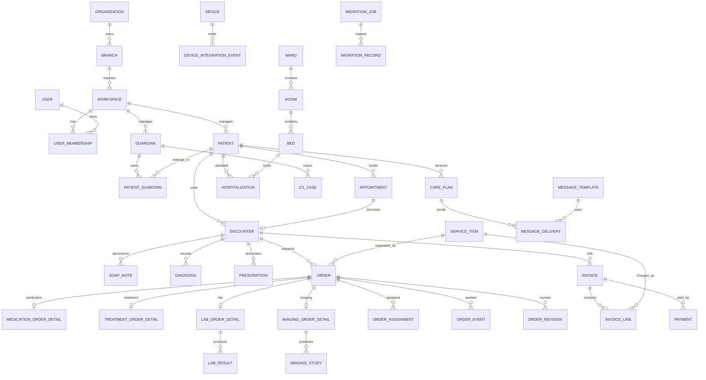

# CLAiR EMR SaaS DB Structure And Spec Draft (EN)

This document is the English version of the database structure draft for the veterinary EMR SaaS project.

Primary references:

- `docs/product/features/legacy-mvp-feature-spec.md`
- `docs/product/user-flows/emr-saas-userflow.md`
- `docs/engineering/architecture/app-shell-layout-contract.md`
- `src/features/dispensing/data.ts`
- `src/types/emr.ts`

Note: the source user flow is the Mermaid document at `docs/product/user-flows/emr-saas-userflow.md`.

## Design Principles

- Use `organization -> branch -> workspace` as the hospital operating hierarchy.
- Model animal patients and guardians as many-to-many. One guardian can manage multiple pets, and one patient can have multiple guardians or contacts.
- Center clinical work on `encounters`. Reception, SOAP notes, diagnoses, prescriptions, orders, billing, and hospitalization should connect through the same encounter.
- Keep the generic order lifecycle in `orders`; store dispensing, treatment, lab, and imaging details in typed detail tables.
- For device integration, messaging, and migration, preserve both status and raw payloads because retry, audit, and rollback matter.
- Start analytics from normalized source tables. Add materialized views or summary tables only when performance requires them.
- Keep app-shell UI state separate from clinical data.

## Full Domain Map

## User-Flow Data Mapping

| Flow | Main Data To Store |
| --- | --- |
| Authentication | Users, memberships, permissions, sessions, audit logs |
| Home/Dashboard | Waiting patients, consultation status, order status, operational metrics |
| Reception/Scheduling | Appointments, reception/check-in, queues, veterinarian assignment, notification messages |
| Clinical Care | SOAP notes, diagnoses, prescriptions, work orders, patient history |
| Work Orders | Dispensing, treatment, lab, imaging orders, assignees, progress status, results |
| Hospitalization | Wards, rooms, beds, admission, discharge, room/bed status |
| Customer Management | Guardians, patients, CS history, care content, outbound messages |
| Operations Analytics | Revenue, profit, visit counts, revisit rate, order completion rate |
| Settings | Clinic profile, business hours, service items, spaces/devices, staff/permissions, migration |

## 1. Organization, Branch, Workspace

### `organizations`

Hospital group or legal organization.

| Column | Type | Notes |
| --- | --- | --- |
| `id` | uuid pk | |
| `name` | text | Example: VIP Animal Medical Center |
| `business_registration_no` | text nullable | |
| `created_at` | timestamptz | |
| `updated_at` | timestamptz | |

### `branches`

Physical hospital branch.

| Column | Type | Notes |
| --- | --- | --- |
| `id` | uuid pk | |
| `organization_id` | uuid fk | |
| `name` | text | Example: Cheongdam branch |
| `phone` | text nullable | |
| `address` | text nullable | |
| `timezone` | text | Default: `Asia/Seoul` |
| `created_at` | timestamptz | |
| `updated_at` | timestamptz | |

### `workspaces`

The app context exposed by `/w/[workspaceId]/...`.

| Column | Type | Notes |
| --- | --- | --- |
| `id` | text pk | Example: `clair-demo` |
| `branch_id` | uuid fk | |
| `display_name` | text | Workspace display name |
| `status` | text | `active`, `archived` |
| `created_at` | timestamptz | |
| `updated_at` | timestamptz | |

## 2. Users, Staff, Permissions

### `users`

All people who can sign in: veterinarians, nurses, desk staff, billing staff, hospital admins, and system admins.

| Column | Type | Notes |
| --- | --- | --- |
| `id` | uuid pk | |
| `display_name` | text | |
| `initial` | text nullable | Avatar label |
| `email` | citext nullable | |
| `phone` | text nullable | |
| `status` | text | `active`, `inactive`, `invited` |
| `created_at` | timestamptz | |
| `updated_at` | timestamptz | |

### `user_memberships`

Workspace-scoped staff profile and role.

| Column | Type | Notes |
| --- | --- | --- |
| `id` | uuid pk | |
| `workspace_id` | text fk | |
| `user_id` | uuid fk | |
| `role` | text | `veterinarian`, `nurse`, `desk`, `billing`, `hospital_admin`, `system_admin` |
| `department` | text nullable | Clinical, dispensing, lab, imaging, inpatient, etc. |
| `title` | text nullable | |
| `hire_date` | date nullable | |
| `status` | text | `active`, `inactive` |

Unique: `(workspace_id, user_id)`.

### `permission_policies`

Fine-grained feature restrictions.

| Column | Type | Notes |
| --- | --- | --- |
| `id` | uuid pk | |
| `workspace_id` | text fk | |
| `name` | text | |
| `scope` | text | `role`, `user` |
| `target_role` | text nullable | |
| `target_user_id` | uuid fk nullable | |
| `permissions` | jsonb | Module/action permissions |
| `created_at` | timestamptz | |
| `updated_at` | timestamptz | |

## 3. Guardians, Patients, Consent

### `guardians`

Human owners or caregivers.

| Column | Type | Notes |
| --- | --- | --- |
| `id` | uuid pk | |
| `workspace_id` | text fk | |
| `name` | text | |
| `mobile_phone` | text nullable | Messaging recipient |
| `phone` | text nullable | |
| `email` | citext nullable | |
| `address` | text nullable | |
| `occupation` | text nullable | Included in the feature spec |
| `memo` | text nullable | |
| `created_at` | timestamptz | |
| `updated_at` | timestamptz | |

### `patients`

Animal patients.

| Column | Type | Notes |
| --- | --- | --- |
| `id` | uuid pk | Hidden internal system ID |
| `patient_no` | text | Staff-facing patient number. Example: `P-260414-0008` |
| `workspace_id` | text fk | |
| `name` | text | |
| `species` | text | `dog`, `cat`, `other` |
| `breed` | text nullable | |
| `birth_date` | date nullable | Prefer deriving age from this |
| `estimated_age_text` | text nullable | For estimated animal age |
| `sex` | text nullable | `male`, `female`, `unknown` |
| `neutered` | boolean nullable | |
| `microchip_no` | text nullable | |
| `allergy_note` | text nullable | Used for prescription warnings |
| `special_note` | text nullable | |
| `handling_caution_note` | text nullable | Internal caution memo for biting, scratching, sensitivity, muzzle needs, etc. Hidden by default |
| `handling_caution_locked` | boolean | Keeps caution notes out of guardian-facing screens/documents by default |
| `status` | text | `active`, `inactive`, `deceased` |
| `created_at` | timestamptz | |
| `updated_at` | timestamptz | |

### `patient_guardians`

Relationship between guardians and patients.

| Column | Type | Notes |
| --- | --- | --- |
| `id` | uuid pk | |
| `patient_id` | uuid fk | |
| `guardian_id` | uuid fk | |
| `relationship` | text nullable | Primary owner, family, etc. |
| `is_primary` | boolean | |
| `can_receive_messages` | boolean | |
| `created_at` | timestamptz | |

### `consents`

Privacy, treatment, hospitalization, surgery, marketing, and messaging consent.

| Column | Type | Notes |
| --- | --- | --- |
| `id` | uuid pk | |
| `workspace_id` | text fk | |
| `guardian_id` | uuid fk | |
| `patient_id` | uuid fk nullable | |
| `consent_type` | text | `privacy`, `treatment`, `surgery`, `hospitalization`, `marketing`, `messaging` |
| `status` | text | `granted`, `revoked` |
| `signed_at` | timestamptz nullable | |
| `revoked_at` | timestamptz nullable | |
| `document_url` | text nullable | |

## 4. Appointments, Reception, Queue

### `appointments`

Appointment booking, rescheduling, cancellation, and veterinarian assignment.

| Column | Type | Notes |
| --- | --- | --- |
| `id` | uuid pk | |
| `workspace_id` | text fk | |
| `patient_id` | uuid fk | |
| `guardian_id` | uuid fk nullable | |
| `assigned_veterinarian_id` | uuid fk nullable | `users.id` |
| `scheduled_start_at` | timestamptz | |
| `scheduled_end_at` | timestamptz nullable | |
| `visit_purpose` | text nullable | |
| `symptom_note` | text nullable | |
| `status` | text | `requested`, `confirmed`, `changed`, `cancelled`, `checked_in`, `no_show` |
| `created_by_user_id` | uuid fk nullable | |
| `created_at` | timestamptz | |
| `updated_at` | timestamptz | |

### `appointment_change_logs`

Appointment change history and approval/notification metadata.

| Column | Type | Notes |
| --- | --- | --- |
| `id` | uuid pk | |
| `appointment_id` | uuid fk | |
| `changed_by_user_id` | uuid fk nullable | |
| `change_type` | text | `create`, `reschedule`, `cancel`, `assign_doctor`, `confirm` |
| `reason` | text nullable | |
| `before_value` | jsonb nullable | |
| `after_value` | jsonb nullable | |
| `created_at` | timestamptz | |

### `encounters`

Actual visit/care episode. Created from check-in or converted from an appointment.

| Column | Type | Notes |
| --- | --- | --- |
| `id` | uuid pk | |
| `workspace_id` | text fk | |
| `patient_id` | uuid fk | |
| `guardian_id` | uuid fk nullable | |
| `appointment_id` | uuid fk nullable | |
| `primary_veterinarian_id` | uuid fk nullable | |
| `encounter_no` | text | Human-readable visit number |
| `chief_complaint` | text nullable | |
| `visit_purpose` | text nullable | |
| `status` | text | `waiting`, `in_consultation`, `ordered`, `ready_for_billing`, `completed`, `cancelled` |
| `checked_in_at` | timestamptz nullable | |
| `started_at` | timestamptz nullable | |
| `completed_at` | timestamptz nullable | |
| `created_at` | timestamptz | |
| `updated_at` | timestamptz | |

### `waiting_queue_entries`

Used by the dashboard for waiting patients and consultation monitoring.

| Column | Type | Notes |
| --- | --- | --- |
| `id` | uuid pk | |
| `workspace_id` | text fk | |
| `encounter_id` | uuid fk | |
| `queue_type` | text | `reception`, `consultation`, `treatment`, `billing` |
| `status` | text | `waiting`, `called`, `in_progress`, `done`, `cancelled` |
| `priority` | text | `urgent`, `high`, `normal`, `low` |
| `sort_order` | int nullable | |
| `entered_at` | timestamptz | |
| `called_at` | timestamptz nullable | |
| `finished_at` | timestamptz nullable | |

## 5. Clinical Chart, Diagnoses, Prescriptions

### `soap_notes`

SOAP note drafting, autosave, signing, and amendments.

| Column | Type | Notes |
| --- | --- | --- |
| `id` | uuid pk | |
| `encounter_id` | uuid fk | |
| `author_user_id` | uuid fk | |
| `subjective` | text nullable | S |
| `objective` | text nullable | O |
| `assessment` | text nullable | A |
| `plan` | text nullable | P |
| `status` | text | `draft`, `autosaved`, `signed`, `amended`, `voided` |
| `signed_at` | timestamptz nullable | |
| `created_at` | timestamptz | |
| `updated_at` | timestamptz | |

### `soap_note_revisions`

Amendment history and audit snapshots.

| Column | Type | Notes |
| --- | --- | --- |
| `id` | uuid pk | |
| `soap_note_id` | uuid fk | |
| `revision_no` | int | |
| `changed_by_user_id` | uuid fk | |
| `change_reason` | text nullable | |
| `snapshot` | jsonb | Full note snapshot after change |
| `created_at` | timestamptz | |

### `chart_templates`

Reusable SOAP templates.

| Column | Type | Notes |
| --- | --- | --- |
| `id` | uuid pk | |
| `workspace_id` | text fk | |
| `owner_user_id` | uuid fk nullable | null means shared clinic template |
| `name` | text | |
| `subjective_template` | text nullable | |
| `objective_template` | text nullable | |
| `assessment_template` | text nullable | |
| `plan_template` | text nullable | |
| `is_active` | boolean | |

### `diagnoses`

Actual diagnosis records.

| Column | Type | Notes |
| --- | --- | --- |
| `id` | uuid pk | |
| `encounter_id` | uuid fk | |
| `diagnosis_catalog_id` | uuid fk nullable | |
| `diagnosis_text` | text | |
| `diagnosis_type` | text | `suspected`, `confirmed`, `differential` |
| `is_primary` | boolean | At most one primary diagnosis per encounter |
| `closed_at` | timestamptz nullable | Diagnosis closure time; `null` means open |
| `closed_by_user_id` | uuid fk nullable | User who closed the diagnosis |
| `sort_order` | integer | Default input order |
| `created_by_user_id` | uuid fk | |
| `updated_by_user_id` | uuid fk nullable | |
| `created_at` | timestamptz | |
| `updated_at` | timestamptz | |

### `diagnosis_catalog`

Disease master data for autocomplete and recommendations.

| Column | Type | Notes |
| --- | --- | --- |
| `id` | uuid pk | |
| `workspace_id` | text fk nullable | null means system-wide |
| `code` | text nullable | |
| `name` | text | |
| `species` | text nullable | |
| `synonyms` | text[] nullable | |

### `prescriptions`

Prescription document. Used for PDF/export/send workflows.

| Column | Type | Notes |
| --- | --- | --- |
| `id` | uuid pk | |
| `encounter_id` | uuid fk | |
| `prescription_no` | text | Example: `RX-260414-0008` |
| `prescriber_user_id` | uuid fk | |
| `status` | text | `draft`, `ordered`, `sent`, `cancelled`, `completed` |
| `issued_at` | timestamptz nullable | |
| `created_at` | timestamptz | |
| `updated_at` | timestamptz | |

### `prescription_items`

Medication prescription line items.

| Column | Type | Notes |
| --- | --- | --- |
| `id` | uuid pk | |
| `prescription_id` | uuid fk | |
| `medication_id` | uuid fk nullable | |
| `medication_name_snapshot` | text | |
| `dose` | text nullable | |
| `route_id` | uuid fk nullable | |
| `frequency` | text nullable | |
| `duration_days` | numeric nullable | |
| `quantity` | numeric nullable | |
| `unit_id` | uuid fk nullable | |
| `dosage_form_id` | uuid fk nullable | |
| `instruction` | text nullable | Medication guidance |
| `status` | text | `active`, `cancelled` |

### `medication_safety_alerts`

Duplicate, interaction, allergy, and controlled-substance warnings.

| Column | Type | Notes |
| --- | --- | --- |
| `id` | uuid pk | |
| `encounter_id` | uuid fk | |
| `prescription_item_id` | uuid fk nullable | |
| `alert_type` | text | `duplicate`, `interaction`, `allergy`, `controlled_substance` |
| `severity` | text | `info`, `warning`, `critical` |
| `message` | text | |
| `acknowledged_by_user_id` | uuid fk nullable | |
| `acknowledged_at` | timestamptz nullable | |

## 6. Generic Order Model

### `service_categories`

Categories for clinical/order/billing items.

| Column | Type | Notes |
| --- | --- | --- |
| `id` | uuid pk | |
| `workspace_id` | text fk | |
| `parent_id` | uuid fk nullable | |
| `name` | text | Consultation, lab, treatment, medication, etc. |
| `sort_order` | int | |

### `service_items`

Clinic-managed service catalog: consultation items, lab tests, treatment items, medications, and billable items.

| Column | Type | Notes |
| --- | --- | --- |
| `id` | uuid pk | |
| `workspace_id` | text fk | |
| `category_id` | uuid fk nullable | |
| `name` | text | |
| `item_type` | text | `consultation`, `medication`, `treatment`, `lab`, `imaging`, `hospitalization`, `misc` |
| `description` | text nullable | |
| `default_duration_minutes` | int nullable | |
| `is_orderable` | boolean | |
| `is_billable` | boolean | |
| `is_active` | boolean | |

### `service_item_prices`

Effective-dated price history.

| Column | Type | Notes |
| --- | --- | --- |
| `id` | uuid pk | |
| `service_item_id` | uuid fk | |
| `price` | numeric | |
| `currency` | text | Default: KRW |
| `effective_from` | date | |
| `effective_to` | date nullable | |

### `order_groups`

Visible order groups such as oral medication group, miscellaneous group, or antibiotic set.

| Column | Type | Notes |
| --- | --- | --- |
| `id` | uuid pk | |
| `encounter_id` | uuid fk | |
| `prescription_id` | uuid fk nullable | |
| `group_type` | text | `dispensing`, `treatment`, `lab`, `imaging`, `mixed` |
| `title` | text | |
| `label` | text nullable | |
| `status` | text | `requested`, `in_progress`, `completed`, `cancelled` |
| `priority` | text | `urgent`, `high`, `normal`, `low` |
| `sort_order` | int | |
| `created_by_user_id` | uuid fk | |
| `created_at` | timestamptz | |
| `updated_at` | timestamptz | |

### `orders`

Generic lifecycle row for all work orders.

| Column | Type | Notes |
| --- | --- | --- |
| `id` | uuid pk | |
| `order_group_id` | uuid fk nullable | |
| `workspace_id` | text fk | Denormalized for clinic-wide home/order dashboards and simpler RLS |
| `encounter_id` | uuid fk | |
| `service_item_id` | uuid fk nullable | |
| `order_type` | text | `dispensing`, `treatment`, `lab`, `imaging` |
| `display_name` | text | |
| `status` | text | `requested`, `re_requested`, `in_progress`, `completed`, `cancelled` |
| `work_status` | text | `pending`, `completed` |
| `priority` | text | `urgent`, `high`, `normal`, `low` |
| `requested_by_user_id` | uuid fk | |
| `requested_at` | timestamptz | |
| `due_at` | timestamptz nullable | For overdue alerts |
| `current_assignee_user_id` | uuid fk nullable | Fast lookup |
| `instruction` | text nullable | |
| `warning_message` | text nullable | Re-request or change warning |
| `sort_order` | int | |
| `created_at` | timestamptz | |
| `updated_at` | timestamptz | |

### `order_assignments`

Assignee history for orders.

| Column | Type | Notes |
| --- | --- | --- |
| `id` | uuid pk | |
| `order_id` | uuid fk | |
| `assignee_user_id` | uuid fk | |
| `assigned_by_user_id` | uuid fk nullable | |
| `status` | text | `active`, `cancelled`, `completed` |
| `assigned_at` | timestamptz | |
| `completed_at` | timestamptz nullable | |
| `cancelled_at` | timestamptz nullable | |

### `order_events`

State changes, assignment changes, completion, cancellation, edits, and result entry logs.

| Column | Type | Notes |
| --- | --- | --- |
| `id` | uuid pk | |
| `order_id` | uuid fk | |
| `event_type` | text | `requested`, `sent`, `assigned`, `started`, `completed`, `cancelled`, `edited`, `result_entered` |
| `performed_by_user_id` | uuid fk nullable | |
| `payload` | jsonb | |
| `created_at` | timestamptz | |

### `order_revisions` / `order_revision_fields`

Order edit/add/cancel history and reason tracking.

| Table | Key Columns |
| --- | --- |
| `order_revisions` | `id`, `order_id`, `revision_no`, `reason`, `created_by_user_id`, `created_at` |
| `order_revision_fields` | `id`, `order_revision_id`, `field_name`, `previous_value`, `current_value` |

## 7. Dispensing, Treatment, Lab, Imaging Details

### `dispensing_order_details`

Dispensing order detail, often generated from a prescription item.

| Column | Type | Notes |
| --- | --- | --- |
| `order_id` | uuid pk/fk | |
| `prescription_item_id` | uuid fk nullable | |
| `medication_id` | uuid fk nullable | |
| `medication_name_snapshot` | text | |
| `dose_text` | text nullable | |
| `route_id` | uuid fk nullable | |
| `frequency` | text nullable | |
| `duration_days` | numeric nullable | |
| `servings` | numeric nullable | |
| `amount` | numeric nullable | |
| `unit_id` | uuid fk nullable | |
| `quantity` | numeric nullable | |
| `dosage_form_id` | uuid fk nullable | |
| `storage_instruction` | text nullable | |
| `medication_guide` | text nullable | |

### `dispensing_records`

Actual dispensing execution record.

| Column | Type | Notes |
| --- | --- | --- |
| `id` | uuid pk | |
| `order_id` | uuid fk | |
| `performed_by_user_id` | uuid fk | |
| `performed_at` | timestamptz | |
| `quantity_prepared` | numeric nullable | |
| `memo` | text nullable | |

### `treatment_order_details`

Treatment order details.

| Column | Type | Notes |
| --- | --- | --- |
| `order_id` | uuid pk/fk | |
| `treatment_type` | text | Injection, wound care, physical therapy, etc. |
| `body_site` | text nullable | |
| `instruction` | text nullable | |
| `expected_duration_minutes` | int nullable | |

### `treatment_records`

Treatment execution record.

| Column | Type | Notes |
| --- | --- | --- |
| `id` | uuid pk | |
| `order_id` | uuid fk | |
| `performed_by_user_id` | uuid fk | |
| `performed_at` | timestamptz | |
| `result_note` | text nullable | |

### `lab_order_details`

Clinical pathology lab order.

| Column | Type | Notes |
| --- | --- | --- |
| `order_id` | uuid pk/fk | |
| `test_code` | text nullable | |
| `test_name` | text | |
| `sample_type` | text nullable | Blood, urine, feces, etc. |
| `device_id` | uuid fk nullable | |

### `lab_results`

Automatically or manually entered lab result.

| Column | Type | Notes |
| --- | --- | --- |
| `id` | uuid pk | |
| `order_id` | uuid fk | |
| `device_id` | uuid fk nullable | |
| `result_status` | text | `received`, `reviewed`, `corrected`, `cancelled` |
| `result_payload` | jsonb | Raw and structured result data |
| `abnormal_flag` | text nullable | `normal`, `low`, `high`, `critical` |
| `received_at` | timestamptz nullable | |
| `reviewed_by_user_id` | uuid fk nullable | |
| `reviewed_at` | timestamptz nullable | |

### `imaging_order_details`

Imaging order detail.

| Column | Type | Notes |
| --- | --- | --- |
| `order_id` | uuid pk/fk | |
| `modality` | text | `xray`, `ultrasound`, `ct`, `mri` |
| `body_part` | text nullable | |
| `device_id` | uuid fk nullable | |
| `instruction` | text nullable | |

### `imaging_studies`

Imaging study metadata.

| Column | Type | Notes |
| --- | --- | --- |
| `id` | uuid pk | |
| `order_id` | uuid fk | |
| `device_id` | uuid fk nullable | |
| `study_uid` | text nullable | For DICOM |
| `status` | text | `received`, `reviewed`, `archived` |
| `captured_at` | timestamptz nullable | |
| `received_at` | timestamptz nullable | |

### `imaging_files`

Image file metadata. Store the actual file in object storage.

| Column | Type | Notes |
| --- | --- | --- |
| `id` | uuid pk | |
| `study_id` | uuid fk | |
| `file_url` | text | |
| `mime_type` | text nullable | |
| `metadata` | jsonb nullable | |
| `created_at` | timestamptz | |

## 8. Devices, Spaces, Hospitalization

### `spaces`, `wards`, `rooms`, `beds`

Hospital space and inpatient structure.

| Table | Purpose |
| --- | --- |
| `spaces` | Exam rooms, waiting rooms, operating rooms, labs |
| `wards` | Dog ward, cat ward, etc. |
| `rooms` | Rooms inside a ward |
| `beds` | Bed/cage inside a room |

Common columns:

- `workspace_id`
- `name`
- `space_type` or `ward_type`
- `status`: `available`, `occupied`, `cleaning`, `maintenance`, `inactive`
- `sort_order`

### `devices`

Lab and imaging devices.

| Column | Type | Notes |
| --- | --- | --- |
| `id` | uuid pk | |
| `workspace_id` | text fk | |
| `space_id` | uuid fk nullable | |
| `name` | text | |
| `device_type` | text | `lab_analyzer`, `xray`, `ultrasound`, `ct`, `mri`, `other` |
| `vendor` | text nullable | |
| `model` | text nullable | |
| `status` | text | `active`, `inactive`, `maintenance` |

### `device_integrations`

Device integration method and non-secret configuration.

| Column | Type | Notes |
| --- | --- | --- |
| `id` | uuid pk | |
| `device_id` | uuid fk | |
| `integration_type` | text | `api`, `hl7`, `dicom`, `file_drop`, `manual` |
| `endpoint` | text nullable | |
| `config` | jsonb | Exclude secrets |
| `status` | text | `enabled`, `disabled`, `error` |

### `device_integration_events`

Inbound result/file/error logs from devices.

| Column | Type | Notes |
| --- | --- | --- |
| `id` | uuid pk | |
| `device_id` | uuid fk | |
| `event_type` | text | `result_received`, `file_received`, `error`, `heartbeat` |
| `raw_payload` | jsonb nullable | |
| `status` | text | `received`, `processed`, `failed` |
| `created_at` | timestamptz | |

### `hospitalizations`

Admission and discharge.

| Column | Type | Notes |
| --- | --- | --- |
| `id` | uuid pk | |
| `workspace_id` | text fk | |
| `patient_id` | uuid fk | |
| `encounter_id` | uuid fk nullable | |
| `bed_id` | uuid fk | |
| `attending_veterinarian_id` | uuid fk nullable | |
| `status` | text | `admitted`, `discharged`, `transferred`, `cancelled` |
| `main_symptom` | text nullable | |
| `admitted_at` | timestamptz | |
| `discharged_at` | timestamptz nullable | |
| `final_diagnosis` | text nullable | |
| `discharge_note` | text nullable | |

### `bed_status_events`

Bed/room status history.

| Column | Type | Notes |
| --- | --- | --- |
| `id` | uuid pk | |
| `bed_id` | uuid fk | |
| `hospitalization_id` | uuid fk nullable | |
| `status` | text | `available`, `occupied`, `cleaning`, `maintenance` |
| `changed_by_user_id` | uuid fk nullable | |
| `created_at` | timestamptz | |

## 9. Billing, Revenue, Operations Analytics

### `invoices`

Billing document after clinical care.

| Column | Type | Notes |
| --- | --- | --- |
| `id` | uuid pk | |
| `workspace_id` | text fk | |
| `encounter_id` | uuid fk | |
| `guardian_id` | uuid fk nullable | |
| `invoice_no` | text | |
| `status` | text | `draft`, `issued`, `paid`, `refund_requested`, `refunded`, `voided` |
| `subtotal_amount` | numeric | |
| `discount_amount` | numeric | |
| `tax_amount` | numeric | |
| `total_amount` | numeric | |
| `issued_at` | timestamptz nullable | |
| `created_at` | timestamptz | |

### `invoice_lines`

Revenue breakdown by service item.

| Column | Type | Notes |
| --- | --- | --- |
| `id` | uuid pk | |
| `invoice_id` | uuid fk | |
| `service_item_id` | uuid fk nullable | |
| `order_id` | uuid fk nullable | |
| `description` | text | |
| `quantity` | numeric | |
| `unit_price` | numeric | |
| `line_total` | numeric | |

### `payments`

Payment records.

| Column | Type | Notes |
| --- | --- | --- |
| `id` | uuid pk | |
| `invoice_id` | uuid fk | |
| `payment_method` | text | `card`, `cash`, `transfer`, `other` |
| `amount` | numeric | |
| `status` | text | `approved`, `cancelled`, `refunded`, `failed` |
| `paid_at` | timestamptz | |
| `metadata` | jsonb nullable | |

Use source tables for revenue, profit, clinical volume, and order completion metrics at first. Add `daily_branch_metrics` or `daily_order_metrics` only when dashboard performance requires it.

## 10. Customer Management, CS, Messaging, Care

### `cs_cases`

Consultations, complaints, requests, and resolution tracking.

| Column | Type | Notes |
| --- | --- | --- |
| `id` | uuid pk | |
| `workspace_id` | text fk | |
| `guardian_id` | uuid fk nullable | |
| `patient_id` | uuid fk nullable | |
| `assigned_user_id` | uuid fk nullable | |
| `case_type` | text | `consultation`, `complaint`, `request`, `etc` |
| `status` | text | `open`, `in_progress`, `resolved`, `closed` |
| `title` | text | |
| `body` | text | |
| `resolution_note` | text nullable | |
| `created_at` | timestamptz | |
| `resolved_at` | timestamptz nullable | |

### `care_templates`

Diagnosis care, medication guidance, post-surgery care, and nutrition templates.

| Column | Type | Notes |
| --- | --- | --- |
| `id` | uuid pk | |
| `workspace_id` | text fk nullable | null means system default |
| `template_type` | text | `medication_guide`, `post_surgery`, `nutrition`, `diagnosis_care` |
| `name` | text | |
| `body` | text | |
| `variables` | jsonb nullable | |
| `is_active` | boolean | |

### `care_plans`

Patient-specific care content.

| Column | Type | Notes |
| --- | --- | --- |
| `id` | uuid pk | |
| `workspace_id` | text fk | |
| `patient_id` | uuid fk | |
| `encounter_id` | uuid fk nullable | |
| `template_id` | uuid fk nullable | |
| `care_type` | text | |
| `title` | text | |
| `body` | text | |
| `created_by_user_id` | uuid fk | |
| `created_at` | timestamptz | |

### `message_templates`

Kakao Alimtalk, SMS, and email templates.

| Column | Type | Notes |
| --- | --- | --- |
| `id` | uuid pk | |
| `workspace_id` | text fk | |
| `channel` | text | `kakao_alimtalk`, `sms`, `email` |
| `message_type` | text | `appointment`, `checkin`, `turn_notice`, `result`, `medication_guide`, `post_surgery`, `care` |
| `name` | text | |
| `body` | text | |
| `provider_template_code` | text nullable | |
| `is_active` | boolean | |

### `message_deliveries`

Delivery history for appointment reminders, check-in notices, turn notices, results, medication guidance, and care messages.

| Column | Type | Notes |
| --- | --- | --- |
| `id` | uuid pk | |
| `workspace_id` | text fk | |
| `template_id` | uuid fk nullable | |
| `guardian_id` | uuid fk nullable | |
| `patient_id` | uuid fk nullable | |
| `encounter_id` | uuid fk nullable | |
| `care_plan_id` | uuid fk nullable | |
| `channel` | text | |
| `recipient` | text | |
| `body_snapshot` | text | |
| `status` | text | `queued`, `sent`, `delivered`, `failed`, `cancelled` |
| `provider_message_id` | text nullable | |
| `failure_reason` | text nullable | |
| `retry_count` | int | |
| `sent_at` | timestamptz nullable | |
| `created_at` | timestamptz | |

## 11. Clinic Settings, Schedule, Migration

### `workspace_operating_hours`

Weekly business hours and lunch break settings.

| Column | Type | Notes |
| --- | --- | --- |
| `id` | uuid pk | |
| `workspace_id` | text fk | |
| `day_of_week` | int | 0-6 |
| `treatment_start` | time nullable | null when closed |
| `treatment_end` | time nullable | null when closed |
| `break_start` | time nullable | |
| `break_end` | time nullable | |
| `is_open` | boolean | |

### `workspace_operating_hour_exceptions`

Workspace-wide closed dates and custom operating-hour overrides. Staff vacations and schedule blocks remain separate scheduling-domain data.

| Column | Type | Notes |
| --- | --- | --- |
| `id` | uuid pk | |
| `workspace_id` | text fk | |
| `operating_date` | date | unique per workspace |
| `mode` | text | `closed`, `custom` |
| `treatment_start` | time nullable | custom mode only |
| `treatment_end` | time nullable | custom mode only |
| `break_start` | time nullable | custom mode only |
| `break_end` | time nullable | custom mode only |
| `reason` | text nullable | |

Workspace `timezone` and `holiday_policy` live on `workspaces`. The authoritative date resolver checks an explicit date exception first, then the weekday row. Public-holiday identification still requires explicit exception dates until a trusted holiday-calendar source is added.

### Settings change audit

Operating-hour changes reuse the canonical `audit_events` table with event type `hospital.operating_hours_updated`; no parallel settings log table is introduced.

### `migration_jobs`

Legacy EMR validation, conversion, import, and rollback.

| Column | Type | Notes |
| --- | --- | --- |
| `id` | uuid pk | |
| `workspace_id` | text fk | |
| `source_system` | text | |
| `status` | text | `uploaded`, `validated`, `converted`, `importing`, `completed`, `failed`, `rolled_back` |
| `uploaded_file_url` | text nullable | |
| `validation_report` | jsonb nullable | |
| `import_summary` | jsonb nullable | |
| `created_by_user_id` | uuid fk | |
| `created_at` | timestamptz | |
| `completed_at` | timestamptz nullable | |

### `migration_records`

Row-level migration result.

| Column | Type | Notes |
| --- | --- | --- |
| `id` | uuid pk | |
| `migration_job_id` | uuid fk | |
| `source_entity_type` | text | patient, guardian, chart, prescription, etc. |
| `source_record_id` | text | |
| `target_entity_type` | text nullable | |
| `target_record_id` | text nullable | |
| `status` | text | `valid`, `converted`, `imported`, `failed`, `rolled_back` |
| `error_message` | text nullable | |
| `raw_payload` | jsonb nullable | |

## 12. App Shell UI State

### `user_module_layout_states`

Optional persistence for module panel, content aside, right panel, drawer, and layout widths. Keep this outside clinical data.

| Column | Type | Notes |
| --- | --- | --- |
| `id` | uuid pk | |
| `workspace_id` | text fk | |
| `user_id` | uuid fk | |
| `module_id` | text | home, reception, treatment, lab, imaging, dispensing, orders, billing, inpatient |
| `module_panel_open` | boolean | |
| `content_aside_open` | boolean | |
| `right_panel_open` | boolean | |
| `module_side_panel_width` | int nullable | |
| `content_aside_width` | int nullable | |
| `right_panel_width` | int nullable | |
| `updated_at` | timestamptz | |

Unique: `(workspace_id, user_id, module_id)`.

## Recommended MVP Schema Scope

Build in this order:

1. `organizations`, `branches`, `workspaces`, `users`, `user_memberships`
2. `guardians`, `patients`, `patient_guardians`, `consents`
3. `appointments`, `encounters`, `waiting_queue_entries`
4. `soap_notes`, `diagnoses`, `prescriptions`, `prescription_items`
5. `service_categories`, `service_items`, `service_item_prices`
6. `order_groups`, `orders`, `order_assignments`, `order_events`, `order_revisions`
7. `dispensing_order_details`, `treatment_order_details`, `lab_order_details`, `imaging_order_details`
8. `invoices`, `invoice_lines`, `payments`
9. `message_templates`, `message_deliveries`
10. Add device integration, hospitalization, CS, care, and migration when those modules are implemented.

## Key Status Values

| Domain | Values |
| --- | --- |
| `appointment.status` | `requested`, `confirmed`, `changed`, `cancelled`, `checked_in`, `no_show` |
| `encounter.status` | `waiting`, `in_consultation`, `ordered`, `ready_for_billing`, `completed`, `cancelled` |
| `order.status` | `requested`, `re_requested`, `in_progress`, `completed`, `cancelled` |
| `order.work_status` | `pending`, `completed` |
| `order.priority` | `urgent`, `high`, `normal`, `low` |
| `invoice.status` | `draft`, `issued`, `paid`, `refund_requested`, `refunded`, `voided` |
| `message.status` | `queued`, `sent`, `delivered`, `failed`, `cancelled` |
| `hospitalization.status` | `admitted`, `discharged`, `transferred`, `cancelled` |

## Initial Indexes

- `guardians(workspace_id, name)`
- `guardians(workspace_id, mobile_phone)`
- `patients(workspace_id, name)`
- `patients(workspace_id, patient_no)`
- `patient_guardians(patient_id, guardian_id)`
- `appointments(workspace_id, scheduled_start_at)`
- `appointments(workspace_id, assigned_veterinarian_id, scheduled_start_at)`
- `encounters(workspace_id, status, checked_in_at)`
- `encounters(patient_id, created_at desc)`
- `waiting_queue_entries(workspace_id, queue_type, status, priority)`
- `soap_notes(encounter_id, updated_at desc)`
- `prescriptions(encounter_id, created_at desc)`
- `orders(workspace_id, status, priority, due_at)`
- `orders(encounter_id, status)`
- `orders(current_assignee_user_id, status, due_at)`
- `order_events(order_id, created_at desc)`
- `lab_results(order_id, received_at desc)`
- `imaging_studies(order_id, received_at desc)`
- `hospitalizations(workspace_id, status, admitted_at)`
- `invoices(workspace_id, status, issued_at)`
- `message_deliveries(workspace_id, status, created_at)`

## Decided

- Patients should have an internal uuid primary key plus a separate human-readable `patient_no`. Staff-facing screens, search, and printed documents can use numbers like `P-260414-0008`.
- The actual clinical `encounter` should be created on reception/check-in, not on appointment confirmation. Because no-shows are common, appointments and actual clinical records should stay separate.
- Prescriptions and actual dispensing records should be separate. A prescription is the veterinarian's medical instruction; a dispensing record is the performed result.
- Device integration should start with file upload/file drop in MVP. API, HL7, and DICOM can be added later.
- Billing MVP should include basic billing, discounts, and refunds. Partial payments and complex tax/settlement workflows can come later.
- Refund approval belongs to hospital admins. Billing staff may create refund requests/notes but should not finalize refunds.
- Kakao Alimtalk should manage message templates and delivery history. Provider approval status and template version tracking can come later.
- Operations analytics should start with live queries from source data. Daily summary tables can be added when data volume requires it.
- The home menu should show clinic-wide order status. A separate order workboard can handle detailed execution workflows.
- Store denormalized `orders.workspace_id` for order dashboard performance and simpler access control.
- Hospitalization should not be deep in MVP. Keep basic inpatient list, ward/bed status, and admission/discharge records available structurally.
- Customer management/care MVP should include guardian/patient master data and message sending. Care plans and CS history can expand later.
- Internal EMR screens and DB docs should use `patient` for animal patients. Guardian-facing copy should prefer `companion animal` or the patient's name.
- Patient handling cautions should be a memo, not structured risk categories in MVP. They should be locked/hidden by default so they do not appear in guardian-facing screens or documents.
- SOAP notes should include basic writing, draft/autosave, and revision history in MVP. Edits are allowed for 24 hours after save; later edits require a reason.
- Diagnoses should allow free text while optionally linking to a diagnosis catalog.
- Medication prescriptions should use a medication catalog and structured fields for dose, unit, route, frequency, duration, quantity, and guidance.
- Patient history should provide both chronological timeline and type filters.
- Orders should include priority from the start: urgent, high, normal, low.
- Guardian consent should store status, consent timestamp, and consent document file. Full e-signature flow can come later.
- Service items and prices should be managed by the hospital, with price change history preserved.
- Appointment availability should consider clinic hours/holidays and veterinarian schedules. Room/space conflicts can be added later.
- No-shows should remain on appointment status and appear in guardian/patient history. Automatic penalties or booking restrictions can come later.
- The waiting queue should default to arrival order while allowing urgency, appointment context, assigned veterinarian, and priority to affect ordering.
- Prescription edits should be allowed only for the authoring veterinarian or another user with veterinarian privileges. Non-veterinarian admins should not edit prescription content.
- Order cancellation/change reason is required.
- Work assignment should support both self-claiming through `Take assignment` and assignment/change by an authorized manager.
- Lab staff enter/attach results and complete the work; the result is then delivered/notified to the veterinarian. The veterinarian's chart order/prescription table must show both progress and results.
- Lab completion and veterinarian review should be separate states, such as `completed/delivered` and `reviewed`.
- Imaging MVP should start with file attachment plus interpretation/memo text. A full DICOM viewer can come later.
- Billing invoices should be built from automatically generated candidate line items from orders/prescriptions, then finalized by billing staff after the visit.
- Message sending should vary by message type. Appointment/check-in/turn notices can be automatic or immediate, while clinical results, medication guidance, and post-surgery care messages require veterinarian confirmation.

## Open Decisions

- These decisions are MVP defaults. During real clinic pilots, permissions, message approval, billing, and device integration scope can be adjusted.
