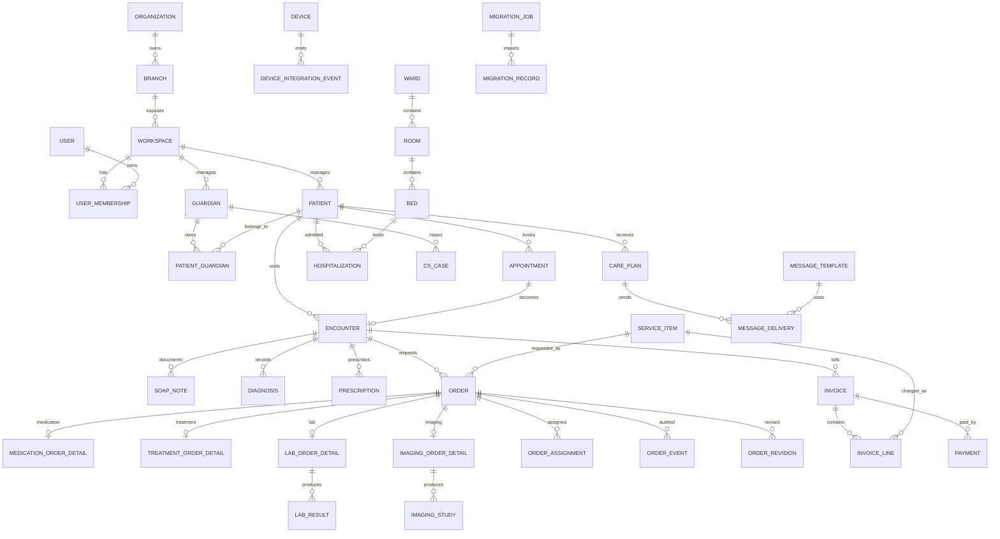

# CLAiR EMR SaaS DB Structure And Spec Draft (KO)

이 문서는 현재 프로젝트의 동물병원 전용 EMR SaaS 기능 명세와 유저 플로우를 기준으로 다시 작성한 DB 구조 초안입니다.

참고 문서:

- `docs/product/features/legacy-mvp-feature-spec.md`
- `docs/product/user-flows/emr-saas-userflow.md`
- `docs/engineering/architecture/app-shell-layout-contract.md`
- `src/features/dispensing/data.ts`
- `src/types/emr.ts`

참고: 유저 플로우 원본은 `docs/product/user-flows/emr-saas-userflow.md`에 있는 Mermaid 문서입니다.

## 설계 원칙

- 병원 운영 단위는 `organization -> branch -> workspace`로 나눈다.
- 동물 환자와 보호자는 다대다 관계로 둔다. 한 보호자가 여러 환자를 가질 수 있고, 한 환자도 여러 보호자/연락처를 가질 수 있다.
- 모든 진료 업무는 `encounter`를 중심으로 연결한다. 접수, SOAP 차트, 진단, 처방, 오더, 수납, 입원은 같은 내원 건에서 이어진다.
- `order`는 공통 수명주기만 담당하고, 조제/처치/검사/영상 세부 데이터는 타입별 상세 테이블로 분리한다.
- 장비 연동, 메시징, 마이그레이션은 이벤트/작업 이력이 중요하므로 원본 payload와 처리 상태를 남긴다.
- 운영 대시보드는 처음부터 별도 집계 테이블에 의존하지 말고, 원천 데이터를 정규화한 뒤 필요 시 materialized view나 summary table을 추가한다.
- 앱 셸의 패널/드로어/컬럼 상태는 임상 데이터와 분리한다.

## 전체 도메인 맵

## 유저 플로우 기준 핵심 데이터 흐름

| Flow | 핵심 저장 데이터 |
| --- | --- |
| 인증 | 사용자, 멤버십, 권한, 세션/감사 로그 |
| 홈/대시보드 | 대기 환자, 진료 현황, 오더 현황, 운영 지표 |
| 접수/예약 | 예약, 접수, 대기열, 담당 수의사 배정, 알림톡 발송 |
| 진료 관리 | SOAP 차트, 진단명, 처방, 업무 오더, 과거 이력 |
| 업무 오더 | 조제/처치/임상병리/영상 오더, 담당자, 진행 상태, 결과 |
| 입원 관리 | 병동/입원실/베드, 입원 등록, 퇴원, 병실 상태 |
| 고객 관리 | 보호자/환자 정보, CS 이력, 케어 정보, 메시지 발송 |
| 운영 분석 | 매출, 수익, 진료 건수, 재방문율, 오더 완료율 |
| 설정 | 병원 정보, 진료 시간, 오더 항목, 공간/장비, 직원/권한, 마이그레이션 |

## 1. 조직, 지점, 워크스페이스

### `organizations`

병원 그룹 또는 법인.

| Column | Type | Notes |
| --- | --- | --- |
| `id` | uuid pk | |
| `name` | text | 예: VIP 동물의료센터 |
| `business_registration_no` | text nullable | |
| `created_at` | timestamptz | |
| `updated_at` | timestamptz | |

### `branches`

실제 병원 지점.

| Column | Type | Notes |
| --- | --- | --- |
| `id` | uuid pk | |
| `organization_id` | uuid fk | |
| `name` | text | 예: 청담점 |
| `phone` | text nullable | |
| `address` | text nullable | |
| `timezone` | text | 기본 `Asia/Seoul` |
| `created_at` | timestamptz | |
| `updated_at` | timestamptz | |

### `workspaces`

앱 라우트 `/w/[workspaceId]/...`의 기준이 되는 작업 공간.

| Column | Type | Notes |
| --- | --- | --- |
| `id` | text pk | 예: `clair-demo` |
| `branch_id` | uuid fk | |
| `display_name` | text | 예: VIP 동물의료센터 청담점 |
| `status` | text | `active`, `archived` |
| `created_at` | timestamptz | |
| `updated_at` | timestamptz | |

## 2. 사용자, 직원, 권한

### `users`

로그인 가능한 사람. 수의사, 간호사, 데스크, 수납, 병원 관리자, 시스템 관리자 모두 포함한다.

| Column | Type | Notes |
| --- | --- | --- |
| `id` | uuid pk | |
| `display_name` | text | |
| `initial` | text nullable | 아바타 표기 |
| `email` | citext nullable | |
| `phone` | text nullable | |
| `status` | text | `active`, `inactive`, `invited` |
| `created_at` | timestamptz | |
| `updated_at` | timestamptz | |

### `user_memberships`

워크스페이스별 직원 정보와 역할.

| Column | Type | Notes |
| --- | --- | --- |
| `id` | uuid pk | |
| `workspace_id` | text fk | |
| `user_id` | uuid fk | |
| `role` | text | `veterinarian`, `nurse`, `desk`, `billing`, `hospital_admin`, `system_admin` |
| `department` | text nullable | 진료, 조제, 검사, 영상, 입원 등 |
| `title` | text nullable | 직책 |
| `hire_date` | date nullable | |
| `status` | text | `active`, `inactive` |

Unique: `(workspace_id, user_id)`.

### `permission_policies`

기능 제한과 세부 권한을 저장한다.

| Column | Type | Notes |
| --- | --- | --- |
| `id` | uuid pk | |
| `workspace_id` | text fk | |
| `name` | text | |
| `scope` | text | `role`, `user` |
| `target_role` | text nullable | |
| `target_user_id` | uuid fk nullable | |
| `permissions` | jsonb | 모듈/액션 단위 권한 |
| `created_at` | timestamptz | |
| `updated_at` | timestamptz | |

## 3. 보호자, 환자, 동의

### `guardians`

보호자/고객.

| Column | Type | Notes |
| --- | --- | --- |
| `id` | uuid pk | |
| `workspace_id` | text fk | |
| `name` | text | |
| `mobile_phone` | text nullable | 알림톡 수신 |
| `phone` | text nullable | |
| `email` | citext nullable | |
| `address` | text nullable | |
| `occupation` | text nullable | 기능 명세에 포함 |
| `memo` | text nullable | |
| `created_at` | timestamptz | |
| `updated_at` | timestamptz | |

### `patients`

동물 환자.

| Column | Type | Notes |
| --- | --- | --- |
| `id` | uuid pk | 내부 시스템용 숨은 ID |
| `patient_no` | text | 직원이 보는 환자번호. 예: `P-260414-0008` |
| `workspace_id` | text fk | |
| `name` | text | |
| `species` | text | `dog`, `cat`, `other` |
| `breed` | text nullable | |
| `birth_date` | date nullable | 나이는 계산값 권장 |
| `estimated_age_text` | text nullable | 나이를 추정으로만 아는 경우 |
| `sex` | text nullable | `male`, `female`, `unknown` |
| `neutered` | boolean nullable | |
| `microchip_no` | text nullable | |
| `allergy_note` | text nullable | 처방 경고에 사용 |
| `special_note` | text nullable | 특이사항 |
| `handling_caution_note` | text nullable | 물림/할큄/예민함 등 내부 직원용 주의사항. 기본 잠금 표시 |
| `handling_caution_locked` | boolean | 보호자-facing 화면/문서에 기본 노출하지 않기 위한 잠금 |
| `status` | text | `active`, `inactive`, `deceased` |
| `created_at` | timestamptz | |
| `updated_at` | timestamptz | |

### `patient_guardians`

보호자와 환자의 관계.

| Column | Type | Notes |
| --- | --- | --- |
| `id` | uuid pk | |
| `patient_id` | uuid fk | |
| `guardian_id` | uuid fk | |
| `relationship` | text nullable | 주보호자, 가족 등 |
| `is_primary` | boolean | |
| `can_receive_messages` | boolean | |
| `created_at` | timestamptz | |

### `consents`

개인정보보호, 진료/검사/입원/메시지 수신 동의.

| Column | Type | Notes |
| --- | --- | --- |
| `id` | uuid pk | |
| `workspace_id` | text fk | |
| `guardian_id` | uuid fk | |
| `patient_id` | uuid fk nullable | |
| `consent_type` | text | `privacy`, `treatment`, `surgery`, `hospitalization`, `marketing`, `messaging` |
| `status` | text | `granted`, `revoked` |
| `signed_at` | timestamptz nullable | |
| `revoked_at` | timestamptz nullable | |
| `document_url` | text nullable | |

## 4. 예약, 접수, 대기열

### `appointments`

예약 등록, 변경, 취소, 담당 수의사 배정의 기준 테이블.

| Column | Type | Notes |
| --- | --- | --- |
| `id` | uuid pk | |
| `workspace_id` | text fk | |
| `patient_id` | uuid fk | |
| `guardian_id` | uuid fk nullable | |
| `assigned_veterinarian_id` | uuid fk nullable | `users.id` |
| `scheduled_start_at` | timestamptz | |
| `scheduled_end_at` | timestamptz nullable | |
| `visit_purpose` | text nullable | |
| `symptom_note` | text nullable | |
| `status` | text | `requested`, `confirmed`, `changed`, `cancelled`, `checked_in`, `no_show` |
| `created_by_user_id` | uuid fk nullable | |
| `created_at` | timestamptz | |
| `updated_at` | timestamptz | |

### `appointment_change_logs`

예약 변경 이력과 승인/알림 프로세스.

| Column | Type | Notes |
| --- | --- | --- |
| `id` | uuid pk | |
| `appointment_id` | uuid fk | |
| `changed_by_user_id` | uuid fk nullable | |
| `change_type` | text | `create`, `reschedule`, `cancel`, `assign_doctor`, `confirm` |
| `reason` | text nullable | |
| `before_value` | jsonb nullable | |
| `after_value` | jsonb nullable | |
| `created_at` | timestamptz | |

### `encounters`

실제 내원/진료 건. 접수 저장 후 생성되거나 예약에서 전환된다.

| Column | Type | Notes |
| --- | --- | --- |
| `id` | uuid pk | |
| `workspace_id` | text fk | |
| `patient_id` | uuid fk | |
| `guardian_id` | uuid fk nullable | |
| `appointment_id` | uuid fk nullable | |
| `primary_veterinarian_id` | uuid fk nullable | |
| `encounter_no` | text | 사람이 보는 진료 번호 |
| `chief_complaint` | text nullable | |
| `visit_purpose` | text nullable | |
| `status` | text | `waiting`, `in_consultation`, `ordered`, `ready_for_billing`, `completed`, `cancelled` |
| `checked_in_at` | timestamptz nullable | |
| `started_at` | timestamptz nullable | |
| `completed_at` | timestamptz nullable | |
| `created_at` | timestamptz | |
| `updated_at` | timestamptz | |

### `waiting_queue_entries`

홈/대시보드의 대기 환자 현황과 진료 현황 모니터링에 사용.

| Column | Type | Notes |
| --- | --- | --- |
| `id` | uuid pk | |
| `workspace_id` | text fk | |
| `encounter_id` | uuid fk | |
| `queue_type` | text | `reception`, `consultation`, `treatment`, `billing` |
| `status` | text | `waiting`, `called`, `in_progress`, `done`, `cancelled` |
| `priority` | text | `urgent`, `high`, `normal`, `low` |
| `sort_order` | int nullable | |
| `entered_at` | timestamptz | |
| `called_at` | timestamptz nullable | |
| `finished_at` | timestamptz nullable | |

## 5. 진료 차트, 진단, 처방

### `soap_notes`

SOAP 차트 작성/임시저장/수정.

| Column | Type | Notes |
| --- | --- | --- |
| `id` | uuid pk | |
| `encounter_id` | uuid fk | |
| `author_user_id` | uuid fk | |
| `subjective` | text nullable | S |
| `objective` | text nullable | O |
| `assessment` | text nullable | A |
| `plan` | text nullable | P |
| `status` | text | `draft`, `autosaved`, `signed`, `amended`, `voided` |
| `signed_at` | timestamptz nullable | |
| `created_at` | timestamptz | |
| `updated_at` | timestamptz | |

### `soap_note_revisions`

진료 후 일정 시간 내 수정, 덧붙이기, 감사 추적.

| Column | Type | Notes |
| --- | --- | --- |
| `id` | uuid pk | |
| `soap_note_id` | uuid fk | |
| `revision_no` | int | |
| `changed_by_user_id` | uuid fk | |
| `change_reason` | text nullable | |
| `snapshot` | jsonb | 수정 후 전체 스냅샷 |
| `created_at` | timestamptz | |

### `chart_templates`

SOAP 템플릿.

| Column | Type | Notes |
| --- | --- | --- |
| `id` | uuid pk | |
| `workspace_id` | text fk | |
| `owner_user_id` | uuid fk nullable | null이면 병원 공용 |
| `name` | text | |
| `subjective_template` | text nullable | |
| `objective_template` | text nullable | |
| `assessment_template` | text nullable | |
| `plan_template` | text nullable | |
| `is_active` | boolean | |

### `diagnoses`

진단명 입력, 검색, 추천 결과의 실제 기록.

| Column | Type | Notes |
| --- | --- | --- |
| `id` | uuid pk | |
| `encounter_id` | uuid fk | |
| `diagnosis_catalog_id` | uuid fk nullable | |
| `diagnosis_text` | text | |
| `diagnosis_type` | text | `suspected`, `confirmed`, `differential` |
| `created_by_user_id` | uuid fk | |
| `created_at` | timestamptz | |

### `diagnosis_catalog`

자동완성/추천용 질병명 마스터.

| Column | Type | Notes |
| --- | --- | --- |
| `id` | uuid pk | |
| `workspace_id` | text fk nullable | null이면 시스템 공용 |
| `code` | text nullable | |
| `name` | text | |
| `species` | text nullable | |
| `synonyms` | text[] nullable | |

### `prescriptions`

처방서 단위. PDF 출력/전송의 기준.

| Column | Type | Notes |
| --- | --- | --- |
| `id` | uuid pk | |
| `encounter_id` | uuid fk | |
| `prescription_no` | text | 예: `RX-260414-0008` |
| `prescriber_user_id` | uuid fk | |
| `status` | text | `draft`, `ordered`, `sent`, `cancelled`, `completed` |
| `issued_at` | timestamptz nullable | |
| `created_at` | timestamptz | |
| `updated_at` | timestamptz | |

### `prescription_items`

약물 처방 상세.

| Column | Type | Notes |
| --- | --- | --- |
| `id` | uuid pk | |
| `prescription_id` | uuid fk | |
| `medication_id` | uuid fk nullable | |
| `medication_name_snapshot` | text | |
| `dose` | text nullable | |
| `route_id` | uuid fk nullable | |
| `frequency` | text nullable | |
| `duration_days` | numeric nullable | |
| `quantity` | numeric nullable | |
| `unit_id` | uuid fk nullable | |
| `dosage_form_id` | uuid fk nullable | |
| `instruction` | text nullable | 복약 지도 |
| `status` | text | `active`, `cancelled` |

### `medication_safety_alerts`

중복, 상호작용, 알레르기, 마약류 경고를 기록한다.

| Column | Type | Notes |
| --- | --- | --- |
| `id` | uuid pk | |
| `encounter_id` | uuid fk | |
| `prescription_item_id` | uuid fk nullable | |
| `alert_type` | text | `duplicate`, `interaction`, `allergy`, `controlled_substance` |
| `severity` | text | `info`, `warning`, `critical` |
| `message` | text | |
| `acknowledged_by_user_id` | uuid fk nullable | |
| `acknowledged_at` | timestamptz nullable | |

## 6. 오더 공통 모델

### `service_categories`

진료 항목/오더 항목 카테고리.

| Column | Type | Notes |
| --- | --- | --- |
| `id` | uuid pk | |
| `workspace_id` | text fk | |
| `parent_id` | uuid fk nullable | |
| `name` | text | 예: 진료, 검사, 처치, 약품 |
| `sort_order` | int | |

### `service_items`

병원에서 관리하는 진료 항목, 검사 종류, 처치 항목, 약품성 수가 항목.

| Column | Type | Notes |
| --- | --- | --- |
| `id` | uuid pk | |
| `workspace_id` | text fk | |
| `category_id` | uuid fk nullable | |
| `name` | text | |
| `item_type` | text | `consultation`, `medication`, `treatment`, `lab`, `imaging`, `hospitalization`, `misc` |
| `description` | text nullable | |
| `default_duration_minutes` | int nullable | |
| `is_orderable` | boolean | |
| `is_billable` | boolean | |
| `is_active` | boolean | |

### `service_item_prices`

기간별 수가.

| Column | Type | Notes |
| --- | --- | --- |
| `id` | uuid pk | |
| `service_item_id` | uuid fk | |
| `price` | numeric | |
| `currency` | text | 기본 KRW |
| `effective_from` | date | |
| `effective_to` | date nullable | |

### `order_groups`

현재 UI의 오더 그룹(경구제/기타/항생제 세트 등). 처방 또는 진료 계획에서 생성될 수 있다.

| Column | Type | Notes |
| --- | --- | --- |
| `id` | uuid pk | |
| `encounter_id` | uuid fk | |
| `prescription_id` | uuid fk nullable | |
| `group_type` | text | `dispensing`, `treatment`, `lab`, `imaging`, `mixed` |
| `title` | text | |
| `label` | text nullable | |
| `status` | text | `requested`, `in_progress`, `completed`, `cancelled` |
| `priority` | text | `urgent`, `high`, `normal`, `low` |
| `sort_order` | int | |
| `created_by_user_id` | uuid fk | |
| `created_at` | timestamptz | |
| `updated_at` | timestamptz | |

### `orders`

모든 업무 오더의 공통 수명주기.

| Column | Type | Notes |
| --- | --- | --- |
| `id` | uuid pk | |
| `order_group_id` | uuid fk nullable | |
| `workspace_id` | text fk | 병원 전체 홈/오더 현황 조회와 RLS 단순화를 위한 중복 컬럼 |
| `encounter_id` | uuid fk | |
| `service_item_id` | uuid fk nullable | |
| `order_type` | text | `dispensing`, `treatment`, `lab`, `imaging` |
| `display_name` | text | |
| `status` | text | `requested`, `re_requested`, `in_progress`, `completed`, `cancelled` |
| `work_status` | text | `pending`, `completed` |
| `priority` | text | `urgent`, `high`, `normal`, `low` |
| `requested_by_user_id` | uuid fk | |
| `requested_at` | timestamptz | |
| `due_at` | timestamptz nullable | 오버듀 알림 |
| `current_assignee_user_id` | uuid fk nullable | 빠른 조회용 |
| `instruction` | text nullable | 수행 지침 |
| `warning_message` | text nullable | 재요청/변경 경고 |
| `sort_order` | int | |
| `created_at` | timestamptz | |
| `updated_at` | timestamptz | |

### `order_assignments`

오더 담당자 배정 이력.

| Column | Type | Notes |
| --- | --- | --- |
| `id` | uuid pk | |
| `order_id` | uuid fk | |
| `assignee_user_id` | uuid fk | |
| `assigned_by_user_id` | uuid fk nullable | |
| `status` | text | `active`, `cancelled`, `completed` |
| `assigned_at` | timestamptz | |
| `completed_at` | timestamptz nullable | |
| `cancelled_at` | timestamptz nullable | |

### `order_events`

상태 변경, 담당 변경, 완료, 취소, 수정 등의 이벤트 로그.

| Column | Type | Notes |
| --- | --- | --- |
| `id` | uuid pk | |
| `order_id` | uuid fk | |
| `event_type` | text | `requested`, `sent`, `assigned`, `started`, `completed`, `cancelled`, `edited`, `result_entered` |
| `performed_by_user_id` | uuid fk nullable | |
| `payload` | jsonb | |
| `created_at` | timestamptz | |

### `order_revisions` / `order_revision_fields`

오더 수정/추가/취소 이력과 변경 사유.

| Table | Key Columns |
| --- | --- |
| `order_revisions` | `id`, `order_id`, `revision_no`, `reason`, `created_by_user_id`, `created_at` |
| `order_revision_fields` | `id`, `order_revision_id`, `field_name`, `previous_value`, `current_value` |

## 7. 조제, 처치, 검사, 영상 상세

### `dispensing_order_details`

조제 오더 상세. 처방 item에서 생성될 수 있다.

| Column | Type | Notes |
| --- | --- | --- |
| `order_id` | uuid pk/fk | |
| `prescription_item_id` | uuid fk nullable | |
| `medication_id` | uuid fk nullable | |
| `medication_name_snapshot` | text | |
| `dose_text` | text nullable | |
| `route_id` | uuid fk nullable | |
| `frequency` | text nullable | |
| `duration_days` | numeric nullable | |
| `servings` | numeric nullable | |
| `amount` | numeric nullable | |
| `unit_id` | uuid fk nullable | |
| `quantity` | numeric nullable | |
| `dosage_form_id` | uuid fk nullable | |
| `storage_instruction` | text nullable | |
| `medication_guide` | text nullable | |

### `dispensing_records`

실제 조제 수행 기록.

| Column | Type | Notes |
| --- | --- | --- |
| `id` | uuid pk | |
| `order_id` | uuid fk | |
| `performed_by_user_id` | uuid fk | |
| `performed_at` | timestamptz | |
| `quantity_prepared` | numeric nullable | |
| `memo` | text nullable | |

### `treatment_order_details`

처치 오더 상세.

| Column | Type | Notes |
| --- | --- | --- |
| `order_id` | uuid pk/fk | |
| `treatment_type` | text | 주사, 상처 치료, 물리 치료 등 |
| `body_site` | text nullable | |
| `instruction` | text nullable | |
| `expected_duration_minutes` | int nullable | |

### `treatment_records`

처치 수행 기록.

| Column | Type | Notes |
| --- | --- | --- |
| `id` | uuid pk | |
| `order_id` | uuid fk | |
| `performed_by_user_id` | uuid fk | |
| `performed_at` | timestamptz | |
| `result_note` | text nullable | |

### `lab_order_details`

임상병리 검사 오더.

| Column | Type | Notes |
| --- | --- | --- |
| `order_id` | uuid pk/fk | |
| `test_code` | text nullable | |
| `test_name` | text | |
| `sample_type` | text nullable | 혈액, 뇨, 분변 등 |
| `device_id` | uuid fk nullable | |

### `lab_results`

검사 결과 자동/수동 입력.

| Column | Type | Notes |
| --- | --- | --- |
| `id` | uuid pk | |
| `order_id` | uuid fk | |
| `device_id` | uuid fk nullable | |
| `result_status` | text | `received`, `reviewed`, `corrected`, `cancelled` |
| `result_payload` | jsonb | 원본/구조화 결과 |
| `abnormal_flag` | text nullable | `normal`, `low`, `high`, `critical` |
| `received_at` | timestamptz nullable | |
| `reviewed_by_user_id` | uuid fk nullable | |
| `reviewed_at` | timestamptz nullable | |

### `imaging_order_details`

영상 검사 오더.

| Column | Type | Notes |
| --- | --- | --- |
| `order_id` | uuid pk/fk | |
| `modality` | text | `xray`, `ultrasound`, `ct`, `mri` |
| `body_part` | text nullable | |
| `device_id` | uuid fk nullable | |
| `instruction` | text nullable | |

### `imaging_studies`

영상 파일/이미지 뷰어의 기준 데이터.

| Column | Type | Notes |
| --- | --- | --- |
| `id` | uuid pk | |
| `order_id` | uuid fk | |
| `device_id` | uuid fk nullable | |
| `study_uid` | text nullable | DICOM 연동 대비 |
| `status` | text | `received`, `reviewed`, `archived` |
| `captured_at` | timestamptz nullable | |
| `received_at` | timestamptz nullable | |

### `imaging_files`

영상 파일 메타데이터. 실제 파일은 object storage에 둔다.

| Column | Type | Notes |
| --- | --- | --- |
| `id` | uuid pk | |
| `study_id` | uuid fk | |
| `file_url` | text | |
| `mime_type` | text nullable | |
| `metadata` | jsonb nullable | |
| `created_at` | timestamptz | |

## 8. 장비, 공간, 입원

### `spaces`, `wards`, `rooms`, `beds`

병원 공간과 병동/입원실 구조.

| Table | Purpose |
| --- | --- |
| `spaces` | 진료실, 대기실, 수술실, 검사실 등 공통 공간 |
| `wards` | 강아지 병동, 고양이 병동 등 |
| `rooms` | 병동 내 입원실 |
| `beds` | 입원실 내 베드/케이지 |

핵심 컬럼:

- `workspace_id`
- `name`
- `space_type` or `ward_type`
- `status`: `available`, `occupied`, `cleaning`, `maintenance`, `inactive`
- `sort_order`

### `devices`

검사/영상 장비.

| Column | Type | Notes |
| --- | --- | --- |
| `id` | uuid pk | |
| `workspace_id` | text fk | |
| `space_id` | uuid fk nullable | |
| `name` | text | |
| `device_type` | text | `lab_analyzer`, `xray`, `ultrasound`, `ct`, `mri`, `other` |
| `vendor` | text nullable | |
| `model` | text nullable | |
| `status` | text | `active`, `inactive`, `maintenance` |

### `device_integrations`

장비 연동 방식과 인증 정보. 민감 값은 별도 secret store 권장.

| Column | Type | Notes |
| --- | --- | --- |
| `id` | uuid pk | |
| `device_id` | uuid fk | |
| `integration_type` | text | `api`, `hl7`, `dicom`, `file_drop`, `manual` |
| `endpoint` | text nullable | |
| `config` | jsonb | secret 제외 |
| `status` | text | `enabled`, `disabled`, `error` |

### `device_integration_events`

장비에서 들어온 결과/파일/오류 로그.

| Column | Type | Notes |
| --- | --- | --- |
| `id` | uuid pk | |
| `device_id` | uuid fk | |
| `event_type` | text | `result_received`, `file_received`, `error`, `heartbeat` |
| `raw_payload` | jsonb nullable | |
| `status` | text | `received`, `processed`, `failed` |
| `created_at` | timestamptz | |

### `hospitalizations`

입원 등록/퇴원 처리.

| Column | Type | Notes |
| --- | --- | --- |
| `id` | uuid pk | |
| `workspace_id` | text fk | |
| `patient_id` | uuid fk | |
| `encounter_id` | uuid fk nullable | |
| `bed_id` | uuid fk | |
| `attending_veterinarian_id` | uuid fk nullable | |
| `status` | text | `admitted`, `discharged`, `transferred`, `cancelled` |
| `main_symptom` | text nullable | |
| `admitted_at` | timestamptz | |
| `discharged_at` | timestamptz nullable | |
| `final_diagnosis` | text nullable | |
| `discharge_note` | text nullable | |

### `bed_status_events`

입원실 상태 변경 이력.

| Column | Type | Notes |
| --- | --- | --- |
| `id` | uuid pk | |
| `bed_id` | uuid fk | |
| `hospitalization_id` | uuid fk nullable | |
| `status` | text | `available`, `occupied`, `cleaning`, `maintenance` |
| `changed_by_user_id` | uuid fk nullable | |
| `created_at` | timestamptz | |

## 9. 수납, 매출, 운영 분석

### `invoices`

진료 완료 후 수납의 기준.

| Column | Type | Notes |
| --- | --- | --- |
| `id` | uuid pk | |
| `workspace_id` | text fk | |
| `encounter_id` | uuid fk | |
| `guardian_id` | uuid fk nullable | |
| `invoice_no` | text | |
| `status` | text | `draft`, `issued`, `paid`, `refund_requested`, `refunded`, `voided` |
| `subtotal_amount` | numeric | |
| `discount_amount` | numeric | |
| `tax_amount` | numeric | |
| `total_amount` | numeric | |
| `issued_at` | timestamptz nullable | |
| `created_at` | timestamptz | |

### `invoice_lines`

진료, 검사, 처치, 약품 등 항목별 매출 구성.

| Column | Type | Notes |
| --- | --- | --- |
| `id` | uuid pk | |
| `invoice_id` | uuid fk | |
| `service_item_id` | uuid fk nullable | |
| `order_id` | uuid fk nullable | |
| `description` | text | |
| `quantity` | numeric | |
| `unit_price` | numeric | |
| `line_total` | numeric | |

### `payments`

결제 내역.

| Column | Type | Notes |
| --- | --- | --- |
| `id` | uuid pk | |
| `invoice_id` | uuid fk | |
| `payment_method` | text | `card`, `cash`, `transfer`, `other` |
| `amount` | numeric | |
| `status` | text | `approved`, `cancelled`, `refunded`, `failed` |
| `paid_at` | timestamptz | |
| `metadata` | jsonb nullable | |

운영 대시보드의 매출/수익/진료 통계/오더 완료율은 위 원천 테이블에서 조회한다. 성능이 필요해지면 `daily_branch_metrics`, `daily_order_metrics` 같은 집계 테이블을 추가한다.

## 10. 고객 관리, CS, 메시징, 케어

### `cs_cases`

상담, 불만, 건의사항, 해결 현황.

| Column | Type | Notes |
| --- | --- | --- |
| `id` | uuid pk | |
| `workspace_id` | text fk | |
| `guardian_id` | uuid fk nullable | |
| `patient_id` | uuid fk nullable | |
| `assigned_user_id` | uuid fk nullable | |
| `case_type` | text | `consultation`, `complaint`, `request`, `etc` |
| `status` | text | `open`, `in_progress`, `resolved`, `closed` |
| `title` | text | |
| `body` | text | |
| `resolution_note` | text nullable | |
| `created_at` | timestamptz | |
| `resolved_at` | timestamptz nullable | |

### `care_templates`

진단별 케어, 복약 지도, 수술 후 관리, 먹이/영양 안내 템플릿.

| Column | Type | Notes |
| --- | --- | --- |
| `id` | uuid pk | |
| `workspace_id` | text fk nullable | null이면 시스템 기본 |
| `template_type` | text | `medication_guide`, `post_surgery`, `nutrition`, `diagnosis_care` |
| `name` | text | |
| `body` | text | |
| `variables` | jsonb nullable | |
| `is_active` | boolean | |

### `care_plans`

환자별 맞춤 케어 정보.

| Column | Type | Notes |
| --- | --- | --- |
| `id` | uuid pk | |
| `workspace_id` | text fk | |
| `patient_id` | uuid fk | |
| `encounter_id` | uuid fk nullable | |
| `template_id` | uuid fk nullable | |
| `care_type` | text | |
| `title` | text | |
| `body` | text | |
| `created_by_user_id` | uuid fk | |
| `created_at` | timestamptz | |

### `message_templates`

알림톡/문자/이메일 템플릿.

| Column | Type | Notes |
| --- | --- | --- |
| `id` | uuid pk | |
| `workspace_id` | text fk | |
| `channel` | text | `kakao_alimtalk`, `sms`, `email` |
| `message_type` | text | `appointment`, `checkin`, `turn_notice`, `result`, `medication_guide`, `post_surgery`, `care` |
| `name` | text | |
| `body` | text | |
| `provider_template_code` | text nullable | |
| `is_active` | boolean | |

### `message_deliveries`

예약 안내, 접수 완료, 진료 차례, 진료 결과, 복약 지도, 수술 후 관리 발송 이력.

| Column | Type | Notes |
| --- | --- | --- |
| `id` | uuid pk | |
| `workspace_id` | text fk | |
| `template_id` | uuid fk nullable | |
| `guardian_id` | uuid fk nullable | |
| `patient_id` | uuid fk nullable | |
| `encounter_id` | uuid fk nullable | |
| `care_plan_id` | uuid fk nullable | |
| `channel` | text | |
| `recipient` | text | |
| `body_snapshot` | text | |
| `status` | text | `queued`, `sent`, `delivered`, `failed`, `cancelled` |
| `provider_message_id` | text nullable | |
| `failure_reason` | text nullable | |
| `retry_count` | int | |
| `sent_at` | timestamptz nullable | |
| `created_at` | timestamptz | |

## 11. 병원 설정, 일정, 마이그레이션

### `clinic_hours`

요일별 진료 시간/점심시간.

| Column | Type | Notes |
| --- | --- | --- |
| `id` | uuid pk | |
| `workspace_id` | text fk | |
| `day_of_week` | int | 0-6 |
| `opens_at` | time nullable | |
| `closes_at` | time nullable | |
| `lunch_starts_at` | time nullable | |
| `lunch_ends_at` | time nullable | |
| `is_closed` | boolean | |

### `schedule_exceptions`

휴무일, 공휴일, 수의사 휴가, 근무 예외.

| Column | Type | Notes |
| --- | --- | --- |
| `id` | uuid pk | |
| `workspace_id` | text fk | |
| `user_id` | uuid fk nullable | null이면 병원 전체 |
| `exception_type` | text | `holiday`, `vacation`, `blocked`, `extra_open` |
| `starts_at` | timestamptz | |
| `ends_at` | timestamptz | |
| `reason` | text nullable | |

### `settings_change_logs`

환경 설정 변경 이력.

| Column | Type | Notes |
| --- | --- | --- |
| `id` | uuid pk | |
| `workspace_id` | text fk | |
| `changed_by_user_id` | uuid fk nullable | |
| `setting_area` | text | `clinic`, `hours`, `service_item`, `space`, `device`, `permission` |
| `before_value` | jsonb nullable | |
| `after_value` | jsonb nullable | |
| `created_at` | timestamptz | |

### `migration_jobs`

기존 EMR 데이터 검증/변환/임포트/롤백.

| Column | Type | Notes |
| --- | --- | --- |
| `id` | uuid pk | |
| `workspace_id` | text fk | |
| `source_system` | text | |
| `status` | text | `uploaded`, `validated`, `converted`, `importing`, `completed`, `failed`, `rolled_back` |
| `uploaded_file_url` | text nullable | |
| `validation_report` | jsonb nullable | |
| `import_summary` | jsonb nullable | |
| `created_by_user_id` | uuid fk | |
| `created_at` | timestamptz | |
| `completed_at` | timestamptz nullable | |

### `migration_records`

행 단위 변환/임포트 결과.

| Column | Type | Notes |
| --- | --- | --- |
| `id` | uuid pk | |
| `migration_job_id` | uuid fk | |
| `source_entity_type` | text | patient, guardian, chart, prescription 등 |
| `source_record_id` | text | |
| `target_entity_type` | text nullable | |
| `target_record_id` | text nullable | |
| `status` | text | `valid`, `converted`, `imported`, `failed`, `rolled_back` |
| `error_message` | text nullable | |
| `raw_payload` | jsonb nullable | |

## 12. 앱 셸 UI 상태

### `user_module_layout_states`

현재 앱 셸의 사이드 패널, 이력 패널, 우측 패널, 드로어 상태를 저장할 때 사용한다. 단, 공유 URL로 충분하면 초기에는 브라우저 local state로 유지해도 된다.

| Column | Type | Notes |
| --- | --- | --- |
| `id` | uuid pk | |
| `workspace_id` | text fk | |
| `user_id` | uuid fk | |
| `module_id` | text | home, reception, treatment, lab, imaging, dispensing, orders, billing, inpatient |
| `module_panel_open` | boolean | |
| `content_aside_open` | boolean | |
| `right_panel_open` | boolean | |
| `module_side_panel_width` | int nullable | |
| `content_aside_width` | int nullable | |
| `right_panel_width` | int nullable | |
| `updated_at` | timestamptz | |

Unique: `(workspace_id, user_id, module_id)`.

## 추천 MVP 스키마 범위

처음부터 전체 스펙을 한 번에 만들기보다 아래 순서가 안전하다.

1. `organizations`, `branches`, `workspaces`, `users`, `user_memberships`
2. `guardians`, `patients`, `patient_guardians`, `consents`
3. `appointments`, `encounters`, `waiting_queue_entries`
4. `soap_notes`, `diagnoses`, `prescriptions`, `prescription_items`
5. `service_categories`, `service_items`, `service_item_prices`
6. `order_groups`, `orders`, `order_assignments`, `order_events`, `order_revisions`
7. `dispensing_order_details`, `treatment_order_details`, `lab_order_details`, `imaging_order_details`
8. `invoices`, `invoice_lines`, `payments`
9. `message_templates`, `message_deliveries`
10. 장비 연동, 입원, CS, 케어, 마이그레이션은 모듈 구현 시점에 확장

## 주요 상태값

| Domain | Values |
| --- | --- |
| `appointment.status` | `requested`, `confirmed`, `changed`, `cancelled`, `checked_in`, `no_show` |
| `encounter.status` | `waiting`, `in_consultation`, `ordered`, `ready_for_billing`, `completed`, `cancelled` |
| `order.status` | `requested`, `re_requested`, `in_progress`, `completed`, `cancelled` |
| `order.work_status` | `pending`, `completed` |
| `order.priority` | `urgent`, `high`, `normal`, `low` |
| `invoice.status` | `draft`, `issued`, `paid`, `refund_requested`, `refunded`, `voided` |
| `message.status` | `queued`, `sent`, `delivered`, `failed`, `cancelled` |
| `hospitalization.status` | `admitted`, `discharged`, `transferred`, `cancelled` |

## 인덱스 초안

- `guardians(workspace_id, name)`
- `guardians(workspace_id, mobile_phone)`
- `patients(workspace_id, name)`
- `patients(workspace_id, patient_no)`
- `patient_guardians(patient_id, guardian_id)`
- `appointments(workspace_id, scheduled_start_at)`
- `appointments(workspace_id, assigned_veterinarian_id, scheduled_start_at)`
- `encounters(workspace_id, status, checked_in_at)`
- `encounters(patient_id, created_at desc)`
- `waiting_queue_entries(workspace_id, queue_type, status, priority)`
- `soap_notes(encounter_id, updated_at desc)`
- `prescriptions(encounter_id, created_at desc)`
- `orders(workspace_id, status, priority, due_at)`
- `orders(encounter_id, status)`
- `orders(current_assignee_user_id, status, due_at)`
- `order_events(order_id, created_at desc)`
- `lab_results(order_id, received_at desc)`
- `imaging_studies(order_id, received_at desc)`
- `hospitalizations(workspace_id, status, admitted_at)`
- `invoices(workspace_id, status, issued_at)`
- `message_deliveries(workspace_id, status, created_at)`

## 결정된 사항

- 환자는 내부 시스템용 uuid 기본키와 병원 직원이 보는 `patient_no`를 분리한다. 화면/검색/출력에는 `P-260414-0008` 같은 환자번호를 사용한다.
- 실제 진료 건인 `encounter`는 예약 확정 시점이 아니라 보호자가 실제 접수/체크인할 때 생성한다. 노쇼가 많기 때문에 예약과 진료 기록을 분리한다.
- 처방과 실제 조제 기록은 분리한다. 처방은 수의사의 의학적 지시, 조제 기록은 실제 수행 결과로 본다.
- 검사/영상 장비 연동은 MVP에서 파일 업로드/파일 드롭부터 시작한다. API, HL7, DICOM은 이후 확장한다.
- 수납/회계 MVP는 기본 수납, 할인, 환불까지 포함한다. 부분 결제와 복잡한 세금/정산은 이후 단계로 둔다.
- 환불 확정 권한은 병원 관리자에게 둔다. 수납 담당자는 환불 요청/메모까지만 가능하게 한다.
- 카카오 알림톡은 템플릿과 발송 이력을 관리한다. 카카오 승인 상태/버전 추적은 이후 단계로 둔다.
- 운영 분석은 원본 데이터를 실시간 조회하는 방식으로 시작한다. 데이터가 많아지면 일별 집계로 확장한다.
- 홈 메뉴에서는 병원 전체 오더 현황을 보여준다. 실제 오더 처리용 업무판은 별도 오더 화면으로 확장 가능하게 둔다.
- 오더 조회 성능과 권한 처리를 위해 `orders.workspace_id`를 중복 저장한다.
- 입원 관리는 처음부터 깊게 만들지 않는다. 기본 입원 환자 목록, 입원실/베드 상태, 입퇴원 기록 정도만 구조를 열어둔다.
- 고객 관리/환자 케어 MVP는 보호자/환자 기본 정보와 메시지 발송까지 포함한다. 케어 플랜과 CS 이력은 이후 단계로 확장한다.
- 내부 업무 화면과 DB 문서에서는 동물을 `환자`로 부른다. 보호자-facing 문구에서는 `반려동물` 또는 환자 이름을 우선 사용한다.
- 환자 주의사항은 구조화된 위험도 대신 메모로 관리한다. 보호자가 볼 수 있는 화면/문서에 바로 노출되지 않도록 기본 잠금 상태로 둔다.
- SOAP 차트는 기본 작성, 임시저장/자동저장, 수정 이력을 MVP에 포함한다. 저장 후 24시간까지 수정 가능하며 이후 수정은 사유를 필수로 남긴다.
- 진단명은 자유 입력을 허용하되 진단명 사전과 연결할 수 있게 한다.
- 약품/처방은 약품명을 사전에서 고르고 용량, 단위, 경로, 횟수, 일수, 수량, 복약 안내를 구조화해서 저장한다.
- 환자 이력은 날짜순 타임라인과 항목별 필터를 함께 제공한다.
- 오더에는 `긴급`, `높음`, `보통`, `낮음` 우선순위를 처음부터 둔다.
- 보호자 동의는 동의 여부, 동의 일시, 동의 문서 파일을 저장한다. 전자서명 전체 플로우는 이후 단계로 둔다.
- 진료 항목/수가는 병원이 직접 관리하며 가격 변경 이력을 남긴다.
- 예약 시간 관리는 병원 영업시간/휴무일과 담당 수의사 스케줄을 기준으로 한다. 진료실/공간 충돌 관리는 이후 확장한다.
- 노쇼는 예약 상태에 남기고 보호자/환자 이력에서도 보이게 한다. 자동 패널티나 예약 제한은 이후 단계로 둔다.
- 대기열은 접수순을 기본으로 하되 응급도, 예약, 담당 수의사 배정, 우선순위를 반영할 수 있게 한다.
- 처방 수정은 작성 수의사 또는 진료 권한이 있는 수의사만 가능하다. 비수의사/관리자는 처방 내용 자체를 수정하지 않는다.
- 오더 취소/변경 시 사유 입력은 필수다.
- 업무 담당자 배정은 담당자가 직접 `담당하기`를 누르는 방식과 관리자/권한자가 지정 또는 변경하는 방식을 모두 지원한다.
- 검사 담당자가 결과를 입력/첨부하고 완료 처리하면 수의사에게 전달/알림된다. 수의사 차트의 오더/처방 테이블에서 진행 상태와 결과를 확인할 수 있어야 한다.
- 검사 완료와 수의사 확인은 분리한다. 상태는 `완료/전달됨`과 `확인됨`을 구분한다.
- 영상 결과는 MVP에서 파일 첨부와 판독/메모 텍스트로 시작한다. DICOM 전문 뷰어는 이후 확장한다.
- 수납 청구서는 오더/처방에서 후보 항목을 자동 생성하고, 진료 완료 후 수납 담당자가 최종 확정한다.
- 메시지는 종류별로 다르게 처리한다. 예약/접수/차례 안내는 자동 또는 즉시 발송 가능하고, 진료 결과/복약 지도/수술 후 관리는 수의사 확인 후 발송한다.

## 열어둘 결정 사항

- 위 결정들은 MVP 기본값이다. 실제 병원 파일럿 운영 중 정책이 달라지면 권한, 메시지 승인, 수납, 장비 연동 범위는 조정할 수 있다.
---

## 2026-05-02 MVP 데이터 보강 Addendum

### PR 1 검수 기준

- `encounter`를 중심으로 guardian, patient, appointment, waitingQueueEntry, soapNote, diagnosis, prescription, orderGroup, order, invoice, payment를 추적 가능하게 유지한다.
- 환자-보호자 N:M 관계와 주 보호자 여부, 추가 보호자, consent, 연락/카카오톡/CS 이력 mock을 연결한다.
- 최신내역은 환자와 보호자 모두에서 업무별 최신 레코드로 접근할 수 있게 한다.
- 검사/영상/수납 mock은 실제 연동 없이 order와 invoice 흐름을 설명할 수 있는 최소 필드를 가진다.

### Prototype Persistence Policy

- PR 2-6의 생성/수정/수납/등록 액션은 prototype 세션 상태로 처리한다.
- 새로고침 후 사라져도 되는 데이터는 draft로 분리한다.
- 서버 저장, audit persistence, 외부 연동은 이번 범위에서 제외한다.

### Status and Label Policy

- DB spec의 영문 enum 값을 정본으로 유지한다.
- 화면 한국어 문구는 status label mapper 또는 presentation layer에서 관리한다.
- module-specific 문구가 필요한 경우 공통 label을 override한다.

### Reference Only

- 병원관리의 Order 관리 / Order 세트 화면은 domain과 reusable pattern 참고 자료다.
- 이번 범위에서는 병원관리 화면 자체를 구현하지 않는다.
