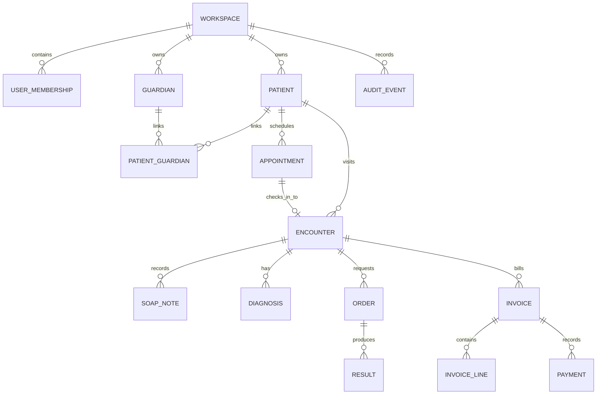

# EMR Domain Entity Map

This document maps the core CLAiR EMR domain entities in product language. It explains what each object means, who owns it operationally, and how it relates to the outpatient workflow.

This is not a database schema. Actual tables, migrations, RLS, indexes, and RPC details belong in `docs/engineering/data-model/` and scoped engineering work.

## Core Relationship

## Entity Groups

| Group | Entities | Product purpose |
| --- | --- | --- |
| Tenant and access | Workspace, user, membership, invitation, role, permission | Determines who can enter which hospital workspace and what they can do. |
| Customer master | Guardian, patient, patient-guardian relationship, consent | Provides reusable customer and patient context across reception, chart, billing, and history. |
| Outpatient workflow | Appointment, encounter, waiting queue | Turns a planned or walk-in visit into a trackable workflow episode. |
| Clinical record | SOAP note, diagnosis, prescription | Captures clinical judgment and plan around the encounter. |
| Operational orders | Order group, order, assignment, order event | Tracks support work such as lab, imaging, dispensing, and treatment. |
| Result artifacts | Lab result, imaging study, attachment | Stores outputs and evidence from ordered work. |
| Billing | Invoice, invoice line, payment | Converts billable work into charge lines and payment state. |
| Safety and operations | Audit event, denial, status history | Preserves important changes and supports review. |

## Entity Definitions

| Entity | Meaning | Key relationships | MVP rule |
| --- | --- | --- | --- |
| Workspace | One approved hospital operating space | Owns members and EMR data | Every live-capable data object must be workspace-scoped. |
| User | Login identity known to the app | Has memberships | Identity alone does not grant workspace access. |
| Membership | User's active relationship to a workspace | Has roles/status | Authorization source for workspace permissions. |
| Invitation | Pending entry path into a workspace | Creates/activates membership | Real email delivery remains approval-gated. |
| Guardian | Customer/protector contact | Links to one or more patients | May contain sensitive contact data; use synthetic data by default. |
| Patient | Animal receiving care | Links to guardians, appointments, encounters | Clinical workflow should use patient plus encounter context. |
| Consent | Recorded permission or agreement | Usually guardian and optionally patient scoped | Consent history should not be silently overwritten. |
| Appointment | Planned visit | May become encounter on check-in | Cancellation/no-show remains historical. |
| Encounter | One outpatient visit/work episode | Connects chart, orders, invoice, audit | Main workflow spine object for MVP. |
| Waiting queue entry | Operational queue item | Points to encounter | Display state, not canonical clinical/billing truth. |
| SOAP note | Clinical note | Belongs to encounter and author | Signed/amended/voided states need history. |
| Diagnosis | Clinical assessment label | Belongs to encounter | Direct input/search is MVP; AI diagnosis is out of scope. |
| Prescription | Medication plan | Belongs to encounter, may produce dispensing order | Live medication safety engine is out of scope. |
| Order | Requested work | Belongs to encounter and optional group | State drives lab/imaging/dispensing/treatment handoff. |
| Result/study | Output from an order | Links to order/encounter | Manual entry is MVP; device/PACS integration is approval-gated. |
| Invoice | Billing summary | Belongs to encounter | Server-side amount recalculation is required for live-capable work. |
| Invoice line | Billable item | May link to order/service item | Tampering must be rejected server-side in live-capable paths. |
| Payment | Payment state record | Belongs to invoice | Synthetic payment is not provider confirmation. |
| Audit event | Safe record of important mutation | Workspace scoped | Exclude secrets, raw tokens, and unnecessary sensitive payloads. |

## Ownership Rules

- Workspace owns the data boundary.
- Encounter owns the outpatient workflow context.
- Patient/guardian master records provide reusable context but should not replace encounter-specific state.
- Orders and results should not become orphaned from encounter context.
- Invoice lines must be traceable to billable work or explicit manual billing decision.
- Audit events should reference the object changed, not duplicate full sensitive records.

## Product Questions Before Adding An Entity

1. Which workflow problem does the entity solve?
2. Does it belong to workspace, patient, guardian, encounter, order, invoice, or audit context?
3. Who can create, view, update, cancel, delete, or restore it?
4. Does it need history rather than overwrite?
5. Is the data synthetic, local-first, remote staging, or live?
6. What must be excluded from audit, logs, screenshots, and HTML reports?

## Related Docs

- [Outpatient Workflow State Model](outpatient-workflow-state-model.md)
- [Product MVP Scope](../roadmap/product-mvp-scope.md)
- [Workspace Auth and Permission Domain](workspace-auth-permissions.md)
- [DB Structure Spec KO](../../engineering/data-model/emr-saas-db-structure-spec.ko.md)
