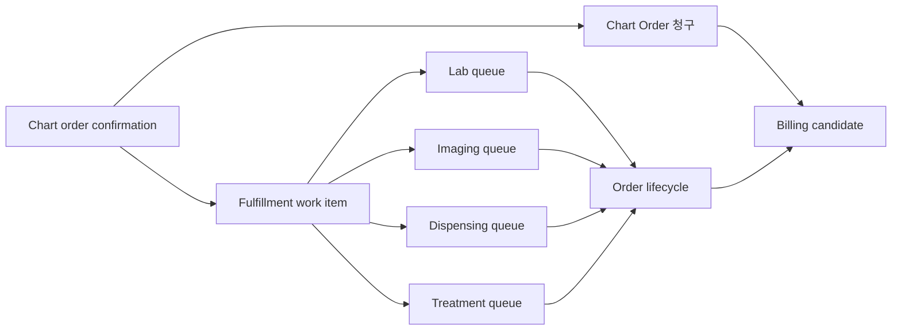

# Order Fulfillment Handoff

This document defines the product-level handoff from chart-confirmed orders to lab, imaging, dispensing, treatment, and billing work. It is a domain contract, not a schema or migration plan.

## Why This Exists

The staging pilot can show a guided synthetic outpatient flow from reception through chart, lab/imaging, dispensing/treatment, and billing. However, the current product claim must stay narrow: lab, imaging, dispensing, and treatment screens are visible, but full live persistence for every downstream path is not complete.

`DEN-235` establishes the next product contract: after a vet confirms an order, the correct downstream team should receive a work item, update its state, and feed completion back into order lifecycle and billing candidate readiness.

## Boundary

| Boundary                       | Claim                                                                                                          |
| ------------------------------ | -------------------------------------------------------------------------------------------------------------- |
| Current demo-visible path      | Synthetic fixtures can show the handoff story in a guided demo.                                                |
| Current local-first foundation | Chart/order/billing persistence routes exist for selected scoped paths.                                        |
| Target for Project 08          | Confirmed orders create server-backed fulfillment work items and downstream status changes.                    |
| Not claimed yet                | Production readiness, real data, provider/device/PACS/payment integration, or full legal/compliance readiness. |

## Product Flow

## Objects

| Object                         | Meaning                                                                       | Product owner                             |
| ------------------------------ | ----------------------------------------------------------------------------- | ----------------------------------------- |
| Order                          | Encounter-owned request created or confirmed by chart workflow                | Vet                                       |
| Fulfillment work item          | Operational task generated from a confirmed order                             | Technician or responsible queue           |
| Queue item                     | Screen-specific presentation of fulfillment work                              | Lab/imaging/dispensing/treatment operator |
| Result or execution record     | Output or completion evidence for the work item                               | Technician, then vet review where needed  |
| Billing queue item / candidate | Server-owned payable handoff created by chart billing action or approved sync | Billing operator                          |

## Order Type Mapping

| Order type            | Destination       | Required display context                                                 | Notes                                                        |
| --------------------- | ----------------- | ------------------------------------------------------------------------ | ------------------------------------------------------------ |
| `lab`                 | Lab queue         | patient, encounter, requested test, requesting vet, priority, due time   | Result entry and vet review may be separate states.          |
| `imaging`             | Imaging queue     | patient, encounter, modality/body part, requesting vet, priority         | PACS/device integration is not part of this contract.        |
| `dispensing`          | Dispensing queue  | medication name, route, frequency, quantity, instruction, requesting vet | Inventory, lot/expiry, and label printing are out of scope.  |
| `treatment`           | Treatment queue   | treatment name/type, body site if any, instruction, expected duration    | Technician completion may not equal vet clinical review.     |
| billable-only service | Billing candidate | encounter, service item, server-calculated amount                        | No downstream clinical queue unless `task_required` is true. |

Phase-1 permission policy: treatment and dispensing fulfillment share the same operational permission boundary. `dispensing:view` and `dispensing:complete` cover both queues until a later approved permission split. 마약류 are not included in this shared boundary; controlled-substance workflows need a separate future security and permission design.

## State Model

Fulfillment work item states are intentionally operational. They do not replace canonical order, result, invoice, or audit state.

| State         | Meaning                                        | Normal next states                                  |
| ------------- | ---------------------------------------------- | --------------------------------------------------- |
| `requested`   | Work item was generated from a confirmed order | `accepted`, `in_progress`, `cancelled`, `returned`  |
| `accepted`    | A team or assignee acknowledged the work       | `in_progress`, `completed`, `cancelled`, `returned` |
| `in_progress` | Work has started                               | `completed`, `cancelled`, `returned`                |
| `completed`   | Work is operationally complete                 | terminal for the work item                          |
| `cancelled`   | Work should not proceed                        | terminal with reason                                |
| `returned`    | Work was sent back for chart/order correction  | `requested`, `cancelled` after chart action         |

## Transition Rules

* Chart confirmation creates or updates fulfillment work items only for orders that require downstream work.
* Creation must be idempotent. Retrying the same confirmation must not create duplicate active work items.
* Cancelling an order must decide whether active fulfillment work is cancelled, returned, or locked for review.
* Completing a work item can update order lifecycle, but completion is not the only path to billing candidate creation.
* Billing candidates must use server-owned service item and price snapshots. Client-submitted amount is not trusted.
* Confirmation may create an internal `candidate_created` record from the frozen snapshot. That record is billing-ready input, not yet a payable handoff.
* `Order 청구` is the encounter-scoped chart action that atomically links every eligible confirmed candidate to one invoice across `lab`, `imaging`, `dispensing`, and `treatment`. Table checkbox selection is not its scope.
* `Order 청구` must not change encounter or operational work status. `requested + 청구됨`, `in_progress + 청구됨`, and `completed + 청구됨` are all valid combinations.
* `Order 청구` means the eligible confirmed orders have been intentionally requested for payment. They appear in Billing as invoice-linked payable rows regardless of operational work status, except cancelled rows. Draft amounts remain estimate-only.
* The billing workspace should not require a second user-facing `청구 확정` step before payment. The primary billing action should be `수납 진행` or `결제 진행`, after the billing user reviews selected rows, optional add-on sale items, discounts, surcharges, and memo context.
* If the implementation needs an immutable amount snapshot before payment provider handoff, that confirmation should be an internal checkout preparation/issue transition tied to `수납 진행`, not a separate primary UX step named `청구 확정`.
* Payment completion happens through `수납 완료`; it must change payment state only and must not be the first point where candidates become visible.
* `미납` should represent an explicit deferred/overdue payment state with a reason, not the default state for every unpaid same-day queue item.
* If selected orders include unfinished work, the UI must ask: `아직 완료되지 않은 오더가 있습니다. 수납을 진행할까요?` and show each unfinished order name with its current status badge.
* Vet result review and re-request remain clinical/result workflow actions. They must not be treated as the default billing gate.
* Workspace catalog confirmations can create fulfillment work items from the applied snapshot even when the selected catalog row does not yet exist in the legacy mock `orders` fixture. The fulfillment source snapshot remains minimal and should contain display, billing, instruction, routing, and service item context only.
* Queue readback may add current patient, guardian, and requester labels as a separate workspace-scoped presentation projection. It must not rewrite the frozen source snapshot.
* Lab, imaging, dispensing, and treatment operating-date navigation writes `date` to the URL so the queue, header, content, and history surfaces read one date boundary.
* A selected queue row writes its exact result/study/work-item id together with the matching encounter and date. Date changes clear that selection, and cross-module navigation drops module-owned selection ids.
* Every mutation must be workspace-scoped and actor-scoped.
* Unauthorized, cross-workspace, invalid transition, and duplicate mutation attempts must keep state unchanged and return safe errors.

## Staff Profile Assigned-Work Read

The profile side panel may summarize work items currently assigned to a staff
member without creating a second work-history model.

- The read is authenticated, workspace-scoped, and limited to an active
  same-workspace target membership.
- Active work follows the current `assigned_to_user_id`. Terminal work retains
  its last assignee, so completed/cancelled/returned rows remain attributable
  without adding a duplicate assignment-history table.
- Pages contain at most 20 rows ordered by `created_at DESC, id DESC`; the opaque
  cursor represents only that stable boundary. Group labels use the hospital
  workspace timezone.
- The response is a minimal presentation projection: category, display title,
  patient/guardian/requestor labels, status, request time, and operating date.
  It never returns the complete source snapshot or internal instructions.
- A detail URL is a server-filtered capability, not an authorization grant. It
  is omitted unless the caller has `lab:view`, `imaging:view`, or the shared
  phase-1 `dispensing:view` permission for dispensing/treatment. The target
  module still performs its own server-side checks.

## Billing State Matrix

| Work state                  | Billing handoff rule                                                                                | User confirmation       |
| --------------------------- | --------------------------------------------------------------------------------------------------- | ----------------------- |
| `requested`                 | Confirmed candidate can be invoice-linked by encounter `Order 청구`                                  | Unfinished warning      |
| `accepted` / `in_progress`  | Confirmed candidate can be invoice-linked by encounter `Order 청구`                                  | Unfinished warning      |
| `completed`                 | Confirmed candidate can be invoice-linked by encounter `Order 청구`                                  | Not required by default |
| `re_requested` / `returned` | Can be invoiced only after explicit unfinished/rework acknowledgement                                | Required                |
| `cancelled`                 | Must not create or link a new active billing candidate                                               | Not applicable          |
| Existing invoice link       | Replaying the same `Order 청구` command returns the same invoice handoff and must not duplicate an invoice line or audit event | Not required by default |

## Billing Checkout Timing

| Step                     | Product meaning                                                                                                                                          | Data authority                                                                                                     |
| ------------------------ | -------------------------------------------------------------------------------------------------------------------------------------------------------- | ------------------------------------------------------------------------------------------------------------------ |
| `Order 청구`               | Chart user requests payment for all currently eligible confirmed encounter orders. Draft rows remain estimate-only.                                      | Server-owned candidates are atomically invoice-linked. Encounter and work status are preserved.                    |
| Billing workspace review | Billing/front desk sees `수납대기` / `수납 후보` rows, can combine guardian-owned patient balances, add approved non-clinical sale items, and apply adjustments. | Candidate-backed invoice rows remain payable but distinguishable from paid history.                                |
| `수납 진행` / `결제 진행`        | Billing/front desk presents the final amount and starts checkout/payment.                                                                                | Server recalculates and snapshots the final payable amount; invoice may move to `issued` internally at this point. |
| `수납 완료`                  | Payment has been completed.                                                                                                                              | Payment state changes to paid/approved against the checkout amount.                                                |
| `미납 처리`                  | Guardian leaves, defers, declines, or due date passes after amount presentation.                                                                         | Payment state changes to unpaid with actor, reason, and follow-up visibility.                                      |

The 2026-05-31 guardian-centered billing review supersedes the earlier user-facing `청구 확정` language from DEN-349. Candidate creation belongs to `Order 청구`; the billing screen should focus on guardian-level checkout selection and `수납 진행`; payment completion belongs to `수납 완료`. The current implementation already inserts/updates `invoice_lines` during candidate sync, which fits this product flow better than a strict candidate-to-line promotion step. See [Guardian-Centered Billing Checkout Flow](https://github.com/mcso0/emr-app-shell-prototype/blob/main/docs/design/flows/guardian-centered-billing-checkout-flow.md) for the UX implementation contract.

## Role Expectations

| Action                                         | Hospital admin               | Vet                          | Technician      | Front desk / billing     |
| ---------------------------------------------- | ---------------------------- | ---------------------------- | --------------- | ------------------------ |
| Confirm order                                  | Oversight only unless scoped | Yes                          | No              | No                       |
| Accept/start fulfillment                       | Oversight if scoped          | Usually no                   | Yes             | No                       |
| Complete lab/imaging/treatment/dispensing work | Oversight if scoped          | Review if scoped             | Yes             | No                       |
| Return work for correction                     | Oversight if scoped          | Yes                          | Yes if reasoned | No                       |
| Sync billable candidate                        | Oversight                    | Yes through chart `Order 청구` | No              | Yes within billing scope |
| Issue/payment finalization                     | Admin oversight              | View                         | No              | Yes within billing scope |

## Demo And Claim Language

Safe wording:

* "The representative outpatient workflow is visible end to end."
* "Project 08 is the track that turns chart-confirmed orders into server-backed downstream work queues."
* "Payment providers, PACS, device ingestion, and production data remain outside this claim."

Do not say:

* "Every lab/imaging/dispensing/treatment path is fully live."
* "External devices or PACS are integrated."
* "Real patient data or production pilots are ready."

## Open Decisions Before Implementation

* DEN-335 replaces the earlier lab/imaging-only billing gate with a unified rule: chart `Order 청구` can advance billable orders to billing candidate state for lab, imaging, dispensing, and treatment, while unfinished orders require explicit user confirmation.
* DEN-280 resolves the MVP technician cancellation policy: technicians can return work to chart with a reason, but should not cancel order work in phase 1.
* DEN-280 resolves the MVP billable-only policy: billable-only service items can skip fulfillment and create billing candidates directly from chart confirmation.
* Whether medication dispensing completion requires inventory or label-printing fields in a later project.
* Which role names and permissions map to each mutation if the current permission set is insufficient.
* 마약류 / controlled-substance workflow policy is a separate future security and permission scope. It is not implemented in this contract and should require veterinarian-only authority or explicit controlled-substance permission.

See [Workspace Order Catalog Platform](https://github.com/mcso0/emr-app-shell-prototype/blob/main/docs/product/domain/workspace-order-catalog-platform.md) for the product policy that links workspace catalog destination, chart snapshots, fulfillment routing, and billing readiness.

## Related Docs

* [Outpatient Workflow State Model](outpatient-workflow-state-model.md)
* [EMR Domain Entity Map](emr-domain-entity-map.md)
* [Mock And Live Boundary Map](../../engineering/architecture/mock-live-boundary-map.md)
* [Order Fulfillment Handoff Engineering Contract](../../engineering/data-model/order-fulfillment-handoff-contract.md)
