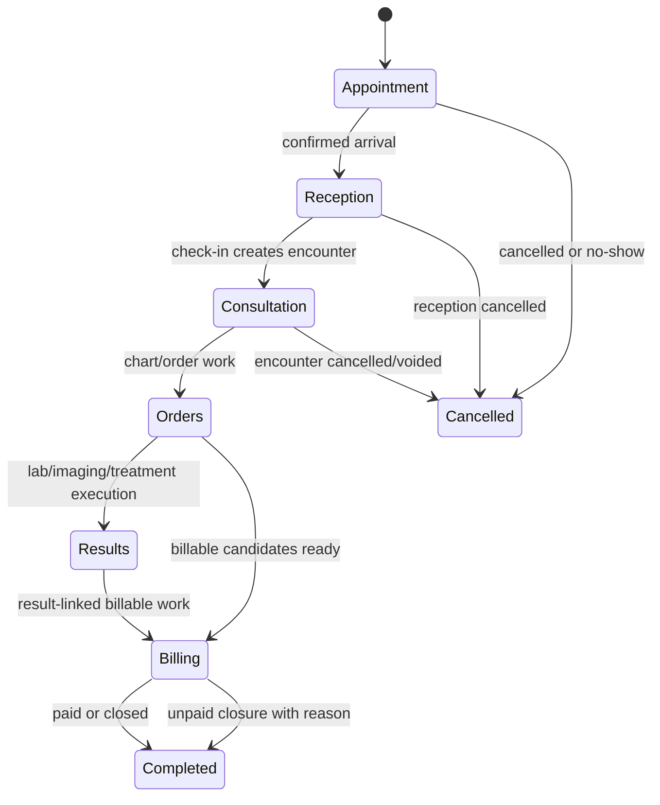

# Outpatient Workflow State Model

This document defines the product-level state model for the CLAiR EMR outpatient workflow. It explains how appointment, reception, encounter, chart, order, result, billing, and audit states should move together.

Use this before implementing or changing outpatient screens, APIs, tests, or QA scenarios. This is a product/domain document, not a DB schema or migration plan.

## Scope

This model covers the Product MVP outpatient spine:

Out of scope for this document:

- database schema, migrations, RLS, or RPC design
- production payment/refund/provider behavior
- full inpatient lifecycle
- automatic device or external provider integration
- final legal/compliance record policy

## State Objects

| Object | Product meaning | Primary owner |
| --- | --- | --- |
| Appointment | Planned visit before the patient is checked in | Front desk |
| Encounter | One outpatient visit/work episode after check-in | Front desk, vet |
| Waiting queue entry | Operational queue position for reception, consultation, treatment, or billing | Front desk, clinical support, billing operator |
| SOAP/chart | Clinical record for the encounter | Vet |
| Order | Requested clinical/support work such as dispensing, treatment, lab, or imaging | Vet, technician |
| Result/study | Manual or future provider-backed output from lab/imaging/treatment | Technician, vet |
| Invoice | Billable summary for the encounter | Front desk, billing operator, hospital admin |
| Audit event | Safe history of important workflow, role, billing, or clinical changes | System |

## Appointment States

| State | Meaning | Normal next states |
| --- | --- | --- |
| `requested` | Appointment request exists but is not confirmed | `confirmed`, `cancelled` |
| `confirmed` | Hospital accepted the appointment | `changed`, `checked_in`, `cancelled`, `no_show` |
| `changed` | Time, assignee, or purpose changed | `confirmed`, `checked_in`, `cancelled`, `no_show` |
| `checked_in` | Patient arrived and encounter was created | Encounter `waiting` |
| `cancelled` | Appointment intentionally cancelled before visit | terminal |
| `no_show` | Patient did not arrive | terminal |

Rules:

- Appointment check-in must create or link one encounter.
- `cancelled` and `no_show` should remain visible in guardian/patient history.
- Appointment changes need actor, time, and reason when they affect operational schedule.

## Encounter States

| State | Meaning | Normal next states |
| --- | --- | --- |
| `waiting` | Patient is checked in and waiting for consultation | `in_consultation`, `cancelled` |
| `in_consultation` | Vet has started clinical work | `ordered`, `ready_for_billing`, `cancelled` |
| `ordered` | One or more orders or billable items exist and work is not fully closed | `ready_for_billing`, `cancelled` |
| `ready_for_billing` | Clinical/order work is ready to be billed | `completed`, `ordered` |
| `completed` | Visit is closed after payment or approved unpaid closure | terminal |
| `cancelled` | Encounter was cancelled or voided before normal completion | terminal with reason |

Primary transition rules:

| Transition | Trigger | Required checks |
| --- | --- | --- |
| none -> `waiting` | appointment check-in or walk-in reception | active workspace, patient, guardian if available, reception authority |
| `waiting` -> `in_consultation` | vet starts consultation | active encounter, assigned or allowed vet, queue state update |
| `in_consultation` -> `ordered` | order or billable clinical item created | chart/order authority, workspace-scoped item |
| `in_consultation` -> `ready_for_billing` | no order remains and chart can close | chart completion intent, billable candidates ready |
| `ordered` -> `ready_for_billing` | required orders completed or intentionally bypassed | open order check, result/review state if relevant |
| `ready_for_billing` -> `completed` | invoice paid or approved unpaid closure | billing authority, invoice/payment state, audit event |
| any non-terminal -> `cancelled` | cancellation/void | reason, actor, downstream cleanup or lock decision |

## Queue States

| Queue type | Meaning | Typical states |
| --- | --- | --- |
| `reception` | New or pending front desk work | `waiting`, `called`, `in_progress`, `done`, `cancelled` |
| `consultation` | Patient waiting for or inside consultation | `waiting`, `called`, `in_progress`, `done`, `cancelled` |
| `treatment` | Order execution queue | `waiting`, `called`, `in_progress`, `done`, `cancelled` |
| `billing` | Billing or payment queue | `waiting`, `called`, `in_progress`, `done`, `cancelled` |

Rules:

- Queue state is operational display state. It must not replace encounter/order/invoice truth.
- A queue item can be `done` while the encounter remains `ordered` or `ready_for_billing`.
- Cancelling a queue item does not automatically cancel the encounter unless the transition explicitly says so.

## Chart And SOAP States

| State | Meaning | Normal next states |
| --- | --- | --- |
| `draft` | Vet is composing the chart | `autosaved`, `signed`, `voided` |
| `autosaved` | Draft was saved automatically | `signed`, `amended`, `voided` |
| `signed` | Chart note is finalized for the current workflow | `amended` |
| `amended` | Signed note has a later correction | `amended` |
| `voided` | Note should not be treated as active clinical record | terminal with reason |

Rules:

- SOAP/chart status is not the same as encounter status.
- A signed chart can support `ready_for_billing`, but billing may also depend on open orders.
- Amendments need reason, actor, timestamp, and audit/history.

## Order States

| State | Meaning | Normal next states |
| --- | --- | --- |
| `requested` | Vet requested work | `in_progress`, `re_requested`, `confirmed`, `cancelled` |
| `re_requested` | Order was sent back or changed after initial request | `in_progress`, `confirmed`, `cancelled` |
| `in_progress` | Technician/support work has started | `confirmed`, `completed`, `cancelled` |
| `confirmed` | Result or execution is ready for vet/billing review | `completed`, `re_requested`, `cancelled` |
| `completed` | Work is finished for the MVP workflow | terminal |
| `cancelled` | Order is cancelled and should not create new active work | terminal with reason |

Rules:

- Order work status can be simpler than order state: `pending` or `completed`.
- Result review and work execution can be separate, especially for lab/imaging. Billing candidate state is also separate and may advance through chart `Order 청구` without marking work complete.
- If unfinished selected orders are billed, the UI must confirm: `아직 완료되지 않은 오더가 있습니다. 수납을 진행할까요?`
- Cancelling an order must decide whether existing invoice candidates are removed, voided, or retained with explanation.
- Editing quantity, billable item, or status after billing candidate creation should produce audit/history.

## Result And Study States

| Object | States | Product rule |
| --- | --- | --- |
| Lab result | `pending`, `received`, `entered`, `completed`, `reviewed` | MVP supports manual entry; result review is separate from billing candidate state. |
| Equipment receipt | `received`, `matched`, `unmatched`, `ignored` | Use only as local/mock or future provider boundary unless approved. |
| Imaging study | `requested`, `captured`, `reading`, `read`, `reviewed` | Vet review and billing candidate state should be distinguishable. |

Rules:

- Result entry can complete an order operationally, but vet review may still be pending.
- Result correction needs reason, actor, timestamp, and safe audit payload.
- Attachments must be linked to the correct workspace, encounter, order/result, and patient context.

## Invoice And Payment States

| Invoice state | Meaning | Normal next states |
| --- | --- | --- |
| `draft` | Candidate-backed payable invoice exists in the billing queue; it is still selectable/editable before checkout | `issued`, `voided` |
| `issued` | Billing has started checkout / presented the payable amount; this can be an internal transition behind `수납 진행` | `paid`, `refund_requested`, `voided` |
| `paid` | Payment state is completed synthetically or by approved provider in future | `refund_requested` |
| `refund_requested` | Refund review was requested | `refunded`, `paid` |
| `refunded` | Refund is completed | terminal |
| `voided` | Invoice is cancelled before normal payment completion | terminal with reason |

| Payment state | Meaning |
| --- | --- |
| `none` | No payment intent or result exists |
| `unpaid` | Payment was explicitly deferred, declined, left unpaid after amount presentation, or became overdue; reason is required |
| `paid` | Payment completed in current approved scope |
| `failed` | Payment attempt failed |
| `refunded` | Payment refunded |

Rules:

- MVP/local-first billing may record synthetic payment completion; it is not provider confirmation.
- Server-side recalculation is required for amount integrity before payment/closure claims.
- Chart `Order 청구` should make selected billable orders visible as `수납대기` / payable billing candidates. They are not `미납` simply because same-day payment has not happened yet.
- `ready_for_billing` -> `completed` may happen through paid completion or approved unpaid closure with reason.
- Refund approval is not a generic front desk action; exact live refund policy remains a later product decision.

## Role-Based Transition Matrix

| Transition area | Hospital admin | Vet | Technician | Front desk |
| --- | --- | --- | --- | --- |
| Appointment create/change/cancel/no-show | Admin | View or limited update if assigned | View | Create/update/cancel/no-show |
| Check-in and encounter creation | Admin | View | View | Create/check-in |
| Start consultation | Admin | Start/update assigned or allowed encounter | View | View |
| SOAP/chart sign/amend/void | Admin for oversight; not default author | Create/sign/amend | No chart mutation | No chart mutation |
| Order request/change/cancel | Admin | Request/update/cancel | Complete assigned operational work; limited update | View |
| Lab/imaging/treatment result entry | Admin | Review/update if allowed | Enter/complete assigned work | View |
| Invoice issue/payment state | Admin | View | Support actions if explicitly scoped | Issue/payment front-desk actions |
| Refund approval/live payment policy | Admin only after explicit product decision | No | No | No |
| Audit review | Admin | Limited or none unless scoped | No | No |

Client UI can guide this matrix, but server/API/DB checks define completion for live-capable work.

## Exception States And Recovery

| Exception | Product handling rule |
| --- | --- |
| Appointment cancellation | Preserve appointment history with actor/time/reason when operationally meaningful. |
| No-show | Do not create a normal completed encounter; keep visible in patient/guardian history. |
| Reception cancellation after check-in | Cancel or void encounter only with reason and downstream state review. |
| Duplicate patient/guardian | Do not silently merge; record duplicate override or create a review path. |
| Open orders at billing | Block billing completion, bypass with reason, or keep encounter in `ordered`; do not silently complete. |
| Order cancellation after invoice candidate | Decide whether invoice line is voided, removed, or retained with explanation. |
| Result correction | Keep correction history; do not overwrite clinically meaningful result without trace. |
| Unauthorized transition | Deny with safe error and keep state unchanged. |
| Reload/reopen | State should be reconstructable from canonical object states, not screen-local assumptions. |

## Audit Expectations

Important transitions should produce an audit event or domain history record:

- check-in and encounter creation
- encounter status change
- SOAP sign, amend, or void
- order request, edit, cancel, complete, or re-request
- lab/imaging result entry, correction, or review
- invoice issue, line edit, payment state change, unpaid closure, refund request/approval
- permission-sensitive denial for mutation attempts

Audit payloads should exclude raw clinical note bodies, secrets, tokens, provider payloads, and unnecessary sensitive personal data.

## Open Product Decisions

These should be decided before live pilot or before implementation enters the affected area:

- Whether invoice issue/payment finalization should require additional vet review for selected high-risk result types. Billing candidate creation itself is not blocked by default under DEN-335.
- Whether front desk can close unpaid invoices without hospital admin approval.
- Exact live refund approval workflow and roles.
- Whether technicians can cancel orders or only mark operational completion.
- How long signed SOAP notes remain directly editable before amendment-only behavior.
- Whether result review by vet is required before final invoice issue for each order type.

## Implementation Guidance For Codex

Before adding or changing outpatient behavior, answer:

1. Which state object changes: appointment, encounter, queue, chart, order, result, invoice, payment, or audit?
2. What is the old state and new state?
3. Which role is allowed to trigger it?
4. What other screens or queues must reflect the change?
5. What happens on cancel, duplicate, unauthorized access, reload, and correction?
6. Is this mock/session-only, local-first, remote staging, or production/live?
7. What focused test or QA scenario proves it?

If the answer requires DB/RLS design, remote Supabase, production deploy, real data, live payment, provider integration, or role policy change, stop and ask 승욱 before proceeding.

## Related Source Docs

- [SaaS Operating Map](../service/clair-emr-saas-operating-map.md)
- [Product MVP Scope And Non-Goals](../roadmap/product-mvp-scope.md)
- [Product User Flow](../user-flows/emr-saas-userflow.md)
- [Legacy MVP Feature Spec](../features/legacy-mvp-feature-spec.md)
- [Workspace Auth and Permission Domain](workspace-auth-permissions.md)
- [EMR Domain Entity Map](emr-domain-entity-map.md)
- [Role And Permission Source Map](role-permission-source-map.md)
- [MVP Current Status](../../engineering/current-status.md)
- [Agent RAG Map](../../_meta/agent-rag-map.md)

## Next Baseline Docs

After this state model, define:

- [EMR domain entity map](emr-domain-entity-map.md)
- [role/permission source normalization](role-permission-source-map.md)
- [mock/live boundary map](../../engineering/architecture/mock-live-boundary-map.md)
- [persistence and data security checklist](../../engineering/auth-security/persistence-data-security-checklist.md)
