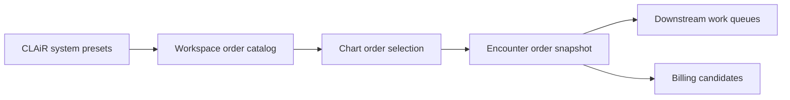

# Workspace Order Catalog Platform

This document defines the product contract for CLAiR EMR's workspace-scoped order catalog platform. It explains how CLAiR-provided presets become hospital-owned order catalog rows, how those rows are edited in hospital admin, and how chart-confirmed orders move into downstream work and billing.

## Product Meaning

`병원관리 > Order 관리` is the master catalog for all hospital work orders, not a single lab order list.

CLAiR provides default order presets. Each hospital workspace receives and customizes its own order catalog. Chart users then search the current workspace catalog, confirm orders on an encounter, and create immutable applied snapshots for clinical records, downstream fulfillment, and billing.



## Relationship To Existing Work

| Existing work                                               | Reuse                                                                                                                                                        | Required reinforcement                                                                                                           |
| ----------------------------------------------------------- | ------------------------------------------------------------------------------------------------------------------------------------------------------------ | -------------------------------------------------------------------------------------------------------------------------------- |
| Project 07 `Hospital Admin Order Catalog Persistence`       | Reuse the local-first catalog foundation, admin/chart read boundaries, mutation boundary, order set expansion, lab item delete locks, and pricing snapshots. | Add product policy for system preset auto-merge, hospital-admin-only MVP management, "사용 중지" UX, and full category coverage. |
| Project 08 `Clinical Order Fulfillment Handoff Persistence` | Reuse confirmed-order-to-fulfillment work item routes, source snapshots, queue adoption, lifecycle readback, and billing candidate sync foundations.         | Add routing policy from workspace catalog destination, separated billing state, and technician return-only policy.               |
| CSV/import planning                                         | Reuse no implementation.                                                                                                                                     | Design only a future-ready CSV template; do not build import in MVP phase 1.                                                     |

## MVP Product Decisions

### 1. First-Scope Order Coverage

The first MVP scope must include all major hospital work-order categories:

- 검사
- 영상
- 예방
- 처치
- 수술
- 입원
- 치료
- 처방/조제/의료물품

Leaving any of these out would make the hospital workflow feel incomplete.

### 2. Phase-1 Management Permission

For phase 1, only `hospital_admin` can create, edit, or stop using workspace catalog orders.

Future phases may allow managers or explicitly permitted vets, but that is a product permission change and needs a separate approval gate.

Implementation should still prefer a permission boundary such as `service_catalog:manage` so the role mapping can expand later without rewriting catalog behavior.

### 3. System Preset Auto-Merge

System preset updates should merge automatically with workspace catalogs:

| Preset update case                      | Phase-1 policy                                                                       |
| --------------------------------------- | ------------------------------------------------------------------------------------ |
| New CLAiR preset                        | Automatically add to workspace catalog when eligible.                                |
| Existing row not customized by hospital | Automatically update from the latest preset.                                         |
| Existing row customized by hospital     | Preserve hospital values; do not overwrite.                                          |
| Conflict or meaningful preset change    | Preserve hospital values and leave future "update available" review UX as follow-up. |

Implementation should track enough source metadata to support this later, such as source preset id, source preset version, imported version, and customized fields.

### 4. Stop Using, Not Hard Delete

The user-facing action should be `사용 중지`, not destructive delete.

Rules:

- Active rows can appear in chart search.
- Stopped rows remain visible in hospital admin for history and possible restoration.
- Stopped rows must not appear as new chart order candidates.
- Historical encounter order snapshots and billing records remain unchanged.
- Hard delete is not a normal product action for order catalog rows.

### 5. Price Change Policy

Phase 1 uses immediate price changes for future orders.

CLAiR does not provide an authoritative default or suggested price in phase 1. The hospital workspace owns the current price. The target contract distinguishes an unset price from an intentionally free zero price, and a billable order cannot become active while its price is unset. Existing non-null zero defaults are compatibility behavior until a scoped schema migration changes them.

Past chart and billing records are protected by applied snapshots. If a catalog price changes from 35,000 KRW to 40,000 KRW, already-confirmed encounter orders keep the old amount snapshot.

Effective dates and price history are deferred until real user feedback requires them.

### 6. Chart Confirmation Snapshot

Chart confirmation must copy the catalog values needed to preserve historical records:

- standard order name
- in-hospital order name
- billing name
- price
- sales unit
- tax inclusion
- amount basis
- target species context where relevant
- care guide and internal instruction where relevant
- billing reflection flag
- destination and task-required flags
- source preset id/version and workspace catalog row id

Later catalog edits affect future order selection only. They must not mutate existing encounter orders, fulfillment source snapshots, or billing candidate amounts.

### 7. Routing And Billing Policy

| Catalog destination | Phase-1 routing policy                                                                                                                 | Billing readiness                                                                    |
| ------------------- | -------------------------------------------------------------------------------------------------------------------------------------- | ------------------------------------------------------------------------------------ |
| `lab`               | Create lab fulfillment work item.                                                                                                      | Chart `Order 청구` can advance billing when billable; unfinished work requires confirmation. |
| `imaging`           | Create imaging fulfillment work item.                                                                                                  | Chart `Order 청구` can advance billing when billable; unfinished work requires confirmation. |
| `dispensing`        | Create dispensing work item.                                                                                                           | Chart `Order 청구` can advance billing when billable; unfinished work requires confirmation. |
| `treatment`         | Create treatment work item. Surgery and therapy-like work can start here in phase 1 unless a later separate surgery queue is approved. | Chart `Order 청구` can advance billing when billable; unfinished work requires confirmation. |
| `inpatient`         | Route to inpatient context when the downstream screen supports it; otherwise keep as explicit follow-up.                               | Billing readiness follows inpatient policy, not immediate outpatient completion.     |
| `billing_only`      | No clinical fulfillment task.                                                                                                          | Can create billing candidate directly from chart confirmation.                       |
| `chart_only`        | No downstream task.                                                                                                                    | Does not create billing candidate unless a later policy explicitly says so.          |

Technicians should not cancel order work in phase 1. They can return work to chart with a reason. Vet or hospital-admin policy can decide cancellation separately.

### 8. Result Review And Billing Separation

Lab, imaging, dispensing, and treatment completion are operational work states. They are separate from billing candidate state.

The billing flow is:

```text
chart user selects billable orders
→ Order 청구
→ unfinished selected work requires confirmation
→ billing candidate is created or refreshed
```

The unfinished-work confirmation copy is:

```text
아직 완료되지 않은 오더가 있습니다. 수납을 진행할까요?
```

The dialog must list each unfinished order name with its current status badge. Result review, vet confirmation, and re-request remain clinical/result actions. They do not block billing candidate creation by default.

### 9. Order Sets

Actual Order Set use in the chart is part of phase 1, but it follows the individual-order foundation inside that phase.

**Phase 1A** stabilizes individual-order CRUD, chart search, immutable confirmation snapshots, routing, and billing. **Phase 1B** then reuses those boundaries for immutable set revisions, one pinned child-set layer, chart expansion, encounter-copy editing, confirmation, routing, and billing.

Phase 1 is not complete until a valid active set can be selected in the chart, expanded to atomic orders, edited for that encounter, confirmed, snapshotted, routed, and billed without changing the hospital-admin preset.

The current Project 07 foundation remains useful, but its direct-child membership and chart-confirmation rejection are implementation gaps against this target. A parent set pins the exact child-set revision it reviewed; child changes create update review and never silently propagate into the parent.

### 10. CSV Template, Not Import

Phase 1 should design a CSV template only. It should not build CSV upload/import execution.

CSV template design means defining the future input shape:

- column names
- required and optional fields
- allowed values for category, destination, target species, status, and billing flags
- validation messages
- duplicate-detection candidates

CSV import implementation is a later project. It would include upload UI, parsing, row validation, merge/add decisions, failure reports, rollback or partial success policy, and import audit logs.

## Existing Technical Inventory

| Area                                   | Current artifact                                                                                                   |
| -------------------------------------- | ------------------------------------------------------------------------------------------------------------------ |
| Admin/chart catalog core               | `src/features/hospital-admin/server-order-catalog-core.ts`                                                         |
| Admin catalog route                    | `src/app/api/workspaces/[workspaceId]/hospital-admin/order-catalog/route.ts`                                       |
| Local-first catalog migration contract | `supabase/migrations/20260520152000_hospital_admin_order_catalog_persistence.sql`                                  |
| Catalog tests                          | `tests/hospital-admin-order-catalog-server.spec.ts`, `tests/hospital-admin-order-catalog-schema-migration.spec.ts` |
| Fulfillment core                       | `src/features/fulfillment/server-fulfillment-work-item-core.ts`                                                    |
| Chart confirmation action              | `src/features/chart/server-order-action-persistence-core.ts`                                                       |
| Fulfillment replay                     | `tests/fulfillment-handoff-replay.spec.ts`                                                                         |

## Implementation Guardrails

- DEN-307 adds the staging chart encounter-id bridge required for the live draft/confirmation path. Client/demo encounter ids such as `encounter-kong-260501` and `encounter-coco-260501` must be resolved on the server before calling live Supabase chart draft/action RPCs that require UUID encounter ids. The bridge remains workspace-member scoped and must not become a broad client-controlled encounter lookup.
- DEN-308 separates hospital-admin table bulk checkbox selection from row focus. New or saved catalog rows may be highlighted for user orientation, but they must not be auto-selected for bulk actions. Catalog read should show table skeleton rows, save/use-stop mutations should use blocking progress UI, and row switching must preserve the drawer workflow without bypassing server mutation permissions.
- DEN-309 replaces the auth gate's visible `로그인 확인 중` card with a workspace-shell skeleton while preserving unauthenticated and unauthorized redirects. Production/staging login surfaces must not expose mock development controls or the invite support side panel; invite context that is needed for the actual form stays in the primary login form and redirect parameters.
- DEN-335 separates order work status from billing candidate state. Chart `Order 청구` is the canonical chart action for moving selected billable lab, imaging, dispensing, and treatment orders to billing candidates; it must not mark unfinished work as completed.
- DEN-298 separates the public billing candidate sync input from trusted server-owned snapshot sync. Public `PATCH /billing/invoice-candidates` reads only `encounterId` and `orderIds`; client-submitted `orderSnapshots`, `priceKrw`, `lineTotalSnapshot`, and `billingName` are not authority for candidate creation. Chart confirmation and fulfillment completion remain the trusted server-owned paths that may pass applied/source snapshots to the invoice candidate gateway.
- DEN-299 wires Supabase-session chart confirmation to live workspace catalog and billing candidate gateways. Live chart confirmation must resolve catalog snapshots through `clair_list_order_catalog_chart_search` and create billing-only candidates through `clair_sync_billing_invoice_candidates`; mock catalog/billing fallback remains limited to demo/session-only paths.
- DEN-300 adds audit events for workspace catalog create, update, and use-stop mutations. Audit payloads include actor, workspace, request id, target catalog item id, changed fields, and minimal before/after catalog snapshots; they must not include raw SOAP, provider payloads, tokens, secrets, or unrelated clinical text.
- DEN-301 confirms phase-1 fulfillment permissions: treatment and dispensing queues intentionally share `dispensing:view` and `dispensing:complete`. 마약류 are excluded from this shared boundary and remain a separate future security/permission scope.
- DEN-289 security review found that public API input and trusted server-owned snapshot input must remain separate. Public billing candidate routes must not accept client-submitted amount/name snapshots as authority. Supabase chart confirmation routes also need live catalog and live billing gateways before live closeout can claim end-to-end catalog/billing correctness.
- DEN-288 connected the first billable catalog snapshot sync path. DEN-335 supersedes its timing policy: chart `Order 청구` can create or refresh billing candidates for billable lab, imaging, dispensing, and treatment orders without requiring operational completion first; unfinished work requires explicit user confirmation.
- DEN-287 connects server-confirmed catalog snapshots to downstream fulfillment work item queues for `lab`, `imaging`, `dispensing`, and `treatment`. Routing uses the persisted applied snapshot destination and task-required flag, preserves idempotent work item creation by order id, and copies only minimal display, billing, instruction, and routing context into the fulfillment source snapshot. `billing_only`, `chart_only`, and `taskRequired: false` catalog rows do not create fulfillment work items.
- DEN-286 connected chart confirmation for newly selected workspace catalog rows to a server-owned applied snapshot. The confirmation boundary resolves the active catalog row again, ignores client-supplied catalog price/name fields, stores the applied standard name, in-hospital name, billing name, price, sales unit, tax flag, amount basis, target species, care guide, internal instruction, destination, task-required flag, quantity, and line total snapshot, and rejects paused rows or Order Sets before confirmation. Order Set rejection is the confirmed current implementation gap; phase 1B must replace it with validated set expansion and confirmation before phase 1 can be called complete.
- DEN-285 connected chart `+ Order` selection to the workspace catalog chart-search route. Chart search now reads active workspace catalog rows and active order sets, filters candidates by patient species in the UI, excludes stopped/paused rows through the route boundary, and fills draft display, billing, instruction, and price candidates. Durable confirmation snapshot persistence remains DEN-286.
- DEN-284 connected hospital-admin drawer create, update, and `사용 중지` actions to the workspace catalog mutation boundary. Phase-1 UX treats the old delete affordance as use-stop: the row remains visible in hospital admin, future chart selection excludes it through `availabilityStatus: paused`, and historical snapshots remain untouched.
- DEN-291 clarified that the planning-only exclusions do not block implementation issues. For Order Platform implementation issues, the following are approved by 승욱:
  - app implementation
  - UI changes
  - API/core changes
  - local tests
  - repo migration file authoring when needed
  - local migration/static tests
- Do not run remote Supabase migration push, RLS replay, production deploy, or real data import without explicit approval.
- Keep Sales Demo and mock fallback paths working unless a scoped issue explicitly removes them.
- Do not trust client-submitted billing amounts.
- Keep source snapshots minimal. Do not include raw SOAP text, secrets, external provider payloads, tokens, or unnecessary personal data.
- Treat UI permission hiding as convenience only. Server/API/DB boundaries remain the security boundary.

## Related Docs

- [Order Catalog Preset Initialization Engineering Contract](../../engineering/data-model/order-catalog-preset-initialization-contract.md)
- [Hospital Admin Order Catalog Persistence Scope](../../engineering/auth-security/auth-login/hospital-admin-order-catalog-persistence-scope.md)
- [Hospital Admin Order Catalog Schema Plan](../../engineering/auth-security/auth-login/hospital-admin-order-catalog-schema-plan.md)
- [Hospital Admin Order Catalog Regression Handoff](../../engineering/auth-security/auth-login/hospital-admin-order-catalog-regression-handoff.md)
- [Order Fulfillment Handoff](order-fulfillment-handoff.md)
- [Order Fulfillment Handoff Engineering Contract](../../engineering/data-model/order-fulfillment-handoff-contract.md)
