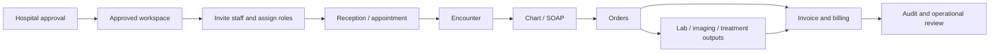

# CLAiR EMR SaaS Operating Map

This document is the compact product operating map for CLAiR EMR. It explains what the SaaS is, who it serves, what work it must connect, and what the current Product MVP can and cannot claim.

Use this before writing feature specs, implementation plans, QA scenarios, or Linear issues that affect product direction.

## One Sentence

CLAiR EMR is an invite-only B2B veterinary EMR SaaS for approved hospitals that connects reception, clinical charting, orders, billing, customer records, workspace permissions, and auditability around one hospital-scoped workflow.

## Product Problem

Veterinary hospitals often run daily work through fragmented screens, manual handoffs, duplicated data entry, unclear role boundaries, and weak operational visibility.

CLAiR EMR exists to reduce these failures:

- reception, charting, order execution, and billing lose shared context
- patient and guardian records are duplicated or updated inconsistently
- staff roles are unclear across clinical, front desk, billing, and admin work
- important changes are not easy to audit
- demo screens can look complete while live data, permissions, persistence, and operations remain incomplete

The product standard is not "does this screen exist?" The standard is:

> Can the hospital complete the workflow with correct data state, role authority, recovery path, and audit trail?

## Primary Customers And Users

| Group | Who they are | What they need from the product |
| --- | --- | --- |
| Buyer / sponsor | Hospital owner, director, or lead administrator | Confidence that the hospital can operate safely, adopt the system, and control staff access |
| Workspace admin | `hospital_admin` in an approved hospital workspace | Invite staff, manage roles, configure operating settings, review audit and operational health |
| Clinical users | Veterinarians and technicians | Fast charting, patient context, order creation/completion, result review, and safe clinical handoff |
| Front desk users | Reception and customer-facing staff | Appointment, walk-in reception, guardian/patient search, customer updates, billing handoff |
| Billing operators | Staff handling invoice and payment state | Accurate charge lines, payment state, unpaid handling, and amount integrity |
| CLAiR operators | Internal operator/support/admin role | Approve hospitals, create or approve workspaces, support pilot rollout, and avoid cross-tenant mistakes |

Current canonical MVP workspace roles are defined in [Workspace Auth and Permission Domain](../domain/workspace-auth-permissions.md): `hospital_admin`, `vet`, `technician`, and `front_desk`.

## Service Boundary

CLAiR EMR has three connected responsibility layers:

| Layer | Product question | Source of truth |
| --- | --- | --- |
| Hospital workflow | What work happens from reception to billing? | Product flow, feature specs, workflow state model |
| SaaS control plane | Who can enter, manage, and operate each hospital workspace? | Workspace auth, invitation, permission, tenant approval, audit docs |
| Technical safety boundary | What makes the product safe enough to pilot or launch? | Current status, mock/live boundary, persistence/security checklist, launch gates |

Do not judge a feature only by UI completion. For B2B SaaS readiness, check all three layers.

## Core Workflow Spine

The MVP workflow spine is:

The product can expand into inpatient care, device integration, messaging, analytics, migration, and AI only after this spine is reliable.

## Current Product MVP Meaning

Current Product MVP means:

- the app shows and tests a connected outpatient workflow from reception through billing
- workspace and role concepts exist and are moving toward server/API/DB enforcement
- local-first persistence and RLS foundations exist for important auth, workspace, customer, chart, order, billing, and audit paths
- the Sales Demo golden path remains a protected fixture and regression path
- live launch claims are still gated by approval, verification, and launch-readiness work

Current Product MVP does not mean:

- production is live
- remote Supabase has been approved and validated
- real hospital/customer/clinical/billing data can be used
- provider integrations are complete
- payment, email, PACS, device, KakaoTalk, accounting, or migration providers are connected
- compliance/legal review is complete

For the latest compact state, read [MVP Current Status](../../engineering/current-status.md). For detailed historical implementation notes, use [MVP Current Status History](../../engineering/current-status-history.md) only when needed.

## Operating Principles

| Principle | Practical rule |
| --- | --- |
| Workflow before screens | Define state transitions, ownership, and exception paths before adding isolated UI. |
| Workspace isolation before convenience | Every live-capable data path must be workspace-scoped and deny cross-workspace access. |
| Server authority before client gating | Hidden buttons and mock roles are UX only; server/API/DB/RLS checks define security completion. |
| Audit before live trust | Important identity, workspace, clinical, order, billing, and admin changes need an audit event path before pilot/live. |
| Local-first before remote/live | Local/mock and local Supabase work can continue by issue scope; remote Supabase, production, email, payment, and real data require explicit approval. |
| Synthetic data before real data | Development and demo work must use synthetic data unless real-data handling is explicitly approved. |
| Linear issue before implementation | Product changes should start from a scoped Linear issue or docs/work item with source docs, done criteria, and verification. |

## Mock, Local-First, And Live Claims

Use these words consistently:

| Term | Meaning | Can Codex proceed by default? |
| --- | --- | --- |
| Mock / session-only | Browser/session state or fixture data; useful for UI and demo behavior, not persistence proof | Yes, when scoped |
| Local-first | Local app or local Supabase-backed implementation with tests and synthetic data | Yes, when the issue scopes it |
| Remote staging | Remote Supabase or hosted non-production environment | No, requires explicit approval |
| Production/live | Customer-facing infrastructure or real operational data | No, requires explicit approval |

Approval gates are defined in [SaaS Launch Approval Gates](../../engineering/auth-security/auth-login/saas-launch-approval-gates.md).

## Baseline Decision Checklist

Before starting a product or implementation issue, answer these:

1. Which hospital workflow state changes?
2. Which role can view, create, update, complete, approve, cancel, export, or delete?
3. Which workspace owns the data?
4. What happens on cancel, correction, duplicate, unauthorized access, or reload?
5. Is the behavior mock, local-first, remote staging, or production/live?
6. What audit event or history record is needed?
7. Which existing source doc becomes more current after the change?
8. Which focused verification proves the change?

If any answer affects live infrastructure, real data, payment, email, role policy, or tenant isolation, stop and ask 승욱 before proceeding.

## Related Source Docs

- [MVP Current Status](../../engineering/current-status.md)
- [PRD](../prd/clair-emr-saas-prd.md)
- [Legacy MVP Feature Spec](../features/legacy-mvp-feature-spec.md)
- [Product User Flow](../user-flows/emr-saas-userflow.md)
- [Workspace Auth and Permission Domain](../domain/workspace-auth-permissions.md)
- [Invite-Only B2B SaaS Launch Architecture](../../engineering/auth-security/auth-login/invite-only-b2b-saas-launch-architecture.md)
- [SaaS Launch Approval Gates](../../engineering/auth-security/auth-login/saas-launch-approval-gates.md)
- [Agent RAG Map](../../_meta/agent-rag-map.md)

## Next Baseline Docs

This operating map intentionally stays high-level. The next product baseline docs should define:

- [MVP scope and non-goals](../roadmap/product-mvp-scope.md)
- [outpatient workflow state model](../domain/outpatient-workflow-state-model.md)
- [EMR domain entity map](../domain/emr-domain-entity-map.md)
- [role/permission source normalization](../domain/role-permission-source-map.md)
- [mock/live boundary map](../../engineering/architecture/mock-live-boundary-map.md)
- [persistence and data security checklist](../../engineering/auth-security/persistence-data-security-checklist.md)
