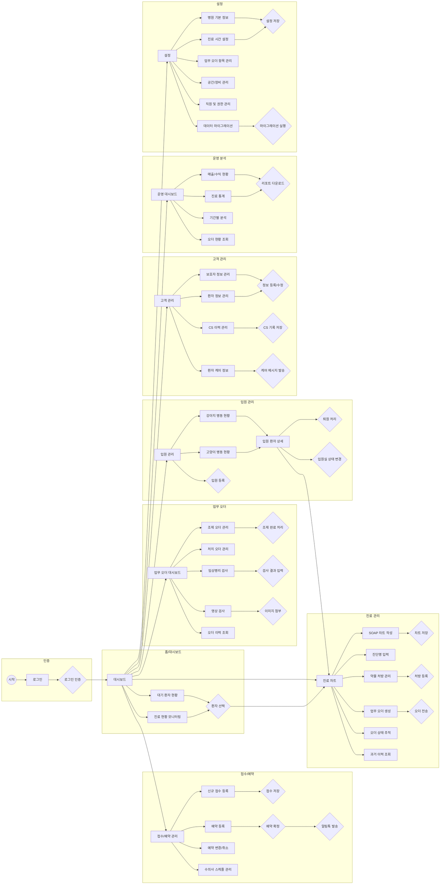
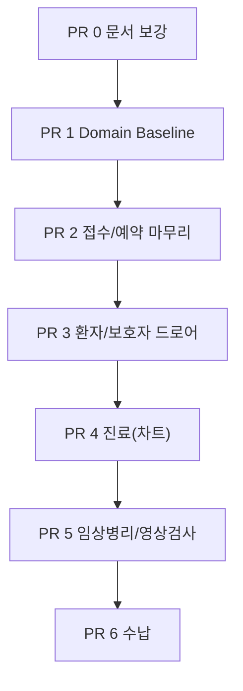
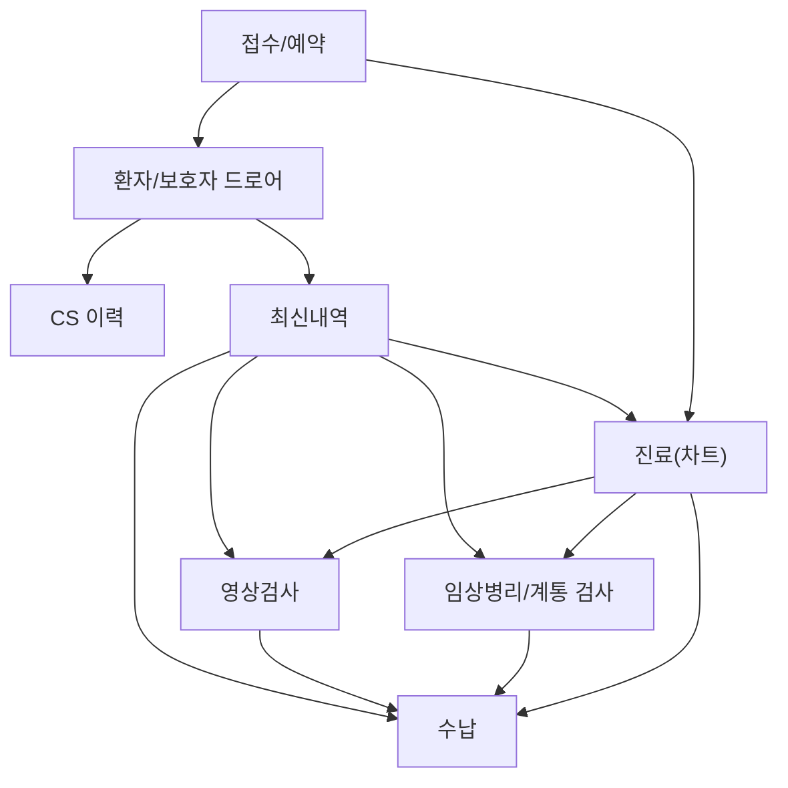

---

## 2026-05-02 MVP User Flow Addendum

### PR Execution Flow

### Operational Flow

### Flow Notes

- 접수/예약은 환자 정보바와 우측 상세 패널을 갖지 않는다. 필요한 상세 정보는 카드 선택 후 드로어에서 본다.
- 환자/보호자 드로어는 접수, 진료, 검사, 영상, 수납에서 재사용 가능한 정보 확인 진입점이다.
- 최신내역은 각 업무 화면으로 이동 가능한 shortcut 역할을 한다.
- 입원과 병원관리 전체 화면은 이번 MVP 흐름에서 제외한다.
