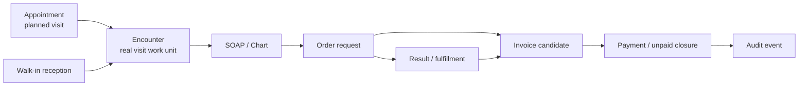
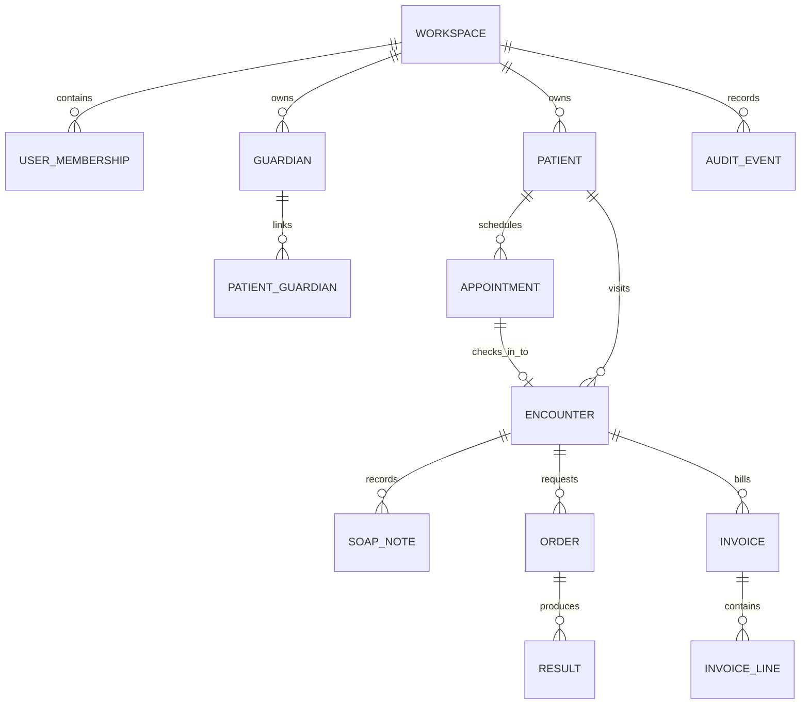
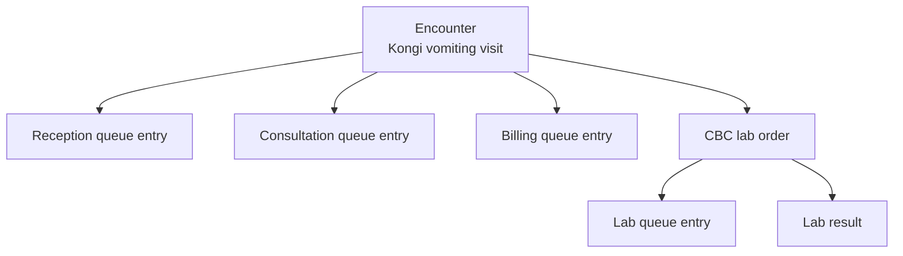
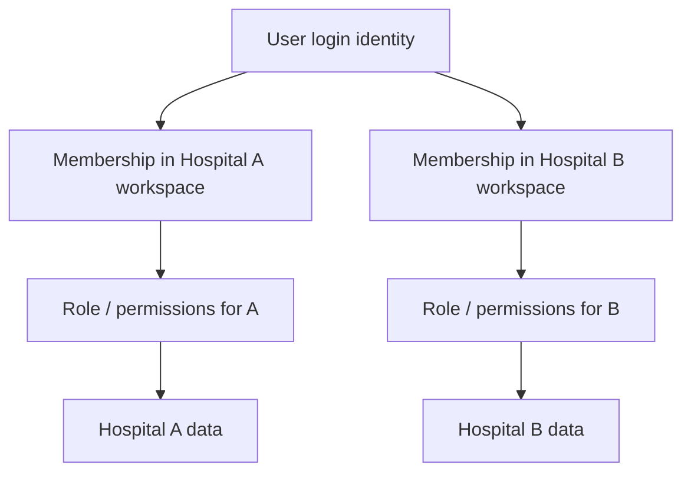
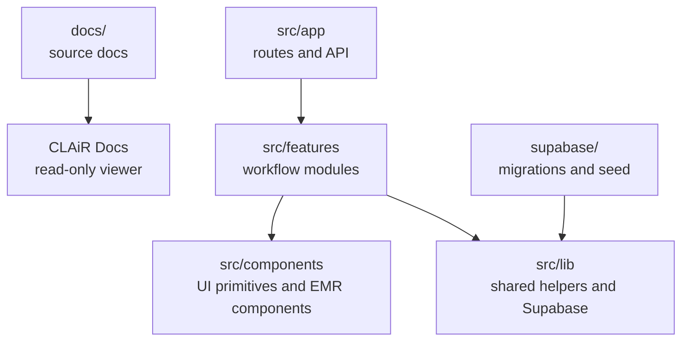

# Study Diagrams

These diagrams are simplified learning aids. Product and engineering source-of-truth diagrams remain in `docs/product` and `docs/engineering`.

## Outpatient Work Spine

Study note:

- Appointment is a possible future visit.
- Encounter is the actual visit work unit.
- Orders and billing should stay connected to the encounter.

## Entity Relationship Learning Map

Study note:

- Workspace is the tenant boundary.
- Encounter is the outpatient workflow context.
- Patient and guardian are reusable master records, not the visit itself.

## Queue Entry Mental Model

Study note:

- Queue entries are operational list rows.
- Encounter and order are the more durable source objects.
- A queue can be done while the encounter still has open chart, order, or billing work.

## Multi-Tenant Boundary

Study note:

- Login identity is not enough.
- Workspace membership determines which hospital data the user can access.
- Client UI can guide, but server/API/DB/RLS checks define live-capable security.

## Repo Structure Learning Map

Study note:

- `docs/` explains the product and engineering intent.
- `src/app` gives routes.
- `src/features` contains the actual workflow modules.
- `supabase/` holds database changes and synthetic seed data.
