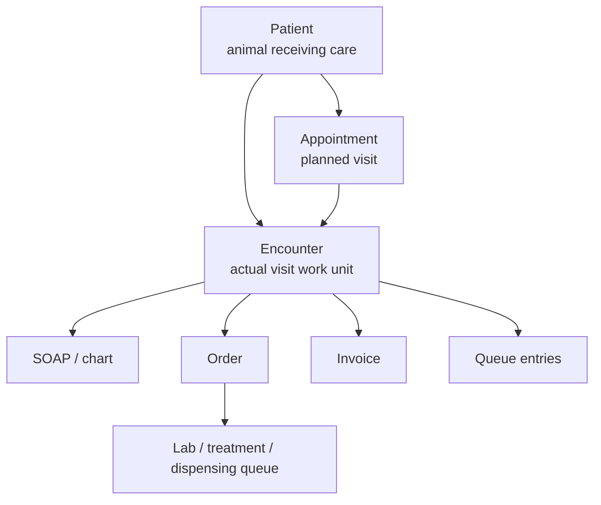

# 01. EMR Domain Basics

## Learning Goal

- Explain why `patient` alone is not enough as the main workflow unit.
- Explain `appointment`, `encounter`, and `queue entry` in plain language.
- Prepare for the next lesson about how `order` relates to `encounter`.

## Source Context

- `docs/product/domain/emr-domain-entity-map.md`
- `docs/product/domain/outpatient-workflow-state-model.md`
- `docs/product/service/clair-emr-saas-operating-map.md`

## Conversation Summary

승욱 asked to study the project structure with 루멘 as a teacher. The first lesson focused on the core EMR domain objects that make the outpatient workflow understandable: `patient`, `appointment`, `encounter`, `queue entry`, and `order`.

## 승욱's Answer: Why Encounter Exists

승욱 explained that an animal patient can have many visit records, so the service should not treat the animal itself as the basic work unit. The actual work unit is the visit episode that starts when the animal comes to the hospital and is checked in. Inside that visit episode, charting happens, orders are requested and performed, results can return, and billing can be requested or deferred.

루멘 confirmed this as the right model.

## 루멘's Correction And Model

`patient` answers:

> Who is this medical history about?

`encounter` answers:

> Which actual visit or outpatient work episode are we handling?

One patient can have many encounters:

```text
Patient: 콩이
  - Encounter: 2026-06-01 vomiting visit
  - Encounter: 2026-06-10 vaccination visit
  - Encounter: 2026-06-17 skin visit
```

Each encounter can have its own chart, diagnosis, orders, results, invoice, payment state, and audit history. If everything were attached directly to `patient`, past visits, today's visit, and future visits would become mixed.

## Appointment Vs Encounter

승욱 described `appointment` as a possible future encounter or an expected work unit. This is a useful mental model.

The precise distinction:

| Object | Meaning |
| --- | --- |
| `appointment` | Planned or scheduled visit. It can be confirmed, changed, cancelled, no-show, or checked in. |
| `encounter` | Real visit/work episode after check-in or walk-in reception starts the work. |

Important rules:

- Not every appointment becomes an encounter.
- A cancelled or no-show appointment can remain as history without creating an encounter.
- A walk-in can create an encounter without a prior appointment.

## Encounter Vs Queue Entry

승욱 described queue entry as the list of work that needs to be done. That is directionally correct.

The precise distinction:

| Object | Meaning |
| --- | --- |
| `encounter` | The actual visit/work episode. |
| `queue entry` | One visible row in an operational list that helps a team process an encounter or order. |

One encounter can appear in several operational queues:

- reception queue
- consultation queue
- treatment queue
- billing queue

Some queues can also be created from an `order`, not directly from the whole encounter. A lab order can create a lab queue entry, and a treatment order can create a treatment queue entry.

## Diagram



## Key Sentences

- `patient` is who the record is about.
- `encounter` is when a specific visit/work episode happened.
- `appointment` is planned; `encounter` is actual.
- `queue entry` is not the source work itself; it is a visible operational row for handling work.
- Orders usually belong to an encounter and can create downstream queue work.

## Review Questions

1. Why is `patient` too broad to be the main workflow unit?
2. When does an `appointment` become connected to an `encounter`?
3. Can an `encounter` exist without an `appointment`?
4. Why is a `queue entry` not the same thing as an `encounter`?
5. What kind of queue might be created from an `order` rather than directly from the whole encounter?

## Next Lesson

Next topic:

> How does `order` relate to `encounter`, charting, fulfillment, and billing?

This follows naturally because an encounter can contain charting work, but order requests are what push work into lab, imaging, treatment, dispensing, and billing handoff paths.
