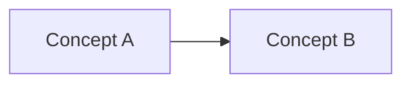

# Lesson Title

## Learning Goal

- Goal 1
- Goal 2

## Source Context

- `docs/...`
- `src/...`

## Conversation Summary

Short summary of what 승욱 asked and what 루멘 explained.

## 승욱's Answer

Record 승욱's own explanation in concise form.

## 루멘's Correction And Model

Confirm what was correct, clarify what was slightly off, and provide a durable mental model.

## Diagram

## Key Sentences

- Sentence 1
- Sentence 2

## Review Questions

1. Question 1
2. Question 2
3. Question 3

## Next Lesson

Next topic and why it follows from this lesson.
