# Clinical Master Order Execution Defaults Remediation

## 1. Purpose

This is the umbrella implementation plan for correcting the order-default
contract across CLAiR master data, workspace order management, chart
Plan/Order, and downstream execution.

The work must be delivered as small, independently reviewable child work
packages. This document does not authorize implementation, remote data writes,
clinical activation, or release by itself.

## 2. Goal

The repository already contains the main transport path:

```text
CLAIr master order and execution preset
  -> workspace-owned order_catalog_items
  -> chart order candidate and editable draft
  -> immutable confirmed order snapshot
  -> downstream work
```

The current defect is not the absence of this path. The defect is that the path
can transport an operationally incomplete preset and still report it as
present. Hospital Admin can then display synthetic fallback values that were
not stored in the master or workspace row, while the chart reads the persisted
values and correctly finds required fields missing. This makes Hospital Admin
look configured while chart confirmation is blocked.

The target is a stronger contract:

1. Every master order has a category-specific, versioned work specification.
2. Reusable operational defaults, formulas, units, rounding rules, instructions,
   and result definitions are stored with explicit ownership and provenance.
3. Each workspace receives a copy and authorized users may customize its local
   values without changing the CLAiR master.
4. A chart draft starts from the effective workspace values, adds legitimate
   encounter/runtime context, and allows patient-specific planned edits.
5. Confirmation freezes the final planned values.
6. Actual execution, actual prepared/administered quantities, measurements, and
   results are recorded separately and never overwrite the planned snapshot.
7. Every in-scope prototype master order is active, searchable, selectable, and
   confirmable without introducing a separate prototype-review lifecycle.
8. Hospital Admin and chart surfaces contain only orders that are actually
   persisted in the current workspace catalog. An empty catalog remains empty;
   no runtime fallback order or fallback field value is injected.
9. The Hospital Admin order table shows each order's category-specific core
   execution details directly in the row, while secondary details remain in the
   detail surface.
10. Hospital Admin provides a complete, auditable workspace view: exact row and
    category counts, correct classification, persisted detail values, status,
    editing, reload persistence, use-stop/reactivation, and chart-search parity.

## 3. Definition Of Done

This remediation program is complete only when all of the following are true:

1. Every in-scope master order has a category-specific, versioned work
   specification and is active, searchable, selectable, and confirmable while
   remaining explicitly synthetic and not clinically validated.
2. Every synthetic default is reproducible from a recorded source, generation
   rule, unit, formula, range, or explicit plausibility rationale. Arbitrary
   one-off values are not accepted.
3. Every required field is either supplied by the correct owner or resolved by
   a verified resolver. Reusable fields are not hidden behind unexplained
   `required_manual` policies.
4. Hospital Admin and chart search represent the same persisted effective
   defaults; neither surface invents configured values.
5. Every Hospital Admin or chart-search row resolves to an actual persisted
   current-workspace catalog identity. Empty and failed reads never substitute
   hard-coded, fixture, demo, master-only, or stale cached orders.
6. Each target workspace's Hospital Admin total and category counts match its
   persisted catalog exactly, with no missing, duplicate, fallback, stale, or
   foreign-workspace rows.
7. Every order appears under the correct category and subcategory, and every
   active chart-eligible order appears in `전체` and its correct chart category
   tab without creating a chart-only order.
8. Every Hospital Admin order row exposes the minimum category-specific details
   needed to identify and compare the work without opening the drawer. The row
   uses persisted values only and shows an explicit missing state when needed.
9. The Hospital Admin detail surface shows the same persisted defaults,
   prototype/clinical-evidence state, availability, source lineage, and relevant
   audit context used by the row and chart projection.
10. Authorized Hospital Admin edits survive save and reload; use-stop and
    reactivation change future chart availability without rewriting history.
11. Authorized workspace edits affect future orders in that workspace only and
    survive safe master updates at the field level.
12. Chart users receive effective defaults, can make patient-specific planned
    edits, and can confirm a semantically complete order.
13. Downstream staff receive the confirmed plan and record actual work/results
    separately.
14. Confirmed plan and result-definition snapshots remain unchanged after later
    master or workspace edits.
15. Category-specific semantic audits and representative end-to-end proofs pass
    for every supported category.
16. The current 522-order prototype baseline, or an explicitly versioned
    successor manifest, passes the complete all-category semantic gate with zero
    unresolved blocking findings.
17. Multi-workspace isolation, authorization, idempotency, conflict handling,
    and negative controls pass.
18. Remote rollout claims are backed by exact readback evidence rather than by
    non-empty JSON counts alone.

## 4. Background And Prototype Data Policy

### 4.1 Current product stage and source constraint

- CLAiR is currently a prototype even though deployable environments exist.
  Production-like deployment does not make the order content clinically
  validated production data.
- There is currently no partner hospital from which CLAiR can import an existing
  operational order catalog or hospital-authored default values.
- The prototype therefore needs a deterministic synthetic order dataset.
  Public standards, product information, reference material, and plausible
  veterinary-hospital workflows inform the values when usable evidence exists.
  When an exact value cannot be found, a documented functional fixture may be
  authored to complete the prototype workflow.
- Prototype functional completeness has priority over clinical accuracy in this
  program. This allows result entry, range display, judgment, re-request, and
  snapshot behavior to be exercised without presenting the values as suitable
  for clinical care.
- The synthetic values must be concrete enough to exercise master authoring,
  workspace adoption and editing, chart prefill and patient-specific editing,
  confirmation, fulfillment, result entry, and historical readback.
- The values belong in the master order records. They must not exist only as UI
  examples, placeholders, or Hospital Admin display fallbacks.

### 4.2 Prototype usage and evidence status

The product does not require a separate prototype-review lifecycle for these
orders. Do not introduce `review_pending`, `검수 대기`,
`prototype_review_complete`, or an equivalent review state merely to allow the
prototype flow.

The target state separates availability, data origin, and clinical evidence:

| Dimension              | Required prototype state                                                        |
| ---------------------- | ------------------------------------------------------------------------------- |
| Workspace availability | Active and copied into each in-scope workspace                                  |
| Chart usability        | Searchable, selectable, editable, and confirmable                               |
| Data origin            | Synthetic; research-informed where possible, explicit functional fixture otherwise |
| Intended use           | Prototype/demo workflow validation only                                         |
| Clinical validation    | Not clinically validated; no claim of veterinarian or partner-hospital approval |

If the current schema conflates availability with review or clinical
validation, a child work item must replace or map that field honestly. It must
not create a fake review-complete state or reuse a clinical-validation label to
enable prototype use.

Every affected record and user-facing detail surface must preserve an
equivalent of one of these provenance labels together with the clinical status:

```text
Active
Synthetic research-informed prototype data / Not clinically validated

or

Synthetic functional fixture / Not clinically validated
```

This policy is a product requirement, not merely display copy. An active
prototype order remains explicitly synthetic and not clinically validated.

### 4.3 Persisted-only order authority and zero-fallback rule

Hospital Admin order management and chart order search must show only orders
that exist as persisted rows in the current workspace's `order_catalog_items`
authority.

This rule is non-negotiable and has no runtime exception. Any fallback order or
invented field value is a release-blocking defect. Missing, empty, failed,
stale, or unauthorized data must remain visible as its true state.

The following runtime behavior is prohibited:

- injecting hard-coded or fixture orders when the workspace catalog is empty;
- merging a demo/default list into a live workspace catalog response;
- showing a master order before a persisted workspace copy exists;
- replacing a failed or unauthorized catalog read with fallback orders;
- reusing cached rows from another workspace or an earlier workspace state;
- displaying invented dose, unit, route, frequency, duration, quantity, price,
  or other field values as if they were saved defaults.

Required empty behavior:

```text
persisted workspace order count = 0
  -> Hospital Admin shows an explicit empty state
  -> chart search returns no workspace order candidates
```

Research-informed synthetic values and explicit functional fixtures are not
fallback values when they are authored by a documented generation rule,
versioned and persisted in the CLAiR master, adopted into the target workspace,
and read back from that workspace row. Their origin remains synthetic, but
their runtime authority is real persisted data. Runtime code must not invent a
replacement value because a persisted field is missing.

Fixtures may exist only in explicitly isolated tests, stories, or development
harnesses. They must not enter a runtime hospital workspace response or be used
to conceal an empty, failed, stale, or unauthorized read.

### 4.4 Hospital Admin table core-detail summary contract

`병원관리 > Order 관리` must expose each order's most important execution
details in the table row. Users must not need to open every drawer merely to
distinguish otherwise similar orders or verify that essential defaults exist.

The table must show only the minimum high-signal fields for the row's category:

| Category                    | Core details expected in the table row                                            |
| --------------------------- | --------------------------------------------------------------------------------- |
| Consultation/preventive     | Work scope/type, occurrence/timing, and concise instruction                       |
| Clinical laboratory         | Specimen, test or panel, and collection condition                                 |
| Imaging                     | Body region, position/views, and contrast/sedation state                          |
| Dispensing                  | Dose/unit, route, frequency, duration, and planned total quantity                 |
| Treatment                   | Method, site, amount/unit, and frequency or schedule                              |
| Hospitalization             | Duration, care level, monitoring interval, and assigned ward/cage when configured |
| System examination          | Body system, examination scope, and method                                        |
| Other/certificate/emergency | Subtype, concise instruction, and destination/task behavior                       |

The exact column or compact-summary-cell design belongs to the relevant child
plan, but these rules are fixed:

- core details come from the persisted effective workspace row;
- a missing value is shown as `미설정`, never as an invented fallback;
- the row summary and detail drawer resolve from the same values;
- optional notes, full instructions, exceptions, evidence, provenance, and
  audit history remain in the detail surface unless separately required;
- the table stays scannable and does not expose every stored field as a column;
- category, filter, sort, and horizontal-scroll behavior must not hide the fact
  that required defaults are missing.

### 4.5 Hospital Admin screen acceptance criteria

Hospital Admin is complete only when the following behavior is verified in the
actual workspace UI, not only in a database query or API response:

1. The table loads the exact persisted workspace catalog set.
2. Total, category, subcategory, active, paused, master-derived, and
   workspace-created counts match the authoritative readback.
3. No duplicate, fallback, fixture, stale, master-only, chart-only, or
   foreign-workspace order appears.
4. Every order is placed under the correct category and subcategory.
5. Each row shows its category-specific core execution details from persisted
   values, using `미설정` for an actual missing value.
6. Opening the detail surface shows the complete supported default values,
   source/master lineage, workspace customization state, prototype review state,
   synthetic/not-clinically-validated label, availability, and applicable audit
   context.
7. The row summary, detail surface, API/readback, and new chart draft agree on
   the same effective defaults.
8. An authorized user can edit supported workspace defaults, save, close,
   reopen, and reload the page without losing the changes.
9. A later master revision preserves customized fields and updates only fields
   allowed by the field-level merge contract.
10. Use-stop removes the order from future chart selection; reactivation restores
    it; neither action changes confirmed historical snapshots.
11. Search, category/subcategory filters, sort, pagination or virtualization,
    and horizontal scrolling do not omit valid rows or mix workspaces.
12. Loading, empty, error, unauthorized, stale/conflict, and incomplete-default
    states are explicit and never replaced with fallback data.
13. Every chart candidate can be traced back to a row visible in Hospital Admin
    when the same workspace, availability, species, and category filters are
    applied.

The representative browser check must include at least one order per supported
category, one customized row, one paused/reactivated row, one empty-workspace
case, and one cross-workspace negative control.

## 5. Product Contract

### 5.1 Non-negotiable behavior

- A master order is not only an identity, label, category, route, or billing
  row. It must define the reusable details required to understand and perform
  that type of work.
- Category-specific defaults may have different schemas. A laboratory order is
  not forced into a dispensing schema, and a treatment order is not reduced to
  a generic memo.
- “Patient-specific” does not justify leaving the reusable work contract absent.
  The master may define a calculation basis, formula, unit, allowed range,
  rounding rule, or required input even when the final patient value is chosen
  in the chart.
- Workspace customization changes the hospital-owned copy only.
- Chart editing changes the encounter-owned planned copy only.
- Actual execution or result recording is separate from both reusable defaults
  and the chart plan.
- Confirmed snapshots are immutable. Later master or workspace changes affect
  only future chart orders.
- Availability, synthetic provenance, and clinical validation are separate
  state dimensions. No prototype-review state is required to enable the flow.
- A visible Hospital Admin or chart-search order must have an actual persisted
  current-workspace catalog identity. There is no runtime fallback catalog.
- The Hospital Admin table must expose category-specific core execution details
  from that persisted row; full secondary detail remains in the drawer.
- The execution specification must be actionable by the veterinarian,
  technician, laboratory or imaging operator, dispenser, or other staff member
  responsible for performing the order.
- Every active chart-eligible workspace order must be discoverable in Hospital
  Admin and in chart `전체` plus its mapped category tab after the documented
  availability and patient filters are applied.

### 5.2 Required ownership layers

| Layer                     | Owns                                                                                                                                                                  | Must not own                                                                                      |
| ------------------------- | --------------------------------------------------------------------------------------------------------------------------------------------------------------------- | ------------------------------------------------------------------------------------------------- |
| CLAiR master              | Stable order identity, category-specific work schema, reusable operational defaults, formulas, units, interpretation rules, provenance, and clinical-validation state | Hospital price, local equipment identity, patient measurements, or actual execution/result values |
| Workspace catalog         | A copied master row, hospital names, availability, price, local equipment/provider/ward choices, and authorized local overrides                                       | Changes to the CLAiR master or another workspace                                                  |
| Encounter chart plan      | Effective workspace defaults plus patient/encounter context and clinician-edited planned values                                                                       | Reusable workspace preset mutation or actual execution result                                     |
| Fulfillment/result record | Actual prepared, collected, acquired, administered, observed, measured, interpreted, or completed values                                                              | Rewriting the confirmed plan or current catalog                                                   |
| Confirmed snapshot        | The exact effective planned values and source revisions at confirmation time                                                                                          | Mutable joins to current master or workspace values as historical truth                           |

## 6. Confirmed Problem Definition

### 6.1 Primary problem

Orders visible in `병원관리 > Order 관리` may appear to have default values,
but the same order can enter chart Plan/Order with required values blank and
therefore fail confirmation.

This affects the all-category order execution contract, not only dispensing.
Dispensing made the defect easiest to observe because dose, unit, frequency,
duration, and total quantity are visible confirmation requirements.

### 6.2 Separate search-visibility behavior

Chart search has a second, independent behavior: the current tab is applied as
a strict category filter before search results are shown. In the current chart
mapping, dispensing is shown under `조제` and treatment under `처치`. Therefore,
a dispensing order is expected in `전체` or `조제`, not in `처치`.

This filtering rule can explain why an existing order appears absent from one
tab, but it does not explain blank defaults or failed confirmation. The two
problems must not be combined into one fix.

## 7. Repository Evidence Baseline

Baseline: local repository `origin/main` and working tree at
`f564a493b52be6f5592bda6484dd0bcf9a8a2c4b` on 2026-09-03.

This section records repository and deterministic-fixture evidence only. It is
not a fresh claim about the current remote Supabase contents or authenticated
production UI.

### 7.1 Root-cause chain

1. The execution-preset generator begins fields as `required_manual` and only
   replaces that policy where a profile supplies a value or a legitimate
   resolver exists.
2. Generic dispensing generation leaves dose, dose unit, frequency, duration,
   total quantity, and sometimes route absent while explicitly retaining
   `required_manual` policies.
3. The database validator permits a required field to be absent when its policy
   is `workspace_resolved`, `runtime_resolved`, or `required_manual`. This
   validates transport structure, not operational completeness.
4. The beta activation/adoption flow copies those preset objects into workspace
   catalog rows without enriching the missing values.
5. Hospital Admin synthesizes display/edit fallbacks for missing dispensing
   values, including examples such as `1`, `tablet`, `PO`, `BID`, and one day.
   Those values can therefore appear configured before they are persisted.
6. Chart Plan/Order does not use the same synthetic fallback. It reads the
   persisted `defaultDetailInputs` or the supported compatibility projection.
7. Draft editing permits partial data, while confirmation validates with
   `requireComplete: true`.

Result:

```text
incomplete master preset
  -> incomplete workspace copy
  -> Hospital Admin appears populated through UI fallback
  -> chart reads the actual incomplete values
  -> confirmation is blocked
```

Primary code evidence:

- [execution-preset generator](../../../scripts/generate-clinical-master-order-execution-presets-v1.mjs)
- [master preset validator and workspace storage](../../../supabase/migrations/20260831064944_clinical_master_order_execution_presets.sql)
- [workspace runtime transport and editing](../../../supabase/migrations/20260831070431_clinical_master_execution_preset_runtime_transport.sql)
- [preset publish and adoption](../../../supabase/migrations/20260831070512_clinical_master_execution_preset_publish_adopt.sql)
- [beta activation](../../../supabase/migrations/20260901131810_clinical_master_beta_order_activation.sql)
- [Hospital Admin catalog mapping](../../../src/features/hospital-admin/data.ts)
- [chart Plan/Order integration](../../../src/features/chart/module.tsx)
- [chart execution-field validation](../../../src/features/chart/order-execution-domain.ts)

### 7.2 Deterministic fixture audit

The current final fixture contains 522 orders with non-empty execution-preset
objects. Non-empty objects are not equivalent to complete work specifications.

The following audit compares required chart fields against only stored preset
values plus explicit schema defaults:

| Clinical order type | Orders | Rows with all required preset/schema values | Required values absent from preset/schema defaults                                                        |
| ------------------- | -----: | ------------------------------------------: | --------------------------------------------------------------------------------------------------------- |
| `consultation`      |     55 |                                           0 | `responsibleClinicianId` on 55; documented as runtime-resolved                                            |
| `clinical_lab`      |     86 |                                          74 | `specimenType` on 12; `required_manual`                                                                   |
| `imaging`           |     30 |                                          26 | `bodyRegion` on 4; `required_manual`                                                                      |
| `dispensing`        |    159 |                                         108 | dose, dose unit, frequency, duration, and total quantity on 51; route also absent on 4; `required_manual` |
| `treatment`         |    111 |                                           0 | administered amount on 111 and site on 89; `required_manual`                                              |
| `hospitalization`   |     30 |                                           0 | ward/cage on 30; documented as workspace-resolved                                                         |
| `system_exam`       |     12 |                                           0 | finding summary on 12; this is an encounter/result value, not a master default                            |
| `other`             |     39 |                                          39 | None in the current chart-required field set                                                              |

Interpretation:

- Runtime-, workspace-, and encounter-owned fields must not be filled with fake
  master values.
- Reusable order-defining fields must not remain `required_manual` merely to
  pass structural validation.
- A future audit must evaluate each missing field by ownership and verify that
  the declared resolver actually exists in the runtime path.
- The current `522 non-empty defaults` metric remains useful for transport
  coverage, but it cannot be used as the semantic completion gate.

## 8. Target Category Contracts

These are target semantics, not final database column names. Each child work
package must freeze the exact fields, types, validation, evidence, and ownership
before implementation.

| Category                         | Master work specification                                                                                                                                                                                               | Workspace customization examples                                                                          | Encounter plan examples                                                                            | Actual/result examples                                                                                 |
| -------------------------------- | ----------------------------------------------------------------------------------------------------------------------------------------------------------------------------------------------------------------------- | --------------------------------------------------------------------------------------------------------- | -------------------------------------------------------------------------------------------------- | ------------------------------------------------------------------------------------------------------ |
| Clinical laboratory              | Specimen and collection requirements, panel/test/analyte membership, result type, unit, reference-range rules, low/high/critical interpretation, and applicable species/breed/sex/age/method dimensions                 | Local analyzer/method, collection instruction, external provider, locally reviewed reference range        | Selected panel, patient context, collection timing, clinical note                                  | Collected specimen, measured analyte values, resolved reference range, flags, interpretation, reviewer |
| Imaging                          | Modality, body region, standard views/positions, protocol, contrast/sedation policy, preparation, and required output                                                                                                   | Device, local protocol, local preparation instructions                                                    | Patient-specific position/view count, contrast or sedation decision                                | Acquired views, actual protocol, quality/repeat state, findings, interpretation                        |
| Dispensing                       | Product/ingredient and strength context, dose basis, dose/unit or calculation rule, route, frequency, duration, theoretical total calculation, practical preparation increment/rounding rule, storage, and instructions | Local product choice, available formulation, preparation increment, label/instruction, reviewed overrides | Patient weight/context, chosen dose, calculated total, adjusted planned dispense amount and reason | Actual prepared quantity, lot/expiry where scoped, variance, preparer/checker, completion              |
| Treatment                        | Method, site policy, amount/dose rule and unit, frequency, schedule, staged procedure, preparation, and exception rules                                                                                                 | Local supplies/device, site convention, instructions                                                      | Patient-specific site, planned amount, schedule, exceptions                                        | Actual administered/performed amount, site, time, performer, variance, response                        |
| Consultation and preventive work | Visit/work scope, required assessment template, standard instruction, timing, and output requirement                                                                                                                    | Local workflow and instruction                                                                            | Responsible clinician and patient-specific plan                                                    | Performed consultation and authored findings/plan                                                      |
| System examination               | Body system, scope, method, laterality policy, and expected result structure                                                                                                                                            | Local examination template                                                                                | Selected site/laterality and intended scope                                                        | Finding summary, abnormal findings, attachments, examiner                                              |
| Hospitalization                  | Default duration/care level, monitoring cadence, nursing/diet/isolation plan templates                                                                                                                                  | Ward/cage inventory, local care protocol                                                                  | Assigned ward/cage, patient-specific care plan                                                     | Actual observations, interventions, handoffs, variance                                                 |
| Other/certificate/emergency      | Explicit subtype schema, instruction, required attachments, destination, and completion/result contract                                                                                                                 | Local forms and routing                                                                                   | Patient-specific request and instructions                                                          | Produced document, observation, completion evidence                                                    |

### 8.1 Laboratory reference-range rule

Reference ranges are versioned work/result definitions, not free text copied
into every chart draft. For the prototype, the master may define either a
research-informed range or an explicit functional fixture. A generated range
must not be attributed to a real commercial analyzer or external laboratory.
A workspace may select or override an explicit method/analyzer/result profile.
The confirmed order/result must pin the exact definition revision and resolved
range used for interpretation.

### 8.2 Dispensing calculation rule

The design must distinguish at least:

- prescribed dose basis and unit;
- patient input such as weight where applicable;
- theoretical calculated quantity;
- available formulation or concentration;
- preparation increment and rounding/adjustment rule;
- final planned dispense quantity;
- actual prepared quantity and any variance reason.

One numeric `totalQuantity` field cannot represent all of these meanings.
CLINICAL-MASTER-PR-023 may provide part of the calculation and preparation
authority, but its approved fields must be evaluated against this complete
workflow before reuse.

## 9. Target Data Flow

```mermaid
flowchart LR
  M[Versioned CLAiR master work specification]
  W[Workspace-owned catalog copy]
  E[Effective workspace defaults]
  D[Encounter chart draft]
  C[Immutable confirmed plan snapshot]
  F[Downstream fulfillment task]
  A[Actual execution or result record]

  M -->|initialize or reviewed update| W
  W -->|workspace overrides + master lineage| E
  E -->|prefill| D
  D -->|patient-specific planned edits| C
  C --> F
  F --> A

  A -.does not rewrite.-> C
  W -.does not rewrite.-> C
  M -.does not rewrite.-> W
```



### 9.1 Effective-value resolution

For a new chart order, resolve values in this order:

1. the workspace's explicit field override;
2. the copied current master field value;
3. a verified workspace/runtime resolver for fields such as ward, clinician, or
   current patient context;
4. explicit chart input where the value is legitimately encounter-specific.

A universal non-clinical schema default may initialize a master or workspace
record only when it is materialized and persisted before runtime reads. It must
not fill a missing field during Hospital Admin or chart read/render behavior.
A displayed value must be traceable to persisted current-workspace data or an
explicit authoritative resolver. Otherwise it is shown as `미설정` or an
explicit error, never as a placeholder that resembles a saved value.

## 10. Architecture And Safety Invariants

- `order_catalog_items` remains the workspace order authority. Chart and
  Hospital Admin must consume compatible projections of the same row.
- Master revisions, workspace revisions, and confirmed encounter snapshots
  remain separately identifiable.
- Field-level source and customization state must be sufficient to preserve a
  hospital-edited field while adopting untouched fields from a newer master.
- A missing required reusable field must fail the master semantic gate. It must
  not be legalized by changing its policy to `required_manual` without an
  approved ownership reason.
- A runtime/workspace resolver policy is valid only when the resolver is
  implemented, permission-checked, and covered by a confirmation test.
- Hospital Admin and chart search must not manufacture orders or values that
  look persisted. Empty, error, stale, and unauthorized states remain explicit.
- Chart tab filtering and catalog availability remain explicit and testable.
- No child task may rewrite confirmed orders, fulfillment history, billing
  snapshots, or results.
- Cross-workspace reads and writes, stale revisions, unauthorized mutations,
  and client-supplied authoritative snapshot values must fail closed.
- Technical publication, active availability, synthetic provenance, and
  clinical validation remain distinct. No prototype-review state is required;
  the prototype may be active while clinical validation remains explicitly
  unclaimed.

## 11. Delivery Strategy

Each work package below should become its own child work item and normally one
reviewable PR. Do not start the next package merely because the previous code
was written; first verify its stated exit gate.

Do not attempt to hand-edit all 522 orders in one change. Complete and verify
one category's entire vertical flow, then reuse the proven contract and tooling
for the next category.

### Foundation progress

| Package | Status  | Current gate                                                                  |
| ------- | ------- | ----------------------------------------------------------------------------- |
| WP-00   | `done`  | Product owner accepted the ownership and semantic-audit package on 2026-09-04 |
| WP-01A  | `done`  | Product owner accepted all six research and candidate decisions on 2026-09-04 |
| WP-01B  | `in_progress` | Persisted Admin/chart ownership/read/trace/UI implemented and locally verified; authenticated deployed acceptance pending |
| WP-02   | `in_progress` | Full field merge/override/clear/reset/CAS locally verified; target acceptance pending |
| WP-03–08 | `in_progress` | All-category definitions, lab profiles/compositions/overrides/retest, registered inpatient resolver and actual/history flows locally verified; no remote application |
| WP-09 | `in_progress` | Full522 reconciliation→524 candidate passes real publish API and local full publish/adopt/retry/foreign/history checks; exact remote target/config and staged delivery remain |

These repository work-item statuses are not a master-order review lifecycle and
must not be copied into order data. The approved review package is
[WP-00·WP-01A 중간 검토 보고서](order-execution-defaults/WP-00-01A-mid-review-report.ko.md).

The current integration gate is [WP-09](./order-execution-defaults/WP-09-complete-candidate-and-rollout.md).
Catalog contracts203, publisher compatibility22, Admin/chart/imaging mocked browser14,
TypeScript/build and combined rollback SQL pass. These do not establish persistent
activation, authenticated deployed acceptance or full completion. Use the
[execution ledger](./order-execution-defaults/EXECUTION-remaining-packages.md) for
per-package status. Earlier research context follows: `OED-LAB-03` completed its local/remote read-only
CBC audit and [transition plan](./order-execution-defaults/artifacts/oed-lab-03/audit-and-transition-plan.md)
on 2026-09-06. Canonical remote result functions require null range/not_judged;
the existing CBC has three members. Reuse existing version/snapshot foundations,
then implement CBC-first OED-LAB-04 slices with WP-02 inheritance. No app or DB
changes were applied by the audit. `OED-LAB-02` completed non-applied candidates:
26 atomic orders, 37 published species/parameter intervals, four numeric profiles
plus one manual profile, 837 branch cases and two coherent synthetic CBC samples.
Candidate completion does not imply master application or live workflow completion.
`OED-LAB-01` completed the broad external landscape research for all 86
laboratory orders without applying any candidate to runtime or database state.
The 2026-09-06 correction repaired two family classifications and separated
non-applied candidate defaults from local fixture bindings. Five specimen-label
conflicts remain flagged for candidate repair; accepted product decisions do not
establish the technical validity of those earlier candidates. Per-order exact
methods, device compatibility and numeric profiles are not yet verified.
WP-01B started separately after the laboratory audit. Its first slice rejects
catalog read failures and implicit fixture authority. Slice 02 now shares
persisted-default resolution across Admin and chart, removes schema/literal
substitution, and preserves missing values during editing and validation.
Slice 03 now removes label/provenance classification inference, retains unresolved
rows in category-wide views, and bounds table fields to shared core details.
Its exact-path transport is now locally implemented and rollback-tested. Read-only
staging checks found that the stored paths do not contain fine Admin subtypes;
connecting UUIDs alone cannot classify CBC/chemistry or imaging modalities. A
two-field design and [non-applied 522-row mapping](./order-execution-defaults/artifacts/wp-01b/slice-03-taxonomy-mapping.md)
are complete as proposals (33 mapping tests; 10 new subtype/12 lab-family codes).
Local two-field persistence/publisher/API plus bounded inheritance are implemented;
see [current handoff](./order-execution-defaults/artifacts/wp-01b/slice-03-taxonomy-fields-local.md).
Local UI authoring/reset/conflict/navigation now has synthetic-browser coverage;
see the [UI handoff](./order-execution-defaults/artifacts/wp-01b/slice-03-taxonomy-ui.md).
Next trace Slice 04 chart candidate/draft parity, then Slice 05 full authenticated
acceptance and fresh remote preflight.
Do not substitute runtime name heuristics. Remote application, UI parity and the full package
remain incomplete. See [follow-up record](./order-execution-defaults/artifacts/wp-01b/slice-03-taxonomy-read.md).

### WP-00 — Prototype contract, status, and semantic audit

Child plan:
[WP-00: Prototype Order Contract, Status, and Semantic Audit](order-execution-defaults/WP-00-prototype-contract-and-semantic-audit.md)

Goal: establish a machine-checkable definition of complete, incomplete, and
legitimately runtime-resolved for every category, including active
availability, synthetic provenance, and not-clinically-validated status.

Deliverables:

- category field/ownership matrix;
- policy vocabulary that distinguishes master, workspace, runtime, encounter,
  and actual/result ownership;
- explicit status mapping for active availability, synthetic provenance, and
  not-clinically-validated evidence without a prototype-review state;
- category-specific completeness rules and a deterministic audit command for
  all 522 fixture orders;
- missing-value classification by order and field;
- research-needs inventory naming the question, acceptable source types, and
  downstream owner for every missing reusable value or rule;
- Korean mid-review report covering the 522-order audit, research needs, and
  unresolved product decisions, finalized through
  `$im-not-ai-codex:humanize-korean` without changing facts, IDs, counts,
  formulas, or source meaning;
- coordination map for existing PR-020, PR-022, and PR-023 contracts.

Exit gate: every missing required field is classified with an owner and an
implemented resolver or a planned remediation package. No runtime behavior or
remote data changes are included.

### WP-01A — Research and deterministic synthetic-data generation

Child plan:
[WP-01A: Research and Deterministic Synthetic Candidate Data](order-execution-defaults/WP-01A-research-and-synthetic-candidate-data.md)

Goal: define how realistic prototype values are researched, generated,
validated for deterministic prototype use, and reproduced without
partner-hospital data.

Deliverables:

- allowed public and reference source types by category;
- `$deep-research-work:deep-research`-based evidence discovery and
  reconciliation, including claim families, evidence gaps, contradictions,
  limitations, and independent spot checks for high-impact rules;
- source ledger with access date, version, license/use note, and supported
  fields;
- generation rules for plausible defaults, units, formulas, ranges, rounding,
  and controlled variation;
- deterministic generator inputs, outputs, stable IDs, and semantic hashes;
- automated rejection of missing, dimensionally incompatible, contradictory,
  or unsupported values;
- provenance and completeness checklist that permits active prototype use
  without claiming clinical validation or creating a review status;
- Korean decision report with category summaries, representative orders,
  source rationale, candidate-value rules, complete 522-order artifact links,
  and decision-only exceptions, finalized through
  `$im-not-ai-codex:humanize-korean`.

Exit gate: the same versioned inputs reproduce the same master candidate, every
generated value is traceable, and no value is accepted solely because it looks
plausible.

### WP-01B — Persisted-only Hospital Admin and chart read parity

Child plan:
[WP-01B: Persisted Hospital Admin and Chart Read Parity](order-execution-defaults/WP-01B-persisted-admin-chart-read-parity.md)

Goal: remove runtime fallback catalog authority and make both surfaces show the
same persisted workspace orders and effective values.

Deliverables:

- removal of fallback order injection and fallback catalog merging from runtime
  hospital workspace paths;
- removal of invented field defaults that appear persisted;
- one shared effective-default interpretation contract;
- category-specific core-detail table summaries backed by the persisted row;
- row-summary and detail-drawer parity tests;
- exact total/category/subcategory count and classification checks;
- persisted detail, edit-save-reload, use-stop/reactivation, and source/status
  checks;
- Admin-visible-set versus chart-eligible-set reconciliation after applying the
  documented workspace, availability, species, and category filters;
- parity tests for Hospital Admin API, chart-search API, and chart draft;
- explicit empty, loading, error, unauthorized, stale, and missing-default UX;
- row-level trace proof from visible Admin/search candidates to the persisted
  current-workspace catalog identity.

Exit gate: an empty workspace catalog produces an empty Admin table and zero
chart candidates; an error or denial remains an error or denial; every visible
row and default traces to the same persisted current-workspace catalog row; each
row shows its required category-specific core detail or an explicit `미설정`
state without requiring the drawer; exact counts, classification,
edit-save-reload, use-stop/reactivation, and chart-search reconciliation pass in
the browser.

### WP-02 — Field-level master-to-workspace lineage and merge

Sequencing clarification (proposed Slice 03 taxonomy extension): the two new
classification fields require a bounded copy/override/merge subset before taxonomy
deployment. Full execution-default inheritance still follows WP-01B. See the
[design](./order-execution-defaults/artifacts/wp-01b/slice-03-taxonomy-design.md)
and [completed mapping / next implementation](./order-execution-defaults/artifacts/wp-01b/slice-03-taxonomy-mapping.md).
This prerequisite is planned, not already supported by the current adopter.

Goal: preserve hospital edits while safely adopting untouched fields from newer
master revisions.

Deliverables:

- field-level source revision and customization tracking for typed execution
  details;
- deterministic merge, conflict, accept, and reject behavior;
- idempotent adoption and stale-CAS protection;
- whole-row compatibility path for existing customized rows until migrated.

Exit gate: master updates cannot overwrite customized fields, and untouched
fields can advance without replacing the entire workspace detail object.

### WP-03 — Dispensing vertical slice

Goal: prove the complete master -> workspace -> chart -> dispensing flow before
expanding to other complex categories.

Deliverables:

- replace or split the 51 dispensing presets whose product or
  ingredient-strength-formulation identity is incomplete before generating
  values; do not fill them with borrowed or plausible-looking fallback doses;
- align PR-023 calculation/preparation authority with the dispensing contract;
- represent theoretical total, planned practical quantity, rounding/adjustment,
  and actual prepared quantity distinctly;
- verify workspace editing, patient-specific chart changes, confirmation,
  downstream handoff, actual preparation, and immutable history.

Exit gate: no active usable dispensing master order has an unexplained reusable
`required_manual` field, and representative orders pass the full flow.

### WP-04 — Treatment vertical slice

Goal: apply the proven prototype-data and end-to-end flow to treatment before
moving to the more complex laboratory result model.

Deliverables:

- research-informed synthetic method, site, amount/unit, frequency, schedule,
  and staged-instruction defaults for all 111 current rows;
- workspace overrides and field-level master-update preservation;
- patient-specific planned values;
- actual administered or performed values, variance recording, and immutable
  snapshots.

Exit gate: every in-scope treatment order is active, explicitly synthetic and
not clinically validated, searchable, prefilled, editable, confirmable, and
traceable through actual execution.

### OED-LAB — Clinical laboratory track

`OED-LAB` is a domain track, not the fifth step in the current execution order.
The former `WP-05A` and `WP-05B` names came from the category order in an older
roadmap and were retired because they looked like completion sequence numbers.

| Stage | State | Purpose |
| --- | --- | --- |
| `OED-LAB-00` | `active` | Preserve approved laboratory requirements, prototype data policy, and research contract |
| `OED-LAB-01` | `done` | Research the broad landscape for all 86 laboratory orders before deep content work |
| `OED-LAB-02` | `done · non-applied candidates` | CBC candidate data and offline functional proof completed |
| `OED-LAB-03` | `done · audit only` | Local/remote schema audit, all nine targets, 26 candidate ID decisions and transition plan delivered |
| `OED-LAB-04` | `planned · CBC-first` | Small implementation slices after WP-01B; profiles/composition, WP-02 adoption, results and retest before wider laboratory rollout |

The current requirements and decision source is
[OED-LAB-00: Clinical Laboratory Requirements And Research Contract](./order-execution-defaults/OED-LAB-00-requirements-and-research-contract.md).
The completed landscape record is
[OED-LAB-01: Clinical Laboratory Landscape Research](./order-execution-defaults/OED-LAB-01-clinical-laboratory-landscape-research.md).
The completed CBC candidate record is
[OED-LAB-02: CBC Functional Specimen Research](./order-execution-defaults/OED-LAB-02-cbc-functional-specimen-research.md).
The next executable plan is
[OED-LAB-03: Master Workspace DB Audit](./order-execution-defaults/OED-LAB-03-master-workspace-db-audit-and-transition-plan.md).

#### OED-LAB-01 — Broad external landscape research

Freeze and classify all 86 current `clinical_lab` orders. Research panel and
atomic-test membership, execution route, result type, unit policy, reference
range dimensions, equipment class, representative models, and public-source
availability. This stage produces non-applied inventories, relationship maps,
equipment candidates, a source ledger, and an explicit gap matrix. It does not
mutate runtime or database state.

Exit gate: every order has a set/atomic disposition, execution route, result
shape, equipment or manual/external-laboratory classification, and known source
availability. Exact values do not need to be complete yet.

Result: broad map completed with 86 classified orders, 72 local V4 test definitions,
16 definitions without direct order profiles, zero nested V4 lab-panel links,
one unbound legacy order, and eleven fixture-scoped structural gaps. This is not
an audit of live DB capabilities. The AI-readable source and the
human-readable report are linked from the OED-LAB-01 work item.

#### OED-LAB-02 — CBC functional specimen

Research one CBC set deeply, including stable atomic orders such as WBC, RBC,
HGB, HCT, and PLT. Define one explicit workspace equipment or CLAiR demo profile,
manual result entry, units, ranges, judgment branches, atomic re-request, and
immutable result-profile snapshots.

Exit gate: the CBC contract can demonstrate normal, low, high, and relevant
exception results without runtime fallback or a false device-integration claim.

#### OED-LAB-03 — Target data structure and transition plan

Audit the local and read-only remote master, workspace, chart, laboratory result,
and re-request structures against the proven CBC contract. Freeze nested-set,
atomic-order, equipment-profile, workspace-selection, versioning, migration,
backfill, deduplication, and rollback rules before any persistent change.

Exit gate: every required entity and relationship has a clear owner, migration
path, verification method, and rollback boundary.

#### OED-LAB-04 — Master content and vertical implementation

Connect all in-scope laboratory orders to complete tests, panels, atomic orders,
analytes, workspace equipment/result profiles, chart expansion, collection work,
manual result entry, range resolution, flags, atomic re-request, and immutable
result-definition snapshots. Use research-informed synthetic values when
available and explicit functional fixtures otherwise. Generated values must not
be attributed to a real commercial analyzer.

Exit gate: all 86 laboratory orders resolve to stable atomic leaves and complete
functional result profiles, representative result branches work end to end, and
later catalog changes do not alter pinned historical results.

### WP-06 — Imaging vertical slice

Goal: complete reusable imaging procedure definitions and their planned/actual
separation.

Deliverables:

- remediate the four current body-region gaps and complete all 30 current
  imaging prototype orders;
- define position/view, contrast/sedation, preparation, and protocol defaults;
- support workspace device/protocol choices and preserved overrides;
- expose imaging core details in Hospital Admin;
- verify chart edits, acquisition recording, result handoff, and immutable
  snapshots.

Exit gate: every in-scope imaging order is active, explicitly synthetic and not
clinically validated, visible with its core details in Hospital Admin,
prefilled and confirmable in the chart, and traceable through acquisition and
result readback.

### WP-07 — Consultation, system exam, hospitalization, and other categories

Goal: correctly resolve the remaining categories without turning encounter
findings or workspace resources into fake master defaults.

Deliverables:

- verify the responsible-clinician runtime resolver for consultation;
- verify the ward/cage workspace resolver for hospitalization;
- keep system-exam finding summaries and abnormal findings encounter-owned;
- define subtype-specific executable contracts for otherwise generic `other`
  rows;
- expose the correct category-specific core details in Hospital Admin and chart
  search without fallback values.

Exit gate: every in-scope remaining-category order is active and usable with a
complete master default or a verified workspace/runtime/encounter resolver, and
no patient finding or workspace resource is fabricated as a master value.

### WP-08 — Cross-category actual execution and result contract

Goal: standardize the boundary between confirmed planned work and what was
actually done or measured.

Deliverables:

- planned-versus-actual field mapping by category;
- actor/time/variance/review lifecycle;
- amendment rules that preserve prior snapshots;
- downstream queue/readback behavior and permission checks.

Exit gate: downstream completion cannot silently rewrite the order plan, and a
reviewer can compare planned and actual values.

### WP-09 — Complete 522-order audit, adoption, and staged rollout

Goal: prove the entire versioned prototype manifest, publish active synthetic
prototype revisions, and update the in-scope prototype workspaces without
losing customization or historical truth.

Deliverables:

- all-category 522-order semantic audit with zero unresolved blocking findings;
- exact backfill manifest and semantic hashes;
- before/after/retry counts and fingerprints;
- customized-field preservation and conflict report;
- allowlisted workspace rollout and unchanged foreign-workspace control;
- authenticated Hospital Admin exact-count/category/detail/edit/reload/status,
  chart, fulfillment, result, and history smoke matrix;
- rollback or forward-fix procedure.

Exit gate: the exact approved dataset is idempotently adopted, every target
workspace passes category semantic, Admin, chart, confirmation, fulfillment,
actual/result, and history checks, the foreign control is unchanged, and no
historical snapshot is mutated.

## 12. Required Child Work-Item Shape

Every child work item must include:

- goal and user-visible outcome;
- in-scope category, rows, surfaces, and environments;
- explicit out-of-scope behavior;
- source documents and dependencies;
- source-ledger and deterministic-generation requirements;
- field ownership and migration impact;
- implementation files or modules expected to change;
- deterministic done criteria;
- focused unit, contract, database, API, and browser verification;
- remote-write approval gate where applicable;
- rollback/forward-fix and stop conditions;
- unresolved clinical-data or product decisions.

Any Korean human-review report produced by this program must use
`$im-not-ai-codex:humanize-korean` after its factual draft and citations are
frozen. The rewrite may improve Korean style only; it must preserve clinical
claims, names, IDs, dates, counts, units, formulas, ranges, source links,
limitations, and decision status. Use the skill's current fast/strict mode
policy, retain its run artifacts under `_workspace/{run_id}/`, and never treat
those temporary artifacts as canonical product or clinical evidence. If the
skill is unavailable or its fidelity check fails, stop the report handoff and
disclose the failure instead of silently skipping the gate.

## 13. Verification Matrix

| Boundary                | Required proof                                                                                                                                                                     |
| ----------------------- | ---------------------------------------------------------------------------------------------------------------------------------------------------------------------------------- |
| Master content          | Category semantic validator passes; active availability, synthetic provenance, and not-clinically-validated evidence are present; no unexplained reusable required field is absent |
| Publish/adoption        | Exact revision/hash transport, idempotent retry, stale-CAS denial, and no duplicate master-derived workspace row                                                                   |
| Workspace customization | Authorized edit persists; customized field survives later master revision; untouched field can update; conflict is visible                                                         |
| Catalog authority       | Empty workspace stays empty; failed/unauthorized reads fail explicitly; every visible row has a persisted current-workspace catalog identity; no runtime fallback rows exist       |
| Hospital Admin table    | Every row shows the category-specific core details from its persisted workspace record; missing values show `미설정`; secondary details remain in the drawer                       |
| Hospital Admin screen   | Exact counts and classification, full detail values/status, edit-save-reload, use-stop/reactivation, filters, and cross-workspace exclusion pass in the actual UI                  |
| Admin/chart parity      | Same workspace row yields the same effective values and missing-state interpretation on the table, drawer, and chart surfaces                                                      |
| Chart plan              | Search visibility matches category/availability; prefill is correct; patient-specific edits stay encounter-owned                                                                   |
| Confirmation            | Complete valid values confirm; missing or invalid required values fail with a field-specific reason                                                                                |
| Fulfillment/result      | Planned snapshot is handed off; actual values and results are recorded separately; variance is reviewable                                                                          |
| History                 | Later master/workspace edits do not change confirmed plan or result-definition snapshots                                                                                           |
| Workspace security      | Active membership and permission checks pass; cross-workspace and unauthorized access fail                                                                                         |
| Rollout                 | Exact target counts/fingerprints, retry no-op, foreign negative control, and scoped authenticated smoke pass                                                                       |
| Korean decision report  | Korean summary matches the frozen audit/source artifacts; `$im-not-ai-codex:humanize-korean` preserves facts, IDs, numbers, units, formulas, citations, limitations, and decisions |

At least one representative order per category must prove this sequence:

```text
master revision
  -> workspace copy
  -> workspace override
  -> chart search
  -> default prefill
  -> patient-specific planned edit
  -> confirmation
  -> downstream task
  -> actual execution or result
  -> immutable historical readback
```

## 14. Data Migration And Rollout Rules

- Never update existing confirmed chart, fulfillment, result, or billing
  snapshots in place.
- Never seed, inject, merge, or calculate fallback orders or field values at
  runtime to make an empty, incomplete, failed, stale, or unauthorized workspace
  catalog appear populated. There are no runtime exceptions. Prototype orders
  and defaults must enter through persisted master publication and workspace
  adoption; violations stop release.
- Publish changed master content as new immutable revisions.
- Run a read-only/dry-run semantic audit before preparing any mutation packet.
- Freeze exact order IDs, workspace IDs, expected counts, semantic hashes, and
  foreign controls before a remote rehearsal or adoption.
- Update unmodified workspace fields automatically only after their lineage is
  proven. Preserve customized fields and surface overlapping changes as review
  conflicts.
- Every in-scope prototype order must receive complete versioned synthetic
  defaults before release and must be active without introducing a
  prototype-review state. The default may be research-informed or an explicit
  functional fixture. An incomplete row fails the build or release gate and
  must be corrected before it joins the prototype master.
- Preserve synthetic/prototype/not-clinically-validated labels even while the
  order is active and usable. Real patient or hospital rollout is outside this
  plan unless separately approved.
- Persistent Airtable, Supabase, GitHub merge, deployment, or activation actions
  require an exact scoped action packet and the repository's approval gates.

## 15. Decisions To Resolve In Child Plans

- What exact current fields or new fields should represent active availability,
  synthetic provenance, and absent clinical validation without introducing a
  prototype-review lifecycle or conflating those meanings?
- What research method and plausibility rules should generate synthetic
  dispensing defaults for every in-scope generic order?
- What is the canonical laboratory reference-range authority when species,
  breed, sex, age, method, analyzer, and workspace ranges overlap?
- What deterministic generation rules distinguish a laboratory functional
  fixture from a research-informed value when exact public data is unavailable?
- Which workspace fields require dedicated normalized entities rather than
  values inside `defaultDetailInputs`?
- Does any new evidence justify changing the default category sequence of
  dispensing, treatment, laboratory, imaging, and remaining categories?
- Which PR-023 authority fields are final inputs to this program and which still
  require source authoring or adoption?

These decisions do not block approval of the umbrella structure. They block
only the child package that depends on them.

## 16. Conversation Requirement Traceability

This table prevents the originating product requirements from being lost when
the umbrella plan is split into child work items.

| ID   | Requirement or decision                                                                                                                                                                       | Owning sections                                             |
| ---- | --------------------------------------------------------------------------------------------------------------------------------------------------------------------------------------------- | ----------------------------------------------------------- |
| R-01 | Master orders contain category-specific defaults and executable work details, not only names or categories                                                                                    | Goal; Product Contract; Target Category Contracts           |
| R-02 | Defaults support veterinarians, technicians, laboratory staff, imaging staff, dispensers, and other performers                                                                                | Product Contract; Target Category Contracts; WP-08          |
| R-03 | A master order is copied into each workspace; authorized users edit the workspace copy                                                                                                        | Product Contract; Target Data Flow; WP-02                   |
| R-04 | Chart uses the effective workspace value, permits patient-specific planned edits, and freezes confirmation                                                                                    | Goal; Target Data Flow; Verification Matrix                 |
| R-05 | Planned values and actual prepared, administered, measured, or result values remain separate                                                                                                  | Goal; Target Category Contracts; WP-08                      |
| R-06 | The product is currently a deployed prototype, not a clinically validated production dataset                                                                                                  | Background 4.1                                              |
| R-07 | There is no partner-hospital order source; complete synthetic values must be created, using research-informed values when available and explicit functional fixtures otherwise                 | Background 4.1; WP-01A; OED-LAB                             |
| R-08 | In-scope orders are active, searchable, selectable, and confirmable without a prototype-review lifecycle                                                                                      | Background 4.2; Definition Of Done; WP-09                   |
| R-09 | Active availability remains visibly separate from synthetic provenance and not-clinically-validated evidence                                                                                  | Background 4.2; Architecture And Safety Invariants          |
| R-10 | Hospital Admin and chart use persisted current-workspace orders only; runtime fallback orders and runtime-invented field values are prohibited without exception                              | Background 4.3; WP-01B; Data Migration And Rollout Rules    |
| R-11 | Hospital Admin order rows expose only the category-specific core details needed for scanning and comparison                                                                                   | Background 4.4; WP-01B; Verification Matrix                 |
| R-12 | Hospital Admin completion includes exact counts/classification, full detail/state, editing, reload persistence, use-stop/reactivation, and explicit empty/error states                        | Background 4.5; Definition Of Done; WP-01B                  |
| R-13 | Every chart candidate comes from Hospital Admin's persisted workspace catalog and appears in `전체` plus the correct category tab after documented filters                                    | Confirmed Problem Definition 6.2; Background 4.5; WP-01B    |
| R-14 | Search-tab visibility and missing-default confirmation are separate problems and must be verified separately                                                                                  | Confirmed Problem Definition 6.1 and 6.2                    |
| R-15 | The current non-empty-object metric is insufficient; category semantic completeness is required                                                                                               | Repository Evidence Baseline 7.2; Definition Of Done; WP-00 |
| R-16 | Work is split into small reviewed packages; dispensing proves the first vertical flow before category expansion                                                                               | Delivery Strategy; WP-03 through WP-09                      |
| R-17 | The complete 522-order baseline is validated across all categories and target workspaces before completion                                                                                    | Definition Of Done; WP-09                                   |
| R-18 | WP-01A source discovery and reconciliation use `$deep-research-work:deep-research`; the Korean owner report uses `$im-not-ai-codex:humanize-korean` only after facts and citations are frozen | WP-00; WP-01A; Child Work Item Template                     |

## 17. Related Sources

- [All-category execution presets](CLINICAL-MASTER-PR-022-all-category-order-execution-presets.md)
- [Plan/Order authority enrichment](CLINICAL-MASTER-PR-023-plan-order-authority-enrichment.md)
- [Workspace dispensing preset management](CLINICAL-MASTER-PR-020-workspace-dispensing-preset-management.md)
- [Order catalog preset initialization contract](../../engineering/data-model/order-catalog-preset-initialization-contract.md)
- [Clinical master target architecture](../../engineering/data-model/clair-clinical-master-data-target-architecture.md)
- [Workspace order catalog platform](../../product/domain/workspace-order-catalog-platform.md)
- [Plan/Order legacy column contract](../../product/domain/plan-order-all-tab-legacy-column-contract.md)
